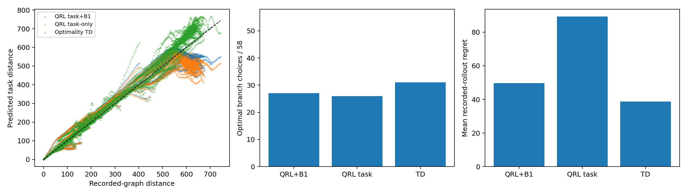
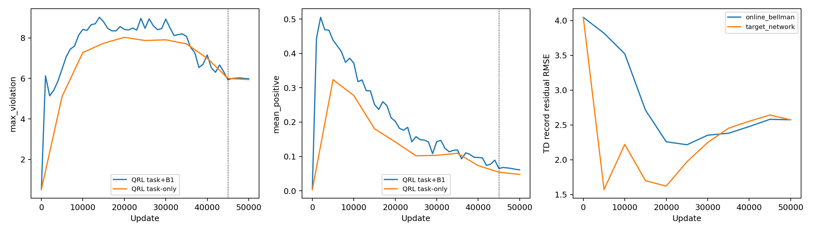

# 联通专家图：参考修正、task-only QRL 与匹配 TD 对照

两组新实验均完成固定 50,000 次更新。三组初始模型、优化器、采样器、RNG 逐位相同，终点采样器及逐记录访问次数相同。结论是：删除 B1 未解决 QRL 的恢复问题；TD 在这张新图上的任务距离更准确，但仍存在明显分支错误，并且不满足 QRL 的局部准度量约束。本次不能宣称 U-trap 拓扑或最优值函数已经恢复。

## 1. 已完成的工作与实验边界

- 第0项：修复目标提取，增加零距离集合及 Bellman 最小值等式检查，提交 `eb2967d`。旧参考错误地包含占位节点0；合法目标只有175。只将节点0的参考值从0修正为595.484283336，不改 replay、成本、节点或旧 checkpoint。
- 第1A项：当前 worktree 新增 task-only 开关，提交 `0201099`。仅关闭 B1，task 系数保持0.6；PHR及其余训练配置保留。
- 第1B项：在 `../quasimetric-rl-td-comprare` 接入同图 optimality TD，提交 `8e61010`。全记录后继取最小值，gamma1、MSE半梯度、EMA tau0.005。读取1A真实 initial.pt，跨 worktree 校验代码与数据。
- 两组固定50k后自动执行统一评估；没有按参考误差选停止点、追加训练、QP、再加global push或修改MPPI。每5000步由独立监督器检查，结束后统一复核全部记录。

共同条件：seed606、共享 encoder/projector/IQE、batch256、4线程、记录无放回采样；45k步lr2e-5，5k步lr2e-6→2e-7，AdamW且weight decay0。两组QRL使用逐记录PHR rho100、按访问用更新前残差eta1更新dual。TD没有局部PHR、push或B1损失。图参考只用于事后评估。

数据为42,536条物理记录、6,958条去重物理候选边、6,767个节点、58个分支。每组累计采样12,735,416条记录，每条访问299–300次。TD额外计算15,621,427条后继候选并更新target，故相同更新预算不等于相同计算预算。

307条轨迹起点只有165个不重复节点。图结构审计确认它是无环图，唯一无出边节点为目标，最长可选记录路径275步。因此300步上限下，各组307/307到达目标是图结构预先保证的，不能作为学会拓扑的证据。以下重点看距离、分支和成本regret；图内结果不代表未见状态或连续环境闭环导航。

## 2. 固定50k终点结果

NRMSE = RMSE / RMS(参考距离)。局部违反定义为 d(s,s′)−c>1e-5，分支最优容差1e-6。路径regret是实际所选记录路径总成本减图最短距离；分支regret是选当前动作后接最优后缀的额外成本。

| 指标 | QRL task+B1 | QRL task-only | Optimality TD |
|---|---:|---:|---:|
| 物理记录 task NRMSE (%) | 10.9571 | 11.7380 | 9.2713 |
| 去重源 task NRMSE (%) | 11.2861 | 13.5878 | 10.3328 |
| 307起点 task NRMSE (%) | 15.2057 | 18.7472 | 11.4270 |
| 165独立起点 task NRMSE (%) | 16.7613 | 20.9879 | 11.0474 |
| 最远四分位 task NRMSE (%) | 14.0505 | 18.2360 | 10.3355 |
| 最远四分位平均偏差 | -75.7593 | -103.4606 | 57.2203 |
| 最优分支 / 58 | 27 | 26 | 31 |
| 严格非平局两两排序正确率 (%) | 62.5259 | 64.5963 | 71.6356 |
| 平均分支 regret | 13.2765 | 13.4869 | 10.0174 |
| regret >10的分支数 | 21 | 20 | 16 |
| 307起点平均路径 regret | 49.7302 | 89.2646 | 38.6726 |
| 165独立起点平均路径 regret | 53.1412 | 116.2332 | 55.0333 |
| 最优路径数 / 307 | 27 | 34 | 46 |
| 违反物理记录数 / 42536 | 20393 | 19462 | 41723 |
| 违反去重边数 / 6958 | 1768 | 1496 | 6631 |
| 最大局部违反 | 5.9890 | 5.9424 | 82.2434 |
| 记录平均正违反 | 0.061196 | 0.047708 | 7.361013 |
| 去重源 task Bellman RMSE | 4.3166 | 4.7355 | 4.9478 |

**1A的结论：不能把B1判为主要病因。** 关闭B1后去重边违反数从1768减到1496，平均正违反也下降，但去重源NRMSE从11.2861%升至13.5878%，最远四分位低估从−75.76加重到−103.46，最终平均路径regret从49.73升至89.26。两两排序率和最优路径个数有小幅改善，不能抵消高成本分支错误。B1在本次初始化和预算下可能提供了有用的距离学习信号；本消融不支持直接删除它作为主线方案，也不能仅凭单seed认定普遍因果。

**1B的结论：TD有部分优势，但不是新版图上的充分恢复。** TD的去重源NRMSE为10.3328%，起点和长程误差也更小，最优分支31/58。不过剩余27个错误分支中16个的regret超过10，远非全部只是近似平局。按307个记录起点加权，路径regret低于QRL+B1；按165个独立起点统计，TD为55.03，略高于QRL+B1的53.14。不能概括成TD在执行上全面优于QRL。这里也未执行MPPI闭环评估。

TD的IQE局部边有6631/6958违反，最大违反82.24；它只优化任务距离，不应按QRL可行性判为实现错误，也不能用它证明正确任务值与全部局部约束已经可以同时表达。旧图TD结果支持共享encoder具备一定任务表达能力；新图这个匹配TD实验仍未达到精确任务恢复。当前证据既不支持直接宣判encoder表达不了，也不支持宣称表示问题已彻底排除。

QRL两组长程明显低估，而TD长程平均高估57.22。三组的任务Bellman RMSE也没有简单对应长程误差排序；在gamma1的长路径上，局部误差的方向、累积位置及分支差分都需要单独观察。

## 3. 45k到50k：误差改善与决策恶化可以同时发生

阶段结果均在完整预算结束后计算；正式终点仍为50k，没有依据这张表回选45k。

| 模型/阶段 | 去重源NRMSE (%) | 最优分支/58 | 307起点路径regret | 去重边违反数 | 最大违反 |
|---|---:|---:|---:|---:|---:|
| QRL task+B1 45k | 11.6230 | 24 | 69.7105 | 1586 | 5.9340 |
| QRL task+B1 50k | 11.2861 | 27 | 49.7302 | 1768 | 5.9890 |
| QRL task-only 45k | 14.5897 | 28 | 30.2210 | 1291 | 6.0041 |
| QRL task-only 50k | 13.5878 | 26 | 89.2646 | 1496 | 5.9424 |
| Optimality TD 45k | 10.8177 | 31 | 38.6726 | 6640 | 82.7537 |
| Optimality TD 50k | 10.3328 | 31 | 38.6726 | 6631 | 82.2434 |

最突出的变化来自task-only：去重源NRMSE从14.5897%降到13.5878%，最大局部违反从6.0041降到5.9424，但去重边违反数1291→1496，路径regret 30.22→89.26。衰减学习率不是对所有评价指标单调有利。

共5个分支的所选动作发生变化：

| 节点 | 45k分支regret | 50k分支regret | 45k模型前两名分数差 | 50k模型前两名分数差 |
|---|---:|---:|---:|---:|
| 33 | 0.000000 | 18.217552 | 0.00124311 | 0.00119829 |
| 104 | 22.026814 | 10.286782 | 0.01482677 | 0.00001526 |
| 288 | 4.271548 | 0.000000 | 0.00476766 | 0.05826640 |
| 468 | 0.000000 | 39.575392 | 0.08029151 | 0.10974216 |
| 630 | 0.000000 | 4.667881 | 0.07173133 | 0.00570703 |

模型在这些分支上的分数差很小，但真实动作代价差并不都小。节点468从最优动作变为额外成本39.5754的动作，它在157条评估路径上被访问。路线变化后，原本已经选错的节点660从仅被访问3次变成160次；其单次regret为77.1645，对平均路径regret的贡献从0.7541增至40.2160。节点468本身贡献20.2389。这解释了为何少量分支翻转就能显著损害完整执行。分支个数、平均value误差和完整路径成本不能互相替代。

诊断程序对每组路径核对了精确恒等式：沿实际选择的记录路径累加 `c+J*(next)−J*(state)`，等于该路径总成本减起点参考值。该参考只用于事后分解，没有加入训练或动作评分。

图中QRL+B1旧实验原来每1000步扫描，新实验每5000步扫描；线条的细密程度不同不能解释为波动差异的定量证据。TD后期target与online残差接近，但残差仍不小；仅把问题归因于target滞后也不充分。

## 4. 对下一步研究的建议

建议继续在这张固定图上定位机制，不立即扩大数据，也不先叠加QP之后的global push。当前结果没有支持“去掉B1即可恢复”，同时说明只看更小的约束均值也不够。

优先考虑一个单变量诊断：保留共享encoder/IQE和task-only的0.6 push，将局部约束从 `d(s,s′)≤c` 替换为任务potential约束 `J(s)−J(s′)≤c`，其中 `J(s)=d(s,G)`、`J(G)=0`。其他记录、初始化、PHR时钟和预算先固定，直接与本次1A比较。它不需要Oracle或最短路标签；变化是约束对象，不是增加一个训练后处理层。

为什么这个诊断值得做：IQE三角不等式使原局部准度量约束足以推出task potential约束，反向一般不成立。对当前有限、全部可达目标的图，task potential逐边约束沿路径求和给出 `J(s)≤J*(s)`；`J*`自身可行。当每个非终态在push中都有正权重时，在不受参数化限制的potential空间最大化task push的最优解就是图最短距离。新诊断可以检验“同时塑造所有局部pair距离”是否增加了任务学习难度。这里并未证明当前网络或随机PHR能够达到该最优解。

这个替代约束实验应继续只使用task push，不能同时保留不受这些约束控制的B1 push。即使成功，也应表述为单任务/目标条件potential恢复，不能冒称恢复了原QRL的全部pairwise准度量。必须仍报告局部IQE边、task不等式、距离、分支和两种起点权重下的路径regret。

若替代约束仍失败，再做明确标注的离线诊断：在同一新图、同一encoder/IQE上拟合固定参考任务距离，区分bootstrap/约束优化困难与当前设置下的拟合困难。该诊断使用参考标签，不能算作无Oracle QRL结果；拟合成功只能证明对应任务函数可近似表达，拟合失败也不能单独证明函数类不够。对“低task误差+局部边可行”是否能共存，还需单独的联合可行性诊断。上述建议尚未执行。

最终要回到冻结MPPI的执行验证：特别关注节点468这类上游决策触发下游高代价分支的情况。现在的307/307记录图到达率不能替代那一步。

## 5. 监督、测试与复现

独立监督器每20秒读取训练日志，在每个5000步扫描后记录检查；两组各含0、5k、…、50k共11条监督记录，全部通过数值有限、终态/anchor零、QRL B1优化行数零等检查，QRL每条物理记录的访问次数差不超过1。最后监督时间为2026-10-24 00:45:34（Asia/Shanghai）。监督原始JSONL保留本地，未纳入提交。

| step | QRL最大违反 | QRL记录平均正违反 | TD在线Bellman记录RMSE |
|---|---:|---:|---:|
| 0 | 0.509607 | 0.003657 | 4.046697 |
| 5000 | 5.106805 | 0.323636 | 3.818423 |
| 10000 | 7.281460 | 0.277395 | 3.521924 |
| 15000 | 7.738318 | 0.180760 | 2.712358 |
| 20000 | 8.031155 | 0.142365 | 2.258177 |
| 25000 | 7.874692 | 0.101991 | 2.214886 |
| 30000 | 7.909375 | 0.103202 | 2.352559 |
| 35000 | 7.708628 | 0.109362 | 2.380096 |
| 40000 | 6.997369 | 0.073315 | 2.476336 |
| 45000 | 6.004051 | 0.054477 | 2.580739 |
| 50000 | 5.942379 | 0.047708 | 2.574130 |

QRL task-only日志总计2037.15秒（含训练循环中的扫描）；TD记录的更新计算时间1843.41秒（不含扫描、初始化）。两者计时定义不同，且两组并行运行，不能据此作算法速度优劣结论。

测试合计26项通过：参考检查3项；task-only新增2项与相关旧入口回归16项；比较器2项；TD新增3项。另在真实全图核对三组initial逐位一致、终点访问/采样器一致、TD候选图哈希一致；修正参考的贪心策略58/58最优分支、307/307零regret。图表已逐张查看，未发现遮挡或标签截断。多线程数值运行及单seed限制仍适用。

复现命令与冻结配置见 `experiments/connected_expert_utrap/TASK_ONLY.md`，TD见另一worktree的 `experiments/expert_utrap_td/CONNECTED_PROTOCOL.md`。比较器 `compare.py` 只在两组COMPLETE存在后执行；`diagnose.py` 复算上述分支翻转及路径regret分解。

| 产物 | SHA256 |
|---|---|
| 统一修正参考 | `cea569cd7a60e00608330dd35866986d2909271aab6af2dbafe23d349308d80f` |
| 初始模型张量 | `047d70d4aaf78b4468aedd09cbd4880f4359a3d964b0f0e7b1ef9010b8cafff8` |
| QRL task+B1 final.pt | `e40171f8c4d23f4d894dc64f37f29ca5d4f9e42a9f5846e4664d197afbe3e37d` |
| QRL task-only final.pt | `287e862cd69847db44848138e40c3ab0700c319b0e73ff9ebc3bc6e810dda7f2` |
| Optimality TD final.pt | `aa3235c5f07b81db3ff41e74e4f1dc34b324ef1e7c092ca61e112654907c906c` |
| 比较器源码 | `56cc93c7594eac0be08215d0d6a937a504b795c0bd4270ba626e9e77597030a5` |

训练目录：旧QRL为 `results/connected_expert_qrl_20261023/main/train`；task-only为 `results/connected_expert_task_only_20261024/main/train`；TD为另一worktree的 `results/connected_expert_td_20261024/main/train`。

提交范围仅包括源码、测试、协议、此报告与引用的comparison.png/training.png。checkpoint、replay、日志、JSON/NPZ数值结果、监督记录、源码快照及其他中间产物均保留本地。
