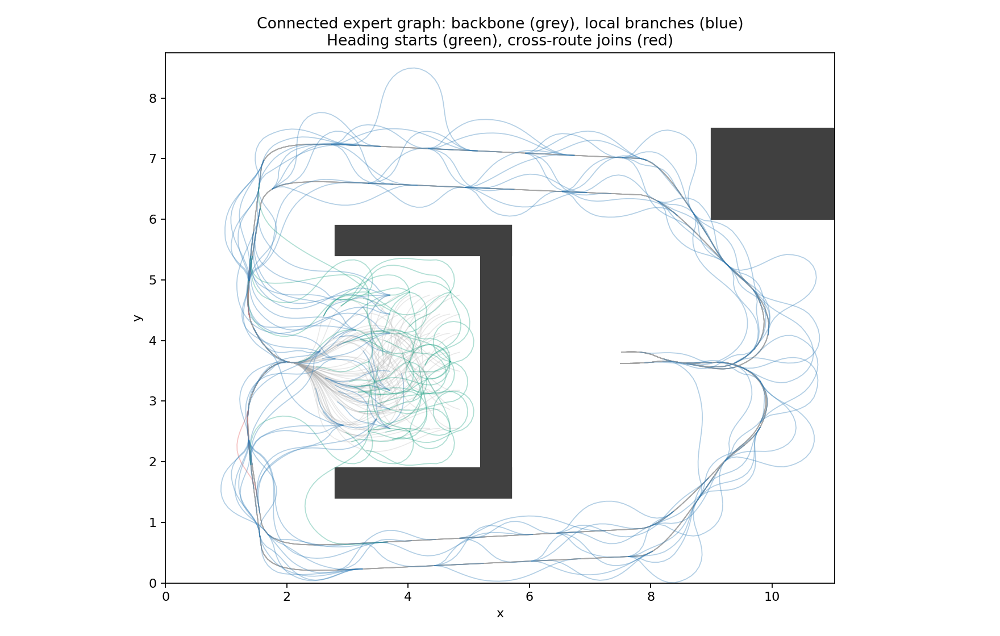

# Connected expert U-trap network: construction audit

Physical records: **42536**; unique physical edges: **6958**; canonical nodes: **6767**.
All 307 trajectories replay exactly to legal success; all 64 old trajectories remain unchanged. New exact suffix joins: 243.
Branch nodes: 58; merge nodes: 156; local sources with multiple accepted controls: 46.

## Accepted construction groups

| Group | Trajectories |
|---|---:|
| backbone | 64 |
| cross_route | 4 |
| local_branch | 184 |
| heading_start | 55 |

New start heading bins (0..7 = -pi .. 3pi/4): `{0: 8, 1: 7, 2: 8, 3: 7, 4: 6, 5: 5, 6: 8, 7: 6}`.

## Old branch successor costs

| Old source | Old spread | New spread |
|---|---:|---:|
| 24 | 19.879691 | 25.050871 |
| 33 | 114.334277 | 18.216858 |
| 166 | 0.207656 | 0.207656 |
| 382 | 75.748117 | 20.096238 |

Old nodes with a shorter graph path: 2459/2534; maximum reduction 653.907860.

All edges are real env.step transitions; exact full observations define joins. No nearest-neighbour edges, snapping, or Oracle/shortest-path training labels. Graph references are audit-only.

Rejected proposals and search exhaustion are retained in attempts.jsonl, not inserted as successful replay. Search failure does not prove unreachability. Dataset sampling remains uniform over physical records; duplicate/shared suffix weights are explicit, not silently deduplicated.

This expert-assisted construction reuses research states and has no held-out claim. All/witnessed task masks agree because every accepted episode has a real success suffix. No MPPI/learner changes or formal training were performed by this audit.

