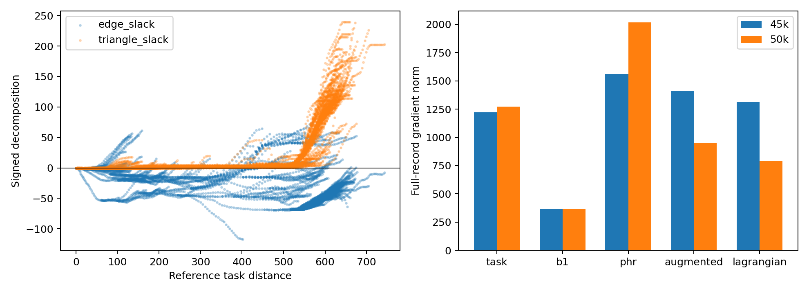

# 原 task+B1 QRL：长程低估分解与全量优化状态诊断

## 结论

当前 50k checkpoint 的长程低估主要体现为路径三角松弛，而不是局部边距离普遍收缩。最长四分位的平均低估 **75.7593 = −34.8940 + 110.6533**：边项为负，意味着参考最短路径上的累计局部违反正在抵消一部分三角松弛。只修可行性而不同时改善长程距离，可能暴露更严重的低估。

模型也没有给出“原约束问题已充分求解”的证据：全量增广梯度仍未充分抵消，可行性和互补残差明显非零。因此先做保持原数学问题不变的求解时钟对照合理；这些诊断既不能证明共享 encoder 无表达能力，也不能保证更换 PHR 时钟能解决问题。

## 固定条件与方法

使用 `connected_expert_qrl_20261023/main/train/phr.pt`（45k）和 `final.pt`（50k），原数据、共享 encoder + IQE、0.6 task + 0.4 B1、`d(s,s')<=c`、rho100、原逐记录乘子均不变。42536 物理记录的重复路径权重完整保留。参考只读自修正后的 `connected_reference_fix_20261024/main`，再次验证唯一合法零目标和所有非终态 Bellman 最小值等式。

对每个节点，沿确定的记录图参考最短路径计算

\[
D^*(s,G)-d(s,G)=\underbrace{\sum_e[c_e-d(e)]}_{E(s)}+
\underbrace{\sum_e d(e)-d(s,G)}_{T(s)}.
\]

`E` 保留正负；`T` 是整条路径的累计三角松弛。两 checkpoint 的恒等式最大误差均为 0，最小 `T` 均为 0。此路径分解属于事后描述，不是因果干预，也没有把图参考送入训练。

## 分解结果

|阶段/群体|平均低估 D*−J|边项 E|三角项 T|E<0 占比|
|---|---:|---:|---:|---:|
|45k 去重 source|13.8580|−23.7144|37.5725|84.53%|
|50k 去重 source|7.7911|−28.3832|36.1743|86.93%|
|45k 最长四分位|83.2016|−27.6901|110.8917|91.67%|
|50k 最长四分位|75.7593|−34.8940|110.6533|93.03%|
|50k 全物理记录 source|−12.6776|−20.2836|7.6060|93.06%|
|50k 全 307 起点|24.2457|−32.3982|56.6439|96.09%|
|50k 去重 165 起点|61.8294|−31.4910|93.3204|94.55%|

45k→50k 长程平均低估改善 7.4423，其中约 7.2039 来自边项更负，只有约 0.2384 来自三角项下降。不能将这段数值改善全部解释为拓扑恢复。记录平均值甚至表现为高估，而去重及长程群体仍低估，说明共享路径重复权重对总体统计影响很大。本诊断不据此更改训练权重。

## 全量梯度与约束状态

全量目标按物理记录均值定义：`−0.6 mean(task)−0.4 mean(B1)+mean(PHR)`。每次导数计算固定保存的乘子；所有 chunk 依记录数加权，float64 累加参数梯度。普通 Lagrangian 以 `mean(lambda*h)` 替换 PHR，另外计算，不与增广梯度混淆。

|指标|45k|50k|
|---|---:|---:|
|task 梯度范数|1223.2982|1273.0095|
|B1 梯度范数|368.4065|367.0427|
|push 合计梯度范数|1368.1034|1417.1041|
|PHR 梯度范数|1560.6191|2017.9225|
|增广总梯度范数|1410.4310|947.7325|
|普通 Lagrangian 总梯度范数|1312.0790|794.7012|
|总梯度/(push范数+PHR范数)|0.4816|0.2759|
|push 与 PHR 梯度 cosine|−0.5428|−0.9061|
|task 与 B1 梯度 cosine|0.2657|0.2706|
|违反记录数（h>1e−5）|15968|20393|
|最大违反|5.9340|5.9890|
|mean max(h,0)|0.065063|0.061196|
|mean abs(lambda*h)|12.7367|12.2051|
|max abs(lambda*h)|12142.9782|13336.5894|
|正乘子且 h<−1e−3 的记录数|12929|8378|
|投影 dual 残差 RMS（eta=1）|0.22757|0.19343|

50k 的两类梯度方向已经较接近相反，但强度仍不匹配。task 与 B1 的全量夹角没有支持“两者整体相互对抗”的解释，不过整体夹角不能排除局部参数或样本冲突。PHR 目标值随乘子变化不可跨阶段直接作为收敛证据。

这些范数依赖当前参数坐标，不是具有普适阈值的 KKT 证书；IQE 为分段可微，报告的是自动微分选定导数。互补性采用保存 lambda 的均值约定，若写成未平均的约束求和，其乘子是 lambda/N。无论该尺度如何解释，当前原始边可行性本身尚未成立。

## 下一项的判别目标

从同一 50k 原 task+B1 checkpoint 做两组 5k 配对续训：A 保留访问时 eta1；B 固定乘子做内层 primal 更新，再用最新全量残差统一更新。两组学习率、采样序列、Adam 状态和累计逐记录 nominal dual 步长匹配。先判断它是否改善全量优化残差和可行性，再检查三角项、长程误差和分支决策，不能只看违反数。

若残差改善但三角项/任务值不改善，结论应是这项求解时钟改动不足，不应立即改任务约束或宣称表示不可能。固定预算内层也不等于求出了精确增广子问题。

## 验证与复现

源码及命令见 `experiments/connected_phr_solver/README.md`。4 项测试通过：正负分解、错误参考拒绝、全量/分块导数与只读性。诊断运行前后原 checkpoint SHA256 不变。

- 45k：`f539b3f25a6fc9f9f36972ee81b36c777755b683881cf753ae04b4ea00171687`
- 50k：`e40171f8c4d23f4d894dc64f37f29ca5d4f9e42a9f5846e4664d197afbe3e37d`
- 修正参考：`cea569cd7a60e00608330dd35866986d2909271aab6af2dbafe23d349308d80f`

本次没有训练、改写 checkpoint、重新建图或替换局部约束。仅提交源码、测试、协议、本报告及引用图，原始 JSON/NPZ 和模型不提交。
