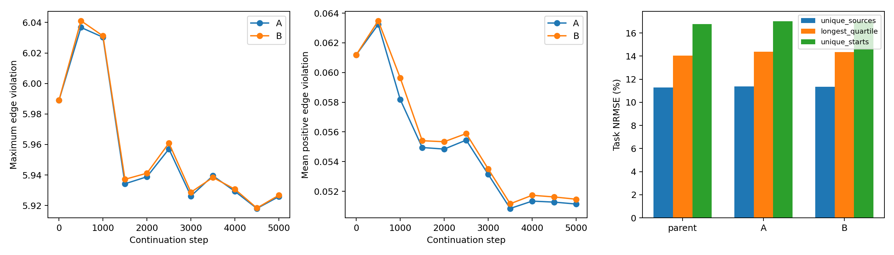

# 原 QRL 目标下：访问式 dual 与固定内层/统一外层 PHR 的配对比较

## 结论

两组均已按协议完成 5000 次追加更新并通过监督。**本次冻结/统一更新 dual 没有带来恢复层面的突破。** A 与 B 的任务误差、边违反和长程三角松弛非常接近。B 有小幅图上决策收益，但不能据此宣布学会 U-trap 拓扑，更不能把本次结果当成原 QRL 理论失效的证据。

值得继续追查的是 **primal 内层是否被充分求解**：B 的10个固定乘子块中有4个块的全量增广目标上升；最后一块在完全相同 lambda 下，梯度范数从464.2148升到708.5243，目标也上升0.00848。当前“固定乘子做500步小批次 Adam”并没有实现足够稳定的内层下降。下一步优先做固定乘子的全量 primal 求解诊断，而不是继续增加算法层数或更换原局部约束。

## 协议与配对核验

共同父模型为原 task+B1 50k checkpoint，初始化 seed606。使用原联通专家图42536物理记录、6958去重候选边、6767节点；重复路径记录原样保留。共享 encoder+IQE、0.6 task+0.4 B1 push、`d(s,s')<=c`、rho100、batch256全部不变。没有 task-potential 替换、最短路监督、QP、数据重采样或自适应早停。

两组均恢复模型、Adam状态、乘子、sampler、RNG、访问计数；共同追加5k，学习率由2e−6衰减至2e−7。父训练使用4线程，本次两组都固定CPU单线程。A保留每次访问、primal更新前残差、eta1的dual更新。B每500步内冻结乘子，然后全量重算最新残差，以该记录本块实际访问次数n_i为步长：`lambda_i <- relu(lambda_i+n_i*h_i)`。B是匹配累计步长的阻尼外层更新，不是eta=rho100的精确子问题ALM。

冻结协议为 `experiments/connected_phr_solver/SOLVER_PROTOCOL.md`。运行前配置保存协议与相关源码哈希；两组运行结束及统一分析均复核未漂移。

核验全部通过：

- 两组初始 model、Adam、dual、visits、sampler、RNG、push counters 与父 checkpoint 逐项相同。
- 两组最终 sampler、RNG、visits、push counters、每条记录累计 nominal dual 步长完全相同。
- 各追加1,273,520次记录访问；每条记录追加29–31次。每个500步块实际访问2–4次，A/B块边界的预算哈希全部一致。
- B最后内层块的lambda逐位不变；最后统一更新前后模型、Adam及采样状态逐位不变。该最终dual更新没有后续primal响应，单独保留更新前状态，不能把更新后乘子当成已经重新优化过的解。
- 0/5000步监督通过；每500步的全量审计无非有限值、终态锚点距离始终为0。训练不加载图参考；固定预算结束后才统一评估。

## 全边可行性和优化状态

|指标|父模型50k|A：visit 55k|B：outer 55k|
|---|---:|---:|---:|
|违反物理记录数（h>1e−5）|20393|18891|18607|
|违反去重候选边数/6958|1768|1684|1681|
|最大违反|5.988971|5.925839|5.926716|
|记录平均正违反|0.061196|0.051140|0.051465|
|去重边平均正违反|0.119981|0.116048|0.116348|
|mean abs(lambda*h)|12.2051|12.0575|12.0792|
|最大lambda|2226.8582|2400.1357|2399.5530|
|全量增广梯度范数|947.7325|719.4019|708.2958|
|全量普通Lagrangian梯度范数|794.7012|722.9346|717.9967|
|增广梯度/(push范数+PHR范数)|0.27590|0.21975|0.21678|
|投影dual残差RMS（eta1）|0.19343|0.18476|0.18497|

最终梯度表使用最终保存的lambda；B外层更新前范数为708.5243，更新后为708.2958。原记录均值目标、乘子尺度及自动微分解释与[第一项报告](../../../connected_phr_diagnostic_20261024/main/report.md)一致：范数依赖参数坐标，不能把任意绝对阈值解释成普适KKT证书。

B比A少284条违反记录，但去重后只少3条；平均正违反和最大违反反而略高。因此不能用记录违反数单一指标宣称B在可行性上全面胜出。两组最大违反只下降约1%，仍明显不可行。

## 距离恢复与长程分解

NRMSE以各群体参考距离RMS归一化，沿用已有报告定义。

|NRMSE群体|父模型|A|B|
|---|---:|---:|---:|
|物理记录source|10.9571%|10.7402%|10.7448%|
|去重6766个source|11.2861%|11.3662%|11.3602%|
|307个原始起点|15.2057%|15.3705%|15.3594%|
|165个去重起点|16.7613%|17.0213%|17.0059%|
|最长四分位source|14.0505%|14.3684%|14.3500%|

记录权重下误差略好，但去重source、起点和长程群体都略差。不能把重复公共路径上的改善等同于整体任务值恢复。

对最长四分位，使用同一参考最短路径的有符号恒等式：`D*−J=Σ(c−d_edge)+(Σd_edge−J)`。

|模型|平均低估|累计边项|累计三角松弛|
|---|---:|---:|---:|
|父模型|75.7593|−34.8940|110.6533|
|A|78.0384|−32.3710|110.4095|
|B|77.9081|−32.4388|110.3469|

两组的三角松弛几乎没有改变。B的三角项仅下降约0.3064（约0.277%），边项变得较不负，长程低估反而增加约2.1487。这与第一项诊断一致：减少累计边违反会减少其对低估的掩盖，但并不自动让三角松弛消失。

最终训练记录均值task push从236.5693变为A235.2229/B235.2657；B1距离均值从137.2821变为A136.6530/B136.6800；加权总push从196.8544变为A195.7949/B195.8314。没有通过追加更强push人为抵消约束损失。

## 图上决策：存在改善，但不要放大为闭环导航结论

评估只在同一记录候选动作集上最小化 `c+J(next)`，并非MPPI或连续空间执行。

|指标|父模型|A|B|
|---|---:|---:|---:|
|最优分支数/58|27|28|28|
|分支平均regret|13.2765|10.1515|10.0102|
|307起点平均路径regret|49.7302|40.4804|38.5851|
|165去重起点平均路径regret|53.1412|47.3293|46.0379|
|307起点最优路径数|27|27|27|
|165去重起点最优路径数|8|8|8|

两组相对父模型都修正了节点40和1769的大regret选择，也都把节点288从最优变为regret4.2715。节点104两组都改善，A为regret10.2868、B为2.0914，父模型为22.0268。

**A与B只在节点104的分支选择不同。** 71条原始起点rollout（26个去重起点）路径因此改变，每条节省8.1953成本，解释了B相对A的路径收益。这是一处有价值的改善，但不是广泛拓扑恢复证据；也不应因整体NRMSE几乎不变就否定该局部决策收益。

三者都是307/307到达。记录图无环且所有可选分支最终通向目标，这个到达率主要受图支持结构保证，不能代表U-trap未见状态或真实闭环导航成功率。

## 为什么这次不能判定“分离内外层已经无效”

B的每个内层块使用固定lambda，可以比较其块起点与终点的**同一个**全量增广目标。依次变化为：

|块终点|Δ全量增广目标（负数为下降）|
|---|---:|
|500|−0.031909|
|1000|+0.005260|
|1500|−0.111033|
|2000|+0.018252|
|2500|−0.061360|
|3000|+0.016530|
|3500|−0.041077|
|4000|−0.018192|
|4500|−0.005802|
|5000|+0.008477|

最后一块的lambda逐位冻结，但梯度范数从464.2148上升至708.5243。这里的结论是这套小批次Adam+当前衰减预算不足以提供稳定内层收敛证据；不能把“做了500次primal更新”当成“求解好了增广子问题”。A块内lambda变化，其跨块目标变化不能按同样方式解释。

本次隔离的是冻结/聚合及更新残差时机的整体策略，且匹配了nominal dual步长；未比较所有外层周期、经典eta=rho的ALM或充分求解的内层，也未从多个独立初始化重复。因此只能得出**当前时钟替换收益有限**，不能排除更可靠的primal求解会改善原QRL问题。

## 下一步建议：只再隔离 primal 求解，不改数学模型

优先从同一父checkpoint固定lambda和rho，在原记录权重、原task+B1目标、原encoder/IQE上，比较当前小批次Adam与分块累积得到精确全量梯度的primal求解。分块只降低内存，不应改变记录权重。全量方案先使用目标下降检查/回溯步长的简单方法，验证原目标能否持续下降；如果尝试L-BFGS，需要注意IQE的分段可微性，不能预设它一定更好。

该实验首先回答“当前固定乘子增广子问题是否还能有效优化”。公平性应按前向/反向处理的记录数或实际耗时报告，而不是把1次全量更新与1次batch256更新当作同预算。停止和接受步骤仅依赖原全量目标、梯度/步长及固定预算；参考仍仅用于结束后的评估。只有证明内层求解更可靠，才值得重新接入外层dual时钟。

如果可靠内层下降仍无法改善原约束与任务距离，再进一步区分固定rho/乘子状态、非凸局部解和表示限制；当前证据还不足以跳到修改局部一致性数学模型。此建议是下一轮研究方向，本轮未追加执行或按参考选择新配置。

## 运行、测试及产物范围

两组包含全量审计的训练墙钟分别为A537.47秒、B537.31秒，约9分钟；两组并发运行，期间有测试负载，不能将0.16秒差异解释为性能优势。每组均5000次primal更新、11次全量前向审计和2次全量梯度审计。B额外执行10次全量向量dual更新；其更新时间未单独计时。最终事后评估再次计算完整梯度和图指标。

7项本目录测试及5项参考/评估回归共12项通过：有符号分解、错误参考拒绝、分块梯度一致/只读性、首步primal一致且固定dual不变、外层公式与锚点保护、完整状态确定性恢复/配置拒绝、配对预算不一致拒绝等。正式运行完成后的分析再次逐项验证全状态配对、最后内层冻结及最后外层不改模型。

源码：`experiments/connected_phr_solver/{objective,diagnostic,train,analyze,test_solver}.py`。命令见README与冻结协议。原始summary、分支明细、数组、日志与checkpoint留在本机，不纳入提交。

- 父模型SHA256：`e40171f8c4d23f4d894dc64f37f29ca5d4f9e42a9f5846e4664d197afbe3e37d`
- A最终SHA256：`7c0386535c5604022c355942d44a1e4dd58fc91571497e89838fc5f6b06a4ee4`
- B最终SHA256：`1dbf011b7a973b96b7cf5cf2a5a9ab39310b939b82859c2960e26c2da5133dab`

只提交本项源码、测试、协议、报告及报告引用的comparison.png。
