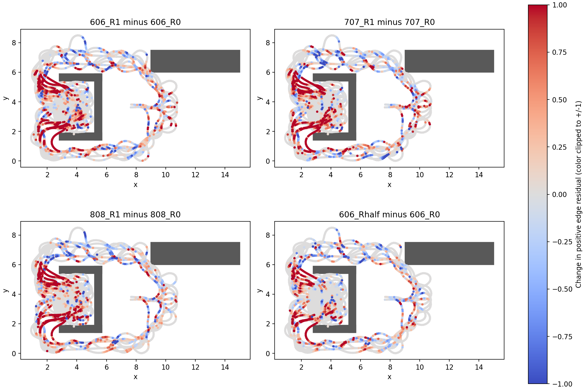
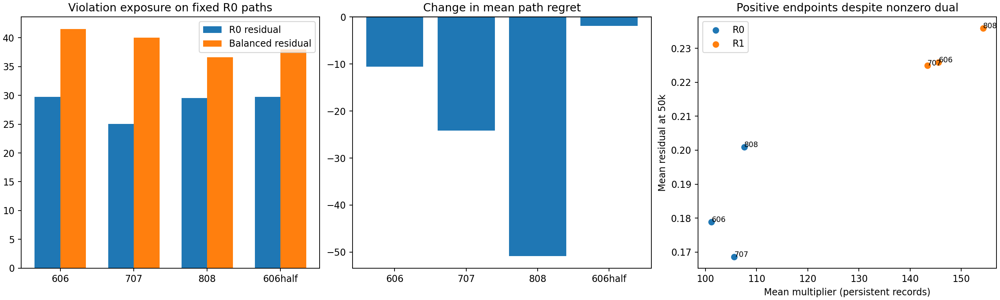

# 源均衡新增违反：位置、路径暴露与乘子窗口诊断

本项基于已有R0/R1三个初始化及seed606 Rhalf，只读重算45k/50k模型，不新增训练或环境交互。新增违反与正残差增量主要落在低重复源/低副本边；没有发现分支三跳邻域或远端源的额外富集。R1降低路径regret的同时，固定R0路径上的累计正违反也增加。乘子确实在更新，仍未实现可行性；两个时间快照不足以将根因认定为dual追不上残差。

## 范围、定义和核验

冻结协议见 `experiments/constraint_exposure_diagnostic/PROTOCOL.md`。使用原42536物理记录、6958条完整source/target/action/cost去重边、6767节点和58个分支；参考是已修正的`connected_reference_fix_20261024`。远端为1692个去重源的最高距离四分位，参考仅用于事后分组。

源重复数n(s)与边副本数m(e)分别统计。前者决定task权重，后者决定某条独特约束拥有几份记录及总访问。高重复源也可能存在只有一份记录的候选动作，二者不可混用。PHR仍保留逐记录乘子，未用代表行替代重复记录的dual。

重新计算七组模型两个时间点的输出，50k预测与原评价数组逐位相同；与训练保存的残差最大差不超过4.77e-07。重复物理边的重算残差一致。全部165独立起点及307原始起点路径通过连通、真实成本、目标及regret恒等式核验。输入模型、replay、参考及决策文件运行前后SHA256不变，分析源码在运行中未变。

## 1. 低重复定位：贡献与富集分开看

|比较|新增违反边|消失违反边|全图新增比例|n(s)=1新增比例|m(e)=1新增比例|n(s)=1正残差净增贡献|m(e)=1正残差净增贡献|
|---|---:|---:|---:|---:|---:|---:|---:|
|606|897|462|12.89%|13.85%|13.83%|92.06%|94.64%|
|707|783|479|11.25%|11.99%|11.87%|91.28%|92.00%|
|808|813|465|11.68%|12.63%|12.71%|91.30%|94.98%|
|606half|636|427|9.14%|9.59%|9.52%|93.30%|94.31%|

n(s)=1包含5414条边，占全部边的77.81%；m(e)=1包含5609条边，占80.61%。所以不能只依据贡献大就宣称富集；本表同时给出新增比例。贡献使用各组正残差变化的有符号净和，某组可以为负，比例不是概率。新增违反阈值1e-5，使用1e-3的敏感性检查只变化少量边。

三个R1共有176条新增违反边，三者并集1682条。跨初始化稳定的是群体趋势，并非同一份逐边错误清单。

每条物理记录最终访问299–300次，45k至50k追加29–31次。低副本边并非从未访问；它们的总约束访问少于拥有大量副本的边。只改task权重并未增加这些独特约束的总采样。
具体而言，单副本边最终299–300次访问；副本数65+的边合计19463–50605次。这些访问并非同等数量独立数据，且每份副本的dual独立演化。

## 2. 分支和远端：没有观察到额外集中

|分组|唯一边数|606新增比例|707新增比例|808新增比例|
|---|---:|---:|---:|---:|
|全图|6958|12.89%|11.25%|11.68%|
|分支源出边|250|12.40%|10.00%|12.80%|
|分支三跳邻域|1674|11.71%|10.57%|10.45%|
|邻域外|5284|13.27%|11.47%|12.07%|
|远端源出边|1709|12.23%|9.25%|10.12%|
|远端最短路径使用边|3720|11.05%|8.87%|9.65%|

三跳邻域采用无向记录图距离，边任意端落入邻域即计入；不是欧氏空间距离。远端最短路径使用边包含共享近目标后缀，不能与远端源出边等同。分组互相重叠，不作比例相加。三组R1的分支邻域、远端源和远端最短路径新增比例都低于各自全图；分支源出边的方向则不统一。因此当前证据不支持仅按“分支附近”或“远端”重采约束。

图中全部唯一边保留，以转移中点表示；红色为正残差增加，颜色固定截断到±1，更大的真实幅度保留在数值结果中。空间图只用于定位，不证明障碍或某区域导致优化失败。

## 3. 实际路径暴露：约束退化没有被路线变化解释掉

累计正违反定义为每条路径沿边sum(max(h,0))，再对165个独立起点等权平均；它不是路径额外成本。以下固定R0路径只替换残差模型，另列平衡模型自身路径，控制路线变化的混淆。

|比较|R0路径/R0残差|R0路径/平衡残差|平衡路径/平衡残差|R0路径regret|平衡路径regret|
|---|---:|---:|---:|---:|---:|
|606|29.7092|41.5185|51.2058|40.3047|29.7446|
|707|25.0021|40.0152|44.6514|77.7958|53.6402|
|808|29.5554|36.6290|42.5244|91.0300|40.1480|
|606half|29.7092|37.9362|36.9352|40.3047|38.3876|

四个比较的固定R0路径累计正违反全部增加。因此约束退化并非只是选择了不同路线造成的统计变化。同时三个R1路径regret下降，说明局部违反总量与实际成本损失不是同一个量。

高暴露示例（按本模型路径暴露×正违反排名，表中含原本已违反的边，不限新增违反）：

|模型|记录行/source→target|位置(x,y)|源重复/边副本|R0→本模型路径经过次数|h45→h50|lambda45→lambda50（副本均值）|
|---|---|---|---|---|---|---|
|606_R1|22365/484→4459|(9.229,2.019)|63/1|19→125|2.7366→2.6945|689.64→766.60|
|606_R1|22368/4461→4462|(9.289,2.304)|1/1|19→125|1.9732→1.8749|163.15→219.32|
|707_R1|22898/4562→4563|(1.795,0.992)|1/1|0→106|3.1945→2.9434|876.50→966.12|
|707_R1|22899/4563→4564|(1.817,0.895)|1/1|0→106|2.4977→2.2623|649.70→718.37|
|808_R1|22898/4562→4563|(1.795,0.992)|1/1|0→104|2.6471→2.3435|617.53→690.78|
|808_R1|22897/4561→4562|(1.784,1.092)|1/1|0→104|2.3259→1.9636|690.40→752.29|
|606_Rhalf|22898/4562→4563|(1.795,0.992)|1/1|105→106|1.9931→2.0063|420.01→480.62|
|606_Rhalf|21490/4226→4227|(6.282,1.077)|1/1|107→114|1.5999→1.5339|434.70→483.26|

例如source484虽有63份源记录，但所选出边row22365只有1份副本。不能由“该源重复多”推断它的全部动作约束都获得了大量访问。

每组最大违反的位置及实际暴露（与高暴露排名分开）：

|模型|记录行/source→target|位置(x,y)|h50|本模型路径经过次数/165|近分支/远端源|lambda50副本均值|
|---|---|---|---:|---:|---|---:|
|606_R1|35495/6129→6130|(4.025,2.500)|8.2510|1|False/True|4141.13|
|707_R1|35495/6129→6130|(4.025,2.500)|8.8305|1|False/True|4433.84|
|808_R1|35495/6129→6130|(4.025,2.500)|8.4671|1|False/True|4241.78|
|606_Rhalf|35495/6129→6130|(4.025,2.500)|8.5539|1|False/True|3681.74|

## 4. 成本损失的直接来源：高暴露错误分支及后继误差差分

逐路径核验：sum[c+J*(next)−J*(state)] = 路径成本−J*(start)。因此以下贡献是可加的成本分解；与局部违反的相关性不能替代它。

|模型|分支源|经过次数/165|单次regret|平均路径贡献|所选边h|所选动作相对参考最优动作的预测分数差|后继预测误差差分|
|---|---:|---:|---:|---:|---:|---:|---:|
|606_R1|24|105|20.1466|12.8205|0.1511|-0.2399|-20.3865|
|606_R1|436|116|14.1541|9.9507|0.6093|-0.2639|-14.4179|
|606_R1|120|29|13.7284|2.4129|0.7130|-0.7192|-14.4475|
|707_R1|468|115|39.5754|27.5828|0.9951|-0.7527|-40.3281|
|707_R1|24|104|20.1466|12.6984|0.2329|-0.2009|-20.3475|
|707_R1|436|113|14.1541|9.6934|0.7814|-0.4965|-14.6506|
|808_R1|468|114|18.8375|13.0150|0.3302|-0.0495|-18.8870|
|808_R1|24|102|20.1466|12.4542|0.0741|-0.0716|-20.2181|
|808_R1|436|112|14.1541|9.6076|0.8371|-0.5698|-14.7238|
|606_Rhalf|24|105|20.1466|12.8205|0.1305|-0.1017|-20.2483|
|606_Rhalf|468|116|14.4931|10.1891|0.3175|-0.0818|-14.5750|
|606_Rhalf|436|114|14.1541|9.7792|1.1868|-0.9058|-15.0599|

分数差恒等式为：预测分数差 = 真实动作regret + 两后继的预测误差差分。错误后继的误差优势可以抵消真实额外成本，让高regret动作以很小预测分数优势胜出。这是冻结输出上的精确代数分解，不证明某条边约束违反是这些后继误差的因果来源。

Rhalf虽降低总体误差和平均违反，其高频分支24、468、436仍产生显著成本。只修复最大违反或继续调alpha，都没有现成证据保证修复这些动作排序。

## 5. 乘子窗口：确实在更新，但未得到可行解

以下群体仅指45k、50k两个端点均h>1e-5的物理记录；不是这5000步连续违反。每一组是在同一模型的相同记录子集上比较两时刻，跨模型子集不同。

|模型|两端均违反记录数|其中lambda增加|其中lambda增加且h也增加|平均h45→h50|平均lambda45→lambda50|
|---|---:|---:|---:|---|---|
|606_R0|11158|11149|6174|0.2114→0.1789|95.44→101.18|
|606_R1|16057|15866|4747|0.3019→0.2258|138.34→145.56|
|707_R0|13669|13651|5875|0.2141→0.1686|100.14→105.62|
|707_R1|15141|15138|5122|0.2809→0.2250|136.03→143.35|
|808_R0|9683|9679|5833|0.1970→0.2010|101.20→107.58|
|808_R1|14762|14712|4170|0.3176→0.2358|146.66→154.26|
|606_Rhalf|13929|13924|4535|0.2525→0.1983|121.58→128.05|

R1两端均违反群体的平均残差在三个seed中都下降，平均乘子都增加；但其中仍有数千条记录同时出现乘子增加、端点残差增加。它们的乘子和有效PHR系数并非为零。这排除了“这些约束根本没有访问/没有乘子响应”的简单解释；不区分dual步长、primal响应、共享参数冲突或非凸局部解。不能据此单独宣布乘子太小，也不能以乘子很大宣布它已经足够。

完整结果另含effective coefficient=max(lambda+100*h,0)、mean(abs(lambda*h))和eta1投影dual残差。这些是标量约束层面的诊断，不等于参数梯度平衡或完整KKT证书。lambda净增量/访问数受投影影响，不是期间平均残差。1000步日志只有聚合量，不能恢复逐边时间序列。

## 6. 下一轮该检验什么

当前定位支持优先检查唯一边副本数造成的约束经验测度失衡。若做训练干预，建议只引入一个明确的约束测度对照：固定R1 task/B1和记录采样，通过全局逆边副本权重调整PHR聚合，并显式规定逐记录dual时钟。它是新的增广目标/有限预算优化实验，不是数学上必须与task分布匹配；本次未实现或运行。不能同时切换采样、dual步长和rho后仍将收益归因于边均衡。

评价至少包括全图/低副本边可行性、远端三角松弛、固定路径累计正违反及高暴露分支成本。如果可行性改善却破坏长程收益，应作为明确取舍报告；如果约束与距离改善但分支仍错，继续分析后继误差差分与未见状态执行。当前证据不支持先按分支地理邻域追加采样，也不支持简单加大dual或先叠加QP/Oracle标签。

## 复现、测试与提交范围

本目录只读计算源码为 `experiments/constraint_exposure_diagnostic/{core,analyze,report}.py`。核心测试8项覆盖完整边身份、分支图距离、远端后缀暴露、独立起点去重、路径成本/advantage恒等式及错误拒绝、逐记录乘子与投影、分支误差差分、残差容差；参考及分组回归5项通过。参考/预测/残差/路径恒等式与输入不变性还在七组真实数据上核验。

分析命令及报告生成命令见README。输出目录必须为新目录；源码和输入SHA见本地integrity.json，报告渲染SHA另见report_manifest.json。仅提交源码、测试、协议、README、本报告以及两张引用图。逐边数组、完整分支明细、JSON、checkpoint、日志、快照和首轮输出均保留本地。本项不改变训练代码、模型、数据或历史正式结果。
