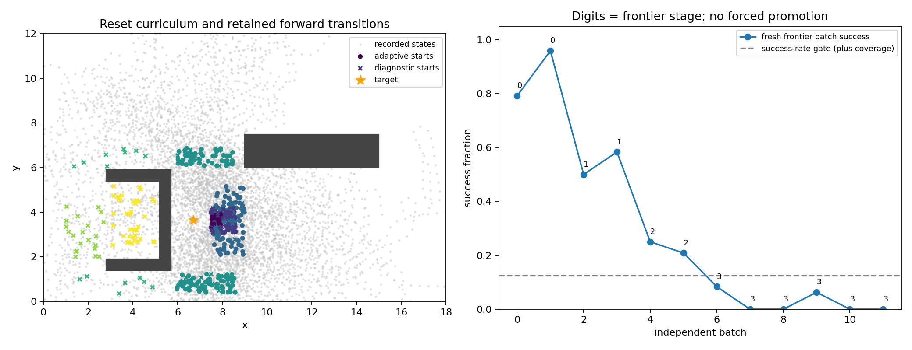

# U-trap 随机动作课程采集与审计

已完成采集和独立审计，未启动正式 QRL 训练。共 **27,399 条真实转移、505 个 episode、151 条成功轨迹**，全部失败保留。合法 anchor 只来自真实成功末尾；失败末尾无目标边。动作完全匹配按独立 episode seed 重建的持续随机控制序列，无专家/规划器动作、Oracle value、回报或最短路训练标签。

## 预先固定的课程与实际停止

最多 30,000 步自适应课程＋6,000 步固定分层诊断（旧 200k 的 18% 上限）。实际课程 21,399 步，诊断 6,000 步，停止原因 **stagnation**，未使用的课程预算 8,601 步不转移、不追加。已通过连续两批门槛的阶段：**0 near_terminal, 1 approach, 2 east_turning**。停止时前沿为阶段 3；未通过的阶段不能称为已掌握。

阶段按合法接近边界→接近区→东侧转弯空间→上下东角→上下外走廊→西出口→U 内部排列，并逐渐扩大 heading 扰动至完整圆周。分区依据 U 墙、开口方向和最小转弯半径 1/3，非欧氏距离排序；这些是目标/地图信息，故本采集不宣称目标盲探索。控制本身只从 ω/ωmax={−1,−0.5,0,0.5,1} 采样，直行概率 0.5、保持 3–10 步；关闭局部前视，动作不读取目标、成功库或规划器。

每批正常取 24 个前沿新起点＋8 个已掌握区域新起点；无已掌握区域时回访阶段0。连续两批前沿成功率≥12.5%、至少2次成功、至少8个位置-heading格与2个heading格，才晋级。3批未晋级后改为16前沿＋16回访；6批未晋级停止，另有24批与30k步上限。回访不参与晋级判定。所有起点和动作使用分离 RNG，episode seed 唯一；独立是指新批次、新起点、新随机流，阶段选择仍依赖过去统计。

课程结束后，阶段1–6各固定采集1000步诊断数据，**不参与晋级，也不表示课程到达这些阶段**。其作用是保留上下绕行、出口和U内的成功/失败实测证据，区分覆盖与成功链支持。下表明确区分两阶段，避免用诊断采样伪装课程推进。

| 阶段 | 数据来源 | 成功/episode | 真实转移 | witnessed源 | 起点/沿途heading格 | 沿途位置-heading格 |
|---|---|---:|---:|---:|---:|---:|
| 0 near_terminal | curriculum | 91/111 (82.0%) | 1801 | 201 | 2/24 | 957 |
| 1 approach | curriculum | 32/73 (43.8%) | 4943 | 198 | 6/24 | 2828 |
| 1 approach | diagnostic | 8/23 (34.8%) | 1000 | 105 | 6/24 | 653 |
| 2 east_turning | curriculum | 15/80 (18.8%) | 5867 | 219 | 12/24 | 3442 |
| 2 east_turning | diagnostic | 1/8 (12.5%) | 1000 | 21 | 7/24 | 635 |
| 3 east_corners | curriculum | 3/120 (2.5%) | 8788 | 159 | 22/24 | 5176 |
| 3 east_corners | diagnostic | 1/16 (6.2%) | 1000 | 64 | 10/24 | 639 |
| 4 outer_corridors | diagnostic | 0/15 (0.0%) | 1000 | 0 | 9/24 | 672 |
| 5 west_exit | diagnostic | 0/21 (0.0%) | 1000 | 0 | 15/24 | 652 |
| 6 u_interior | diagnostic | 0/38 (0.0%) | 1000 | 0 | 21/24 | 605 |

失败类型总计：`{"collision": 213, "success": 151, "out_of_bounds": 128, "timeout": 7, "budget_cutoff": 6}`。逐阶段碰撞、越界、超时、预算截断与描述性 Wilson 区间见 `stage_metrics.json`；自适应、非同分布的批次不能将汇总区间解释成固定策略泛化置信保证。

## 记录路径支持与核验

严格 context 内可用于 witnessed task push 的源为 **967/27,399**；同任务完整观测逐位连接的图可达源为 **967**。`all` 与 `witnessed` 是否等价：**False**。未见证失败源继续参与真实边 PHR 与合法同轨迹 B1，只从 witnessed task 最大化中排除。没有近邻合并、倒放边或 reset→起点的虚构物理边；位置覆盖不等于有记录成功链。

全部 27,399 条记录经独立正向重放，状态、42维观测、动作、float32 reward 逐位一致。启动审计从观测重建状态后，使用环境标量成本核验，最大差 9.42e-07。MPPI 向量近似在极近目标处的最大差为 9.32e-05（目标坐标精度影响 bearing）；此项只报告，不替换环境成本，不修改 MPPI。所有 anchor 重新判定合法；阶段晋级、起点/回访/动作 RNG、预算与 B1 边界均重新验证。上述重放是额外的验证计算，不计入采集数据预算。图只做采集后的精确可达性审计，本轮没有计算最短路。

冻结测试状态仅作为排除清单读取，起点位置排除半径0.25、不论heading；实际起点最小距离 0.253558，精确测试pose命中 0。沿途有 1008 个记录状态落入该位置邻域：它们不是主动测试起点重置，且为保留完整真实轨迹而不删边。因此不能把这些结果当作与测试分布完全分离的泛化证据。

## 描述性对照（统一筛选 u_trap_target）

| 数据 | 真实转移 | 成功/episode | 严格见证源 | 位置-heading格（0.25 / 24 bins） |
|---|---:|---:|---:|---:|
| original random U subset | 50000 | 2/188 (1.1%) | 370 (0.7%) | 25505 |
| four paths | 335 | 4/4 (100.0%) | 335 (100.0%) | 191 |
| expert network | 11949 | 64/64 (100.0%) | 11949 (100.0%) | 801 |
| curriculum + diagnostic | 27399 | 151/505 (29.9%) | 967 (3.5%) | 12840 |

这些不是配对因果实验：旧随机数据含局部安全前视及重复起点、任务预算为50k；本轮起点安排有目标/地图信息且无安全前视；四路径/专家网络使用规划器或设计控制、只含成功路径。专家网络另有精确分支与交汇，本课程的覆盖格不能替代其连接结构。比较文件只在采集结束后读取，不用于门槛、动作或选取数据；不宣称课程已经解决远端任务连接或优化困难。

## 文件、复现与训练入口

`verified_replay.pt` 沿用 MultiEpisodeData；成功与失败正常转移、一步成本和合法成功 anchor 都在同一数据内。`goal_return_cost`全零、mask全假。原采集器为失败额外采样的独立 anchor 被丢弃，既不接到失败末尾也不作为额外训练边。

采集后仅修正了训练加载器的成本核验依据（向量近似→环境标量），采集逻辑及数据未变。原加载器快照保留于 `source_snapshot`，新旧 SHA 与原因见 `summary.json` 的 `post_collection_validation_revisions`。

数据指纹：`bb55f1558d145b0530226926317705bac170376670aac632c4c2c02a8def8f28`。`config.json`、`protocol.json` 与源码快照在首次交互前冻结，`episodes.jsonl`、`decisions.json`、`physical_states.npz` 保留全部阶段与重放信息。`audit/recorded_support.npz` 仅用于审计，训练加载器不读取它。

复现：仓库根目录运行 `python -m experiments.curriculum_utrap.collect --output results/NEW_CURRICULUM`，随后 `python -m experiments.curriculum_utrap.audit --root results/NEW_CURRICULUM`；使用仓库既有虚拟环境，详见 `experiments/curriculum_utrap/README.md`。训练器新增 `--curriculum-data`，保留共享网络、AdamW、PHR与预算；该数据含失败，推荐显式 `--task-mode witnessed`。默认 all 保持旧命令兼容，但两种 task 目标在本数据上不同。本轮只验证接入，不启动正式训练。

