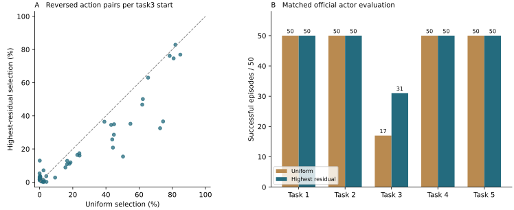
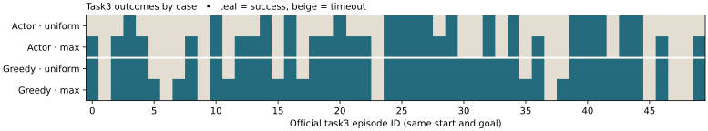

# E16 八候选目标选择消融

2026-11-02 · OGBench pointmaze-medium-navigate-v0 · 原官方 100k，训练 seed 0

**在相同八候选池和更新预算下，高残差选择对排序和实际导航都贡献了收益。** 相比均匀随机选择，E16 在 50 个共同 task3 起点上的严格动作对反序率从 23.94% 降到 18.29%，相同提取流程后的正式 actor 从 17/50 提高到 31/50。新增 14 个成功，失去 0 个，其余四个任务均保持 50/50。绕开 actor 和潜在动力学后，真实后继贪心也从 35/50 提高到 42/50。结论限于这份初始 checkpoint、固定教师、一次随机选列流与这批评价输入。



## 同池比较如何隔离目标选择

高残差组直接复用 E16 critic 与 E17-B 提取策略。新增 random8 组从相同的官方 100k 完整 checkpoint 开始，保留原网络、Adam 矩与计数、agent RNG、学习率 0.0003 及 E10 教师。每次从原 GCDataset 取 256 行。128 个偶数行沿用原查询，128 个奇数行的源、Sobol 偏移及八个候选目标均按原 E16 实现生成。两组都在更新前计算每个候选的教师目标，以及正反两个方向的平方误差均值。每个奇数行最后只用一个候选反传，偶数行不变，均使用原双向 MSE 更新。

- **E16** 取当前网络在该行八个候选中双向误差最大的列，并列时取首列。
- **random8** 用独立 PCG64 流（seed 20261102）均匀取一列。八列实际选择数分别为 15,752、16,083、16,152、15,912、16,178、16,241、15,914、15,768。128,000 次中有 12.503% 恰好抽中当时误差最大的列。随机组覆盖全部 6,302 个原型，E16 的历史选择覆盖 6,283 个。

候选列由同一个 6,302 原型池和 stride 3895 生成，两组均计算了 1,024,000 个扩展候选的双向误差。核验覆盖完整训练流，而非首批抽查。原始批次三字段 SHA-256 前缀为 `c479992dde1c`，候选 0 查询流为 `022856c711ee`，八候选池（扩展源、全部候选目标、全部教师标签）为 `411bc31c455c`，均与 E16 逐字节相同。选列流按设计不同，高残差为 `8eb230404dd4`，随机为 `9531555a82eb`。分化后的两网络会得到不同残差数值，这也是处理结果的一部分。[采样预检与输入指纹](preflight.json) · [新组实际流与 checkpoint](critic.json)

critic 固定 1,000 次更新。随后重新从原采样 seed 2001 起步，用 E17 的原始损失和优化器接续 1,000 次 dynamics-only 和 1,000 次 actor-only 更新，阶段之间不重置采样，每次实取 batch 256。两阶段完整五字段流与 E17 一致；每阶段分别核对冻结参数及 Adam 矩，提取前后 value 参数树逐叶一致。critic 两步烟雾、dynamics 和 actor 各两步烟雾的 checkpoint 均通过重载与冻结核验。烟雾状态随后丢弃，各正式阶段从预定参数和采样流重新开始。训练只使用官方训练样本、候选和固定教师值。预检读取历史元数据核验身份，评价目标、成功轨迹、失败轨迹、墙体图和最短路均未进入训练损失、选列或停止规则。[冻结协议](PROTOCOL.md) · [动力学核验](dynamics.json) · [actor 核验](actor.json)

E16 原有、固定且未参与更新的验证候选池还提供了选列有效性的检查。random8 与高残差组的池平均双向平方误差分别为 2.451 和 1.813，先逐源取八候选最大误差再平均分别为 11.537 和 6.923。较大的教师拟合残差得到改善，下面用独立环境参考和真正执行的控制器检查这种改善能否转化为决策收益。[两组完整对比表](comparison.csv)

## 共同 task3 起点上的动作排序

50 个官方 reset 各恢复完整 MuJoCo integration state，枚举固定 11×11 动作，生成 121 个真实可执行后继。两组在同一候选集上用各自正向神经距离 J(s′,g) 评分。参考按独立的 0.2 间距环境几何图，考虑墙体及 pointbody 半径 0.7，将连续后继映射到最近自由节点，对实际目标半径 1 的成功圆求最短步数。每个控制步成本为 1。它给出有限候选相对同一离散参考的额外步数；连续环境精确最优成本未知。参考并列按 10⁻⁴ 容差排除，模型并列单列。E16 的逐起点反序、错选额外成本和后继误差差分已复核到统一诊断记录。

| 50 个共同起点 | random8 | E16 高残差 | 高残差减随机 |
|---|---:|---:|---:|
| 严格参考对中反序 | 52,272 / 218,301（23.94%） | 39,917 / 218,301（18.29%） | −5.66 个百分点 |
| 所选动作非参考最优 | 13/50 | 8/50 | −5 个 |
| 参考额外成本，所有起点等权 | 0.460 步 | 0.300 步 | −0.160 步 |
| 参考额外成本，仅各自错选起点 | 1.769 步 | 1.875 步 | +0.106 步 |

E16 在 32 个起点上的动作对反序率更低，在 18 个更高。就最终选中的动作而言，5 个起点从次优恢复到参考最优，另 45 个的参考额外成本持平，无一增加。两个条件均值的分母不同；全体额外成本下降，来自错选发生得更少。每个起点贡献很多彼此相关的动作对，218,301 对不能当作独立回合。[逐起点配对](ranking_pairs.csv) · [所有判定及候选指纹](decisions.csv)

## 局部违反与路径分解

| 统一指标 | random8 | E16 高残差 |
|---|---:|---:|
| 验证集 h 均值 / 正部均值 | −0.0807 / 0.0666 | −0.0525 / 0.0841 |
| h 的 P95 / P99 / 最大值 | 0.3009 / 0.5256 / 1.3975 | 0.3629 / 0.6293 / 1.4800 |
| h > 10⁻⁴ 的比例 | 47.794% | 51.402% |
| 固定 60 步环境图最短路，Στ / (Στ/C) | 17.566 / 0.293 | 19.683 / 0.328 |
| 对应 61 步真实重放，Στ / (Στ/C) | 18.410 / 0.302 | 20.409 / 0.335 |
| 50 个实际目标的固定环境图最短路，平均 Στ / 平均 Στ/C | 25.240 / 0.369 | 29.482 / 0.430 |

h=d(s,s′)−1，分母覆盖全部 100,000 条有效验证转移。τ=d(s,s′)+J(s′,g)−J(s,g)，对同一条路径同时计算有符号 H=Σh，逐前缀验证 J₀−C=J末+H−Στ。网络预测到点目标的距离，真实任务以进入成功圆终止，故保留 J末。例如在 60 步路径上，E16 的 (H,Στ,J末) 为 (16.142,19.683,5.859)，random8 为 (11.078,17.566,5.234)。61 步模拟器重放的成本只作为路径成本。按 50 个实际目标补充的图路径固定相同分支规则、平均长 68.3 步，Στ/C 先逐路径求比再等权平均。高残差组在上述局部违反和累计松弛指标上都更大，却有更好的首动作排序；本次收益不能解释为它普遍压低了局部违反或路径松弛。[局部完整分布](local.csv) · [路径逐例分解](paths.csv) · [补充路径的固定规则](EVALUATION_NOTES.md)

## 实际导航

每组五任务各 50 个正式回合。配对方向均为 random8 → E16/E17-B，新增表示仅高残差组成功，失去表示仅随机组成功。正式评分使用原官方 actor 与 evaluate，温度 0、无高斯动作噪声，按步后进入成功圆或 1000 步超时终止。

| 官方任务 | random8 actor | 高残差 actor | 新增 | 失去 | 两组都失败 |
|---|---:|---:|---:|---:|---:|
| task1 | 50/50 | 50/50 | 0 | 0 | 0 |
| task2 | 50/50 | 50/50 | 0 | 0 | 0 |
| task3 | 17/50 | 31/50 | 14 | 0 | 19 |
| task4 | 50/50 | 50/50 | 0 | 0 | 0 |
| task5 | 50/50 | 50/50 | 0 | 0 | 0 |
| 合计 | 217/250（86.8%） | 231/250（92.4%） | 14 | 0 | 19 |

同一批 50 个 task3 reset 改用真实后继贪心，random8 成功 35/50，高残差 42/50，新增 7、失去 0、都失败 8。该控制器每步恢复真实模拟器、评价 121 个后继，所选后继逐位等于实际 env.step；沿用完整时限和原神经评分规则。它支持差异已经存在于 critic 可用于控制的距离场中。保留的另一个结果是历史 25-case bank 上，两组直接 actor 同为 23/25，task3 同为 3/5，新增和失去均为 0。此前反复用于方法开发的小 bank 没有显示这次收益。[全任务导航比较](navigation.csv) · [250 个官方配对](official_pairs.csv) · [50 个贪心配对](greedy_pairs.csv) · [25 个固定 bank 配对](fixed_pairs.csv)



**随机流核验。** 新组由独立进程调用原 E17 评价入口，在官方 evaluate 外透明记录 reset 前后的 NumPy RNG 摘要和真正传给 actor 的 JAX key，原始采样调用保持不变。独立重建五任务按 rng0 的 reset 顺序，250 个初始观测和 goal 均与新旧两组逐位相等。核对全部 250 个新回合的完整 key 流摘要、首末 key、步数及 reset RNG 状态；历史 B 没有原始 key 日志，按固定源码、每个 task 的 key 种子和历史步数重建，并用历史 checkpoint 核对每个回合的首末两个实际动作，共 500 个。温度 0 下动作对 key 不敏感，单凭动作相同不足以验证历史 key。官方 evaluator 在每个 task 内连续 split，不在 episode 间重置；步数不同会使下一回合的 key 偏移不同。这里配对成立的依据是相同的 reset/goal 流、相同的每任务 key 生成规则和确定性 actor。[逐回合随机流审计](rng_audit.json)

首步参考错选被纠正的 5 个起点，与贪心新增成功的 7 例只有 1 个重合，与正式 actor 新增的 14 例没有重合。对距离排序和闭环成功都有同向的处理效应，但不能把新增成功逐例归因于首动作纠正。

## 证据边界

E15 固定单候选的历史神经贪心为 21/25，E16 为 25/25；该比较同时改变可选目标池。E18 的普通 mean 价值续训加同预算提取为 task3 0/50，已排除了“单纯多做相同次数的更新”解释。本轮补上同八候选池、同前向评分、同反传目标数的随机对照，因而能在这个固定设置内把额外的排序和导航收益归于**根据当前残差选择哪一列**。随机组自身也能导航；全任务净收益集中在 task3，不能外推到其他初始化、选列种子、教师或完整 1M 预算。[E15 背景](../ogbench_critic_20261029/goal_support_1000/report.md) · [E16](../ogbench_critic_20261029/hard_goal_1000/report.md) · [E17](../ogbench_critic_20261029/extraction_1000/report.md) · [E18](../ogbench_critic_20261029/mean_extraction_1000/report.md)

E10 教师由训练数据的 0.2 粗粒化支持图产生，使用对称边、几何代价和多点连接。扩展坐标可能不可执行，教师对角附近也存在近似误差；高教师残差不等于高真实环境误差。独立的墙体几何图仅用于事后排序和路径评估，真实闭环成功另由 MuJoCo 官方任务判定。统一诊断与小图实验直接复用。小图干预局部边权 q，本轮固定局部数据与查询候选、干预教师目标的选列规则，两种干预不能互作训练根因的证明。[统一诊断](../unified_mechanism_20261102/report.md) · [边权小图](../edge_weight_graph_20261102/report.md)

## 产物与复现

完整路径如下（本机）。历史输入与新模型的全长 SHA-256 均列于[checkpoint 清单](checkpoints.json)。

- 共同官方 100k　`/Users/z./.codex/worktrees/5670/quasimetric-rl-topology-improvements/results/ogbench_official_qrl_20261026_seed0/main/OGBench/navigate_100k/sd000_20261026_115628/params_100000.pkl`
- E16 高残差 critic　`/Users/z./.codex/worktrees/5670/quasimetric-rl-topology-improvements/results/ogbench_critic_20261029/hard_goal_1000/model/params_101000.pkl`
- E17-B dynamics　`/Users/z./.codex/worktrees/5670/quasimetric-rl-topology-improvements/results/ogbench_critic_20261029/extraction_1000/improved/dynamics/params_102000.pkl`
- E17-B actor　`/Users/z./.codex/worktrees/5670/quasimetric-rl-topology-improvements/results/ogbench_critic_20261029/extraction_1000/improved/actor/params_103000.pkl`
- random8 critic　`/Users/z./Documents/博士/本科毕设/quasimetric-rl-mechanism-diagnostics/results/e16_selection_ablation_20261102/critic/params_101000.pkl`
- random8 dynamics　`/Users/z./Documents/博士/本科毕设/quasimetric-rl-mechanism-diagnostics/results/e16_selection_ablation_20261102/dynamics/params_102000.pkl`
- random8 actor　`/Users/z./Documents/博士/本科毕设/quasimetric-rl-mechanism-diagnostics/results/e16_selection_ablation_20261102/actor/params_103000.pkl`

教师文件为历史树内的 `results/ogbench_critic_20261029/roadmap_metric/graph.npz`（SHA 前缀 ee6ca69c3e70）与 `distances.npy`（2d8eda547fb6）。完整数据、教师、源码和解释器路径见[输入清单](preflight.json)。两组全部成功与失败均计入指标。新组 250 个正式 actor 轨迹、25 个固定 bank 轨迹、50 个贪心轨迹分别保存在 `official_evaluation/official/`、`official_evaluation/fixed_bank/`、`greedy/`；逐条包含观测、动作和目标。

```bash
# 在本仓库根目录执行，指定全新输出目录
bash experiments/e16_selection_ablation/run.sh results/e16_selection_ablation_reproduction
```

已有此次产物时，可用输入清单中记录的 Python 解释器执行 `experiments/e16_selection_ablation/finish.py results/e16_selection_ablation_20261102`，只读重算指标、配对表和图，无需重新训练或运行环境。

入口默认从统一诊断的 audit.json 取得历史工作树，使用该树的官方 JAX/MuJoCo 虚拟环境。也可用 ABLATION_RAW 和 OG_PY 指定具有相同输入指纹的历史树及解释器。统一诊断的原始 og/decisions.csv、og/metrics.csv 和 og/paths.csv 需可读。新增训练、诊断和轨迹都在独立输出目录，高残差组直接读取既有产物。[复现入口](../../experiments/e16_selection_ablation/run.sh) · [训练实现](../../experiments/e16_selection_ablation/train.py) · [评价 RNG 核验](../../experiments/e16_selection_ablation/official.py) · [真实后继与路径诊断](../../experiments/e16_selection_ablation/diagnose.py) · [汇总审计](audit.json)
