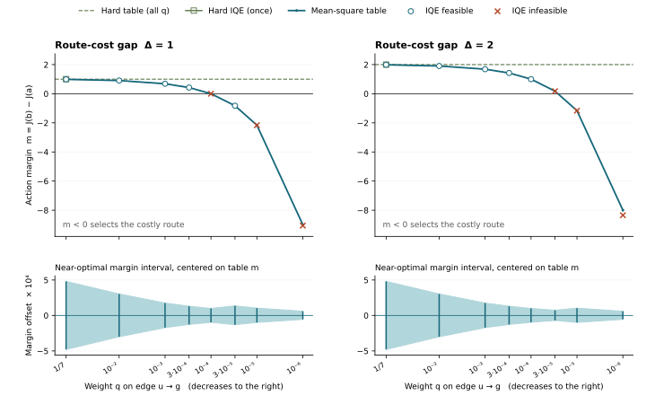

# 仅降低一条边的约束权重，能否迫使最优解选错首动作？

**能。在本图的平均平方松弛约束下，降低真实便宜路线末边 u→g 的权重，足以使所有精确最优解都选择较贵的 b 路线。** 同一 Δ 内，图、边成本、查询目标和五个源的权重完全相同，所有边始终可见。下表列出相邻实测 q 的判定。表格解的判断使用整个近最优可行集的保守外界，因此也覆盖精确最优集。

| 真实路线差 Δ | 降低 q 时最后一个被迫排对的点 | 下一个被迫反序的点 | 全部被迫反序的实测 q | 选错一次的真实额外成本 |
|---:|---:|---:|---|---:|
| 1 | 10⁻⁴ | 3×10⁻⁵ | 3×10⁻⁵、10⁻⁵、10⁻⁶ | 1 |
| 2 | 3×10⁻⁵ | 10⁻⁵ | 10⁻⁵、10⁻⁶ | 2 |

在其余已测 q 上，平均约束的近最优集全部排对。提高 q 到表中对应的排对点，或改为逐边硬约束，均恢复正确排序。特别地，在同一个 q=3×10⁻⁵，只把 v→g 再加一单位成本，判定就由被迫反序变为被迫排对。两档 Δ 各只运行一次硬约束。没有测得跨零或并列的区间。



横轴向右表示权重降低。上图零线以下会选择 b。方块为与 q 无关的硬约束 IQE 终点，绘在左侧一次。圆圈和叉分别为平均约束下可行及超出容差的 IQE 终点。近最优区间在上图尺度下很窄，下图将其相对表格最优间隔的偏移放大 10⁴ 倍。折线只连接已测点，边界报告到相邻 q 之间。

## 实验如何隔离权重的作用

强连通有向图有两条出发路线 s→a→u→g、s→b→v→g，以及返回边 g→s。除 v→g 的成本为 1+Δ，其余边成本均为 1。首次到达 g 即停止，真实总代价分别为 3、3+Δ。返回边参与距离矩阵和约束，但不会延长成功轨迹。全批量推远目标 F 是五个非终节点到同一个 g 的预测距离均值。真实首步成本均为 1，因此首动作间隔 m=J(b)−J(a)，正值选 a，负值选 b。排序死区为 ±10⁻⁶，并列时另报额外成本范围 [0,Δ]。

表格和 IQE 分别处理两种约束。硬组要求每一条边的 h=d(i,j)−c 都不为正。平均组固定 η=10⁻⁴，要求 R=Σwₑ[max(hₑ,0)]²≤η。仅 u→g 权重为 q，减少的质量均分给其他六边，各得 (1−q)/6。每一步均使用全部七条边。这里的“低权重”没有改变样本可见性，也没有降低对 u 等源的查询频率。[运行前冻结协议](PROTOCOL.md)

## 全部首动作判定

表格列给出 F≥F*−10⁻⁶ 的可行集上 m 的保守区间，显示值向外舍入。IQE 列给出第 12,000 步实际 m。† 表示按冻结容差不可行；不把这些终点作为可行解的证据。

| 约束或 q | Δ=1 表格最优 m | Δ=1 近最优区间 | Δ=1 IQE m | Δ=2 表格最优 m | Δ=2 近最优区间 | Δ=2 IQE m |
|---|---:|---|---:|---:|---|---:|
| 硬约束 | 1.000000 | [0.999994, 1.000003] | 1.000001 | 2.000000 | [1.999994, 2.000003] | 2.000000 |
| 1/7 | 0.987860 | [0.987381, 0.988341] | 0.987864 | 1.987860 | [1.987381, 1.988341] | 1.987863 |
| 10⁻² | 0.905161 | [0.904861, 0.905465] | 0.905162 | 1.905161 | [1.904861, 1.905465] | 1.905162 |
| 10⁻³ | 0.685453 | [0.685281, 0.685629] | 0.685453 | 1.685453 | [1.685281, 1.685629] | 1.685453 |
| 3×10⁻⁴ | 0.423573 | [0.423445, 0.423703] | 0.423573 | 1.423573 | [1.423445, 1.423703] | 1.423573 |
| 10⁻⁴ | 0.000533 | [0.000436, 0.000633] | 0.000121 † | 1.000533 | [1.000437, 1.000633] | 1.000534 |
| 3×10⁻⁵ | -0.824469 | [-0.824600, -0.824333] | -0.823721 | 0.174550 | [0.174479, 0.174625] | 0.174425 † |
| 10⁻⁵ | -2.161543 | [-2.161642, -2.161438] | -2.164566 † | -1.161543 | [-1.161642, -1.161438] | -1.164254 † |
| 10⁻⁶ | -8.999768 | [-8.999823, -8.999708] | -9.057958 † | -7.999768 | [-7.999823, -7.999708] | -8.345351 † |

## 为什么这是关于精确最优解的结论

表格组直接优化 6×6 完整有向距离矩阵，约束包含非负、零对角和所有三角不等式。逐边硬组是线性规划。沿任意到 g 的路径反复应用三角不等式，得到 J 不超过路径成本，进而不超过真实最短路。全对 Dijkstra 距离同时达到所有源的上界。因五个源在 F 中权重严格为正，最优目标列唯一。按 s,a,u,b,v,g 顺序，求解所得 J 为 (3,2,1,2+Δ,1+Δ,0)，与 Dijkstra 逐项一致，硬组 F*=2.2、2.6。其余列无需唯一。

平均组额外引入七个非负变量 y，用线性约束 dₑ≤cₑ+√(η/wₑ)yₑ 和单位二范数球 ‖y‖₂≤1 精确表达平方预算。完整矩阵问题用 SLSQP 找可行候选，并用球面支持平面构造外部线性规划，给出最大目标值的上界。另一份独立证书直接利用图的两条路线。设 s 有 p 比例的查询流走 a，其余走 b，其他四个源走各自后缀。按 sa、au、ug、sb、bv、vg、gs 排列，五个源均分后的边流量为

**f(p) = (p, 1+p, 2+p, 1−p, 2−p, 3−p, 0) / 5。**

令 xₑ=max(hₑ,0)。三角不等式给出 F≤f·(c+x)。在预算内用加权柯西不等式可得 **F≤f·c+√η‖f/√w‖₂**。任意 p∈[0,1] 都是有效上界；取最紧的 p，用达到该线性上界的非负 xₑ∝fₑ/wₑ 加长各边，再求全对最短路，得到满足原始非线性约束的距离矩阵。其 F 与上界相符。报告的表格终点取已验证可行候选中目标最优者，这一规则允许使用上述构造。完整矩阵 LP 对偶上界与所报 F 的最大差为 6.12×10⁻¹¹，结合路径证书后最大差为 2.02×10⁻¹³。

对每个问题再分别最大化 m 和 −m，同时保留近最优目标下限。每端保存一个原问题可行矩阵及一个 LP 对偶外界。对偶界包含有限变量上限上的站立残差修正与浮点余量。36 个区间端点中，可行见证与相应外界最宽相差 8.70×10⁻⁷。最近零的一档 Δ=1、q=10⁻⁴，其全局下界仍大于 0.000436，明显超过判定死区。18 个表格主解全都通过原始可行性检查，非负和对角残差均为 0，最大三角残差为 1.78×10⁻¹⁵。硬组最大逐边正违反为 0；平均组允许个别边超过成本，实际 R 与逐边违反分开保存在表中。[全局解与双侧界](table.csv) · [逐端可行见证](interval_witnesses.csv) · [核验摘要](audit.json)

## 哪一项翻转了首动作

沿 a→u→g 与 b→v→g 的真实最短后缀分别求 H=Σ(dₑ−cₑ)、T=Σ(dₑ+J后继−J当前)。因 J(g)=0，预测后缀成本减真实后缀成本恰为 H−T。因此 **m=Δ+(H_b−H_a)−(T_b−T_a)**。计算中 H 保留正负号，只有约束的平方风险取正部。36 个表格与 IQE 主终点逐例核验，最大等式误差为 1.78×10⁻¹⁵。

| 表格条件 | u→g 的 h | H_a | H_b | T_a，T_b | m | 真实额外成本 |
|---|---:|---:|---:|---:|---:|---:|
| Δ=1，q=10⁻⁴ | 0.999667 | 1.000067 | 0.000600 | ≈0，≈0 | +0.000533 | 0 |
| Δ=1，q=3×10⁻⁵ | 1.825126 | 1.825290 | 0.000821 | ≈0，≈0 | −0.824469 | 1 |
| Δ=2，同一 q=3×10⁻⁵ | 1.825559 | 1.825778 | 0.000329 | ≈0，≈0 | +0.174550 | 0 |
| Δ=2，q=10⁻⁵ | 3.161922 | 3.162017 | 0.000474 | ≈0，≈0 | −1.161543 | 2 |

以第二行为例，单条 u→g 边耗用 9.99325×10⁻⁵ 的平方预算，占总预算约 99.93%。增加这条边的预测距离，同时允许 u 和 a 两个源对推远项贡献更大的 J。它位于真实较便宜的路线，故失真主要抬高 J(a)。当两条后缀的误差差超过 Δ，s 就选 b。在该图的表格最优解上，两条指定后缀的三角松弛均接近零；这一翻转可以由累计有符号边误差差分解释。单边上限 h₊≤√(η/q) 只说明预算允许多大失真，迫使最优解反序的结论来自完整推远目标和区间证书。[所有七边的值、权重与预算贡献](edges.csv)

## 有限预算 IQE 的结果

18 个独立训练条件共享同一份起始参数。网络为 6×64 节点 embedding 和 8 个分量的 IQE-maxmean。每组都从零 Adam 状态、零乘子开始；硬组用七个乘子，平均组用一个乘子。平均组把加权平方预算改写成等价的加权范数约束后做 PHR 更新，因而两种表达有相同可行域，优化过程可能不同。取固定终点，按原始最大逐边正违反或原始平均平方风险判断可行性。宽容差为硬组 10⁻⁵、平均组 R−η≤10⁻⁸。

- **两个硬组**都可行且排对，推远目标距表格最优值均不足 10⁻⁶。
- **16 个平均组**中有 10 个可行。Δ=1、q=3×10⁻⁵ 给出了实际可行的 IQE 反序实例，m=−0.823721，R=0.00009991484，F 比表格最优值低 0.00031220。它支持有限网络可以实际选错，精确最优性的证明仍来自表格组。
- 其余 6 个平均组的原始终点超出风险容差，全部保留。超限条件分别是 Δ=1 的 10⁻⁴、10⁻⁵、10⁻⁶，以及 Δ=2 的 3×10⁻⁵、10⁻⁵、10⁻⁶。Δ=2 下两个反序 IQE 终点均不可行。例如 q=10⁻⁶ 时 R=0.00010702968，F=7.13825 高于表格可行最优值 7.00004。这个差反映了越过约束预算。
- 总计 12/18 个 IQE 终点可行，其中 11 个满足冻结的近最优目标门槛。18 个终点的排序符号都与各自表格区间一致，也没有并列。因此“表格稳定排对而 IQE 排反”的监督拟合触发数为 0。没有据此判断该架构可以精确表示任意表格距离矩阵。[固定终点完整数值](metrics.csv) · [IQE 原始结果](iqe.csv)

## 能解释真实 checkpoint 的哪一层

**OGBench 的原始 value loss** 使用经验平均的单步正违反平方和共享 λ。小图解释了这种聚合形式的一项性质：即使所有边都有正权重并且表格问题被全局求解，低权重关键边仍可能在推远目标下获得足以翻转动作的松弛预算。真实 OGBench 同时具有连续观测、目标采样和共享神经参数，原始 ε 也不同于本实验 η；E16 还引入了不同的监督。既有统一诊断中，原 100k 错选时较大的误差差来自后续路线累计三角松弛，这里表格翻转主要来自 H 差。小图证明了一个充分机制，不能把 OGBench 的停滞直接归因于低权重边。

**U-trap 的 R0/R1** 对物理记录使用逐记录 PHR 和各自的乘子。重复数影响总暴露量和乘子演化，但每条记录有自己的约束。R1 干预的是 task 推远查询的源权重，本实验的查询权重始终固定。小图逐边硬表格对照说明了本图中理想可行且全局最优时应有的排序；真实 U-trap 的有限 PHR 训练没有这个保证。U 的错误分支在后继后缀上确实有足以盖过参考间隔的 H 差，这与小图在决策层相符。现有证据没有把真实 H 差追溯到相同的 q 干预。[统一机制诊断](../unified_mechanism_20261102/report.md) · [U 的冻结训练协议](../../experiments/task_source_balance/PROTOCOL.md) · [OG 平均约束对照](../../experiments/ogbench_critic/TAIL_PROTOCOL.md)

**返回真实模型的最小验证。** 先在冻结的 U-trap R0 上使用已有 58 个专家分支和修订图的最短后缀。对每个分支用图参考预选最优与严格次优动作，再只按 replay 副本数选最优后缀上最低暴露的边，预先固定并列规则。逐例记录这条边的有符号 h、两条后缀的 ΔH、ΔT、参考间隔和实际 m。保持网络、其余边和路径不变，仅在误差分解中把该边 h 的贡献置零，共享后缀两侧同时扣除；报告有多少错对因此跨回零线，并与同后缀成本相近的高暴露边作配对比较。该操作检验“低暴露边的已实现误差，在数量上足以解释错选”，属于冻结点评分归因。要证明训练权重造成了该误差，还需要在查询分布不变时独立干预局部约束权重。

## 复现与文件

从仓库根目录运行以下命令，输出目录须全新。默认解释器是相邻主仓库的 .venv，可用 PY 指定等价环境。执行器先核验并复制冻结协议，然后完成表格、IQE、条件拟合判定、终点重载、汇总和绘图。运行环境为 arm64 CPU、Python 3.9.25、NumPy 2.0.2、SciPy 1.13.1、Torch 2.8.0、torchqmet 0.1.0。协议、初始参数和代码的摘要见 audit.json。

```bash
bash experiments/edge_weight_graph/run.sh results/edge_weight_graph_reproduction
```

[执行入口](../../experiments/edge_weight_graph/run.sh) · [完整矩阵求解](../../experiments/edge_weight_graph/table.py) · [IQE 与条件拟合](../../experiments/edge_weight_graph/iqe.py) · [终点核验与绘图](../../experiments/edge_weight_graph/finish.py)

metrics.csv 每行对应一个主终点，包含首动作、真实额外成本、F、目标差、最大逐边违反、加权平方违反、可行性及带符号路径分解。硬组的平方违反按均匀权重仅作描述。table/ 保留主解、两端近最优见证、Dijkstra 参考和求解日志；iqe/ 保留每次训练的固定终点参数、全距离矩阵和每 100 次更新日志。原统一诊断目录保持只读。

在全新目录用上述入口从头复算，两次运行生成的 81 个文件逐字节一致，包括全部终点参数、数值表、区间见证和曲线。[复现校验](reproduction.json)
