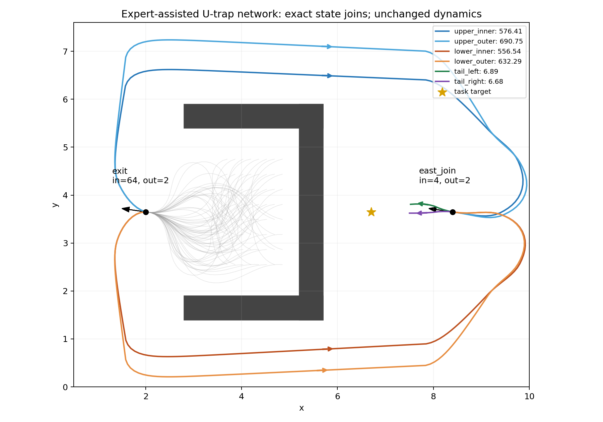

# 专家辅助 U-trap 转移网络：构造与审计

本轮仅构造数据并审计，未启动训练或保存模型；兼容性测试仅实例化生产网络并做无梯度前向。64 条成功轨迹包含 **11,949 条真实转移记录、2,537 条去重物理边、64 条合法零成本 anchor**。9,412 条重复记录来自共享片段；不是同样数量的独立样本。每条轨迹 173–197 步，环境上限保持 300。

64 个 U 内前缀精确汇合到出口 `(2, 3.65, 3)`；出口先选上/下，两侧各自再选内/外，形成 4 条绕行路线，它们精确汇合到东侧非终态 `(8.4, 3.65, 3)`；随后有 2 条不同接近路线到合法任务终态。两个交汇节点的 heading 均为 3 rad。原始完整 42 维观测中共有 4 个分支节点、2 个交汇节点；出口入/出度为 64/2，东侧为 4/2。度数按不同前驱/后继计算，不把重复行算成分支。四处分支的记录图成本间隔均非零，逐分支动作和成本见 `summary.json` 的 `branch_choices`。终态 quotient 合并另行处理，不充作物理交汇。

专家辅助来源是本轮助手在脚本中显式设计的起点、绕行 waypoint 和接近控制，加仅优化端点几何的 float32 控制序列 shooting；没有真人示教或外部专家标注。提议动力学只用于求控制；每一段、每一条最终轨迹都由原环境 `step` 重新执行。连接要求 `(x,y,heading)` 和完整观测逐位一致；没有状态吸附、空间近邻边或段内 reset。方向受限、障碍物、任务条件、一步成本均沿用原环境。

| 片段 | 步数 | 累计环境成本（仅报告） |
|---|---:|---:|
| upper_inner | 142 | 576.412055 |
| upper_outer | 154 | 690.747025 |
| lower_inner | 143 | 556.539272 |
| lower_outer | 150 | 632.288035 |
| tail_left | 9 | 6.886025 |
| tail_right | 9 | 6.676079 |

共享出口和东侧交汇使 64×4×2=512 种完整组合有记录边支持；训练 replay 仅存 64 种。审计实际重新执行了 512 种，其中 448 种未作为完整训练轨迹保存，全部逐位匹配组成片段并合法成功，最长 207 步。它们未追加到训练数据。记录图审计发现 6,592 个源记录可通过改选分支取得更低成本，最大较本条记录后缀低 134.417699。这使路线排序、交汇后的片段拼接成为实质诊断；图最短距离只保存在 `audit/graph_reference_audit_only.npz`。

全部 11,949 个 task push 源，在自己的 context 内就有连续成功后缀及合法 anchor，跨轨迹拼接不是见证的前提。现有 `configure_global_push_sampling(state_mode="trajectory", seed=42)` 重建 B1 后，all 与 witnessed 的 task mask、B1 索引和指纹完全相等。11,949 个 B1 配对均严格位于本轨迹后续物理状态内。anchor 在既有生产 canonicalization 下映为恒等边；入终态的物理边仍保留原始正成本。

审计重放全部 64 条轨迹和 70 个片段，观测、动作、奖励逐位一致；另用现有向量成本实现重算，最大成本差 4.77e-07。解析一步动力学最大位置/heading 误差为 5.13e-07/1.79e-07（观测编码浮点误差），无碰撞、越界、超时或中途终止。严格 context 可达和同任务精确图可达均覆盖所有物理源。图中的全部 2534 个 canonical 节点都有逐边核验的合法最短路见证。

| 覆盖区域 | 源记录数 | 去重完整源状态数 |
|---|---:|---:|
| U interior | 1334 | 1334 |
| west exit | 1959 | 677 |
| upper detour | 2656 | 166 |
| lower detour | 2624 | 164 |
| east approach | 3056 | 172 |

数据指纹 `replay_sha256`：`628b365614027b6b57ee55c2a6b2b11188444dd4cf33e77cdb9acfa570eb3824`。文件 SHA256、环境签名、旧输入/源码哈希和源码快照见 `manifest.json`；节点、成本、固定 B1 指纹见 `audit/summary.json`。`construction_attempts.json` 保留未成功的 shooting 长度候选；它们不进入 replay。旧实验产物及环境/MPPI/encoder 源码哈希均核验未变。

沿用四路径的 `MultiEpisodeData`、一步 reward/cost 和生产终态映射；完整 replay、witnessed 与 PHR 校准提示需同时诊断可达支持、长程紧致性和约束可行性，不能以残差下降单独判定距离恢复。训练 payload 没有 Oracle value 或最短路回归标签，既有 `goal_return_cost` 为零且 mask 全关。加载器不会读取 audit 参考。后续入口与复现方式见仓库 `experiments/expert_utrap_network/README.md`。

这是有专家辅助、单任务、有限精确状态网络上的机制诊断数据。起点与路线是设计样本，可能靠近既有测试位置；不继承旧四路径的 held-out 排除协议，不能拿旧探针宣称独立泛化。不宣称无专家学习、连续环境最优性或闭环 MPPI 改善。共享片段会改变按行采样权重，未来若去重或改权重，应另立协议并重建 B1/见证，不能静默替换当前数据。

