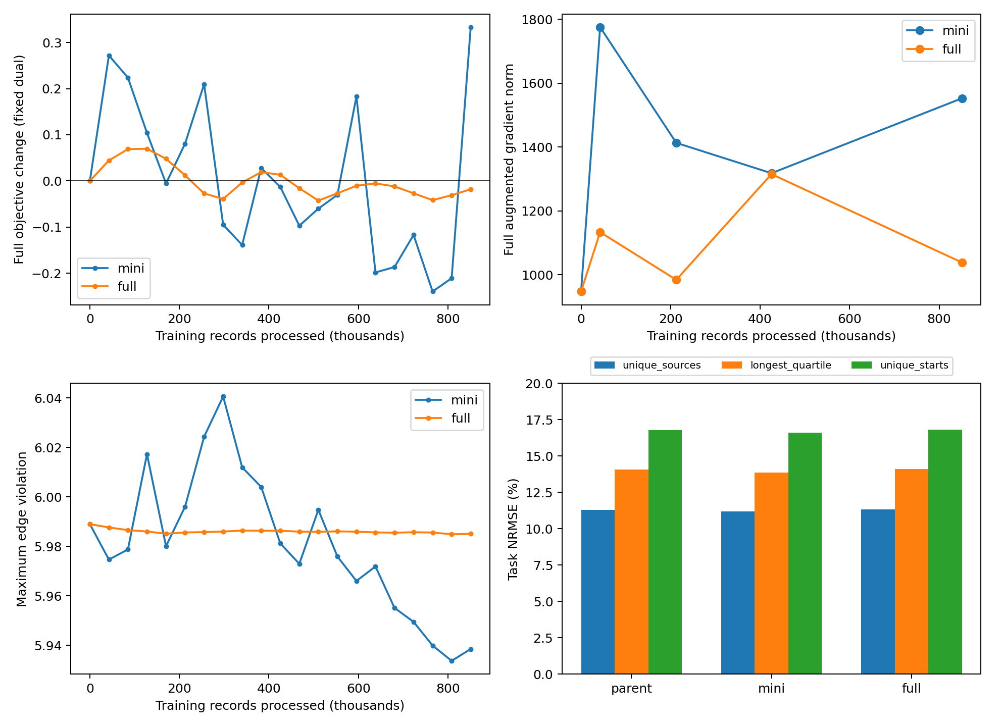

# 固定乘子下的小批次与全量 primal 优化对照

## 结论

两组已完成冻结的20遍训练，每组处理850720条物理记录的前向、850720条反向，乘子全程逐位不变。**全量梯度加上当前继承Adam与固定学习率，并没有显著改善内层求解或恢复长程结构。** 它的最终目标小幅下降0.0181，但全量梯度范数反而从947.7增至1038.7，三角松弛与任务误差基本未改善。

小批次组能找到更低的目标值，但波动明显：第18遍比起点下降0.2397，第20遍最终却上升0.3332，最终梯度范数1552.6。不能因此说“小批次完全无法下降”，也不能只取它最好的中间点宣布收敛。

本次结果支持继续检查**步长、Adam历史状态和更新频率造成的内层优化问题**，但尚未证明梯度噪声是主因，也不支持宣布PHR不适配或共享网络表达能力不足。它排除了一个过于简单的预期：在同记录处理预算下，直接把每批更新换成全量累积、保持同一学习率和Adam状态，就能明显解决当前问题。

## 冻结条件、预算与监督

协议为 `experiments/fixed_dual_primal/PROTOCOL.md`，在正式运行前写入并由两组配置记录SHA256。共同起点是**原始50k父checkpoint** `results/connected_expert_qrl_20261023/main/train/final.pt`，不是上一轮A/B终点。

共享encoder/IQE、42536条物理记录及其重复权重、原0.6 task+0.4 B1、局部约束`d(s,s')<=c`和rho100全部保留。两组恢复相同网络、Adam全部状态、lambda及torch RNG；lambda在整个训练期间不更新。固定最小化

\[
F(\theta;\lambda)=-0.6\,\overline{d(s,G)}-0.4\,\overline{d(s,g_{B1})}
+\frac1N\sum_i\frac{[\max(\lambda_i+100h_i,0)]^2-\lambda_i^2}{200},
\qquad h_i=d(s_i,s'_i)-c_i.
\]

没有辅助loss、QP、图距离标签、重新配对或目标约束替换。

|项目|mini|full|
|---|---:|---:|
|完整遍历数|20|20|
|每条记录追加访问|20|20|
|训练前向记录数|850720|850720|
|训练反向记录数|850720|850720|
|每遍网络更新次数|167|1|
|总网络更新次数|3340|20|
|batch/chunk大小|256，末批40|256，末块40|
|学习率|恒定2e−6|恒定2e−6|
|记录遍历排列|每遍与full完全一致|每遍与mini完全一致|

完整遍历使用共同新sampler seed2026102401，未接着父sampler的半个epoch运行。mini沿用已有batch均值更新；full在一遍中保持参数不变，每块梯度按`块记录数/42536`加权，float64累计后转回float32参数梯度，仅最后做一次Adam更新。末块40条没有被当成256条等权处理。

两组初始模型、Adam、dual、访问计数、RNG和push counters与父模型逐项一致；最终sampler、逐记录访问、RNG、push counters、处理量完全匹配。21个审计点的lambda哈希一致，20个遍历排列哈希一致。pass0/1/5/10/15/20监督通过，所有全量审计均有限，终态锚点距离为0。正式训练源码与协议哈希在结束时和统一评估时复核未变。

参考仅在两组COMPLETE后加载；未参与训练、步长、停止或模型选择。实际结束点固定为第20遍。

## 固定乘子全量目标：两组都不能称为已经收敛

下表采用每遍相同全量前向审计口径，负的变化表示目标下降。

|指标|mini|full|
|---|---:|---:|
|初始F|−184.816483|−184.816483|
|最终F|−184.483327|−184.834544|
|最终F−初始F|+0.333157|−0.018061|
|20个更新遍中目标上升次数|11|10|
|所记录的最低F−初始F|−0.239651（pass18）|−0.042617（pass12）|
|最后5个审计点平均F−初始F|−0.084212|−0.025866|
|最后5个审计点F标准差|0.212584|0.010302|
|相对父模型的参数位移范数|0.211298|0.005255|

最低值和最后5点统计是描述性分析，不是早停或checkpoint选择规则；全部图指标只评价固定第20遍终点。mini最后一遍上升约0.5440，说明单个终点具有较强波动，不能只凭最终F上升就否认过程中存在下降。另一方面，曾经下降也不代表当前配置已经能稳定求解内层。

所有遍末审计都发生在mini最后40条短batch更新后；这里保留了原更新方式，尚未单独隔离短batch与审计相位的影响。不能直接把第20遍回升归因于最后40条，或把它全部归因于一般意义的梯度噪声。

## 全量梯度与可行性

|处理进度|mini增广梯度范数|full增广梯度范数|
|---|---:|---:|
|0遍|947.7325|947.7325|
|1遍 / 42536条|1775.3387|1133.6588|
|5遍 / 212680条|1413.1223|984.3427|
|10遍 / 425360条|1318.1143|1315.2627|
|20遍 / 850720条|1552.6262|1038.6740|

最后的相对抵消指标`||总梯度||/(||push梯度||+||PHR梯度||)`从0.27590变为mini0.50206、full0.37399。两组最终全量梯度均高于起点，不能把full较平滑的目标曲线当成驻点收敛。梯度范数依赖参数坐标，IQE为分段可微，报告的是自动微分导数；它不是全局最优性或表示能力的判定证书。

|指标|父模型|mini|full|
|---|---:|---:|---:|
|违反物理记录数（h>1e−5）|20393|20622|19671|
|违反去重候选边数/6958|1768|1754|1744|
|最大违反|5.988971|5.938485|5.985022|
|记录平均正违反|0.061196|0.066337|0.060467|
|去重边平均正违反|0.119981|0.124138|0.119667|
|mean abs(lambda*h)|12.2051|12.6000|12.2060|
|投影dual残差RMS（eta1，仅评估）|0.19343|0.20028|0.19363|

mini最大违反下降但平均正违反变大；full仅轻微改变可行性。所有lambda仍等于父模型，最大值2226.8582、均值55.9441。以上互补/dual残差仅用于描述，未据此更新乘子。

## task/B1 push及损失组成

|记录均值|父模型|mini|full|
|---|---:|---:|---:|
|task距离|236.5693|236.6831|236.3195|
|B1距离|137.2821|137.9020|137.2695|
|0.6 task+0.4 B1|196.8544|197.1707|196.6995|
|PHR项|12.037934|12.687357|11.864950|

mini增加了push，但PHR增加更多，最终F恶化；full的PHR下降略大于push损失，最终F小幅改善。这里没有出现显著“同时保住push并大幅压低约束残差”的恢复。

全量梯度审计的loss按chunk加权累加，与独立全量前向审计存在约1e−5以内的float32舍入差异，远小于报告的主要变化；比较曲线统一使用后一口径。

## 事后距离恢复与三角松弛

参考来自已修正的 `connected_reference_fix_20261024/main`，再次核验合法目标零集合、非终态Bellman最小值等式及数据指纹。NRMSE沿用参考距离RMS归一化定义。

|任务NRMSE|父模型|mini|full|
|---|---:|---:|---:|
|去重source|11.2861%|11.1989%|11.3097%|
|307原始起点|15.2057%|15.0672%|15.2481%|
|165去重起点|16.7613%|16.5864%|16.8196%|
|最长四分位source|14.0505%|13.8564%|14.1157%|

mini有小幅任务误差改善，full基本不变、略差。两者均未实现准确恢复。

沿同一参考最短路径，最长四分位的均值分解为`D*−J=Σ(c−d_edge)+(Σd_edge−J)`：

|模型|低估D*−J|累计边项|累计三角松弛|
|---|---:|---:|---:|
|父模型|75.7593|−34.8940|110.6533|
|mini|74.4228|−37.3505|111.7733|
|full|76.2153|−34.5187|110.7340|

mini的低估改善约1.3366，但三角项反而增加约1.1199；改善来自边项更负，累计局部违反对低估的掩盖更强。因此这项距离改善不能解释为原理论机制恢复。full的两项基本未变。

## 分支与图上路径决策

|指标|父模型|mini|full|
|---|---:|---:|---:|
|最优分支数/58|27|28|25|
|分支平均regret|13.2765|10.0102|13.4806|
|307起点平均路径regret|49.7302|38.5851|46.1698|
|165去重起点平均路径regret|53.1412|46.0379|50.9693|
|最优路径数（307/165起点）|27 / 8|27 / 8|27 / 8|

mini相对父模型改善节点40、104、1769的选择，但把节点288从最优改为regret4.2715。full只改变节点88和288，两处都从局部最优变为次优，最优分支数下降。

full的路径regret仍略降，并不矛盾：路径改变后，下游错误被访问的频率变化。以307起点的平均regret贡献核算，节点88/288分别增加0.8630/0.0696；节点104/304因访问减少分别降低2.5112/3.5469；节点120因访问增加上升1.5651，合计−3.5604，精确解释49.7302→46.1698。分析代码已验证“逐分支regret×访问次数”的总和等于路径regret。

这只是记录图上以`c+J(next)`选边的评价，不是MPPI或连续状态闭环实验。三组均307/307到达，受无环且通向目标的记录图结构保证，不能据此声称解决U-trap未见状态导航。

## 为什么不能把两组差异全部归因于梯度噪声

训练记录预算相同，但更新次数为3340与20，mini的参数位移约为full的40倍。继承Adam配置实际为beta=(0.9,0.999)、eps=1e−8、weight decay=0；父模型最后lr为2e−7，本次两组统一改为恒定2e−6，未为任何一组搜索最优学习率。

按Adam递推式，经过T次更新后，旧一阶矩的线性系数为beta1^T，旧二阶矩为beta2^T：

|历史项系数|mini，3340次|full，20次|
|---|---:|---:|
|旧一阶矩系数|约1.48e−153|0.12158|
|旧二阶矩系数|0.03538|0.98019|

这是历史项的递推系数，不是其占最终矩总量的比例。full的二阶矩历史消退极慢，mini则已大量更新预条件状态。相同名义lr也不意味着相同参数位移或相同优化进展。由此不能把full的较小波动全部归因于消除采样噪声，也不能因为20次全量更新进展小就判定该方向无效。

## 预定探针是否触发，以及下一步

协议规定：只有full最终F未比起点降低超过1e−4时，才运行父/终点模型上的独立一步步长与一阶矩清零探针。实际下降0.01806，条件未触发，**本次没有运行这些额外候选，也没有按图参考改动配置**。探针代码及只读性测试已完成；这不等于已经验证了哪种步长或动量重置更好。

下一步建议先做一个更直接的固定lambda下降方向检查：在相同checkpoint上计算精确全量梯度，分别检查继承Adam方向与不含历史一阶矩的方向，记录`梯度·实际位移`和原全量目标变化，再用只依赖该目标的回溯步长验证能否获得稳定下降。保持原数学目标、网络、记录权重不变，明确统计额外目标评估成本。若某方向不是下降方向，应先处理方向与动量；若是下降方向但目标上升，应检查步长和分段非光滑性，而不是立刻修改QRL约束。

对mini，还值得在固定预算内增加最后短batch之前/之后的目标观测，区分末批波动和整遍优化效果。当前结果未隔离这一因素，本轮不据此新增训练组或挑选中间checkpoint。

只有内层全量目标能更稳定下降、梯度/可行性趋势更明确后，才适合重新接入外层dual更新。即使固定lambda子问题求解改善，也仍需另行验证完整primal-dual问题及长程结构，不能直接跳到网络表达能力不足或PHR理论不适配。

## 计算开销、测试与追溯

|开销|mini|full|
|---|---:|---:|
|训练循环时间|316.54秒|309.20秒|
|全量审计时间|315.50秒|315.50秒|
|循环总墙钟（含保存等）|633.24秒|625.89秒|
|审计物理记录前向|1105936|1105936|
|审计反向记录等价量|850720|850720|

审计包含21次全量前向与5次梯度审计；梯度审计各共用一轮前向、分别计算task/B1/PHR/Lagrangian四次反向。307个终态锚点的额外前向检查不计入物理训练预算。两组并发运行，期间有测试负载，这些时间仅为实测，不是严格性能基准；初始化与事后图评价不包含在表中的训练循环时间。

本目录6项测试加既有求解器/参考/评估回归，共**18项通过**。覆盖全量分块与整批梯度/Adam更新等价、短块加权、chunk期间参数冻结、生产float32的小批次等价与续训恢复、乘子冻结、预算配平、只读探针、重复恢复日志校验和路径regret重构。高精度代数测试避免Adam对近零float32舍入梯度的放大；正式训练精度保持父模型一致。所有源checkpoint和最终模型在分析前后哈希不变。

- 父checkpoint SHA256：`e40171f8c4d23f4d894dc64f37f29ca5d4f9e42a9f5846e4664d197afbe3e37d`
- mini最终 SHA256：`2ffcb56f360d8f87993216186cd85867c0d7c84fb48a439a3f90fcdb2082b250`
- full最终 SHA256：`260321a7993327c4cd52f758401ce08dce67b628b051ecb7f4717bd6bfa913e3`
- 修正参考 SHA256：`cea569cd7a60e00608330dd35866986d2909271aab6af2dbafe23d349308d80f`

复现命令见冻结协议。仅提交源码、测试、协议、本报告及引用图片；checkpoint、原始JSON/NPZ、日志、监督记录及初版分析目录留在本机，不提交。
