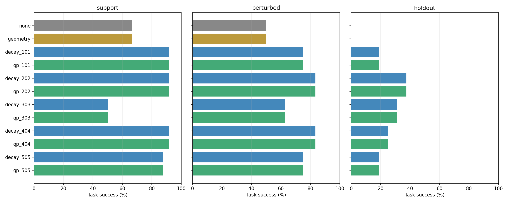
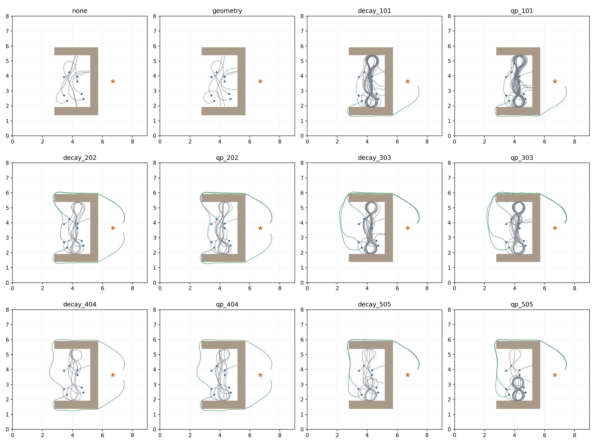
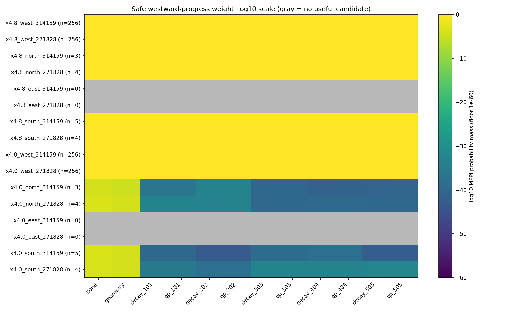

# 四路径 QRL：QP 前后 × MPPI 配对执行（2026-10-17）

## 结论与范围

冻结配置下完成768/768个episode；进程失败组：无。全部五个网络初始化均纳入。修复前QRL的成功数为211/320，修复后为211/320。同起点/heading/规划随机种子的QP前后配对中，**失败→成功1组，成功→失败1组**；下表完整保留每个seed和测试层的表现。

QRL终值在这组固定配置上优于无终值/现有几何引导，但收益不能归于QP：原图联合通过的404并非执行最优（202为48/64，404为46/64），记录图指标和离轨执行不是同一件事。支持层成功率82.5%、扰动层75.8%、保留U内姿态26.25%，说明存在明显的离轨/heading脆弱性。下一步优先分开验证候选覆盖与离轨终值排序，当前证据不支持继续仅靠压低记录边残差来改善执行。

这一评估将记录图的局部可行性与实际闭环执行分开检验。不能用QP后的零边违反代替执行成功，也不能把五份模型在相同32个状态上的结果当成320个独立测试状态。固定规划配置只有一组，不能据此断言MPPI所有配置的能力上限。

| 组别 | 测试层 | 成功/总数 | 成功率% | 碰撞数 | 越界数 | 超时数 | 成功成本均值 | 成功步数均值 |
|---|---|---|---|---|---|---|---|---|
| none | all | 28/64 | 43.8 | 36 (56.2%) | 0 (0.0%) | 0 (0.0%) | 100.481 | 45.7 |
| geometry | all | 28/64 | 43.8 | 36 (56.2%) | 0 (0.0%) | 0 (0.0%) | 100.498 | 45.7 |
| decay | all | 211/320 | 65.9 | 80 (25.0%) | 15 (4.7%) | 14 (4.4%) | 154.544 | 59.4 |
| qp | all | 211/320 | 65.9 | 74 (23.1%) | 15 (4.7%) | 20 (6.2%) | 150.257 | 59.1 |
| none | support | 16/24 | 66.7 | 8 (33.3%) | 0 (0.0%) | 0 (0.0%) | 111.287 | 48.6 |
| geometry | support | 16/24 | 66.7 | 8 (33.3%) | 0 (0.0%) | 0 (0.0%) | 111.277 | 48.6 |
| decay | support | 99/120 | 82.5 | 9 (7.5%) | 10 (8.3%) | 2 (1.7%) | 136.858 | 55.6 |
| qp | support | 99/120 | 82.5 | 10 (8.3%) | 10 (8.3%) | 1 (0.8%) | 136.859 | 55.6 |
| none | perturbed | 12/24 | 50.0 | 12 (50.0%) | 0 (0.0%) | 0 (0.0%) | 86.072 | 41.8 |
| geometry | perturbed | 12/24 | 50.0 | 12 (50.0%) | 0 (0.0%) | 0 (0.0%) | 86.127 | 41.9 |
| decay | perturbed | 91/120 | 75.8 | 20 (16.7%) | 5 (4.2%) | 4 (3.3%) | 148.210 | 56.7 |
| qp | perturbed | 91/120 | 75.8 | 17 (14.2%) | 5 (4.2%) | 7 (5.8%) | 138.288 | 55.9 |
| none | holdout | 0/16 | 0.0 | 16 (100.0%) | 0 (0.0%) | 0 (0.0%) | — | — |
| geometry | holdout | 0/16 | 0.0 | 16 (100.0%) | 0 (0.0%) | 0 (0.0%) | — | — |
| decay | holdout | 21/80 | 26.2 | 51 (63.7%) | 0 (0.0%) | 8 (10.0%) | 265.364 | 89.4 |
| qp | holdout | 21/80 | 26.2 | 47 (58.8%) | 0 (0.0%) | 12 (15.0%) | 265.285 | 89.3 |


三种失败比例均可由同一行总数计算，精确rate见[aggregates.csv](aggregates.csv)。无终值和几何baseline各仅64次，QRL各阶段为5×64次；所有组每个网络/基线均使用同一32状态×2规划seed，基线不复制成五份样本。只在成功任务内报告成本/步数，所有episode平均截断成本不用于优劣排序。



## 全部seed与逐对变化

| 执行组 | 测试层 | 成功/总数 | 碰撞 | 越界 | 超时 | 成功成本 | 成功步数 |
|---|---|---|---|---|---|---|---|
| none | all | 28/64 | 36 | 0 | 0 | 100.481 | 45.7 |
| geometry | all | 28/64 | 36 | 0 | 0 | 100.498 | 45.7 |
| decay_101 | all | 43/64 | 10 | 0 | 11 | 137.911 | 56.2 |
| qp_101 | all | 43/64 | 10 | 0 | 11 | 137.894 | 56.2 |
| decay_202 | all | 48/64 | 16 | 0 | 0 | 153.508 | 60.4 |
| qp_202 | all | 48/64 | 15 | 0 | 1 | 153.631 | 60.5 |
| decay_303 | all | 32/64 | 15 | 15 | 2 | 172.455 | 59.3 |
| qp_303 | all | 32/64 | 11 | 15 | 6 | 144.067 | 57.0 |
| decay_404 | all | 46/64 | 17 | 0 | 1 | 158.807 | 60.9 |
| qp_404 | all | 46/64 | 17 | 0 | 1 | 158.837 | 60.9 |
| decay_505 | all | 42/64 | 22 | 0 | 0 | 154.441 | 60.0 |
| qp_505 | all | 42/64 | 21 | 0 | 1 | 154.379 | 60.0 |
| none | support | 16/24 | 8 | 0 | 0 | 111.287 | 48.6 |
| geometry | support | 16/24 | 8 | 0 | 0 | 111.277 | 48.6 |
| decay_101 | support | 22/24 | 0 | 0 | 2 | 137.420 | 55.9 |
| qp_101 | support | 22/24 | 1 | 0 | 1 | 137.474 | 55.9 |
| decay_202 | support | 22/24 | 2 | 0 | 0 | 136.711 | 55.8 |
| qp_202 | support | 22/24 | 2 | 0 | 0 | 136.673 | 55.8 |
| decay_303 | support | 12/24 | 2 | 10 | 0 | 97.380 | 45.5 |
| qp_303 | support | 12/24 | 2 | 10 | 0 | 97.394 | 45.5 |
| decay_404 | support | 22/24 | 2 | 0 | 0 | 148.785 | 58.4 |
| qp_404 | support | 22/24 | 2 | 0 | 0 | 148.825 | 58.4 |
| decay_505 | support | 21/24 | 3 | 0 | 0 | 146.489 | 58.0 |
| qp_505 | support | 21/24 | 3 | 0 | 0 | 146.427 | 58.0 |
| none | perturbed | 12/24 | 12 | 0 | 0 | 86.072 | 41.8 |
| geometry | perturbed | 12/24 | 12 | 0 | 0 | 86.127 | 41.9 |
| decay_101 | perturbed | 18/24 | 3 | 0 | 3 | 126.169 | 53.2 |
| qp_101 | perturbed | 18/24 | 2 | 0 | 4 | 126.132 | 53.2 |
| decay_202 | perturbed | 20/24 | 4 | 0 | 0 | 146.949 | 58.4 |
| qp_202 | perturbed | 20/24 | 3 | 0 | 1 | 147.249 | 58.5 |
| decay_303 | perturbed | 15/24 | 4 | 5 | 0 | 185.279 | 57.2 |
| qp_303 | perturbed | 15/24 | 2 | 5 | 2 | 124.735 | 52.1 |
| decay_404 | perturbed | 20/24 | 3 | 0 | 1 | 145.949 | 57.6 |
| qp_404 | perturbed | 20/24 | 4 | 0 | 0 | 146.003 | 57.6 |
| decay_505 | perturbed | 18/24 | 6 | 0 | 0 | 143.275 | 56.8 |
| qp_505 | perturbed | 18/24 | 6 | 0 | 0 | 143.209 | 56.8 |
| none | holdout | 0/16 | 16 | 0 | 0 | — | — |
| geometry | holdout | 0/16 | 16 | 0 | 0 | — | — |
| decay_101 | holdout | 3/16 | 7 | 0 | 6 | 211.960 | 77.0 |
| qp_101 | holdout | 3/16 | 7 | 0 | 6 | 211.546 | 76.7 |
| decay_202 | holdout | 6/16 | 10 | 0 | 0 | 236.962 | 84.2 |
| qp_202 | holdout | 6/16 | 10 | 0 | 0 | 237.080 | 84.2 |
| decay_303 | holdout | 5/16 | 9 | 0 | 2 | 314.162 | 99.0 |
| qp_303 | holdout | 5/16 | 7 | 0 | 4 | 314.077 | 99.0 |
| decay_404 | holdout | 4/16 | 12 | 0 | 0 | 278.215 | 91.5 |
| qp_404 | holdout | 4/16 | 11 | 0 | 1 | 278.074 | 91.5 |
| decay_505 | holdout | 3/16 | 13 | 0 | 0 | 277.104 | 93.3 |
| qp_505 | holdout | 3/16 | 12 | 0 | 1 | 277.061 | 93.3 |


QP后−QP前的严格配对结果：成本/步数差仅在两者都成功的同一状态/RNG组合上计算，避免成功集合变化造成错误比较。空集合记为“—”，不是0。

| 网络seed | 层 | 改善 | 退化 | 均成功 | 均失败 | 成功率差百分点 | 共同成功成本差 | 共同成功步数差 |
|---|---|---|---|---|---|---|---|---|
| 101 | all | 0 | 0 | 43 | 21 | 0.00 | -0.017 | 0.0 |
| 202 | all | 0 | 0 | 48 | 16 | 0.00 | 0.123 | 0.0 |
| 303 | all | 1 | 1 | 31 | 31 | 0.00 | -0.006 | 0.0 |
| 404 | all | 0 | 0 | 46 | 18 | 0.00 | 0.030 | 0.0 |
| 505 | all | 0 | 0 | 42 | 22 | 0.00 | -0.063 | 0.0 |
| 101 | support | 0 | 0 | 22 | 2 | 0.00 | 0.054 | 0.0 |
| 202 | support | 0 | 0 | 22 | 2 | 0.00 | -0.038 | -0.0 |
| 303 | support | 0 | 0 | 12 | 12 | 0.00 | 0.014 | 0.0 |
| 404 | support | 0 | 0 | 22 | 2 | 0.00 | 0.040 | 0.0 |
| 505 | support | 0 | 0 | 21 | 3 | 0.00 | -0.062 | 0.0 |
| 101 | perturbed | 0 | 0 | 18 | 6 | 0.00 | -0.037 | 0.0 |
| 202 | perturbed | 0 | 0 | 20 | 4 | 0.00 | 0.300 | 0.1 |
| 303 | perturbed | 1 | 1 | 14 | 8 | 0.00 | 0.005 | 0.0 |
| 404 | perturbed | 0 | 0 | 20 | 4 | 0.00 | 0.054 | 0.1 |
| 505 | perturbed | 0 | 0 | 18 | 6 | 0.00 | -0.067 | 0.0 |
| 101 | holdout | 0 | 0 | 3 | 13 | 0.00 | -0.414 | -0.3 |
| 202 | holdout | 0 | 0 | 6 | 10 | 0.00 | 0.118 | 0.0 |
| 303 | holdout | 0 | 0 | 5 | 11 | 0.00 | -0.085 | 0.0 |
| 404 | holdout | 0 | 0 | 4 | 12 | 0.00 | -0.141 | 0.0 |
| 505 | holdout | 0 | 0 | 3 | 13 | 0.00 | -0.042 | 0.0 |


与无终值、几何baseline的相同键配对也保存在[paired.csv](paired.csv)。这些是有限固定状态的描述性结果，未把状态内两个规划随机种子或共享baseline当作独立重复来计算显著性。

共同成功210对的QP后成本平均差为+0.01778，接近不变；总体成功成本均值154.544→150.257的下降主要受成功集合换位影响，不能据此认定QP普遍缩短执行成本。碰撞数80→74同时超时14→20，主要是失败模式变化，并非任务完成率提升。

## 阶段完成与轨迹

“离开U”定义为访问西侧出口区域；“完成绕墙”要求先到达上/下墙包围框之外，再到闭墙东侧；“合法终态”为真实环境巡检任务success，包含位置、视角/heading、视线与通信要求。

对已在西出口或闭墙东侧的中间起点，不能把之前已经过的阶段计成新完成。因此分别给出当前起点适用的阶段完成数/分母，以及含已记录训练前缀的累计比例。扰动状态不继承训练路径前缀证据，不适用的早期阶段记NA；保留U内起点对三个阶段均适用。全量JSON保留prefix与eligible标记。

初版episode日志仅检查离散状态是否落在西出口区域，会漏掉从西角一步跨过区域的情况。独立审计统一按环境使用的线性移动线段检查出口相交，修正所有组的阶段计数；没有改变轨迹、动作或成功/失败标签。原始episodes.jsonl及冻结源码不变，[统计修正明细](stage_measurement_corrections.json)保存所有差异，新增跨角回归验证。此项是事后修正测量漏计，不是更改成功门槛。

| 组 | 层 | 新离开U/适用 | 新绕墙/适用 | 合法终态/全部 | 含前缀离U% | 含前缀绕墙% |
|---|---|---|---|---|---|---|
| none | all | 6/36 | 12/48 | 28/64 | 40.6 | 40.6 |
| geometry | all | 6/36 | 12/48 | 28/64 | 40.6 | 40.6 |
| decay_101 | all | 17/36 | 27/48 | 43/64 | 57.8 | 64.1 |
| qp_101 | all | 17/36 | 27/48 | 43/64 | 57.8 | 64.1 |
| decay_202 | all | 20/36 | 32/48 | 48/64 | 62.5 | 71.9 |
| qp_202 | all | 20/36 | 32/48 | 48/64 | 62.5 | 71.9 |
| decay_303 | all | 19/36 | 16/48 | 32/64 | 60.9 | 46.9 |
| qp_303 | all | 19/36 | 16/48 | 32/64 | 60.9 | 46.9 |
| decay_404 | all | 18/36 | 30/48 | 46/64 | 59.4 | 68.8 |
| qp_404 | all | 18/36 | 30/48 | 46/64 | 59.4 | 68.8 |
| decay_505 | all | 18/36 | 26/48 | 42/64 | 59.4 | 62.5 |
| qp_505 | all | 18/36 | 26/48 | 42/64 | 59.4 | 62.5 |
| none | support | 2/8 | 8/16 | 16/24 | 75.0 | 66.7 |
| geometry | support | 2/8 | 8/16 | 16/24 | 75.0 | 66.7 |
| decay_101 | support | 6/8 | 14/16 | 22/24 | 91.7 | 91.7 |
| qp_101 | support | 6/8 | 14/16 | 22/24 | 91.7 | 91.7 |
| decay_202 | support | 6/8 | 14/16 | 22/24 | 91.7 | 91.7 |
| qp_202 | support | 6/8 | 14/16 | 22/24 | 91.7 | 91.7 |
| decay_303 | support | 6/8 | 4/16 | 12/24 | 91.7 | 50.0 |
| qp_303 | support | 6/8 | 4/16 | 12/24 | 91.7 | 50.0 |
| decay_404 | support | 6/8 | 14/16 | 22/24 | 91.7 | 91.7 |
| qp_404 | support | 6/8 | 14/16 | 22/24 | 91.7 | 91.7 |
| decay_505 | support | 6/8 | 13/16 | 21/24 | 91.7 | 87.5 |
| qp_505 | support | 6/8 | 13/16 | 21/24 | 91.7 | 87.5 |
| none | perturbed | 4/12 | 4/16 | 12/24 | 33.3 | 41.7 |
| geometry | perturbed | 4/12 | 4/16 | 12/24 | 33.3 | 41.7 |
| decay_101 | perturbed | 8/12 | 10/16 | 18/24 | 50.0 | 66.7 |
| qp_101 | perturbed | 8/12 | 10/16 | 18/24 | 50.0 | 66.7 |
| decay_202 | perturbed | 8/12 | 12/16 | 20/24 | 50.0 | 75.0 |
| qp_202 | perturbed | 8/12 | 12/16 | 20/24 | 50.0 | 75.0 |
| decay_303 | perturbed | 8/12 | 7/16 | 15/24 | 50.0 | 54.2 |
| qp_303 | perturbed | 8/12 | 7/16 | 15/24 | 50.0 | 54.2 |
| decay_404 | perturbed | 8/12 | 12/16 | 20/24 | 50.0 | 75.0 |
| qp_404 | perturbed | 8/12 | 12/16 | 20/24 | 50.0 | 75.0 |
| decay_505 | perturbed | 8/12 | 10/16 | 18/24 | 50.0 | 66.7 |
| qp_505 | perturbed | 8/12 | 10/16 | 18/24 | 50.0 | 66.7 |
| none | holdout | 0/16 | 0/16 | 0/16 | 0.0 | 0.0 |
| geometry | holdout | 0/16 | 0/16 | 0/16 | 0.0 | 0.0 |
| decay_101 | holdout | 3/16 | 3/16 | 3/16 | 18.8 | 18.8 |
| qp_101 | holdout | 3/16 | 3/16 | 3/16 | 18.8 | 18.8 |
| decay_202 | holdout | 6/16 | 6/16 | 6/16 | 37.5 | 37.5 |
| qp_202 | holdout | 6/16 | 6/16 | 6/16 | 37.5 | 37.5 |
| decay_303 | holdout | 5/16 | 5/16 | 5/16 | 31.2 | 31.2 |
| qp_303 | holdout | 5/16 | 5/16 | 5/16 | 31.2 | 31.2 |
| decay_404 | holdout | 4/16 | 4/16 | 4/16 | 25.0 | 25.0 |
| qp_404 | holdout | 4/16 | 4/16 | 4/16 | 25.0 | 25.0 |
| decay_505 | holdout | 4/16 | 3/16 | 3/16 | 25.0 | 18.8 |
| qp_505 | holdout | 4/16 | 3/16 | 3/16 | 25.0 | 18.8 |




图中固定展示规划seed314159下全部8个保留状态，每组同一集合，没有挑选最好轨迹；绿线成功、灰线失败。逐episode完整轨迹、动作、环境奖励及逐决策计算量位于`../arms/<arm>/*.npz`。绘图窗口覆盖所示全部轨迹，显示U区域细节。第一步前的候选噪声相同；闭环状态、名义控制序列分化后，候选轨迹自然不同，本报告没有声称全过程共享候选。

## 固定候选评分诊断

16批开发状态候选，来自深处/中部×四个heading×两个规划seed；每批同一256×20控制序列、同一环境模型rollout被12组评分，完全隔离候选采样变化。未用这些开发点调参，也没有向候选池注入训练路径或oracle动作。

“有用”是本窗口内未碰撞/越界、完整20步、向西进展至少0.25且末heading朝西的局部指标；它不是完整脱困可达性的证明。另列安全访问西出口的候选数。

| x | heading | 规划seed | 安全/256 | 有用/256 | 访问出口/256 |
|---|---|---|---|---|---|
| 4.8 | west | 314159 | 256 | 256 | 0 |
| 4.8 | west | 271828 | 256 | 256 | 0 |
| 4.8 | north | 314159 | 3 | 3 | 0 |
| 4.8 | north | 271828 | 4 | 4 | 0 |
| 4.8 | east | 314159 | 0 | 0 | 0 |
| 4.8 | east | 271828 | 0 | 0 | 0 |
| 4.8 | south | 314159 | 5 | 5 | 0 |
| 4.8 | south | 271828 | 4 | 4 | 0 |
| 4.0 | west | 314159 | 256 | 256 | 256 |
| 4.0 | west | 271828 | 256 | 256 | 256 |
| 4.0 | north | 314159 | 8 | 3 | 0 |
| 4.0 | north | 271828 | 7 | 4 | 0 |
| 4.0 | east | 314159 | 0 | 0 | 0 |
| 4.0 | east | 271828 | 0 | 0 | 0 |
| 4.0 | south | 314159 | 8 | 5 | 0 |
| 4.0 | south | 271828 | 8 | 4 | 1 |


**4/16批没有采到符合该局部进展定义的候选。** 这4批均为朝东状态，安全候选数也为0；在无效轨迹上本实现不加terminal value，此时更换QRL无法改变这批候选的终值排序。没有覆盖时，不能仅凭terminal value的排序来解释失败；有覆盖时可进一步检查这些候选获得的概率质量。零进展候选不证明任何闭环策略都不能脱困：MPPI还会滚动重采样，且加权平均动作可能不等于某条候选首动作。

| 模型seed | 安全排序Spearman均值 | 权重TV均值 | 有效top-k重合% | 首动作绝对差均值 | 首动作绝对差最大 | 有用权重差均值 |
|---|---|---|---|---|---|---|
| 101 | 0.99999 | 0.00061 | 100.0 | 0.00028 | 0.00217 | -0.00000 |
| 202 | 1.00000 | 0.00066 | 100.0 | 0.00028 | 0.00143 | 0.00000 |
| 303 | 1.00000 | 0.00010 | 100.0 | 0.00007 | 0.00030 | 0.00000 |
| 404 | 1.00000 | 0.00018 | 100.0 | 0.00012 | 0.00060 | 0.00000 |
| 505 | 1.00000 | 0.00032 | 100.0 | 0.00019 | 0.00079 | -0.00000 |




安全候选的top-k集合在全部有安全候选的批次中完全重合（k=min(10,安全候选数)，空集合排除）；平均Spearman均≥0.9999949，QP前后最大首动作差≤0.002169 rad/s。局部修复几乎保留了原执行排序。

同时存在“已采到进展但几乎不给权重”的情形：开发状态(4.0,3.65)、north、规划seed314159有3/256条安全西进展候选；无终值给出的总权重约9.63×10⁻⁵，五个QRL修复前仅约10⁻⁴¹至10⁻³⁴、修复后仍近零。south同位置有5/256条，QRL权重约10⁻⁴³至10⁻³⁹。QRL给这些候选终点的成本估计高于其他安全候选；这是对西向局部进展的强烈压低，尚不是全局优劣的oracle证明。QP未改变这一现象，支持把下一轮重点放在离轨/heading价值排序和采样覆盖，而非重复原记录图可行性修复。

热力图采用log10权重（低于1e-60按1e-60显示），灰色行表示根本没有采到有用候选；因此能区分覆盖缺失和已有候选被压低权重。评分明细包括每批有用候选的terminal contribution、权重质量、top10数量、有效样本数与加权首动作安全性，见[全部评分](../candidates/scores.json)和[配对诊断](../candidates/paired.json)。每批NPZ包含候选、每步状态、每组cost/weight，能够定位具体哪些候选获得权重。安全候选排序相关只在相同safe mask上计算，不让统一的无效罚项主导相关系数。

## 固定配置、模型适配与保留集

完全不改learner、不优化任何checkpoint。使用五个25k降步长终点和上一轮数值修复统一重跑所得QP终点（包括未通过1%门槛的模型）。[manifest](../manifest.json)冻结全部checkpoint SHA256、状态bank、源码哈希和参数；结束后再次校验checkpoint与评估模型未变。

复用现有MPPI，horizon20（2秒）、候选256、逐时独立高斯噪声σ0.8、温度1、terminal weight1、无效罚项1e6；几何terminal使用原有位置时间+转向时间启发与128个合法终态样本，不把它解释成成本最优值。几何启发只含飞行/转向时间，而QRL估计还包含观测和通信罚项；共同terminal weight并不匹配二者值尺度，因此本对照不能单独证明学到的结构本身优于经过校准的几何引导。保持环境原成本、地图、300步上限，训练bank/B1配对未修改。

IndexedIQE的encoder、projector与IQE head以strict state_dict加载到生产critic，再用现有QRLGoalValueAdapter；明确distance_scale=1.0，未再次乘dt。十个模型全部339边+335 task+335 B1共1009配对输出最大差为0；原始42D状态与规范状态一致、不同推理batch分块误差在既定浮点容差内，详见[适配验证](../adapter_validation.json)。不能把独立latent表用于任意离轨状态，本次仅共享encoder模型。

32状态由几何规则生成并在闭环执行前冻结：四路径的起点/首次西出口/首次闭墙东侧共12个支持状态；各加一个dx/dy∈[−.15,.15]、heading∈[−.35,.35]扰动共12个；独立随机seed2026101702生成8个U内位置与完整[-π,π] heading，排除距任何训练轨迹状态、旧诊断起点、旧候选起点位置≤.25的点。只按有效性/非终态几何筛选，不按模型分数或执行结果筛选。[states.json](../states.json)记录所有姿态、来源和排除距离。这是同一地图/任务的新姿态保留集，不能称为新地图泛化或从未用于任何研究的任务。

## 计算开销与验证

| 组 | episodes | 规划总秒 | 每决策平均ms | 候选序列rollout数 | 实际模型状态转移数 |
|---|---|---|---|---|---|
| none | 64 | 31.0 | 11.83 | 670208 | 10545921 |
| geometry | 64 | 29.8 | 12.31 | 618752 | 9590091 |
| decay_101 | 64 | 171.9 | 26.84 | 1639680 | 26506620 |
| qp_101 | 64 | 172.5 | 26.64 | 1657600 | 26757710 |
| decay_202 | 64 | 127.2 | 29.65 | 1098496 | 17498287 |
| qp_202 | 64 | 135.8 | 29.02 | 1198080 | 19204450 |
| decay_303 | 64 | 166.0 | 27.03 | 1571840 | 26201289 |
| qp_303 | 64 | 174.6 | 26.95 | 1658880 | 27391181 |
| decay_404 | 64 | 124.9 | 29.95 | 1068032 | 17217590 |
| qp_404 | 64 | 128.1 | 29.57 | 1109504 | 17950273 |
| decay_505 | 64 | 111.1 | 27.27 | 1043200 | 16579779 |
| qp_505 | 64 | 117.5 | 26.48 | 1135872 | 18074068 |


模型rollout数按每次规划256条序列计算，实际模型状态转移数考虑提前成功/碰撞和剩余环境步数截断。另有16×256=4096条固定候选诊断rollout，12组仅重复评分，不虚计成12倍环境rollout。规划时间包含每次episode终态样本初始化和在线规划；四个CPU进程并发、每进程一个torch线程，延迟包含系统调度负载，不是专用硬件基准。独立3步smoke的各组耗时也保留在`../../smoke/smoke.json`。

18项测试通过：十模型适配、状态bank确定性、矩形碰撞边界/随机标量对照、旧版本MPPI连续控制一致、环境rollout成本与终止对照、阶段资格以及成功条件成本/配对统计、线段跨出口计数。见[最终验证输出](../../validation_final.txt)。新增矩形批量碰撞路径只替换Python逐候选循环，采样、成本、温度、更新公式保持一致。暴露候选采样和评分接口使诊断与闭环复用相同实现；没有另写一套评分规则。

[审计](audit.json)从保存轨迹重算成本、步数、阶段、rollout计数，核对完整配对矩阵和不可变checkpoint。源快照及所有失败结果保留，不覆盖上一轮实验。另将全部768条已保存的真实动作序列重新送入原环境，逐步核对状态、奖励和成功/失败终止，见[环境重放审计](../replay_audit.json)。统计修正后的分析源码另存analysis_snapshot及analysis_manifest.json，不改写正式执行时的冻结源码。

## 复现

```sh
export MPLCONFIGDIR=/tmp/qrl-execution-mpl OMP_NUM_THREADS=1 OPENBLAS_NUM_THREADS=1
PY=../quasimetric-rl/.venv/bin/python
$PY -m pytest experiments/four_path_execution/test_execution.py minimal_qrl/test_comm_inspection_baselines.py -q
$PY -m experiments.four_path_execution.smoke --output results/NEW_EXECUTION/smoke
$PY -m experiments.four_path_execution.prepare --output results/NEW_EXECUTION/main
$PY -m experiments.four_path_execution.suite --root results/NEW_EXECUTION/main --workers 4
$PY -m experiments.four_path_execution.candidates --root results/NEW_EXECUTION/main
$PY -m experiments.four_path_execution.audit_replay --root results/NEW_EXECUTION/main
$PY -m experiments.four_path_execution.report --root results/NEW_EXECUTION/main
```

输出目录必须不存在。新运行需要本地冻结训练bank/replay与上一轮十个checkpoint；路径及SHA256见common.py与manifest。图参考不参与任何执行动作、候选评分或测试状态筛选。当前结论仅限该固定MPPI预算和三层姿态集合，下一轮应根据候选覆盖与配对执行证据分别检验采样、终值泛化及终态接近控制，不在本次结果上为每个模型单独调参。
