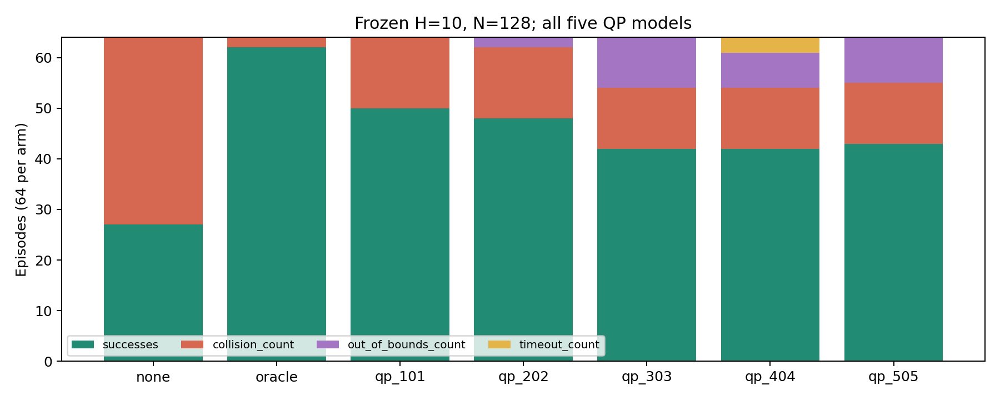
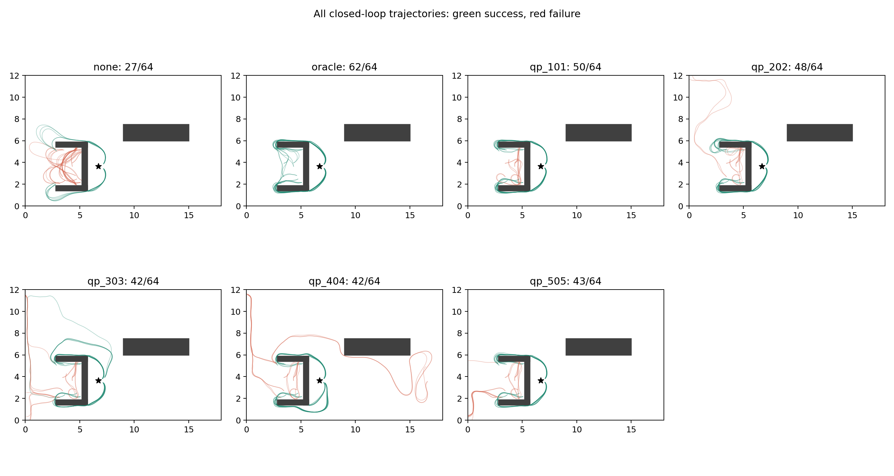

# Oracle、五个 QP 后 QRL 与无终值 MPPI 配对评估

全部 448 个 episode 完成；未重新训练、选择或修改任何 QRL checkpoint。所有组统一 horizon=10、128 条候选，其余参数沿用上一轮。

## 配置、可比性与 Oracle 定义

使用上一轮原样冻结的 32 个位置/heading 状态 × 两个 planner seed（314159、271828）。support / perturbed 各 24 次，holdout 16 次/组。holdout 是上一轮已评估的保留队列，本轮没有重新抽样，也没有据结果调参。相同初始 RNG 并不保证闭环分化后候选轨迹相同。

Oracle 文件原样移植自 `34d1c011f637b3352ac1dc1134650f6f28c20b17`。位置分辨率 0.25，heading 24 bins，5 步定控制原语，转向比例 [-1,-0.5,0,0.5,1]；反向 Dijkstra 求网格终值，最近网格查询，合法终态为零，不可达查询为 1e6。与 QRL 一样直接使用环境成本单位，不再乘 dt。采样器、碰撞判定和闭环执行复用当前实现。

这是拥有完整环境模型的离散格点参考，拥有四条数据以外的信息；它不是连续环境最优距离，也不是四路径记录图距离。端点吸附使网格成本不必对应可执行连续路径，因此表值不是连续最优成本的已证明上下界；Oracle-MPPI 成功轨迹的实际成本只是可行解成本。历史目录的 12/12 成功来自另一组主要朝西的起点与 RNG，不能与本表直接配对。

状态文件 SHA256：`3dd2df2d38abedf6e693a9b8d98a97a34a061c02856b849840642401cb45798f`。模型、成本/数据、代码指纹和软件版本见 `../manifest.json`；五个适配器验证见 `../adapter_validation.json`。

## 所有模型与失败分类

| 组别 | 成功 | 碰撞 | 越界 | 超时 | 成功成本均值 | 成功步数均值 |
|---|---|---|---|---|---|---|
| none | 27/64 (42.2%) | 37 (57.8%) | 0 (0.0%) | 0 (0.0%) | 147.014 | 52.741 |
| oracle | 62/64 (96.9%) | 2 (3.1%) | 0 (0.0%) | 0 (0.0%) | 171.184 | 64.903 |
| qp_101 | 50/64 (78.1%) | 14 (21.9%) | 0 (0.0%) | 0 (0.0%) | 152.308 | 59.720 |
| qp_202 | 48/64 (75.0%) | 14 (21.9%) | 2 (3.1%) | 0 (0.0%) | 157.972 | 59.896 |
| qp_303 | 42/64 (65.6%) | 12 (18.8%) | 10 (15.6%) | 0 (0.0%) | 201.550 | 65.976 |
| qp_404 | 42/64 (65.6%) | 12 (18.8%) | 7 (10.9%) | 3 (4.7%) | 162.780 | 63.238 |
| qp_505 | 43/64 (67.2%) | 12 (18.8%) | 9 (14.1%) | 0 (0.0%) | 147.324 | 58.605 |

五个 QRL 的汇总成功率为 225/320（70.3%）。这是五个模型在同一 64 个实例上的描述性汇总，不是 320 个独立起点。失败提前截断成本，不参与成本优劣排名；成功集合不同，下面另给共同成功实例的配对成本。

## 分层与阶段完成

| 组别 | support 成功 /24 | perturbed 成功 /24 | holdout 成功 /16 | 离开 U（适用实例） | 绕墙（适用实例） |
|---|---|---|---|---|---|
| none | 15 (62.5%) | 12 (50.0%) | 0 (0.0%) | 12/36 (33.3%) | 11/48 (22.9%) |
| oracle | 24 (100.0%) | 22 (91.7%) | 16 (100.0%) | 34/36 (94.4%) | 46/48 (95.8%) |
| qp_101 | 24 (100.0%) | 22 (91.7%) | 4 (25.0%) | 24/36 (66.7%) | 34/48 (70.8%) |
| qp_202 | 24 (100.0%) | 20 (83.3%) | 4 (25.0%) | 22/36 (61.1%) | 32/48 (66.7%) |
| qp_303 | 20 (83.3%) | 18 (75.0%) | 4 (25.0%) | 24/36 (66.7%) | 26/48 (54.2%) |
| qp_404 | 20 (83.3%) | 18 (75.0%) | 4 (25.0%) | 24/36 (66.7%) | 29/48 (60.4%) |
| qp_505 | 22 (91.7%) | 17 (70.8%) | 4 (25.0%) | 24/36 (66.7%) | 27/48 (56.2%) |

离开 U 只对初始位于内部的实例计分，并检查运动线段是否穿过西出口；绕墙只对初始未处于东侧的实例计分。合法终态完成率就是任务成功率；训练路径的中间状态不能因已经走过前一阶段而自动计为本轮新完成。

## 配对结果

以下“新增成功/失去成功”以左侧参考组为起点；成本差 = 右组 − 左组，只在双方成功时计算。

| 参考 → 对比 | 新增成功 | 失去成功 | 共同成功 | 共同成功成本差 | 共同成功步数差 |
|---|---|---|---|---|---|
| oracle → none | 0 | 35 | 27 | 49.605 | 8.852 |
| none → oracle | 35 | 0 | 27 | -49.605 | -8.852 |
| none → qp_101 | 23 | 0 | 27 | -49.815 | -8.630 |
| oracle → qp_101 | 0 | 12 | 50 | 1.225 | 0.560 |
| none → qp_202 | 21 | 0 | 27 | -47.415 | -8.630 |
| oracle → qp_202 | 0 | 14 | 48 | 10.745 | 1.917 |
| none → qp_303 | 18 | 3 | 24 | 40.878 | 3.542 |
| oracle → qp_303 | 0 | 20 | 42 | 57.382 | 8.500 |
| none → qp_404 | 18 | 3 | 24 | -14.654 | -2.250 |
| oracle → qp_404 | 0 | 20 | 42 | 18.979 | 5.833 |
| none → qp_505 | 18 | 2 | 25 | -45.986 | -7.720 |
| oracle → qp_505 | 0 | 19 | 43 | 2.470 | 0.977 |

## 计算开销

| 组别 | 在线 ms/决策 | 初始化合计秒 | MPPI rollout 数 | 实际模型一步转移数 |
|---|---|---|---|---|
| none | 6.017 | 0.002 | 383872 | 3554534 |
| oracle | 7.316 | 1.131 | 515328 | 4697871 |
| qp_101 | 18.378 | 0.001 | 442112 | 3984108 |
| qp_202 | 18.888 | 0.001 | 452864 | 4121385 |
| qp_303 | 17.993 | 0.002 | 486016 | 4424949 |
| qp_404 | 19.180 | 0.002 | 582784 | 5451069 |
| qp_505 | 17.348 | 0.001 | 420096 | 3776358 |

Oracle 冷建表 1.094 秒，网格 85848 个状态、363143 条非终态边；有效格点可达比例 96.1%。首次 episode 建表，后续复用内存缓存。另有 416616 次终值查询，其中 4387 次不可达（1.1%）。建表需额外模拟至多 85848×5×5=2,146,200 个格点原语时间步槽位，实际活动步会因无效/终态提前结束；此上限不是实测转移数，不包含在 MPPI rollout 列中。

在线时间含 rollout、终值评分和加权控制，不含一次性表构建；初始化单列。CPU 单线程/进程、最多四组并发，墙钟延迟受调度影响，不是独占硬件基准。每步均为 128 条候选，总量不同源自 episode 长度和终止原因。

## 固定候选评分

沿用上一轮 8 个开发 pose × 2 个 RNG，零 nominal，按本轮 H10/N128 重新生成 16 个批次。同一批次由七组分别评分，保存完整动作、终态、成本和权重。useful 定义为全程安全、完整 horizon、向西推进至少 0.25 且最终朝西；只是局部进展指标，不能证明后续能脱困。

| 组别 | 存在 useful 的批次数 | 这些批次 useful 权重均值 | 与 Oracle 安全候选 Spearman 均值 | 最大首控制差 |
|---|---|---|---|---|
| none | 12 | 0.357 | -0.034 | 1.777 |
| oracle | 12 | 0.509 | — | 0.000 |
| qp_101 | 12 | 0.333 | -0.351 | 2.346 |
| qp_202 | 12 | 0.333 | -0.363 | 2.862 |
| qp_303 | 12 | 0.333 | -0.294 | 2.201 |
| qp_404 | 12 | 0.333 | -0.289 | 2.808 |
| qp_505 | 12 | 0.333 | -0.290 | 2.926 |

16 个批次中，2 批完全没有安全候选，4 批没有符合上述定义的西向进展候选。价值函数无法选择未采到的轨迹；MPPI 的加权平均首动作也不等于选择单条安全候选。

## 验证、复现与产物

22 项测试通过，包括历史 Oracle 文件逐字节一致、provider 控制输出一致、缓存失效/终态零/成本单位、既有 MPPI 回归与真实环境 rollout 一致性。正式运行前每组做 3 步 smoke；全部 25649 次真实执行动作已重新回放，状态和奖励误差均为零，终止分类和合法终态核验通过。五个 checkpoint 文件及推理参数前后哈希不变。

运行命令和冻结规则见 `../../../../experiments/four_path_oracle_execution/PROTOCOL.md`。每组原始 JSONL、逐步 NPZ、所有失败均在 `../arms/`；`summary.json` / `episodes.csv` 提供机器可读汇总，`../candidates/` 为候选评分，`../replay_audit.json` 为完整回放核验。
## 解释与下一步

在完全相同的 H10/N128 执行器下，Oracle 为 62/64，五个 QRL 为 225/320，无终值为 27/64。Oracle 在 support 和 holdout 均全成功，五个 QRL 的 holdout 均为 4/16。说明该配置的采样/控制器能够在这些保留状态上完成任务；QRL 与 Oracle 的差距不能全部归咎于 horizon 或候选数不足。证据更支持四路径之外的 heading/状态价值结构与候选排序仍有缺口，但本实验不能把表示容量、训练数据覆盖和优化误差分离。

在双方均成功的配对中，五个 QRL 相对 Oracle 的平均成本差都为正，101 最接近（+1.225），303 最大（+57.382）。Oracle 独有成功覆盖了更难的起点，因此不能用其全体成功成本 171.184 高于部分 QRL 的均值来判定 Oracle 更差。

候选诊断同时揭示两种限制：朝东的深 U 开发点两批都没有安全候选；朝北/朝南的八批却有 5–8 条安全西向进展候选，QRL 给它们的总权重均低于 1e-5。Oracle 在朝南四批分配约 0.043–0.994 的权重，在朝北四批仅约 0.010–0.014；不能把“西向进展”启发式本身当作正确控制标签。模型与 Oracle 的安全候选排序平均负相关，是局部评分结构不同的证据，不是连续最优性的证明。

下一步宜将离轨 heading 的终值排序/局部下降方向审计与候选覆盖审计分开：先用这些已保存批次定位错误排序，再在独立冻结测试集上验证修正。对于全无安全候选的边界状态，可另行评估统一的控制原语候选或安全恢复策略；本轮没有修改采样器或给 Oracle 特殊控制。不要再将记录图联合门槛通过等同于闭环执行成功。

上一轮 H20/N256 的 QP 汇总为 211/320，本轮 H10/N128 为 225/320；这是两个配置字段一起变化的描述性对照，不能单独归因为缩短 horizon 或减少候选数，更不能据此按模型挑选超参数。

## 历史等价性与 Oracle 两次失败的事后核查

本轮新建表与用户指定历史缓存的全部 value 元素逐位相同：True，有限值最大差 0.0；环境/格点签名一致。详情见 `../oracle_audit/historical_cache_comparison.json`。

两次失败均为 `path2_west_exit_perturbed`，初态 [2.91515, 1.92077, -2.72330]，第一步碰撞。两批 128 条候选均没有完整安全的 H10 轨迹；314159 中仅 1 条候选首步安全，271828 中为 0 条。所有候选都被标为 invalid，因此不会调用 Oracle 终值，当前加权控制最终仍碰撞。

事后固定施加合法控制 omega=-3 两步可安全到达 [2.71750, 1.92704, 2.95989]，说明第一步碰撞并非这个位置/heading 的必然结果。这只是两步恢复见证，不证明整项巡检能完成；它未加入正式候选，也没有触发重跑或调参。失败批次和对照保存在 `../oracle_audit/`。

