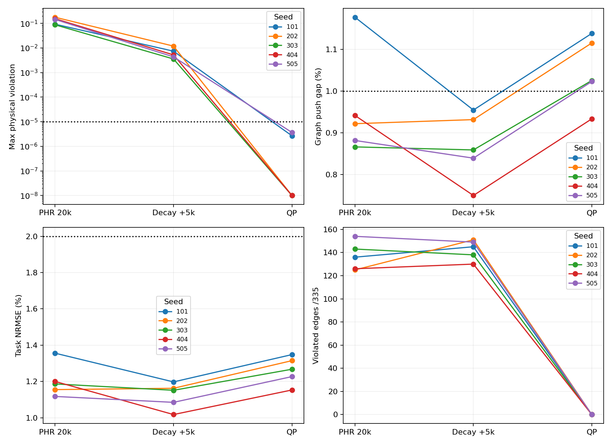
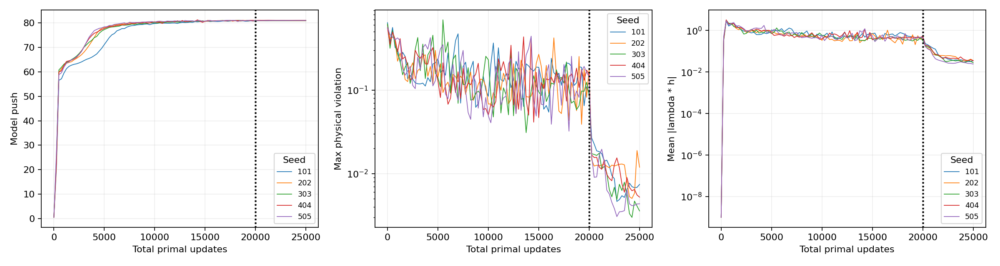

# 四路径固定流程的五个新初始化复现（2026-10-17）

最终审计：**1/5通过联合门槛**，成功seed为[404]。PHR后、降步长后、QP后分别通过0/5、0/5、1/5。分母始终是101、202、303、404、505，不替换失败seed。本次结果不支持“固定流程可稳定重复找到通过解”；旧checkpoint的成功仍是存在性证据。

原版冻结运行的联合通过率为 **1/5**，两个seed（202、303）在QP第0轮触发Gram半正定断言，完整失败日志保留。排查发现，四项展开式在相减时产生数值误差：最小/最大特征值比为−1.49×10⁻¹⁰、−1.60×10⁻¹⁰，略超原1e-10阈值。没有放宽阈值，而是在检查失败时直接累加显式Jacobian分块的PSD内积。与原展开Gram相差的相对范数为7.37×10⁻¹⁰、7.81×10⁻¹⁰，独立参数空间二次型检查相对误差小于2.2×10⁻¹³。详见[数值诊断](../../gram_diagnosis.json)。

统一修复后，对**全部五个seed**都从各自原始decay.pt重新执行完全相同预算的QP；没有重新训练、改δ、改容差、加预算或替换seed。原正常完成的404、505得到逐位相同模型；101未触发回退，但重跑从3轮变为2轮，最终push差−3.05×10⁻⁵、参数差L2=1.83×10⁻⁴，联合失败结论不变。这里没有假定多线程CPU及近奇异Gram分解逐位可复现，已记录这一数值敏感性。数值修复是看到运行错误后作出的实现修正，因此上报原版与修正版两组结果，不声称修正版结果是完全未经事后修正的预登记结果。修正版源码、来源checkpoint哈希及日志保存在[数值修复清单](../../qp_numerical_fix/manifest.json)。

| seed | 原进程exit | 原QP结果/停止原因 | 原push gap % | 原联合门槛 |
|---|---|---|---|---|
| 101 | 0 | feasible_with_value_guard | 1.13796 | 失败 |
| 202 | 1 | Gram PSD断言 | 未完成 | 失败 |
| 303 | 1 | Gram PSD断言 | 未完成 | 失败 |
| 404 | 0 | feasible_with_value_guard | 0.93318 | 通过 |
| 505 | 0 | feasible_with_value_guard | 1.02263 | 失败 |


## 三个固定阶段的完整结果

| seed | 阶段 | push | push gap % | task NRMSE % | 最大有符号h | 违反边/335 | 严格h≤0 | 联合门槛 |
|---|---|---|---|---|---|---|---|---|
| 101 | phr | 80.65700 | 1.1767 | 1.3558 | +0.09271598 | 136 | 否 | 失败 |
| 101 | decay | 80.83855 | 0.9543 | 1.1975 | +0.00740480 | 145 | 否 | 失败 |
| 101 | qp | 80.68858 | 1.1380 | 1.3480 | +0.00000268 | 0 | 否 | 失败 |
| 202 | phr | 80.86524 | 0.9216 | 1.1551 | +0.17767379 | 125 | 否 | 失败 |
| 202 | decay | 80.85727 | 0.9313 | 1.1623 | +0.01190424 | 151 | 否 | 失败 |
| 202 | qp | 80.70732 | 1.1150 | 1.3147 | -0.00001740 | 0 | 是 | 失败 |
| 303 | phr | 80.91064 | 0.8659 | 1.1864 | +0.08751602 | 143 | 否 | 失败 |
| 303 | decay | 80.91661 | 0.8586 | 1.1513 | +0.00356722 | 138 | 否 | 失败 |
| 303 | qp | 80.78072 | 1.0251 | 1.2674 | -0.00001810 | 0 | 是 | 失败 |
| 404 | phr | 80.84920 | 0.9412 | 1.2000 | +0.15513629 | 126 | 否 | 失败 |
| 404 | decay | 81.00570 | 0.7495 | 1.0176 | +0.00522256 | 130 | 否 | 失败 |
| 404 | qp | 80.85575 | 0.9332 | 1.1530 | -0.00000888 | 0 | 是 | 通过 |
| 505 | phr | 80.89809 | 0.8813 | 1.1174 | +0.14489460 | 154 | 否 | 失败 |
| 505 | decay | 80.93269 | 0.8389 | 1.0848 | +0.00434518 | 149 | 否 | 失败 |
| 505 | qp | 80.78275 | 1.0226 | 1.2267 | +0.00000367 | 0 | 否 | 失败 |


门槛保持不变：物理边最大正残差≤1e-5、终态与anchor≤1e-6、同采样支持push gap≤1%、task NRMSE≤2%。严格可行单独按float32前向max h≤0判断，容差内正残差不能称严格可行，浮点检查也不是实数算术证明。记录图参考push=81.617389992，只用于结束后的评估，不是连续环境最优距离。详见[CSV](summary.csv)、[独立审计](independent_audit.json)。

| seed | 最终模型自身停止原因 | 未通过项 |
|---|---|---|
| 101 | feasible_with_value_guard | push gap |
| 202 | feasible_with_value_guard | push gap |
| 303 | feasible_with_value_guard | push gap |
| 404 | feasible_with_value_guard | 通过 |
| 505 | feasible_with_value_guard | push gap |




违反量对数轴把零画在1e-8处，仅用于显示；有符号原值见表。

## 固定价值保护与阶段作用

| seed | 降步长终点push | 固定push下限 | QP终点push | 实际push损失 | Σ接受步参数L2 |
|---|---|---|---|---|---|
| 101 | 80.838554 | 80.688554 | 80.688583 | 0.149971 | 0.019914 |
| 202 | 80.857269 | 80.707269 | 80.707321 | 0.149948 | 0.025323 |
| 303 | 80.916611 | 80.766611 | 80.780716 | 0.135895 | 0.005616 |
| 404 | 81.005699 | 80.855699 | 80.855751 | 0.149948 | 0.016778 |
| 505 | 80.932686 | 80.782686 | 80.782745 | 0.149940 | 0.009546 |


δ始终为绝对0.15。价值下限只来自各模型的降步长终点，既不读取图参考，也不按seed重选。本次降步长后的五个模型均已满足push gap≤1%与task NRMSE≤2%，但局部边仍不可行；QP后五个模型都满足可行容差，其中202、303、404严格非正，另外两个保留容差内微小正残差。全部task NRMSE仍通过，四个失败均来自push gap。

独立评估给出的1% push门槛为80.801216092。五个修复起点距离这一门槛的余量依次仅0.037338、0.056053、0.115395、0.204483、0.131470，实际修复损失约0.136–0.150；只有404有足够余量。因此主要暴露的是当前恢复步骤的价值消耗与起点余量之间的耦合，而不是单纯“修不到局部可行”。R0最小化参数改动，并不最小化push损失；0.15模型保护条件也不保证独立参考的1%门槛。该参考余量仅在结束后分析，未用于停止、修改δ或重跑选择。不能据此断言更小损失的可行解不存在。

建议下一轮把“降步长阶段已展开多少价值”与“修复消耗多少模型push”作为两个问题。首先验证统一预算下更充分的primal/PHR子问题优化或固定的模型push上升策略，再冻结另一套流程，在新的独立初始化上检验。当前5个seed保留为诊断集；不要用它们逐个调δ或修复预算后重新宣称本次成功。局部修复停滞也不证明不存在高价值可行解。



训练曲线只记录模型push、一步约束残差与互补性，没有图参考驱动停止。全边乘子互补性均值/最大值见CSV与审计JSON；QP保留训练乘子，这些量是诊断，不是QP重新求得的KKT证书。

| seed | 阶段 | 平均参数更新L2 | 最大L2 | 末250步平均L2 | 最大L∞ |
|---|---|---|---|---|---|
| 101 | phr | 0.003482397 | 0.02348202 | 0.001832984 | 0.0001429836 |
| 101 | decay | 7.525001e-05 | 0.0007874271 | 3.13618e-05 | 9.843148e-06 |
| 202 | phr | 0.003014729 | 0.02435552 | 0.001990417 | 0.0001386832 |
| 202 | decay | 6.236394e-05 | 0.0003886006 | 3.678213e-05 | 8.687377e-06 |
| 303 | phr | 0.003067574 | 0.02490394 | 0.001707813 | 0.0001404439 |
| 303 | decay | 8.958488e-05 | 0.0006179425 | 2.93214e-05 | 8.595176e-06 |
| 404 | phr | 0.002989644 | 0.0236455 | 0.002018292 | 0.0001369175 |
| 404 | decay | 0.0001027175 | 0.000628115 | 4.07701e-05 | 9.201467e-06 |
| 505 | phr | 0.003024047 | 0.02285837 | 0.001900141 | 0.0001404174 |
| 505 | decay | 7.29005e-05 | 0.0003741838 | 2.717686e-05 | 7.262453e-06 |


## 冻结支持、初始化与停止隔离

[原始预登记协议](../source_snapshot/experiments/four_path_reproducibility/PROTOCOL.md)：同一四路径bank、完整42D规范状态的336节点、335物理边+4 anchor、终态quotient、task/B1配对与一步成本。B1数据seed固定42，与网络seed无关。[数据指纹](data_fingerprints.json)全部一致。

每个seed通过生产QuasimetricCritic构造器从头初始化encoder、projector、IQE；没有加载旧critic，Adam为空，339个逐边乘子为零。[完整模型/encoder/projector/表示哈希](initialization_hashes.json)均五份不同。测试在禁止torch.load时仍创建五份新模型，同seed可重建相同参数。

PHR固定20k全量primal/dual更新，AdamW lr2e-5、wd0、ρ100、λ←[λ+h_pre]+；接着5k仅把全部primal学习率按2e-6×0.1^((j−1)/4999)降至2e-7，保留Adam状态及乘子。QP固定最终projector整层1,050,624个参数，全339边加模型push下限，R0方向目标为零；最多40轮、每次2000 sweeps、信赖半径0.1、内部余量5e-5、13级回溯、elastic fallback100。真实非线性前向检查所有候选，允许不可行起点恢复，连续3轮无接受步则停止。

停止调整已经先提交`7bdabd0`。QP只使用全边可行性、固定模型push下限和迭代/停滞预算选择终点，保存模型后才评估图参考；低价值但可行的模型正常停止，随后记为联合失败。原版失败进程在错误结束后进行独立审计，不借参考挑选中间模型；数值修复重跑统一从既定decay终点开始。三阶段评估均在运行结束后进行。没有使用图距离、累计成本或LP multiplier作为训练标签。

## 每条路径及进入终态的边

| seed | 阶段 | 路径 | 起点估值 | 记录图参考 | Σ正残差 | Σ三角余量 |
|---|---|---|---|---|---|---|
| 101 | phr | 0 | 192.77774 | 194.48878 | 0.2793986 | 0.4144703 |
| 101 | phr | 1 | 209.40175 | 213.11611 | 0.3795250 | 0.1858571 |
| 101 | phr | 2 | 257.63638 | 259.06265 | 0.4556002 | 0.2291653 |
| 101 | phr | 3 | 266.37982 | 270.54802 | 0.2798669 | 0.9421152 |
| 101 | decay | 0 | 193.11195 | 194.48878 | 0.0381910 | 0.1426870 |
| 101 | decay | 1 | 209.61452 | 213.11611 | 0.0351739 | 0.0068692 |
| 101 | decay | 2 | 258.15186 | 259.06265 | 0.0398409 | 0.0084139 |
| 101 | decay | 3 | 266.60767 | 270.54802 | 0.0304196 | 0.7089424 |
| 101 | qp | 0 | 192.80336 | 194.48878 | 0.0000027 | 0.1446474 |
| 101 | qp | 1 | 209.23624 | 213.11611 | 0.0000000 | 0.0069478 |
| 101 | qp | 2 | 257.71323 | 259.06265 | 0.0000000 | 0.0110701 |
| 101 | qp | 3 | 266.12662 | 270.54802 | 0.0000000 | 0.7073050 |
| 202 | phr | 0 | 192.69189 | 194.48878 | 0.2039252 | 0.0472729 |
| 202 | phr | 1 | 210.43172 | 213.11611 | 0.4030236 | 0.0021246 |
| 202 | phr | 2 | 257.72372 | 259.06265 | 0.4432859 | 0.0110567 |
| 202 | phr | 3 | 267.33859 | 270.54802 | 0.2997112 | 0.3457229 |
| 202 | decay | 0 | 192.59013 | 194.48878 | 0.0310631 | 0.0115483 |
| 202 | decay | 1 | 210.37723 | 213.11611 | 0.0258907 | 0.0016946 |
| 202 | decay | 2 | 257.79089 | 259.06265 | 0.0618823 | 0.0108795 |
| 202 | decay | 3 | 267.26770 | 270.54802 | 0.0471182 | 0.4382534 |
| 202 | qp | 0 | 192.23302 | 194.48878 | 0.0000000 | 0.0111182 |
| 202 | qp | 1 | 209.97055 | 213.11611 | 0.0000000 | 0.0021658 |
| 202 | qp | 2 | 257.19562 | 259.06265 | 0.0000000 | 0.0108966 |
| 202 | qp | 3 | 266.66876 | 270.54802 | 0.0000000 | 0.4399831 |
| 303 | phr | 0 | 193.25792 | 194.48878 | 0.1560630 | 0.0014117 |
| 303 | phr | 1 | 209.04816 | 213.11611 | 0.1820472 | 0.0079302 |
| 303 | phr | 2 | 258.54794 | 259.06265 | 0.4525285 | 0.0393336 |
| 303 | phr | 3 | 266.35324 | 270.54802 | 0.3358968 | 0.5727536 |
| 303 | decay | 0 | 193.31441 | 194.48878 | 0.0406593 | 0.0006629 |
| 303 | decay | 1 | 209.14336 | 213.11611 | 0.0346723 | 0.0061085 |
| 303 | decay | 2 | 258.30737 | 259.06265 | 0.0183609 | 0.0407946 |
| 303 | decay | 3 | 266.44968 | 270.54802 | 0.0156260 | 0.5474102 |
| 303 | qp | 0 | 193.01486 | 194.48878 | 0.0000000 | 0.0015469 |
| 303 | qp | 1 | 208.86917 | 213.11611 | 0.0000000 | 0.0102298 |
| 303 | qp | 2 | 257.97189 | 259.06265 | 0.0000000 | 0.0425107 |
| 303 | qp | 3 | 266.13910 | 270.54802 | 0.0000000 | 0.5583858 |
| 404 | phr | 0 | 193.08983 | 194.48878 | 0.1819866 | 0.0358669 |
| 404 | phr | 1 | 209.46912 | 213.11611 | 0.2114651 | 0.0006360 |
| 404 | phr | 2 | 259.03076 | 259.06265 | 0.5169266 | 0.0002370 |
| 404 | phr | 3 | 266.86008 | 270.54802 | 0.3369279 | 0.4268950 |
| 404 | decay | 0 | 193.32736 | 194.48878 | 0.0633247 | 0.0239828 |
| 404 | decay | 1 | 209.88391 | 213.11611 | 0.0179414 | 0.0004434 |
| 404 | decay | 2 | 258.96106 | 259.06265 | 0.0292812 | 0.0002308 |
| 404 | decay | 3 | 267.27277 | 270.54802 | 0.0224443 | 0.4938670 |
| 404 | qp | 0 | 193.01807 | 194.48878 | 0.0000000 | 0.0243322 |
| 404 | qp | 1 | 209.55911 | 213.11611 | 0.0000000 | 0.0011645 |
| 404 | qp | 2 | 258.59402 | 259.06265 | 0.0000000 | 0.0004742 |
| 404 | qp | 3 | 266.89154 | 270.54802 | 0.0000000 | 0.5032250 |
| 505 | phr | 0 | 193.18260 | 194.48878 | 0.3400247 | 0.1503528 |
| 505 | phr | 1 | 209.85162 | 213.11611 | 0.3991887 | 0.0002237 |
| 505 | phr | 2 | 258.26700 | 259.06265 | 0.3698038 | 0.0150405 |
| 505 | phr | 3 | 267.27982 | 270.54802 | 0.4831056 | 0.4296873 |
| 505 | decay | 0 | 193.34834 | 194.48878 | 0.0468014 | 0.1255374 |
| 505 | decay | 1 | 210.09178 | 213.11611 | 0.0265888 | -0.0000306 |
| 505 | decay | 2 | 258.35370 | 259.06265 | 0.0216589 | 0.0000233 |
| 505 | decay | 3 | 267.25809 | 270.54802 | 0.0097354 | 0.4991438 |
| 505 | qp | 0 | 193.02164 | 194.48878 | 0.0000000 | 0.1266447 |
| 505 | qp | 1 | 209.75394 | 213.11611 | 0.0000000 | 0.0004874 |
| 505 | qp | 2 | 257.98785 | 259.06265 | 0.0000000 | 0.0004259 |
| 505 | qp | 3 | 266.88028 | 270.54802 | 0.0000037 | 0.5028948 |


四条进入终态的物理边成本均0.1；终态自距离为零不代替入口边检查。终态/anchor残差另保存在CSV，逐节点路径值及全339边数组在本目录`seed_*_values.json`、`seed_*_edges.npz`。

| seed | 阶段 | 路径 | replay row | 入口有符号残差 |
|---|---|---|---|---|
| 101 | phr | 0 | 71 | -0.05202216 |
| 101 | phr | 1 | 148 | -0.10000000 |
| 101 | phr | 2 | 240 | -0.10000000 |
| 101 | phr | 3 | 337 | -0.02791254 |
| 101 | decay | 0 | 71 | -0.00103582 |
| 101 | decay | 1 | 148 | +0.00059179 |
| 101 | decay | 2 | 240 | -0.00016859 |
| 101 | decay | 3 | 337 | +0.00096053 |
| 101 | qp | 0 | 71 | -0.00196753 |
| 101 | qp | 1 | 148 | -0.00139649 |
| 101 | qp | 2 | 240 | -0.00001033 |
| 101 | qp | 3 | 337 | -0.00015317 |
| 202 | phr | 0 | 71 | +0.07039390 |
| 202 | phr | 1 | 148 | +0.17767379 |
| 202 | phr | 2 | 240 | +0.10564300 |
| 202 | phr | 3 | 337 | +0.07729209 |
| 202 | decay | 0 | 71 | +0.00048957 |
| 202 | decay | 1 | 148 | -0.00033750 |
| 202 | decay | 2 | 240 | -0.00004179 |
| 202 | decay | 3 | 337 | +0.00042902 |
| 202 | qp | 0 | 71 | -0.00012843 |
| 202 | qp | 1 | 148 | -0.00105895 |
| 202 | qp | 2 | 240 | -0.00004594 |
| 202 | qp | 3 | 337 | -0.00020408 |
| 303 | phr | 0 | 71 | +0.05060332 |
| 303 | phr | 1 | 148 | +0.08751602 |
| 303 | phr | 2 | 240 | +0.06987143 |
| 303 | phr | 3 | 337 | +0.01616156 |
| 303 | decay | 0 | 71 | +0.00136817 |
| 303 | decay | 1 | 148 | +0.00005253 |
| 303 | decay | 2 | 240 | -0.00147501 |
| 303 | decay | 3 | 337 | -0.00096440 |
| 303 | qp | 0 | 71 | -0.00001810 |
| 303 | qp | 1 | 148 | -0.00050110 |
| 303 | qp | 2 | 240 | -0.00182866 |
| 303 | qp | 3 | 337 | -0.00129312 |
| 404 | phr | 0 | 71 | +0.09095012 |
| 404 | phr | 1 | 148 | +0.09533130 |
| 404 | phr | 2 | 240 | +0.15513629 |
| 404 | phr | 3 | 337 | +0.05018852 |
| 404 | decay | 0 | 71 | +0.00009279 |
| 404 | decay | 1 | 148 | -0.00003745 |
| 404 | decay | 2 | 240 | -0.00006244 |
| 404 | decay | 3 | 337 | +0.00022735 |
| 404 | qp | 0 | 71 | -0.00005469 |
| 404 | qp | 1 | 148 | -0.00353132 |
| 404 | qp | 2 | 240 | -0.00009253 |
| 404 | qp | 3 | 337 | -0.00022151 |
| 505 | phr | 0 | 71 | +0.00198606 |
| 505 | phr | 1 | 148 | +0.14489460 |
| 505 | phr | 2 | 240 | -0.01623960 |
| 505 | phr | 3 | 337 | +0.03144278 |
| 505 | decay | 0 | 71 | +0.00113578 |
| 505 | decay | 1 | 148 | -0.00031028 |
| 505 | decay | 2 | 240 | -0.00079637 |
| 505 | decay | 3 | 337 | +0.00007039 |
| 505 | qp | 0 | 71 | -0.00009460 |
| 505 | qp | 1 | 148 | -0.00135904 |
| 505 | qp | 2 | 240 | -0.00263494 |
| 505 | qp | 3 | 337 | +0.00000367 |


## 实际预算与复现

| seed | PHR步 | 降步长步 | QP轮 | 接受步 | QP求解次数 | 候选前向 | Gram回退次数 | PHR秒 | 降步长秒 | 最终QP秒 |
|---|---|---|---|---|---|---|---|---|---|---|
| 101 | 20000 | 5000 | 2 | 2 | 2 | 2 | 0 | 1958.7 | 439.9 | 2.1 |
| 202 | 20000 | 5000 | 4 | 4 | 4 | 4 | 4 | 1963.5 | 441.8 | 8.0 |
| 303 | 20000 | 5000 | 2 | 2 | 2 | 2 | 2 | 1959.3 | 445.5 | 3.9 |
| 404 | 20000 | 5000 | 2 | 2 | 2 | 2 | 0 | 1947.7 | 439.0 | 2.2 |
| 505 | 20000 | 5000 | 4 | 4 | 4 | 15 | 0 | 1930.1 | 438.7 | 3.7 |


五个seed共执行125000次primal、125000次dual更新；没有训练重跑。各进程CPU torch线程2，并发执行，表内秒数是各阶段墙钟、不能直接当独占CPU耗时。原版suite墙钟2414.0秒；最后一列仅计最终QP，原版QP/失败日志仍保留。统一数值修复重跑suite墙钟12.1秒。 独立smoke seed9001执行20+20更新与2轮QP，不计成功率，也未用于调参。

审计重载所有初始化、PHR、decay及正常完成的QP终点，核对数据/代码/checkpoint哈希、Adam步数20k/25k、25k更新序列/学习率、阶段边界模型指标连续、固定push下限、所有接受候选的价值保护、最终全边数组与联合门槛。原三个完整进程还核对已记录的边界Adam/乘子哈希；两个原中断进程没有生成summary，不虚构这项记录，状态保留由共同训练代码及连续性测试验证。相关测试23项通过，见[测试输出](../../validation_final.txt)。旧实验产物均未覆盖。

当前实现可直接从头复现，输出目录须不存在：

```sh
export MPLCONFIGDIR=/tmp/qrl-factorial-mpl OMP_NUM_THREADS=2 OPENBLAS_NUM_THREADS=2
PY=../quasimetric-rl/.venv/bin/python
$PY -m pytest experiments/four_path_reproducibility experiments/four_path_refinement/test_refinement.py experiments/four_path_factorial/test_factorial.py -q
$PY -m experiments.four_path_reproducibility.suite --smoke --output results/NEW_RUN/smoke
$PY -m experiments.four_path_reproducibility.suite --output results/NEW_RUN/main
$PY -m experiments.four_path_reproducibility.summarize --root results/NEW_RUN/main
```

本次在保留原运行基础上的数值修复/审计命令：

```sh
$PY -m experiments.four_path_reproducibility.rerun_qp --source results/four_path_reproducibility_20261016/main --output results/four_path_reproducibility_20261016/qp_numerical_fix
$PY -m experiments.four_path_reproducibility.summarize --root results/four_path_reproducibility_20261016/main --corrected results/four_path_reproducibility_20261016/qp_numerical_fix
```

仅检验固定四路径经验图，不外推到新成本尺度或连续环境最优性。源代码与轻量结果进入本次提交；大体积checkpoint和逐步更新日志留在上述本地结果目录，可按命令重新生成。
