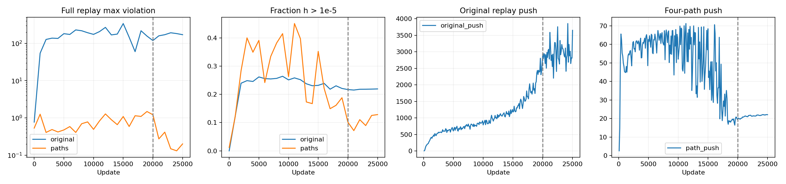
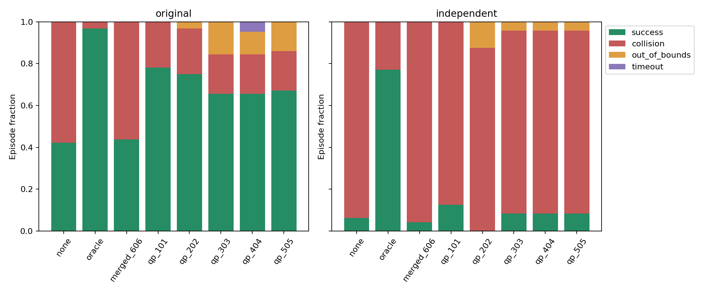

# 完整 20 万转移＋四路径：单 seed 训练与冻结 MPPI 实验

仅训练 seed 606 的合并数据组，从独立初始化开始。固定完成 20,000 步 PHR 与 5,000 步降步长；未新增采集数据、未训练原始 replay 单独对照、未按 Oracle/图参考选 checkpoint。

**结论：本次合并数据训练没有改善泛化，且未能恢复四路径的长程价值结构。** 原状态集为 28/64（既有五个四路径模型合计 225/320）；原 holdout 为 0/16（既有五个均为 4/16）；新独立集为 2/48，No Terminal 为 3/48，既有四路径五模型合计 18/240，Oracle 为 37/48。小样本差异不作显著性宣称。记录边可行性和四路径估值也同时失败，因此这不是一次已恢复约束后检验纯泛化上限的实验。

## 数据、训练和边界

合并 200,000＋335 条物理转移及 748＋4 条零成本 anchor，共 201,087 条约束、200,665 个规范节点。完整动力学、合法 anchor、一步成本与 B1 轨迹边界审计通过；一步成本重算最大绝对差 2.60e-5，训练使用未经改写的原始奖励。各任务条件全部保留，没有把其他设备任务重标为 U-trap。

每步 256 条原始物理边（轮末较小 batch，无放回遍历）＋全部四路径边；两个来源的 push 与 PHR 各占 50%。每个来源 push 为 0.6 task(all)＋0.4 固定 B1。四路径 B1 与历史完全一致；原始 B1 单独按 seed 42 重建。均匀混合时路径物理边仅约占 0.167%，固定分层权重用于避免其长程信号被淹没。

共享 production encoder/projector/IQE，rho=100、逐记录边独立 multiplier、访问时 eta=1 更新。原始 multiplier 的更新频次低于四路径；这与小图全边 PHR 不同。没有大规模 QP。原始零 anchor 在 quotient 后恒等，训练可省略其零项，所有 anchor 仍纳入全量检查。

原始边每条访问 31–32 次，平均 31.970 次；四路径每条参与 25,000 次。每 1,000 步全量检查。主阶段 lr=2e-5，后 5,000 步从 2e-6 指数降至 2e-7，Adam 历史连续保留。训练墙钟约 31.4 分钟。

## 全量约束与长程记录图

| 来源 | 物理边 | h>1e-5 | 最大正残差 | 平均正残差 |
|---|---:|---:|---:|---:|
| original | 200000 | 43845 | 171.253 | 0.932728 |
| paths | 335 | 43 | 0.200007 | 0.00607408 |

| 进入终态的边 | 边数 | h>1e-5 | 最大正残差 |
|---|---:|---:|---:|
| original_terminal_entry | 14 | 12 | 171.253052 |
| path_terminal_entry | 4 | 2 | 0.022325 |

全部 anchor 最大绝对残差 0。约束容差没有放宽；有违反就不能称作完成记录图近似恢复。
四路径 task RMSE=104.586，NRMSE=85.354%；push=22.060，图参考=81.617，gap=72.972%。这些指标单独在四路径上计算，不把大 replay 的无终态链状态当作有限图标签。为与旧实验一致，此处 task RMSE 将四个零终态计入分母；下表物理 source RMSE 不含这四个零值，所以略有不同。

| 图检查子集 | 状态数 | 有记录终态链 | 无记录终态链 | 有限参考 RMSE |
|---|---:|---:|---:|---:|
| original | 200000 | 2586 | 197414 | 339.462 |
| paths | 335 | 335 | 0 | 105.209 |
| original_U | 6407 | 0 | 6407 | — |
| paths_U | 61 | 61 | 0 | 201.326 |

严格图只连接逐字节相同的完整规范状态，没有增加近邻边或位置取整。无记录链表示没有数据内的绝对路径上界，不表示真实环境不可达。B1 的记录片段成本另存为上界，不默认它就是最短路。所有图计算发生在 final checkpoint 固定之后。

## 闭环成功与所有失败

MPPI 保持 H10/N128，噪声、温度、终值权重、碰撞判定、环境成本与合法任务终态定义均不变。两个 planner seed 为 314159、271828。原有 32 状态的七个基线按数据/代码/模型指纹复用；新模型重新运行 64 次。独立测试为预先冻结的 24 个 U 内状态，八个 heading 分层；八组均运行 48 次。两个集合分别报告。

### original

| 组别 | 成功 | 碰撞 | 越界 | 超时 | 成功成本均值 |
|---|---:|---:|---:|---:|---:|
| none | 27/64 (42.2%) | 37 | 0 | 0 | 147.014 |
| oracle | 62/64 (96.9%) | 2 | 0 | 0 | 171.184 |
| merged_606 | 28/64 (43.8%) | 36 | 0 | 0 | 106.993 |
| qp_101 | 50/64 (78.1%) | 14 | 0 | 0 | 152.308 |
| qp_202 | 48/64 (75.0%) | 14 | 2 | 0 | 157.972 |
| qp_303 | 42/64 (65.6%) | 12 | 10 | 0 | 201.550 |
| qp_404 | 42/64 (65.6%) | 12 | 7 | 3 | 162.780 |
| qp_505 | 43/64 (67.2%) | 12 | 9 | 0 | 147.324 |

### independent

| 组别 | 成功 | 碰撞 | 越界 | 超时 | 成功成本均值 |
|---|---:|---:|---:|---:|---:|
| none | 3/48 (6.2%) | 45 | 0 | 0 | 294.728 |
| oracle | 37/48 (77.1%) | 11 | 0 | 0 | 244.417 |
| merged_606 | 2/48 (4.2%) | 46 | 0 | 0 | 224.218 |
| qp_101 | 6/48 (12.5%) | 42 | 0 | 0 | 215.559 |
| qp_202 | 0/48 (0.0%) | 42 | 6 | 0 | — |
| qp_303 | 4/48 (8.3%) | 42 | 2 | 0 | 210.853 |
| qp_404 | 4/48 (8.3%) | 42 | 2 | 0 | 216.900 |
| qp_505 | 4/48 (8.3%) | 42 | 2 | 0 | 212.723 |

| 组别 | 原 support /24 | 原 perturbed /24 | 原 holdout /16 |
|---|---:|---:|---:|
| none | 15 | 12 | 0 |
| oracle | 24 | 22 | 16 |
| merged_606 | 16 | 12 | 0 |
| qp_101 | 24 | 22 | 4 |
| qp_202 | 24 | 20 | 4 |
| qp_303 | 20 | 18 | 4 |
| qp_404 | 20 | 18 | 4 |
| qp_505 | 22 | 17 | 4 |

失败的提前截断成本不用于成本优劣排名。下表成本差只比较共同成功实例；新增/失去成功以参考组为起点。

| 集合 | 参考 → merged_606 | 新增成功 | 失去成功 | 共同成功 | 共同成功成本差 |
|---|---|---:|---:|---:|---:|
| original | none | 1 | 0 | 27 | -43.308 |
| original | oracle | 0 | 34 | 28 | 6.317 |
| original | qp_101 | 0 | 22 | 28 | 6.685 |
| original | qp_202 | 0 | 20 | 28 | 3.713 |
| original | qp_303 | 3 | 17 | 25 | -83.949 |
| original | qp_404 | 4 | 18 | 24 | -4.885 |
| original | qp_505 | 2 | 17 | 26 | 4.588 |
| independent | none | 0 | 1 | 2 | -34.429 |
| independent | oracle | 0 | 35 | 2 | 7.536 |
| independent | qp_101 | 0 | 4 | 2 | 3.444 |
| independent | qp_202 | 2 | 0 | 0 | — |
| independent | qp_303 | 2 | 4 | 0 | — |
| independent | qp_404 | 2 | 4 | 0 | — |
| independent | qp_505 | 2 | 4 | 0 | — |

## 固定候选评分与未见状态估值

沿用 16 个开发候选批次，并对 24 个独立状态×2 RNG 生成 48 个独立候选批次。每批动作和模拟结果固定，由所有八组评分；保存全部成本、权重和轨迹。safe 指 horizon 内无碰撞/越界，useful 指完整安全 horizon、向西至少 0.25 且末态朝西，只是局部进展启发式。Spearman 比较同一批安全候选与 Oracle 的总成本排序。

| 候选集合 | 组别 | 无 safe 批次 | 有 useful 批次 | useful 权重均值 | 与 Oracle Spearman | 首动作安全批次 |
|---|---|---:|---:|---:|---:|---:|
| development | none | 2/16 | 12 | 0.357 | -0.034 | 16/16 |
| development | oracle | 2/16 | 12 | 0.509 | — | 16/16 |
| development | merged_606 | 2/16 | 12 | 0.335 | -0.152 | 16/16 |
| development | qp_101 | 2/16 | 12 | 0.333 | -0.351 | 16/16 |
| development | qp_202 | 2/16 | 12 | 0.333 | -0.363 | 16/16 |
| development | qp_303 | 2/16 | 12 | 0.333 | -0.294 | 16/16 |
| development | qp_404 | 2/16 | 12 | 0.333 | -0.289 | 16/16 |
| development | qp_505 | 2/16 | 12 | 0.333 | -0.290 | 16/16 |
| independent | none | 8/48 | 24 | 0.781 | 0.200 | 48/48 |
| independent | oracle | 8/48 | 24 | 0.921 | — | 48/48 |
| independent | merged_606 | 8/48 | 24 | 0.643 | -0.122 | 48/48 |
| independent | qp_101 | 8/48 | 24 | 0.501 | -0.046 | 48/48 |
| independent | qp_202 | 8/48 | 24 | 0.502 | -0.196 | 48/48 |
| independent | qp_303 | 8/48 | 24 | 0.527 | -0.046 | 48/48 |
| independent | qp_404 | 8/48 | 24 | 0.517 | -0.019 | 48/48 |
| independent | qp_505 | 8/48 | 24 | 0.515 | -0.002 | 48/48 |

候选不足时终值无法选择不存在的轨迹；MPPI 加权平均控制也不保证对应某条安全候选。局部排序和 useful 权重不能替代完整闭环成功。Oracle 是具有完整模型的离散格点参考，不是连续最优距离，也不保证产生成功动作。

| 状态分层 | merged 对 Oracle RMSE | qp_101 对 Oracle RMSE |
|---|---:|---:|
| support | 146.400 | 9.383 |
| perturbed | 144.720 | 10.256 |
| holdout | 215.302 | 38.449 |
| independent | 224.825 | 75.742 |

独立状态中与训练规范节点完全相同者 0/24；到原始同任务 replay 最近位置距离中位数 0.0101。位置接近不代表 heading 或后继路径支持充分；独立抽样也不等于远离全部训练数据。

## 解释与结论范围

首先是优化没有达到本轮所需的基础条件。原始边有 43,845/200,000（21.92%）违反；14 条原始终态入口边中 12 条失败，最坏边成本只有 0.1、残差却为 171.253。原始每条边的 dual 只更新 31–32 次，而路径边更新 25,000 次，相差约 782 倍。这个按访问次数计时的随机 PHR 扩展没有保留小图全量 dual 的时间尺度，稀少的关键入口也未被专门保障；其影响不能由总 primal 步数掩盖。

其次是无见证 task push 与多任务数值规模失衡。原始 200,000 个 source 中 197,414 个没有记录终态链；corridor_target 的全部 50,000 个 source 都无有限图参考，其平均 task 估值达到 16,869.64，平均 push 为 10,183.61。相比之下，四路径平均 push 仅 22.06，原 U 内 Oracle 格点可达的 6,236 个状态上，模型平均估值约 22.62，Oracle 参考平均约 240.00。给路径 50% 采样权重并没有保持其长程结构：四个起点只预测 16.64–28.79，记录路径参考却为 194.49–270.55。

终点追加的只读目标分解（每个原始任务固定抽 512 行）测得 corridor push 梯度范数约 30,705，四路径约 1,180；原始混合 push 与路径 push 梯度余弦为 +0.335，含 PHR 的目标下降方向余弦约 −0.037。它们提示尺度与约束梯度问题，并不证明持续反向梯度冲突；这是单个终点的局部欧氏梯度，不是 Adam 实际更新，也没有用于重训或挑选模型。

最后，连接与执行瓶颈仍然存在。合并后原始 U 内 6,407 个 source 仍没有严格记录链接到终态；独立候选中 8/48 批没有完整安全候选，但 Oracle 仍完成 37/48，而合并模型只有 2/48，故失败不能全部归因于候选覆盖。合并模型在独立安全候选上的 Oracle 排序相关为 −0.122；其 useful 权重 0.643 虽高于若干四路径模型，仍未形成闭环收益，验证了局部西向启发式不足以代表正确终值。

后续若继续使用同一数据，应先验证有界/有见证的任务 push 支持、跨任务目标尺度，以及按边覆盖校准的 dual 更新和关键终态入口约束工作集，再讨论数据互补性。上述建议未在本轮实施。本轮只能判断当前固定训练方案失败，不能判断更充分、正确优化后的合并数据必然无效，也不能把失败归结为 encoder 容量上限。

本轮的结果需要同时检查约束残差、四路径估值、严格图连通性、未见状态排序及闭环成功。扩大数据确实增加局部覆盖，但共享参数能否将没有记录链的分量连接起来，不能从零 anchor 残差或较大 push 推出。task(all) 对无终态链片段没有由记录路径给出的有限上界，可能推动相对关系之外的整体数值增长；若仍有局部违反，还同时存在约束优化误差。

本实验只有一个新训练初始化，而且同时改变数据支持、采样权重和约束更新频次，也没有原始 20 万单独对照，不能把改善或退化单独归因于数据量。旧五 seed 汇总是同一实例集合上的描述性结果，不是独立样本数的增加。保留本次全部失败，不以最佳子集代替完整结果。

## 验证与复现

训练前完成全量数据审计、110 步独立 smoke、CPU 线程基准和 16 项测试（含真实恢复更新一致性及冻结 MPPI/Oracle 回归）。初次测试中的测试夹具 deepcopy 问题已修复为重新构造再加载 state_dict；没有据评估结果重训。训练 checkpoint 包含模型、Adam、所有逐边 multiplier、采样排列与游标、访问计数及 RNG。恢复状态采用原子写入。

新执行的原有状态64次和独立状态384次，共448次闭环评估、16,945个真实动作，均在不改动的环境中逐动作重放；状态与奖励最大误差均为0，终止分类全部一致。复用的七个历史基线已完成原有448次评估的重放核验；16批开发候选的动作、模型模拟结果和七个历史基线的评分与权重均逐位复现。全部成功、失败及分层配对结果均纳入前文统计。

最终模型 SHA256：`b70c08477c7d203375bd33593b44d7574c4f37d8936e8a5910209f4320c53668`。

复现入口：[实验说明与运行命令](../../../../experiments/full_replay_four_path/README.md)。

