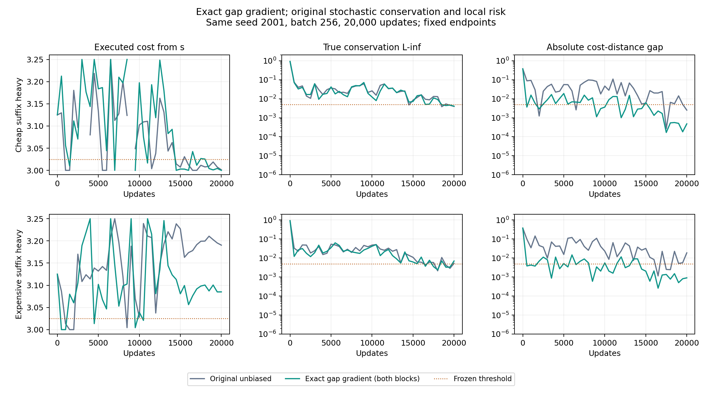

**精确缺口梯度对照：明显改善昂贵组，但不足以修复失败**

2026-11-10。以第一阶段原无偏随机版本为基线，仅把 G² 对距离和流的梯度同时替换为精确值。守恒项保留原 U-statistic、局部风险保留原小批量均值。没有沿用上一轮守恒梯度投影。

**固定终点结果。** 昂贵后缀重的起点实际成本从 **3.190450 降到 3.085068**，减少 0.105382；相对最优成本 3 的额外成本降低 **55.33%**，但仍高于原定 **3.025**。便宜后缀重从 **3.001054 降到 3.000000**，仍通过全部原定条件。昂贵组仍未通过，因此本次没有满足“昂贵组恢复且便宜组仍通过”的预设充分性检验。

| 查询混合 | 版本 | 起点实际成本 | 查询平均实际成本 | 真实守恒 L∞ | 真实守恒 L2 | 全部判据 |
|---|---|---:|---:|---:|---:|---|
| 便宜后缀重 | 原无偏 | 3.001054 | 1.125053 | 0.003967 | 0.005494 | 通过 |
| 便宜后缀重 | 精确缺口梯度 | **3.000000** | **1.125000** | 0.004056 | 0.005490 | **通过** |
| 昂贵后缀重 | 原无偏 | 3.190450 | 1.362023 | 0.005242 | 0.007500 | 未通过 |
| 昂贵后缀重 | 精确缺口梯度 | **3.085068** | **1.356753** | **0.006975** | 0.010892 | **未通过** |

四个终点策略的全部五个查询状态到达概率均为 1。昂贵路线选择概率在便宜组从 0.4215% 降到 0，在昂贵组从 **76.1801% 降到 34.0272%**；后者仍超过成本阈值对应的 10%。全部主结论取第 20000 步，没有挑选中间较好 checkpoint。

| 查询混合 | 版本 | 成本—距离缺口 G | 局部平方风险 R | 查询平均额外成本 |
|---|---|---:|---:|---:|
| 便宜后缀重 | 原无偏 | −0.00251777 | 4.89669e−6 | 0.00005269 |
| 便宜后缀重 | 精确缺口梯度 | −0.00047760 | 1.44419e−12 | 0 |
| 昂贵后缀重 | 原无偏 | +0.01870722 | 1.63864e−6 | 0.00952252 |
| 昂贵后缀重 | 精确缺口梯度 | +0.00090327 | 5.23987e−6 | 0.00425341 |

昂贵组现在通过缺口、风险、可达性、查询平均额外成本四项；仍未通过**真实守恒 L∞≤.005** 和**起点成本≤3.025**。便宜组仍通过所有六项。

**唯一干预及正确性。** 记全参数为 x=(d,f)，目标为

$$
L(d,f)=G(d,f)^2+\lambda R(d)+\beta\|Bf-b\|^2,
\qquad G(d,f)=c^\top f-\sum_s\mu_s d(s,g).
$$

用当前学得的距离、流、已知边成本与既定 μ 计算 G。六个非终点出边流仍独立训练，终点出流沿用吸收语义固定为零。精确缺口梯度为

$$
\nabla_{d(s,t)}G^2=-2G\mu_s\mathbf1\{t=g\},\qquad
\nabla_fG^2=2Gc.
$$

代码从原完整无偏梯度中减去原随机缺口梯度的**两个块**，再加上上述精确梯度。因此

$$
\widehat g_{\rm new}=2G\nabla G+\lambda\widehat g_R+\widehat g_{\rm cons},
\qquad \mathbb E[\widehat g_{\rm new}\mid d,f]=\nabla L(d,f).
$$

总体目标没有改变；精确 G 不涉及最短路、最优流或动作顺序。损失日志中的缺口平方同步替换为精确 G²，使日志与实际梯度一致，日志不控制更新或停止。守恒损失仍允许无偏估计为负，不做截断。

核验结果：

- 训练前在两种 μ、两个非最优参数点上，枚举 batch=2 的全部 35² 个独立样本对。期望梯度与原总体梯度的最大绝对误差为 **3.38e−14**，期望损失误差不超过 **9.11e−15**。
- 对固定批次的全部 36 个坐标做有限差分；最大误差 **1.57e−10**。单独检查精确缺口的距离和流梯度，均通过。
- 训练全程 **40000 批**逐批核验：距离缺口梯度最大误差 **1.10e−16**，流缺口梯度最大误差 **8.89e−16**；守恒梯度保留误差不超过 **8.89e−16**，风险梯度保留误差不超过 **1.10e−16**。
- 初始化、完整采样流 SHA256 和保存步数与各自原无偏基线一致；基线快照、原评估和协议哈希未变。所有源文件与训练前记录匹配。
- 准度量约束最大数值违反小于 1e−12，流非负约束无违反；两组均未触发投影求解器后备。

**这次结果能说明什么。** 精确化缺口的两个梯度块，在本次固定采样流和预算下，明显改善了昂贵组的最终分流；但它并未使真实守恒同步改善，守恒 L∞ 反而从 .005242 增加到 .006975。故不能将先前失败全部归因于缺口项的随机实现，也不能把此次“缺口通过”判成“联合学习成功”。守恒误差是剩余未通过项之一，当前对照尚不能证明它是剩余路线错误的唯一原因。

小缺口也不等于小执行成本。设 Jμ(π) 是归一化流策略的真实查询平均成本，有恒等式

$$
G=\underbrace{C(f)-J_\mu(\pi)}_{\text{学得流成本与执行成本的差}}
+\underbrace{J_\mu(\pi)-\mu^\top d_g}_{\text{执行成本与学得距离的差}}.
$$

昂贵组新终点为 C(f)=1.35907035、Jμ(π)=1.35675341、μᵀd=1.35816708，因而

$$
G=0.00231694-0.00141367=0.00090327.
$$

这直接显示，缺口已经很小，流成本仍不等于策略执行成本。此外本图的查询平均额外成本等于 .05 倍起点额外成本：.05×.085068=.0042534。它可以通过 .005 的查询平均阈值，同时仍违反 3.025 的起点阈值。不能省略后两项独立评估。

本轮同时改变了距离侧与流侧的缺口梯度，并改变了其与其它随机梯度合成后的 Adam 统计量；结果不区分这些作用的单独贡献。这仍是精确图求和的机制对照，没有交付新的可扩展随机估计器，也没有追加其它干预、seed 或训练步数。



成本曲线断开处表示该保存步的策略不能到达目标，成本按无穷处理，不插入默认动作；不是训练数据缺失。所有最终策略均可达。

**复现。** 复用同一 CPU FP64 环境、seed 2001、batch 256、每组 20000 步、原 Adam 和学习率、原策略提取及全部阈值。两组训练分别约 6.18、6.41 秒；训练前核验、训练和评估约 13.12 秒；完整流程含绘图约 30.01 秒，低于 600 秒预算。只新增两组，原无偏基线读取已有文件。

从仓库目录执行到一个尚不存在的目录：

```sh
env PYTHONDONTWRITEBYTECODE=1 ../quasimetric-rl/.venv/bin/python experiments/gap_exact_gradient/run_all.py /private/tmp/qrl-exact-gap-reproduction
```

复现目录包含固定终点 `summary.csv`、完整评估 `evaluation.json`、训练前核验 `preflight.json` 和逐批及来源核验 `verification.json`。新检出中的基线生成和传入方式见 [实现与复现说明](../../experiments/gap_exact_gradient/README.md)。干预细节见 [梯度替换代码](../../experiments/gap_exact_gradient/estimator.py)和[冻结协议](../../experiments/gap_exact_gradient/PROTOCOL.md)。
