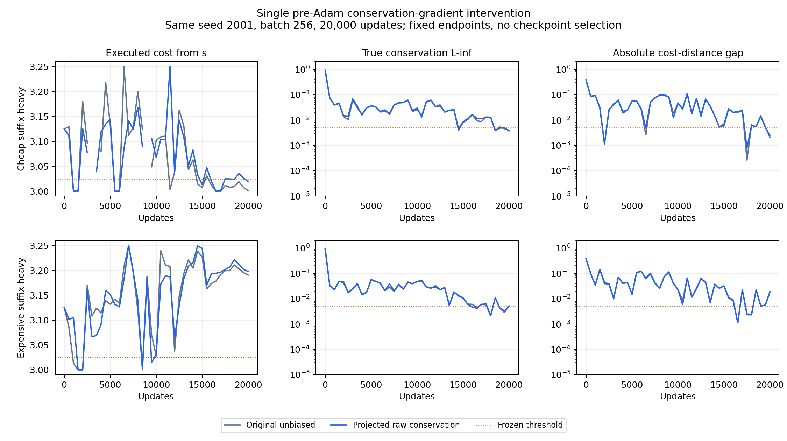

**守恒原始梯度分流投影：未修复失败组，原通过组仍通过**

2026-11-09。仅新增用户指定的一项消融、两种原查询混合。原无偏基线直接读取第一阶段产物，没有重训。新组均使用相同初始化、seed 2001、采样流、batch 256、20000 步、Adam、策略提取和固定终点判据。

**主要结果。** 昂贵后缀重的起点成本从 **3.190450 变成 3.197695**，增加 0.007245，没有降到 3.025。便宜后缀重从 **3.001054 变成 3.019157**，增加 0.018103，但仍通过所有原定判据。两组的新旧策略都能从全部五个正质量查询状态到达目标，到达概率均为 1。

| 查询混合 | 版本 | 起点实际成本 | 查询平均实际成本 | 真实守恒 L∞ | 真实守恒 L2 | 联合判据 |
|---|---|---:|---:|---:|---:|---|
| 便宜后缀重 | 原无偏 | 3.001054 | 1.125053 | 0.003967 | 0.005494 | 通过 |
| 便宜后缀重 | 投影守恒原始梯度 | 3.019157 | 1.125958 | 0.003735 | 0.005613 | **通过** |
| 昂贵后缀重 | 原无偏 | 3.190450 | 1.362023 | 0.005242 | 0.007500 | 未通过 |
| 昂贵后缀重 | 投影守恒原始梯度 | 3.197695 | 1.362385 | 0.005198 | 0.007296 | **未通过** |

对应昂贵路线的选择概率，便宜后缀组从 0.42% 升至 7.66%，昂贵后缀组从 76.18% 升至 79.08%。因此这项干预确实改变了有限步分流，但在本次固定采样流上没有改善两个终点的路线成本。守恒残差变化很小，L∞ 略降不能抵消策略成本的恶化。

完整终点风险和缺口也保持独立核验：

| 查询混合 | 版本 | $G=C(f)-V_\mu(d)$ | 局部平方风险 $R$ |
|---|---|---:|---:|
| 便宜后缀重 | 原无偏 | −0.002518 | 4.8967e−6 |
| 便宜后缀重 | 投影组 | −0.002114 | 6.0167e−6 |
| 昂贵后缀重 | 原无偏 | +0.018707 | 1.6386e−6 |
| 昂贵后缀重 | 投影组 | +0.018968 | 1.9672e−6 |

昂贵后缀投影组未通过的仍是缺口、守恒 L∞、起点成本和查询平均额外成本四项；局部风险和全部查询可达性通过。便宜后缀投影组的所有条件均通过，但起点成本距离 3.025 阈值的余量已明显减小。所有结论使用第 20000 步，没有挑选中间较好 checkpoint。

**唯一干预及无偏性核验。**

对六个自由流坐标，关联矩阵 $B$ 的零空间是一维。仅从 $B$ 计算单位方向 $z$，其符号按首个非零坐标定向，不读取成本或动作排序。数值上它为

$$
z=\frac1{\sqrt6}(1,1,1,-1,-1,-1),\qquad P_z=I-zz^\top.
$$

新梯度为

$$
\widehat g_{\rm new}
=\widehat g_{\rm gap}+\lambda\widehat g_R
+P_z\widehat g_{\rm cons}.
$$

代码仅在进入原 Adam 一阶、二阶矩累积之前，从六个流梯度坐标中减去 $z(z^\top\widehat g_{\rm cons})$。距离梯度、缺口梯度、局部风险梯度不变；没有投影总梯度、Adam 更新或流变量到守恒集合。六个边流仍是独立非负变量。

对任意当前 $f$，无论它是否守恒，都有

$$
g_{\rm cons}=2\beta B^\top(Bf-b),\qquad
z^\top g_{\rm cons}=2\beta(Bz)^\top(Bf-b)=0.
$$

因为 $P_z$ 固定且与当前抽样无关，

$$
\boxed{\mathbb E[P_z\widehat g_{\rm cons}\mid d,f]
=P_zg_{\rm cons}=g_{\rm cons}.}
$$

所以新原始梯度的期望仍对应第一阶段的同一个总体目标。这是梯度估计器干预；投影后的单批梯度不必是原单批标量损失的精确导数。日志仍记录原随机损失，不把它当作改变后梯度的逐批势函数。

训练前，在两种查询混合、两个非最优测试点上，枚举 batch=2 的全部 $35^2$ 个独立样本对。最大期望总梯度误差为 $5.78\times10^{-15}$；守恒分量分解、改动范围和投影后零分量均通过数值检查。

训练全程的 **40000 个批次** 逐批审计：

- 投影后原始守恒分流分量的最大绝对值为 **$6.67\times10^{-16}$**。
- 原始梯度改动严格限于指定的守恒分量；距离梯度逐元素相同，缺口分流分量保持误差不超过 $6.67\times10^{-16}$。
- 两组初始化摘要、完整边序列/查询均匀数 SHA256 与各自原无偏组一致。
- 第一阶段原始快照在比较前后哈希保持不变。

复现目录中的 `preflight.json` 保存训练前核验。两个 `.npz` 中的 `gradient_audit` 保存逐批审计，列名见 `manifest.json`。

**减少了原始梯度方差，但没有得到期望的有限步改善。**

在相同的第一阶段终点参数处，沿 $z$ 的新总梯度只剩缺口项的分量，因此可以精确比较干预前后的方差，避免混入两条训练轨迹参数不同的影响：

| 固定参数点 | 原总梯度分流标准差 | 投影后总梯度分流标准差 | 分流方差降低 |
|---|---:|---:|---:|
| 便宜后缀原终点 | 0.111453 | 0.064995 | 65.99% |
| 昂贵后缀原终点 | 0.128682 | 0.082906 | 58.49% |

这些是有限分布上的精确 U-statistic 方差计算，没有增加随机训练或新 seed。它说明干预不是数值上无效：指定分量确实被删除，原始总分流方差也明显下降。但缺口项的噪声仍保留，固定预算下的最终策略成本没有改善。

此外，Adam 前的正交性不会自动变成更新方向的正交性。即使守恒一阶矩 $m^{\rm cons}_t$ 满足 $z^\top m^{\rm cons}_t=0$，逐坐标度量 $D_t$ 一般仍使

$$
z^\top D_t^{-1}m^{\rm cons}_t\ne0.
$$

日志中守恒一阶矩的分流分量始终为浮点零，但经同一 Adam 对角缩放后，最后 500 步该分量的 RMS 约为 .2472、.2449。这是乘学习率前的分量，包含平均梯度缩放和随机波动，**不能全部解释为残余噪声，也没有据此证明 Adam 就是本次失败的唯一原因**。本轮严格保持用户指定的干预位置，没有继续对 Adam 更新施加投影。

因此，本消融不支持“只删除守恒原始梯度的分流噪声，就能修复当前失败组”。它也不足以证明守恒噪声完全无关：干预确实改变了路线分配，而缺口噪声、Adam 非线性及有限步优化仍共同存在。第一阶段的噪声诊断不能直接升级成这一个分量的充分机制解释；本次负结果收窄了这一解释的范围。



**复现与交付。**

从仓库目录运行，输出目录需尚不存在：

```sh
env PYTHONDONTWRITEBYTECODE=1 ../quasimetric-rl/.venv/bin/python experiments/gap_route_noise/run_all.py /private/tmp/qrl-route-noise-reproduction
```

该入口只运行本次两组干预，并读取原基线，不重训其它组。训练前核验、两组训练与主要评估合计约 8 秒，未追加预算、改判据、换 seed 或更换策略提取方式。

复现目录包含 `summary.csv`、`evaluation.json` 和同参数点的方差诊断 `noise_diagnostics.json`。新检出中的基线生成和传入方式见 [实现与复现说明](../../experiments/gap_route_noise/README.md)。干预细节见 [梯度干预代码](../../experiments/gap_route_noise/estimator.py)和[冻结协议](../../experiments/gap_route_noise/PROTOCOL.md)。
