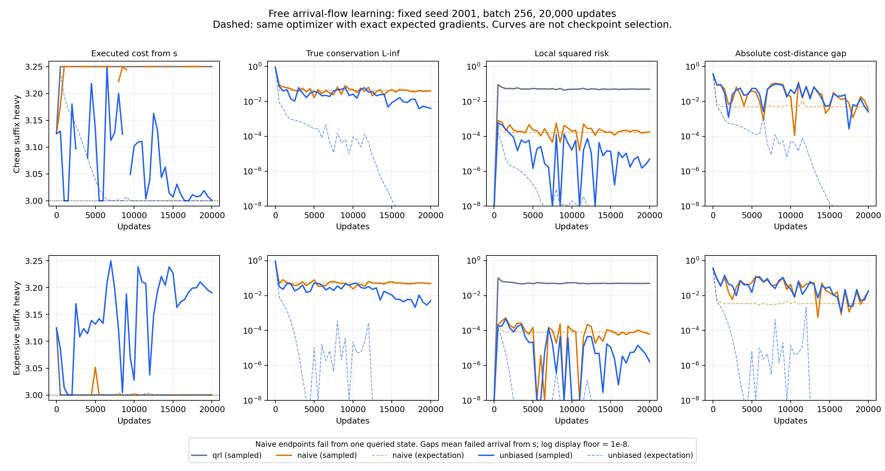

**第一阶段可行性验证：自由流可以学出，无偏随机训练只部分通过**

2026-11-08。完成真实小批量训练，未使用最短路、最优流或动作顺序作为标签。结论限定于既有六节点确定性图、完整准度量表和固定采样 seed 2001。

**本轮回答。** 新增流学习在完整表格上可行：使用同一初始化、同一优化器和同一 20000 步预算，精确期望梯度对照在两种查询混合下都同时学到了正确距离、守恒流和最优策略。真实小批量无偏训练只有一组通过预先冻结的联合判据，另一组虽然风险很小且基本守恒，仍选择了较差的分流。因此本轮不能宣称“无偏随机训练已经可靠消除了路线偏差”。当前主要瓶颈是有限批量下的流方向梯度噪声及弱成本信号，而不是本图上的表示能力或期望目标没有正确解。

**实现与预算。**

沿用两条路线 $s\to a\to u\to g$、$s\to b\to v\to g$，真实成本分别为 3、3.25，另有数据边 $g\to s$。七条边采样质量均为 $1/7$。两组查询分别为 $(.05,.01,.92,.01,.01)$ 与 $(.05,.01,.01,.01,.92)$；下文称“便宜后缀重”和“昂贵后缀重”。起点 $s$ 的质量始终为 .05。

训练变量为 30 个非对角距离表项与 6 个独立非负边流。目标出边流固定为零，仅表达首次到达目标即停止的语义。距离通过只依赖状态三元组的数值投影保持非负与三角不等式；**没有流守恒投影、路径混合参数、最优流初始化或任何教师标签**。每条流初始为 .1，全部非对角距离初始为 1。

六个主组共享同一边采样序列与查询均匀数，仅按各自 $\mu$ 映射查询。batch=256，每组 20000 次更新，固定最后一步，不选 checkpoint。新目标 $\lambda=\beta=1$；原 QRL 使用线性推远和风险上限 .05。三组均用相同 Adam 配置和学习率计划，准度量投影采用与 Adam 对应的对角度量。完整设置见训练前冻结的 [PROTOCOL.md](../../experiments/gap_stochastic/PROTOCOL.md)。

此外运行了四个相同预算的期望梯度对照，以及完整 36 变量的独立凸优化参考解。参考解只在训练后评估，未传回训练程序。主计算及主要评估约 38 秒；修复数值异常后的同流端到端重放约 56 秒，两者均计入后仍低于冻结的 600 秒预算。重放不增加统计样本量。

**固定训练终点。**

$G=C(f)-V_\mu(d)$；$R$ 用全部七条边精确计算；$r=Bf-b$ 是未经修复的真实守恒残差。“查询成本”是从完整查询分布出发的实际到达成本，不是流成本 $C(f)$。

| 查询混合 | 方法 | $G$ | $R$ | $\|r\|_\infty$ | 从 $s$ 的实际成本 | 查询实际成本 |
|---|---|---:|---:|---:|---:|---:|
| 便宜后缀重 | 原 QRL | — | 0.049902 | — | 3.250000 | 1.137500 |
| 便宜后缀重 | 朴素联合 | +0.003414 | 1.7874e−4 | 0.040673 | 3.250000 | **∞：从 a 失败** |
| 便宜后缀重 | 无偏联合 | −0.002518 | 4.8967e−6 | 0.003967 | **3.001054** | 1.125053 |
| 昂贵后缀重 | 原 QRL | — | 0.050512 | — | 3.000000 | 1.352500 |
| 昂贵后缀重 | 朴素联合 | +0.017866 | 6.1746e−5 | 0.048683 | 3.000000 | **∞：从 b 失败** |
| 昂贵后缀重 | 无偏联合 | +0.018707 | 1.6386e−6 | 0.005242 | **3.190450** | 1.362023 |

两个查询分布的真实最优平均成本分别为 1.125 与 1.3525。它们的平均值不能跨分布直接比较优劣。原 QRL 没有学习到达流，“—”不是零残差。其昂贵后缀组风险超过 .05 约 $5.12\times10^{-4}$，没有满足严格预算；不把该组描述为已精确求解的约束基线，也不据此声称两组已完成严格可行的机制对照。

无偏组真实守恒最大残差从初始的 .92 降至约 .0040 与 .0052，且两组所有正质量查询都能到达目标。但便宜后缀组某个 .01 质量起点的相对残差仍约 39.7%，另一组的最大相对源残差约 16.0%；不能把总体绝对残差较小写成“每个查询都精确守恒”。

预先冻结的联合通过条件是：全部查询可到达；$|G|\le .005$；$R\le10^{-4}$；$\|r\|_\infty\le.005$；从 $s$ 的成本不超过 3.025；查询平均额外成本不超过 .005。**真实无偏训练为 1/2 通过，朴素训练为 0/2 通过。** 无偏失败组选择便宜路线的概率只有 0.2382，昂贵路线概率为 0.7618。没有在看到这一结果后加训练步数、调权重、换 seed 或改用另一 checkpoint。

**新增流学习确实完成过；随机版本失败不能归因于没有正确解。**

以下对照使用相同的自由流变量、相同初始化与优化器，仅把小批梯度换成目标的精确期望梯度：

| 期望梯度目标 | 便宜后缀重：从 s 成本 / 守恒最大残差 | 昂贵后缀重：从 s 成本 / 守恒最大残差 |
|---|---:|---:|
| 无偏目标 $G^2+R+\|r\|^2$ | 3.000000 / 9.48e−12 | 3.000000 / 2.57e−16 |
| 朴素估计的期望目标 | 3.250000 / 0.042686 | 3.000000 / 0.053297 |

两个无偏期望梯度终点均满足全部联合条件。朴素期望梯度终点仍分别丢掉 $a$、$b$ 的出流。另一个独立 SLSQP 求解器对完整 36 变量期望目标也给出一致结论；用线性化 LP 和非负下界校验，数值目标证书间隙小于 $7\times10^{-7}$。参考求解没有消去守恒自由度，也没有使用一维路径混合。

**朴素平方造成两种偏差，其中一种比原来的路线反序更严重。**

独立采样边和查询，令

$$
Z_i=\frac{c_{e_i}f_{e_i}}{p_{e_i}}-d(q_i,g),\qquad
H_i=\frac{f_{e_i}}{p_{e_i}}B_{e_i}-b(q_i).
$$

朴素估计实际优化

$$
\mathbb E\widehat{\mathcal L}_{\rm naive}
=\mathcal L
+\frac1n\operatorname{Var}(Z)
+\frac\beta n\operatorname{tr}\operatorname{Cov}(H).
$$

除前次推导的成本—距离方差外，本轮真正学习守恒后还多出

$$
\operatorname{tr}\operatorname{Cov}(H)
=\sum_e\frac{f_e^2}{p_e}\|B_e\|^2-\|Bf\|^2
+\mathbb E_q\|b(q)\|^2-\|b\|^2.
$$

它会改变流的大小和分配。稀有查询的源质量为 .01，把该起点出流降到零只产生量级 $10^{-4}$ 的单状态平方残差，优化器可能接受这个代价来减少额外方差。两组朴素训练确实分别把 $f_{a\to u}$、$f_{b\to v}$ 压成**精确零**。

因此，从固定 $s$ 看起来仍能完成到达，不代表策略对完整查询分布有效。评估没有为零出流状态补默认动作：这两个状态到达概率为 0，且查询质量均为 .01，所以协议下总体到达成本为无穷。JSON 用 `proper=false` 与 `query_cost=null` 表示这种失败，CSV 明确写 `inf`。

独立期望目标消融也支持两类偏差都存在。在便宜后缀组，仅保留缺口平方的对角方差项时，最优点的起点成本为 3.25、守恒最大残差为 .014404；仅保留守恒平方的对角方差项时，成本仍为 3.25、残差为 .027795。这些只是求解参考问题，没有增加新的随机训练组。

**无偏估计消除了这两个期望偏差，却没有消除流方向上的随机梯度噪声。**

对 $G^2$ 和 $\|r\|^2$ 都采用不同样本之间的乘积，逐边风险仍用普通均值。枚举 batch=2 的全部 $35^2$ 个独立样本对，损失与梯度期望均与推导一致，最大梯度误差 $1.42\times10^{-14}$。采样梯度的有限差分误差不超过 $5.32\times10^{-10}$。负的无偏损失估计完整保留，没有截断。

为了量化真正影响分流的噪声，在**训练后诊断中**从 $B$ 的零空间提取单位方向

$$
z=\frac1{\sqrt6}(1,1,1,-1,-1,-1),\qquad Bz=0,\quad c^\top z<0.
$$

这个方向只用于评估梯度，不是训练参数。沿它增加流会从昂贵路线移向便宜路线。总体目标在该方向上的导数为

$$
\partial_z\mathcal L=2G\,c^\top z,
\qquad
\partial_z\{\beta\|Bf-b\|^2\}=0.
$$

守恒项在这个可行分流方向上理论上完全没有优化信号，但其小批量梯度仍有噪声。用有限分布精确计算 U-statistic 核方差，得到：

| 无偏随机终点 | 正确方向导数的绝对均值 | 单批梯度标准差 | 信噪比 |
|---|---:|---:|---:|
| 便宜后缀重 | 0.000514 | 0.111453 | 0.00461 |
| 昂贵后缀重 | 0.003819 | 0.128682 | 0.02967 |

失败组噪声约为信号的 **34 倍**。其守恒项单独贡献的梯度标准差约为 .06638，但期望方向导数为 0。即使把诊断点放在真实最优距离与最优流上，整体单批梯度标准差仍约为 .11115 和 .11993。这些值来自精确有限求和，不是新增 seed 的蒙特卡洛估计。

方差计算使用对称梯度核 $k(X,Y)$。令 $m(X)=\mathbb E_Y k(X,Y)$、$\bar k=\mathbb E k$，则

$$
\operatorname{Var}(\widehat{\partial_z\mathcal L})
=\frac4n\operatorname{Var}(m(X))
+\frac2{n(n-1)}\mathbb E[k-m(X)-m(Y)+\bar k]^2.
$$

在精确最优点，守恒项沿此方向的核是退化的，其方差为 $O(n^{-2})$，但本图常数很大；缺口项还保留 $O(n^{-1})$ 的方差。不能把“无偏”误写成“零损失解处每个随机梯度也为零”。另外，这里报告的是原始梯度的精确方差，不是声称已经证明 Adam 终点分布或把所有有限步误差唯一归因于一个方差分量。期望梯度对照、完整轨迹与方向诊断共同支持噪声及有限步优化是当前主要瓶颈。

**实际策略成本不能用流成本代替。**

当归一化流策略能到达目标时，独立策略值 $J_{\pi_f}$ 给出精确恒等式

$$
\boxed{C(f)-C(\pi_f)=J_{\pi_f}^{\top}(Bf-b).}
$$

它来自策略 Bellman 等式乘以源出流后求和。本轮两个无偏随机终点均通过该恒等式的浮点核验。便宜后缀组的流成本为 1.120893，甚至低于真实最优平均成本 1.125；实际执行成本却为 1.125053。差别由守恒误差解释，不能把低流成本当成超越最优策略。

昂贵后缀无偏组在第 18000 步曾有很小的总体损失约 $2.19\times10^{-5}$，但从 $s$ 的成本仍约为 3.1996。这不是选取该 checkpoint 报结果，而是展示为什么损失不足以判断决策：固定起点仅占查询质量 .05，明显的该起点错误被平均目标稀释。

所有四个新方案随机终点的 critic 贪心策略，从 $s$ 出发都选择正确路线；实际流策略却有失败。这个诊断进一步把本图的主要问题定位到流与策略提取。没有事后改用 critic 贪心来替代流策略并宣称联合方案成功。



实线为小批量训练，虚线为同优化器的期望梯度对照。对数轴仅显示到 $10^{-8}$，更小的真实数值保存在原始记录；起点成本曲线不能代替全部查询可达性。朴素终点均有一个查询状态的零出流失败。

**复现与数值审计。**

单命令复现，输出目录必须尚不存在：

```sh
env PYTHONDONTWRITEBYTECODE=1 ../quasimetric-rl/.venv/bin/python experiments/gap_stochastic/run_all.py /private/tmp/qrl-gap-stage1-new-run
```

实际已完成一次相同采样流的端到端重放，10 个组的全部 41 个保存时刻、距离、流和乘子数组均逐项相同。它验证实现可复现，不作为跨 seed 或独立重复的证据。两次运行的输出目录可用 [重放比对脚本](../../experiments/gap_stochastic/compare_reproduction.py) 检查。

最后一个期望梯度对照在第 4683 步触发 SciPy 1.13 NNLS 的空活跃集异常。修复只增加了求解**相同对角度量投影**的 SLSQP 后备；保持六个已完成随机组不动，仅恢复中断的确定性对照。后备输入的三角违反量约 $1.68\times10^{-9}$，输出为 0。原异常 manifest 保留，完整同流重放证明六个主组未被改写。该修复不改变目标、不修复守恒、不提供标签。独立凸参考问题另以更紧的非负下界核验接近零的解，避免把不够紧的数值线性化界当作优化失败。

复现目录包含逐组评估 `evaluation.json`、汇总 `summary.csv`、机制诊断 `diagnostics.json`、梯度预检 `preflight.json`，以及各组快照和训练日志。入口和代码见 [实现说明](../../experiments/gap_stochastic/README.md)、[核心目标与估计器](../../experiments/gap_stochastic/core.py)和[训练程序](../../experiments/gap_stochastic/train.py)。

本阶段应停在“期望目标与自由流学习可行，当前无偏小批量原型尚未可靠完成”的结论。下一阶段更明确的问题是：如何避免守恒矩估计向理论上零信号的可行分流方向注入噪声，并保持无偏性及实际策略保证。本轮没有通过调大 $\beta$、增加训练步数、换提取器或增加辅助损失来掩盖这一问题。
