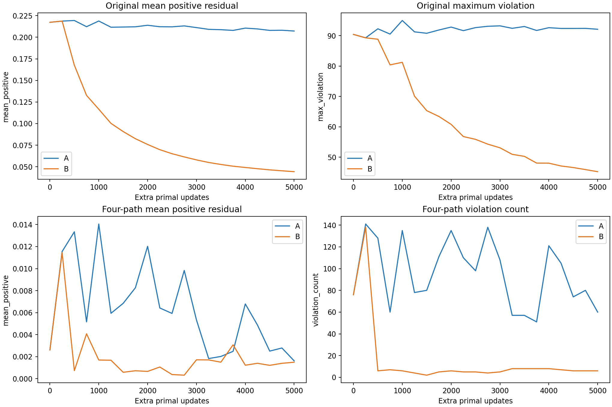
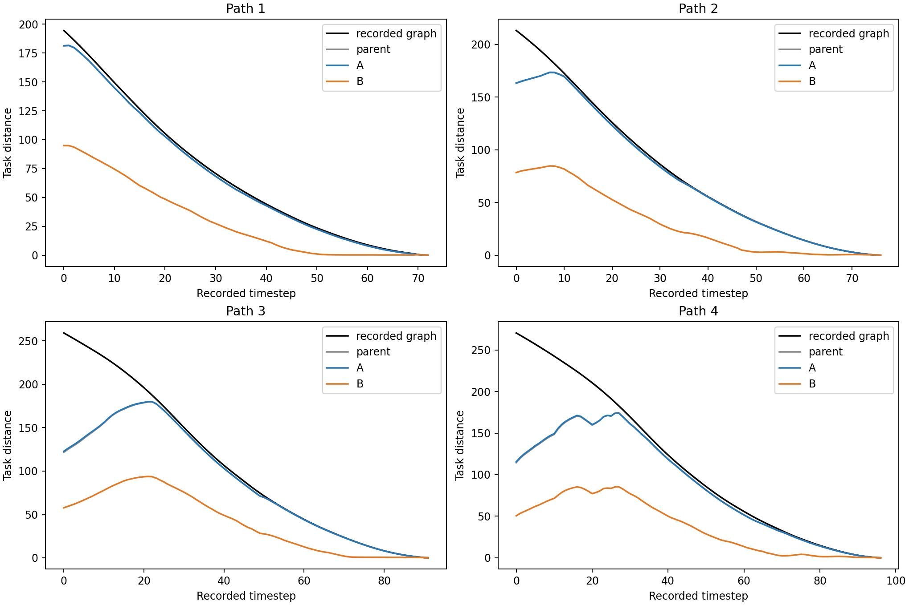

# 大 replay PHR 校准：5k A/B 续训

两组均从同一个 witnessed final（step 25,000、seed 606）继承完整模型、AdamW、dual 和采样状态，续训到 step 30,000。只改变 B 的原始边 dual 更新机制；task push、B1、primal 采样、模型和环境保持不变。

**本次结果：B 明显改善原始边约束，但显著损害四路径长程价值，没有实现联合改善。A 的长程估值基本维持父模型水平，原始边残差仅小幅下降。当前 B 配置不能作为同时恢复可行性与价值的替代方案。** 以下违反数始终使用 h>1e-5 阈值。

| 指标 | witnessed 父模型 | A：按访问 dual | B：全量外层 dual |
|---|---:|---:|---:|
| 原始 20 万边 违反数 | 34566 | 33121 | 6305 |
| 原始 20 万边 最大正残差 | 90.4281 | 92.1216 | 45.2496 |
| 原始 20 万边 平均正残差 | 0.217276 | 0.20719 | 0.0442632 |
| 四路径边 违反数 | 76 | 60 | 6 |
| 四路径边 最大正残差 | 0.0669125 | 0.0530933 | 0.134216 |
| 四路径边 平均正残差 | 0.00260921 | 0.0016218 | 0.00149701 |
| 原始入终态边 违反数 | 13 | 13 | 14 |
| 原始入终态边 最大正残差 | 90.4281 | 92.1216 | 45.2496 |
| 原始入终态边 平均正残差 | 48.0997 | 51.8376 | 15.5504 |
| 四路径入终态边 违反数 | 3 | 0 | 4 |
| 四路径入终态边 最大正残差 | 0.0669125 | 0 | 0.134216 |
| 四路径入终态边 平均正残差 | 0.0246361 | 0 | 0.0822395 |
| 四路径 task NRMSE (%) | 27.3566 | 27.1352 | 63.1359 |
| 四路径 push gap (%) | 15.2683 | 15.2074 | 59.7975 |
| 四路径 task RMSE | 33.5205 | 33.2493 | 77.3615 |

B 相对 A 的原始边平均正残差变化 -78.64%；四路径 NRMSE 差为 +36.001 个百分点。需同时检查长程估值与局部可行性，不能将压缩距离造成的残差下降自动视作恢复。

| 路径起点 | 父模型 | A | B | 记录图参考 | B edge slack | B triangle slack |
|---|---:|---:|---:|---:|---:|---:|
| P1 | 181.169 | 181.341 | 94.856 | 194.489 | 77.976 | 21.657 |
| P2 | 163.008 | 163.322 | 78.405 | 213.116 | 88.483 | 46.228 |
| P3 | 121.559 | 122.677 | 57.549 | 259.063 | 95.370 | 106.144 |
| P4 | 114.401 | 115.413 | 50.462 | 270.548 | 106.383 | 113.703 |

edge slack 与 triangle slack 之和为路径起点低估，完整路径曲线保留在图中。记录图近似恢复不是未见状态泛化或闭环成功，本轮没有候选或导航评估。
B 的四条路径 edge slack 增至约 78–106，A 仅约 5–25，说明路径预测边长明显收缩。P3/P4 的 triangle slack 甚至比 A 略低，但 edge slack 的增加更大，导致起点距离继续下降；这不是原有长程关系已经恢复。合并图对这 335 个路径源的参考与四路径图逐点一致，参考误差为零，排除了两组使用不同图目标的解释。
原始入终态边 B 仍有 14/14 条违反；四路径入终态边 A 为 0/4，B 为 4/4。B 的四路径总违反数很少，但其最大违反量更大，不能把“只剩几条”当成近似恢复。

## 剩余瓶颈与解释范围

原始 dual 最终最大值 A=3471.5、B=123106.8；平均绝对互补残差 |lambda*h| 分别为 37.850 与 486.921。B 的值是在最终外层更新后统计；不同 dual 强度不能被当作等预算收敛指标，且两组均未满足全量可行性。
在本配置下，B 施加更强且更及时的原始 dual 约束压力，进一步降低了残差；但在当前共享模型、采样和 5k 小学习率预算下，所选 eta=100/周期250 的校准伴随距离收缩。可能涉及外层步长与内层适应不足、不同来源对共享表示的竞争；本实验没有分别隔离这些原因。标准 PHR 系数并不保证有限内层更新已经充分优化，不能据此否定所有全量 dual 更新方案，也不应把当前 B 当作成功校准。

## 更新机制与预算

A 保持每次访问更新原始 dual：lambda ← relu(lambda+h_pre)，eta=1。B 在 primal 中固定原始 dual，每 250 步对当前模型全量扫描后同步更新：lambda ← relu(lambda+100*h_latest)。rho=100，因此外层 eta=100 使用标准 PHR 系数。四路径两组都每步更新、eta=1，未改 task push 或其空 batch 语义。
两组都继承完整 Adam 状态，使用相同 2e-6→2e-7 指数降步长，共 5k 更新；这相对父模型末步 2e-7 是共同的低步长重启。A 控制这部分额外预算与学习率改变。两组每 250 步都全量审计，不根据参考值停止。
B 共 20 次外层更新；最后一次在第 5,000 步末，只改变保存的 dual，未反馈到本轮最终 primal 模型。本轮模型受前 19 次更新影响。B 每边名义 eta 总和 2,000，A 约 6.4；因此这是更新及时性、频率和强度一起改变的校准机制对照，不是单纯刷新频率的因果实验。

## 完整性与保留的失败

初始模型、Adam、dual、采样器/RNG 和计数与父 checkpoint 逐位相同；最终 A/B 采样、访问和 push 计数逐位一致。每条原始物理边新增访问 6–8 次，原始 B1 新增 1,278,656 次，四路径 B1 新增 1,675,000 次。原始空 task batch 新增 161 次。所有真实边和有效 B1 都保留。
独立重算第一个外层模型的全部残差，B dual 与 relu(父 dual+100*h_latest) 的最大误差为 0。checkpoint 恢复验证保证边界更新不重做。父模型及旧结果哈希未变。
全部最终残差/dual 保存于各组 final_constraints.npz；最坏 50 边、各任务统计、B1 上界违反和完整曲线均保留。752 个 quotient anchor 恒为零，真实入终态边独立列出。源码快照、父文件哈希、配置及复现命令见 protocol.json 和 experiments/large_phr_calibration/README.md。
正式训练固定 4 CPU 线程，沿用父实验已记录的微小数值非确定性；相同 seed 与采样不保证全部浮点轨迹逐位一致。结论仅覆盖这一个父 checkpoint 和所选 eta/周期，不代表外层参数最优或跨 seed 稳健。Oracle 未用于训练、校准或停止，无新数据和闭环评估。

