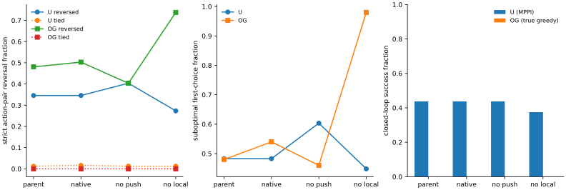

# 保留各自原配方的小预算消融：两边是否由同一损失方向造成失败？

2026-11-02 至 11-03 · 同父状态、同环境内同批次、每组 512 步

**结果不支持把两种失败统一归因于一个应当删去的损失项。** 去掉直接局部惩罚，在 U 的专家图上改善排序和路径成本，却在 OG 上严重破坏排序；U 连续 MPPI 还丢失 4 个成功。去掉推远项，U 图内排序恶化，OG 首步排序略好，但两边闭环都没有新增成功。原配方续训本身也没有恢复失败。

这些是各自当前 checkpoint 附近的受控处理效应，不是证明两个环境绝不存在任何更深层共同原因。更明确的结论是：**原推远、局部可行性、特定目标的距离形状与实际执行不能合并成一个标量故障。** 只从局部项梯度、局部违反率或专家图内排序挑一个指标，不能推断共同训练根因。

## 1. 三组改变了什么，保留了什么

每个环境都从原完整父状态独立开始，固定 512 步，只评价终点，不选中间模型。

| 组 | U-trap | OGBench |
|---|---|---|
| native | 原 −0.6 task−0.4 B1+PHR | 原完整 value+dynamics+actor |
| no_push | 仅去掉 task/B1 推远 | 仅去掉 value softplus 推远 |
| no_local | 仅去掉 PHR primal 项 | 仅去掉 value 的 λ×平均局部正违反平方 |

三组均继续原 dual 更新。OG 的 lam_loss、dynamics_loss、actor_loss 保留，因此 no_local 仍有 dynamics 对表示的训练作用；它不是“所有局部信息都消失”。后续 λ、dynamics、actor 的变化属于处理后的间接响应，不把它们错误地宣称为全程冻结。

U 保留原共享 encoder/projector/IQE、任务终态 quotient、物理成本、全部重复记录、task/B1 查询与逐记录乘子，恢复父 sampler、Adam 矩和计数，学习率固定在父终点 2×10⁻⁷。512 步实际新增 130424 次记录访问，保留 epoch 尾批。OG 保留原 IQE、官方 GCDataset、目标语义、eps、联合优化与 agent RNG，batch1024、lr0.0003，采样 seed4400，共 524288 行。跨环境预算不同，只在各自三个处理间作配对因果比较。

两边前 32 批完整流与上一项冻结诊断一致；三组共享同一实际批次。U 512 步流 SHA 前缀为 `2e74dcbb2210`，OG 三字段流为 `c715653b5fd8`，完整字段流为 `99b130ebf0fe`。训练没有读取参考距离、评价目标、动作排序或轨迹成败。[冻结协议](PROTOCOL.md) · [训练 U](../../experiments/native_ablation/train_u.py) · [训练 OG](../../experiments/native_ablation/train_og.py)

## 2. 全候选排序与执行

U 为 58 个专家图分支、483 个严格参考动作对；OG 为同一 50 个官方 task3 reset，各 121 个真正可执行的 MuJoCo 后继，218301 个严格参考动作对。OG 参考继续使用独立 0.2 环境图、pointbody 半径 0.7 与目标成功圆半径 1，离散参考不是连续精确最优值。模型并列另报，未算成反序。

| 环境 / 组 | 严格动作对反序 | 模型并列（严格参考对内） | 首选非参考最优 | 全体首选额外成本均值 | 真正执行成功 |
|---|---:|---:|---:|---:|---:|
| U parent | 167/483（34.58%） | 6 | 28/58 | 10.699 | MPPI 28/64 |
| U native | 167/483（34.58%） | 8 | 28/58 | 10.699 | MPPI 28/64 |
| U no_push | 195/483（40.37%） | 6 | 35/58 | 15.610 | MPPI 28/64 |
| U no_local | 132/483（27.33%） | 6 | 26/58 | 6.000 | MPPI 24/64 |
| OG parent | 104953/218301（48.08%） | 14 | 24/50 | 0.940 步 | 真后继贪心 0/50 |
| OG native | 109817/218301（50.31%） | 15 | 27/50 | 1.060 步 | 真后继贪心 0/50 |
| OG no_push | 88053/218301（40.34%） | 17 | 23/50 | 0.900 步 | 真后继贪心 0/50 |
| OG no_local | 161008/218301（73.76%） | 1 | 49/50 | 1.900 步 | 真后继贪心 0/50 |

U 使用原 H10/N128、温度 1 的 MPPI，32 个共同地理起点×两个 planner seeds，原 300 步上限。全部 192 个新增回合的首候选 bank 与父回合同 hash，终值外的控制器与物理设置不变。OG 使用同一原始模拟器的 121 动作真实后继贪心，原 1000 步上限；每次实际 env.step 的后继与所选候选逐位一致。这绕开了 actor 和潜在动力学提取误差，因此 **OG 此表不是官方 actor 评价，也不是新平均五任务成绩**。

全部新组相对 parent/native 的新增成功均为 0。U no_local 唯一的 4 个失去是 inside_16 与 west_03，各两个 planner seeds；两个随机种子并不是四个独立地理样本。U no_push 与 native 的 64 个成功/失败标签完全相同。OG 三组在 50 个原输入上均超时，未缩短失败回合或挑选初态。[配对表](episode_pairs.csv) · [汇总](summary.csv) · [U 轨迹索引](u/episodes.csv) · [OG 轨迹索引](og/episodes.csv)



两环境的参考、成本、控制器不同，图中不合并成功率或效应量。动作对也共享同一状态，不能把 218301 对当作独立回合来计算显著性。

## 3. U：图内改善与连续执行退化同时发生

165 个不同专家起点的图内贪心平均额外成本为：parent/native 40.305、no_push 101.543、no_local 25.551。该图所有分支都可通往目标，图内到达主要由支持图结构保证；其成本改善无法保证连续规划候选和实际访问状态的终值同样可靠。

| U 全物理记录 / 全去重边 | parent | native | no_push | no_local |
|---|---:|---:|---:|---:|
| 记录平均正违反 | 0.06043 | 0.05991 | 0.02109 | 0.48230 |
| 去重边平均正违反 | 0.12413 | 0.12438 | 0.08960 | 0.26861 |
| 最大正违反 | 7.308 | 7.314 | 6.747 | 11.905 |
| 非终图源任务 J 均值 | 398.981 | 399.008 | 353.849 | 446.063 |

no_push 压低局部违反，却失去图内长程成本与排序；no_local 保留推远驱动，图内分支成本下降，但物理边违反显著增大，实际 MPPI 成功减少。它支持两种相互约束的要求，而不是某项损失单独无用。仍不能把新增碰撞唯一归因于最大违反：连续访问分布、候选终值差异与控制预算也同时作用，本项没有逐项隔离它们。[图内路径](u/graph.csv) · [局部违反](u/local.csv) · [任务值尺度](u/values.csv)

## 4. OG：局部违反几乎消失，仍有目标相关陷阱

| OG 全 100000 验证转移 / 同 canonical 环境图 | parent | native | no_push | no_local |
|---|---:|---:|---:|---:|
| 局部正违反均值 | 0.14113 | 0.13464 | 0.000219 | 24.52085 |
| 局部正违反比例 | 56.054% | 54.852% | 0.284% | 99.886% |
| 最大 h | 1.813 | 1.947 | 0.415 | 86.963 |
| 原锚点到目标的最低路线峰差 | 6.631 | 6.382 | 3.996 | 0 |
| 峰差 / 全图距离 IQR | 0.1195 | 0.1170 | 0.1549 | 0 |
| 锚点有严格下降通道 | 否 | 否 | 否 | 否 |

no_push 将验证正违反均值压到 parent 的约 0.16%，首步反序也降低，但 50 回合仍全部失败。原尺度峰差下降并不代表形状变好：其距离 IQR 从 55.509 降到 25.805，归一化峰差反而增大。不能把尺度收缩当作绕墙距离恢复。

no_local 的原锚点最低路线峰差为 0，也不能宣布没有陷阱：存在不超过**初始值**的路线，不保证沿途始终下降。该组严格下降可达节点比例从约 90.0% 降到 33.0%，出口走廊 Spearman 从 +0.298 变为 −0.796，首动作几乎全部错选，实际执行仍 0/50。它示范了“单个最小峰值指标归零”同样不能代替可执行的相对排序。[局部统计](og/local.csv) · [完整距离场指标](og/fields.csv)

## 5. 冻结点梯度是否预测了 512 步结果

沿用上一项预选的 58/50 个动作对，而非在终点重新挑对。U no_local 在原 24 个错对上严格修复 7 个，同时把 4 个原对变错；OG no_local 则修复 1 个、将全部 24 个原对变错。no_push 的对应数字为 U 修复 2、变错 4；OG 修复 1、变错 0。

U 初始错对的 32 批平均 SGD 投影中，局部项原本在纠正、push 平均反向；但继承 Adam 后 no_local 的 512 步错对平均间隔仍增加。OG 的 no_push 也没有因初始 push 投影多数纠正就普遍恶化。这与此前 E1 长预算中已经观察到的现象一致：一步投影检验的是局部压力，不是固定方向的训练历史，也不是长期处理效应。**本次不能将上一项的梯度均值直接命名为根因。** [冻结梯度报告](../native_margin_20261102_verified/report.md) · [逐对终点](u/margins.csv) · [OG 逐对终点](og/margins.csv)

## 6. 对两边共同根因的实质约束

- 若假设两边都是“局部项损害任务排序，删掉就能修复”，OG no_local 的严重退化与 U 连续执行退化反驳了这个预期。
- 若假设两边都是“push 太强导致局部违反，只要压低违反就能恢复”，no_push 没有新增任何成功，U 图内代价反而大幅变坏；该固定预算处理不支持这个修复链条。
- 若把“后继评分反序”当作同一个训练原因，本项表明它可以在不同损失压力下出现，而且图内反序减少与闭环成功减少能同时发生。它是共同决策机制，不是唯一训练归因。

这不证明所有更深的共同原因都不存在，也不证明当前 native 优化已收敛。更符合证据的分工是：U 要同时追踪有限 PHR 可行性、任务源测度和连续访问分布；OG 要追踪目标相关全局排序及其提取链，平均局部统计不能单独保证目标场正确。小图的低 q 全局最优反序证书仍是一个充分机制，不能把它直接当作 U 与 OG 的共同真实训练原因。[真实 U 稀有边诊断](../rare_edge_attribution_20261103/report.md) · [统一诊断](../unified_mechanism_20261102/report.md) · [小图](../edge_weight_graph_20261102/report.md)

下一项最小区分是只读检查：在各自原经验约束下，用不改变距离次序的正缩放构造可行性证书，检验“局部不可行本身”是否必要；它无需任何新训练或把 OG 转成 U 的配方。当前报告不提前使用该项尚未计算的结果。

## 核验、异常与复现

训练前各组两步 smoke 的完整状态往返通过，随后全部丢弃。U 首步 dual 与原入口完全一致；OG 首步 λ/dynamics/actor 参数的最大组间差为 2.98×10⁻⁸，确认删除项没有直接误改其他梯度通道。正式终点 U Adam 为 50512、OG 为 100512，原模型文件和数据 SHA 均不变。

OG 首次 preflight 的额外 JIT 包装未通过 native 与原入口逐位一致的要求，因此取消 native 外层包装，直接调用官方 update，再从原状态做 smoke 和完整正式训练；失败时尚未产生 OG 正式终点，U 已完成结果没有重跑。U 评价最初把独立抽象锚 episode 也算入起点，随后改为复用 physical_episodes；诊断动作对另固定为上一项完全相同的前向 batch，消除 1.22×10⁻⁴ 量级的 FP32 批形差。这些修复未改训练、预算或正式样本。报告保留 adapter 与直接 probe 的批形最大差 1.83×10⁻⁴，不从边界近零变化作强结论。

新增汇总回归测试 3 项及上一项选择测试 2 项通过。独立核验器检查六个终点 SHA、训练源码、输入文件、前 32 批、342 条完整新增轨迹、相同起点/目标、真实步数/时限、成功标记与表格，全部通过。图已渲染查看。未重复正式训练以追求更好结果。[最终审计](audit.json) · [评价补充](../../experiments/native_ablation/EVALUATION_NOTES.md)

```bash
# 全新目录；包含三组训练与全部正式执行
bash experiments/native_ablation/run.sh "/Users/z./.codex/worktrees/5670/quasimetric-rl-topology-improvements" results/native_ablation_reproduction

# 已有产物：只重算汇总、绘图与完整性核验
../quasimetric-rl/.venv/bin/python experiments/native_ablation/summarize.py results/native_ablation_20261102
../quasimetric-rl/.venv/bin/python experiments/native_ablation/verify.py "/Users/z./.codex/worktrees/5670/quasimetric-rl-topology-improvements" results/native_ablation_20261102
```

执行入口默认两个既有运行时，可用 U_PY、OG_PY 覆盖。新增源码、测试、协议、评价说明、本报告与引用 SVG 提交；终点、数值表、完整轨迹、审计 JSON、日志、smoke 与临时 PNG 留本地。[入口](../../experiments/native_ablation/run.sh) · [U 评价](../../experiments/native_ablation/eval_u.py) · [OG 评价](../../experiments/native_ablation/eval_og.py) · [核验器](../../experiments/native_ablation/verify.py)
