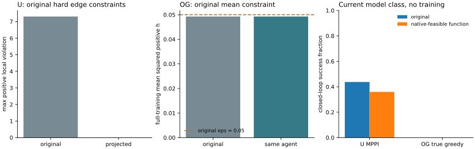

# U-trap 与 OGBench 根因辨析：原约束可行性与四项新证据

2026-11-03 · 原 U-trap R0/R1、OGBench navigate seed0 100k · 保留各自模型结构与环境设置

**当前证据支持共同的决策失效，但不支持把两边归为同一个具体训练单因。** 两边都因后继之间的误差差分而选错；然而 U 的逐边 PHR 尚未得到经验可行解，OG 原模型却已经满足自己的全训练集平均局部约束。两边删去相同角色的损失项，排序响应也相反。把小图的“低 q 平均松弛导致全局最优反序”直接当成两个真实 checkpoint 的同一根因，会混淆不同训练问题与不同执行分布。

这一结论针对当前模型与数据，不是宣称任何更高层共同因素都不存在。若把“任务相关距离没有学对”称作共同根因，它当然符合两边现象，却没有进一步解释**为什么**；本报告将这一共同决策机制与具体训练归因分开。

## 1. 本项最关键的新区分：OG 原模型已经平均可行

直接遍历官方训练集的 **1000000 条有效转移**，排除 1000 个 compact episode 末行，计算原官方 loss 使用的

**R=mean(max(d(s,s′)−1,0)²)。**

| 原 OG 100k，未改参数 | 全量结果 |
|---|---:|
| 原 eps | 0.05 |
| 全训练集 R | **0.04926729497911975** |
| h>10⁻⁴ 的训练边比例 | 55.4109% |
| 全训练集最大 h | 2.44717 |
| 同模型、同 50 个 task3 起点，真实后继贪心 | **0/50** |
| canonical 锚点最低路线峰差 / IQR | 0.11946 |
| 锚点严格下降通道 | 无 |

这不是一个验证 batch 或 Monte Carlo 估计。官方 Dataset.get_random_idxs 从全部 valid 索引均匀抽样，因此本项正是其单步局部约束的完整经验总体。随机 value_goals 不进入这项 pair 风险。训练集平均可行与大量单边正违反并不矛盾：官方要求的是一个平均平方预算，而非每条边 h≤0。

按运行前协议，若 R(1)≤eps，就取缩放 a=1。结果确实如此：本项 **没有改动 OG 完整 agent 的任何参数、优化器、计数或 RNG**，也没有新训练或重复执行旧 50 回合。先核对完整 agent 逐叶不变、50 个首步候选分数/argmin不变，再复用已完成的原始 0/50 记录。[全量距离缓存](og/local.npz) · [完整结果](og/analysis.json) · [50 例复用标记](og/episodes.csv)

因此，OG 当前失败不能简单归为“和 U 一样，原经验局部约束还没被满足”。另一方面，**平均可行不代表推远目标已优化、互补条件已满足或网络达到全局最优**；本项不把真实 OG 模型称为小图那样的全局最优反例。

## 2. U：同一模型类内能构造经验硬可行点，但没有修复执行

U 原 R0 在全部 42536 条物理训练记录上的最大 h 为 7.30814，约 46.19% 记录 h>10⁻⁴，确实不满足自己的逐边约束。

只从这些训练转移和原成本计算

**a*=min(1,min_{d_i>0} c_i/d_i)=0.2868861940。**

取预定数值余量 a=a*×(1−10⁻⁴)=0.2868575054。当前 IQE 没有 transform/discount，其距离对最终投影特征正齐次；把原 projector 最后线性层的 weight/bias 同比缩放，就在**同一架构、同一输入语义和目标 quotient** 内实现新的可行函数。不是给 MPPI 改温度、成本或终值系数，也没有替换为表格模型、Oracle 或更大网络。

实际执行的是缩放后的网络参数，而非只对缓存表乘一个数。其余参数逐叶不变，完整训练物理边重新前向核验：

| U 原 R0 → 经验硬可行函数 | 原模型 | 投影后 |
|---|---:|---:|
| 全训练物理记录最大 h | +7.30814 | **−0.00032139** |
| 训练记录正违反比例 | 46.1938% | **0%** |
| 58 分支内严格反序 | 167/483 | 154/483 |
| 首选非图参考最优 | 28/58 | 28/58 |
| 165 专家起点图内平均额外成本 | 40.3047 | 29.9734 |
| 原 MPPI，32 地理起点×2 seeds | 28/64 | **23/64** |
| 相对原回合新增 / 失去成功 | — | **0 / 5** |

三角不等式和全部图边硬可行共同给出 J(s,g)≤已记录图最短路值。实际重算的 J−V 最大值为 0，平均偏差约 −295.12；它是一个明显未把任务距离充分推远的可行点。**可行点不等于原最大化问题的最优点**，这个结果不反驳 QRL 的理想最优性条件。

64 个新增 MPPI 回合保持原 H10/N128、温度 1、物理成本、任务集合与原时限；全部首候选 bank 与原回合同 hash。新增 23 个成功、41 个碰撞，没有超时或漏掉失败回合。失去的五例是 inside_16/271828、west_03/两 seeds、west_06/两 seeds。[逐回合](u/episodes.csv) · [完整 U 结果](u/analysis.json)

**经验可行还没有推广到连续执行边。** 新 64 条实际路径共 2966 步，约 18.81% 的边 h>10⁻⁴，最大 h=13.03。该比例来自实际访问分布，不是训练集可行性的反例：这些边大多不等于专家图记录边。独立重放全部动作，逐步状态、奖励、终止与保存轨迹完全一致；用当时实际观测重新计算 h，与保存值最大差为 0。[物理重放核验](verification.json)

这把 U 的两层问题具体分开了：原训练点上有有限 PHR 求解/共享参数压力下的残余违反；即使先消除这些训练违反，还存在未推至正确任务值、以及图外局部几何没有获得同样保证的问题。不能把图上的可行性或排序指标当作连续控制已经修复。



左图画 max(h,0)，实际投影后最大有符号 h 为负。中图保留 OG 原 eps，没有改成 U 的逐边要求。右图两个环境的控制器和分母不同；OG 可行列复用同一个原 agent 的既有回合。

## 3. 四项新实验如何共同约束根因解释

以下工作均保留两边现有网络结构；唯一正式续训是各环境三组、每组 512 步，总计 3072 次更新，没有新的从头训练、训练初始化或官方 1M。

| 新工作 | 最能区分解释的结果 | 可以支持什么 |
|---|---|---|
| 原损失的分支梯度压力：58/50 对，各重放 32 批 | 初始错对上 U 平均 local纠正/push反向；OG 这一批一步后继平均方向相反，环境内部也不一致 | 不支持统一的固定损失方向故事；一步投影不是训练历史 |
| 同父状态、同流、各 512 步损失消融 | 去 local：U 图反序 167→132、图路径成本改善，却 MPPI 28→24；OG 首选错选 24→49、0/50不变。去 push 两边均无新增成功 | 不存在本轮验证出的同一个“删掉该项就恢复”的链条；图内与闭环必须区分 |
| 真实 U 稀有边分解，R0/R1 | 最低副本单边归零修复 5/24、7/24；全部单副本边累计项归零修复 19/24、16/24；很多所选边是共享后缀 | 低暴露累计误差重要，但不能用一条稀有边统一归因，更不等于训练权重因果证明 |
| 本项原经验可行性 | OG 原模型全训练风险已在 eps 内；U 硬可行投影训练违反全消，却 MPPI 23/64、图外仍违反 | “原经验约束不可行”不是两边共同的必要失效条件；经验可行本身不是距离/执行正确性的充分条件 |

各项详细协议、数值边界、源码和图分别见：[梯度诊断](../native_margin_20261102_verified/report.md)、[512 步消融](../native_ablation_20261102/report.md)、[真实稀有边](../rare_edge_attribution_20261103/report.md)。它们新增了冻结点压力、实际训练干预和完整经验可行性三类不同证据，不只是重复同一个评分恒等式。

## 4. 对“是不是同一根因”的具体回答

**决策层：是同一类失效。** 两边在同一状态、目标和可执行候选上，后继预测误差的差超过参考成本间隔，较差动作会排在前面。原统一诊断已经绕过 OG actor/潜在动力学，并复原 U 原 MPPI 首候选，不能把该层错误完全推给提取器。[统一报告](../unified_mechanism_20261102/report.md)

**训练层：不能认定为同一个具体原因，已测反事实支持分别解释。**

- U 的原问题要求逐记录局部上界。当前 R0/R1 未满足这些上界，低副本边的累计误差与任务源测度均有作用；局部项和 task/B1 的有限优化相互牵制。连续控制另访问专家图以外的后继，原经验约束对这些边没有已验证保证。
- OG 的原问题只要求平均平方预算，原 100k 模型在完整训练总体上已经可行，但仍保留绕墙目标场陷阱。压低局部违反、换局部风险、简单源均衡、普通续训或删去某一项，均没有在既有受控预算中恢复 task3。现有正结果来自数据支持的全局目标监督与查询误差选择，且仍有单独的提取缺口。[OG 历史对照与改进](../ogbench_critic_20261029/research_summary/report.md)

这不是说 U 完全没有目标查询问题，或 OG 完全没有有限优化问题；本项没有全局最优证书。它说明“两个局部优化器都没满足相同约束”“两个环境都被同一条低暴露边主导”“同一项损失总在破坏正确方向”这三种简单合并，均没有得到当前真实模型证据支持。

**小图结论仍成立，但归因边界更清楚。** 85b7b16 证明：在其固定查询和平均平方预算下，低 q 可以使所有近最优可行解反序。U 不使用该平均预算；OG 虽使用同类聚合，却没有本项真实全局最优证书，而且连续目标支持、共享网络和查询分布均不同。不能用小图的充分条件替代真实训练的唯一历史因果链。[小图报告](../edge_weight_graph_20261102/report.md)

如果需要一句适合写进论文/毕设的结论，可以用：

> 在当前 U-trap 与 OGBench checkpoint 中，QRL 失败共享“决策相关的后继差分评分失真”，但其训练与执行瓶颈呈现异质性：U-trap 同时存在逐边经验不可行和图外约束泛化缺口，OGBench 则在原平均局部约束经验可行时仍有目标相关全局距离陷阱。原配方下的损失消融与稀有边诊断不支持将二者归为同一具体训练单因。

## 5. 哪些结论仍然不能写

没有证明两个算法的全局最优目标都必然失败；没有证明共享 IQE 架构无表达能力；没有证明某个 λ 太小、乘子没更新或训练数据完全缺失；没有从一次采样流推断跨初始化稳定性；没有把 OG 点目标语义改成 U 的目标 quotient，或把 OG 整套改成逐边 PHR 后完整重训。

正缩放也不是建议的修复方案：U 的可行投影损失任务值尺度并减少成功，OG 根本无需缩放就满足自己的经验约束。本项用于辨别必要条件和充分条件，不把“制造一个可行但欠优化的点”冒充求解了原最大化问题。未满足连续所有边的全域约束，也没有根据当前结果承诺一个唯一的全训练历史原因。

## 6. 数值、核验与复现

U 首次齐次性核验使用逐元素绝对/相对容差，在接近的高维潜在投影相减处停止；最终保留全部误差，按相对 L2 核验而不改变 a。实际重实现的最大距离差 1.014×10⁻⁴、相对 L2 2.436×10⁻⁵；关键的全部训练硬约束由**实际网络重新前向**独立通过，并非只验证理想乘法表。没有借数值误差放宽硬约束容差或选择其他比例。

三个核心测试覆盖最大可行硬缩放、完整平均风险、二分区间、零距离与非法输入。独立核验器重查两份完整总体缓存，并用原物理环境重放全部 64 条新轨迹的 2966 步。原输入 checkpoint/数据 SHA 前后不变，OG 完整 agent 逐叶不变。图已渲染查看。训练更新数为 0；新增正式执行只有 U 的 64 回合，OG 按协议原样复用。[核验器](../../experiments/native_feasibility/verify.py) · [验证记录](verification.json)

```bash
# 新输出目录；默认使用既有 Torch 与官方 JAX/MuJoCo 两个运行时
bash experiments/native_feasibility/run.sh "/Users/z./.codex/worktrees/5670/quasimetric-rl-topology-improvements" results/native_feasibility_reproduction

# 现有产物上只重查完整总体与逐步物理重放
../quasimetric-rl/.venv/bin/python experiments/native_feasibility/verify.py "/Users/z./.codex/worktrees/5670/quasimetric-rl-topology-improvements" results/native_feasibility_20261103
```

[冻结协议](PROTOCOL.md) · [执行入口](../../experiments/native_feasibility/run.sh) · [U 实现](../../experiments/native_feasibility/utrap.py) · [OG 实现](../../experiments/native_feasibility/ogbench.py) · [可行比例函数](../../experiments/native_feasibility/core.py)

原输入继续来自历史产物树，两个原 checkpoint 的 SHA 前缀为 U `4225998ede46`、OG `397e919f2c45`。提交只含源码、测试、协议、本报告和引用 SVG；完整总体 NPZ、数值 CSV/JSON、64 条轨迹、审计和临时 PNG 留本地。四项新工作的每项源码/分析均已或随本项独立提交，未将结果文件混入提交。
