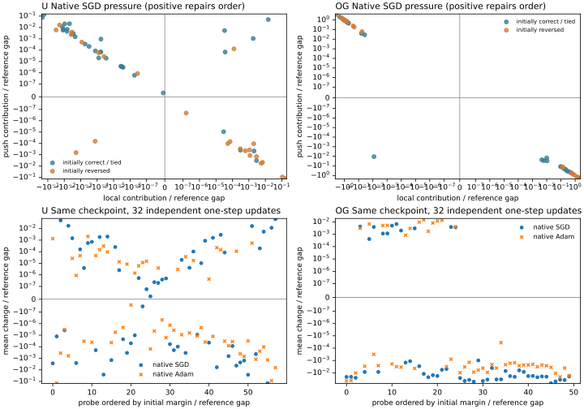

# 原训练机制是否在以同样的方式维持错误排序？

2026-11-02 · U-trap R0 50k 与 OGBench navigate seed0 100k · 原模型只读诊断

**本项不支持把两边统一解释为“推远项压过了本来正确的局部纠正信号”。** 在参考预选的错序动作对上，U 的局部项平均增加正确间隔、task/B1 推远项平均减少它；OG 的这批真实一步后继恰好相反。两种方向在每个环境内又都不是全体一致。共同点仍是原训练信号没有稳定维护决策所需的相对次序；具体哪个损失在纠正、哪个在破坏，依赖环境与被测查询，不能仅从一个已知走廊或总体局部违反率推断。

本轮没有持续更新模型，也没有改变两边训练配方。32 次 Adam 反事实都从各自同一完整历史状态独立出发，只用于测量一步响应。它比恒等式分解更接近训练机制，但仍不能单独确定原训练全程的根因。

## 1. 检查的是哪些动作对

U 使用全部 58 个有不同物理后继的专家图源。去除 (源、后继、成本) 完全重复的边后，按修订图的精确 c+V 选择最佳动作与最接近的严格次优动作，并列按原记录编号。OG 使用同一 50 个官方 task3 reset、完整 MuJoCo 状态和固定 121 动作，先按 0.2 环境图选择最佳与最近严格次优，再要求 0.1 图也严格同序；没有排除起点。每一对都在读取 critic 评分前确定。

定义 m=(c坏+J坏)−(c好+J好)，正值排对。U 58 对中 24 对 m<−10⁻⁴，其余 34 对排对；OG 50 对中 26 对反序、24 对排对，无模型并列。U 的参考间隔范围 0.00152–96.95，OG 本次所选间隔全部为 1。OG 后继映射到离散参考，仍不能当作连续环境精确最优值。

这里的“错序动作对”与先前报告的“critic 在全部候选里首选非最优”不同。前者只比较预选的两动作；critic 可能选中第三个动作。因此 24/58 和 26/50 不能替换统一诊断的首选错选率，也不能替换正式成功率。

## 2. 保留两边原损失与采样机制

U 恢复 R0 的终点 sampler，重放接下来的 32×256 个物理记录。原损失为 −0.6 task−0.4 B1+PHR，rho100，逐记录保存的乘子不变。一步 Adam 使用保存的一二阶矩与终点实际学习率 2×10⁻⁷；每批从同一状态独立更新，其 dual 更新只作用于临时副本。

OG 重放历史 M1 的 seed4400、32×1024 个官方 GCDataset 批次，三个字段的完整流 SHA 为 `4ee851da655b…`，与历史逐字节相同。继续使用原 softplus 推远、原 λ 乘平均局部正违反平方、原 dynamics 和 actor loss，Adam 学习率 0.0003、原完整状态。actor 对 value 的梯度最大值为 0；完整 value+dynamics+actor 梯度与官方 total_loss 核对一致。λ 自身的更新方向参与完整 Adam，m 对 λ 的直接导数为 0。

对每个动作对、每个批次计算 Δm_SGD=−lr〈∇m,∇L〉，正表示改善该对的正确间隔。下表先对一个动作对的 32 批取均值，再对同一环境中初始错序的动作对等权平均。**不跨环境比较梯度数值大小**，两边的学习率、目标尺度、网络和经验总体都不同。

| 初始错序动作对 | U：24 对 | OG：26 对 |
|---|---:|---:|
| 推远项平均 Δm_SGD | −0.002183 | +0.397825 |
| 局部项平均 Δm_SGD | +0.002352 | −0.403082 |
| 原总损失平均 Δm_SGD | +0.000169 | −0.006157 |
| 推远项均值方向为纠正 | 9/24 | 16/26 |
| 局部项均值方向为纠正 | 14/24 | 10/26 |
| 原总损失均值方向为纠正 | 12/24 | 11/26 |
| 局部纠正、推远反向 | 13/24 | 10/26 |
| 上一行且总压力仍破坏排序 | 4/24 | 6/26 |

OG 的推远和局部投影量级很大且相互抵消，不能只报告两者中有利的一项。平均 dynamics 投影由总项减两项约为 −0.000900；它不改变该组平均方向。U 中各自反传再相加与联合反传的最大相对 L2 差 7.28×10⁻⁶，最大坐标差 0.00195，属于报告保留的 FP32 抵消误差。[逐批投影](u/pressure.csv) · [OG 逐批投影](og/pressure.csv) · [逐状态汇总](per_probe.csv)



图上排每点代表一个状态/动作对；坐标均除以该对参考间隔，正方向增加正确间隔。图下排对同一动作对比较原总梯度和真实 Adam。symlog 用于显示不同量级，零线未移动。状态与共享网络梯度相关，不能把每个动作对的 32 批当作独立训练重复。

## 3. 曝光不足并不是已经识别的共同原因

U 的两个后继作为物理源出现的记录数，中位数在判对、判错两组都为 1。32 批内，24 个错对中 22 个至少有一侧后继没有被直接抽到；全部 58 对中为 50 个。OG 按后继半径 0.2 内训练物理源计数：错对的两侧中位数分别为 7.5、9，判对为 127.5、141；32 批内至少一侧邻域没有样本的错对为 16/26，全部为 25/50。

这支持检查支持度，但不能把“该点没有直接抽中”写成“无纠正梯度”。共享网络会从其他状态获得非零投影；U 中源副本数也不等于决定整条后缀的暴露量，OG 的邻域计数则不涉及这次目标被抽中的概率。

补充按参考间隔与两后继支持度分箱，U 有 8 个箱同时含对/错动作对，覆盖 42/58；OG 为 7 个箱、45/50。其余 16 和 5 个样本没有同箱对照。该描述性分层是在主结果之后补设，不是预注册因果匹配，也没有消除箱内位置、方向、目标或后缀差异。各箱梯度方向仍混合，不能由总体计数判定同一个曝光缺口。[分层和缺失对照](strata.csv) · [事后分层与数值说明](../../experiments/native_margin/NUMERICS.md)

同批次只在离线求导时将局部项按源等权，U 使用精确 canonical 源，OG 使用 0.2 源箱，原 push/dynamics 不动。错对中原总压力为纠正的数量，U 从 12/24 变为 9/24，OG 从 11/26 变为 15/26；对应总投影均值从 +0.000169 变为 −0.001979，从 −0.006157 变为 +0.012726。它说明经验权重的作用不同，不能将 U 的重复记录与 OG 连续密度等同。这里没有实际执行重加权 Adam，更没有由此推断完整训练能恢复导航。

## 4. Adam 的实际一步响应不能用普通梯度代替

| 初始错序动作对 | U | OG |
|---|---:|---:|
| 真实 Adam 的平均 Δm | +0.0000631 | −0.001618 |
| 真实 Adam 的 32 批均值为正 | 14/24 | 13/26 |
| 减去零新梯度动量对照后均值为正 | 12/24 | 0/26 |

这些数只说明原状态附近的更新响应。U 的实际变化约在 FP32 大值相减的量级，正号数量不等于已经修正排序。两边全部 32 批/全部 probe 的一阶位移预测与实际值最大差分别为 0.00102、0.00585；报告保留逐例误差，不要求非光滑 IQE 的有限步变化等于线性预测。OG 中部分原生一步改善来自继承动量，而相对零新梯度对照，新批次梯度在这 26 个错对上的均值全部更差。此差分也不是 push、local、dynamics 可相加的 Adam 因果贡献。

## 5. 对共同根因的判断推进到哪一步

1. **排除了过于简单的统一方向解释。** “原局部约束总是在修正这些错序，而推远项总在阻止它”不成立；相反方向在 OG 也大量出现。此前 OG 单走廊上推远项破坏上坡的结果并未被否定：它测的是一条长路线上的锚点与峰值，本次测的是真实一步动作后继。查询不同，局部训练压力也不同。
2. **仍有共同的目标冲突，但不是同一个已证实根因。** 两边都有部分动作对的局部纠正被抵消，也都有局部项对所测排序施加错误方向。局部距离可行性、特定目标的长程距离拟合、以及两个可执行后继的相对间隔并非同一观测量。
3. **尚不能由冻结点投影推出整个训练历史。** 需要在各自原损失上做小预算、同流、继承状态的损失消融，检查这里的压力能否预测有限续训的排序和闭环变化；无需把 OG 改成 U 的约束、目标或采样方案。

本项不报告新的导航成功率。旧成功率与本项梯度结果分开；此前共同的后继评分失效、U 的连续访问分布偏差、OG 的提取差距和有限控制预算仍然成立。[统一诊断](../unified_mechanism_20261102/report.md) · [平均约束低权边小图](../edge_weight_graph_20261102/report.md) · [同池查询选择消融](../e16_selection_ablation_20261102/report.md)

## 复现与核验

```bash
bash experiments/native_margin/run.sh "/Users/z./.codex/worktrees/5670/quasimetric-rl-topology-improvements" results/native_margin_reproduction
```

默认分别使用相邻主仓库的 Torch 环境和历史树的官方 JAX/MuJoCo 环境，可用 U_PY、OG_PY 覆盖解释器。输入完整 SHA 清单、32 批流、全部 probe、实际一步差与零梯度动量对照都留在输出目录。checkpoint 文件前后校验不变，OG 完整 agent 不变，U 模型与优化器恢复原态。原始数值与反事实中间状态均不提交；只提交实现、测试、协议、报告和本图。

完整重放的 7 份 CSV 与前一次完整计算逐字节一致。[复算核验](reproduction.json)。新选择/权重测试通过；原 OG 梯度分解、形状缩放与 Adam 动量 3 项 unittest 在历史官方运行时通过。本工作树没有 vendor 与原始场景文件，旧回归测试最初因缺少这些输入停止收集/fixture；改用历史 vendor，并将 U fixture 的场景路径显式绑定到同 SHA 的历史文件后重跑，不修改旧测试或训练源码。

[冻结协议](../../experiments/native_margin/PROTOCOL.md) · [执行入口](../../experiments/native_margin/run.sh) · [U 实现](../../experiments/native_margin/utrap.py) · [OG 实现](../../experiments/native_margin/ogbench.py) · [汇总](../../experiments/native_margin/summarize.py)
