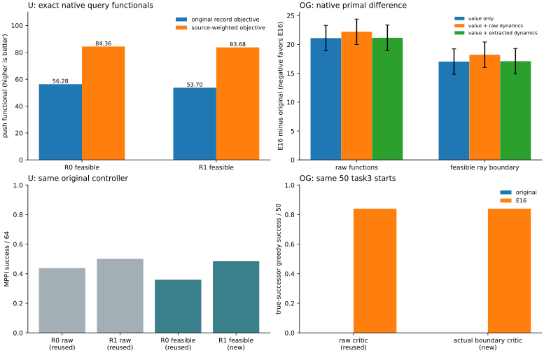

# 原配方内的可行参数反例：共同的训练代理漏洞与不同的求解问题

2026-11-03 · U-trap R0/R1、OGBench原100k/E16 · 新增训练更新为0

**本轮把共同点推进到了训练问题：两边都存在满足各自原经验约束的同结构神经距离场，原目标更偏好其中导航更差的那一个。** 这比“两个 critic 都有错误排序”更强，说明在当前有限模型与数据下，原经验训练指标不能稳定分辨控制所需的相对几何。该反例不依赖把 OGBench 改成 U-trap 的目标、PHR、采样或模型。

但也不能把它扩大成“所有失败都来自同一个具体单因”。U 当前冻结 PHR 子问题还存在已知更低 merit、控制更好的参数点；OG 的已知好距离场即使平均可行、动力学已匹配，仍被原目标明显惩罚。因此，共同的是**经验训练代理与控制查询几何的失配漏洞**，具体求解、支持分布、候选覆盖与提取问题仍须分开。

## 1. 为什么这次比较能回答上一项未解决的问题

8177519 发现 OG 原模型已在全100万训练边上平均可行，U 则在经验硬可行投影后仍失败；它尚未比较这些距离场在原训练目标下的优劣。本项固定已有较好字段与原字段，只在各自原可行域内部比较：

- U：同一seed606、同数据和网络的 R0/R1 50k；保留原任务集合、成本、task/B1端点及逐边上界。分别按全部物理边的 min(c/d) 取最大可行正缩放，留10⁻⁴数值余量。
- OG：原seed0 100k与已有E16 critic；保留原100%随机value目标、softplus推远、平均风险预算eps=0.05及原网络。分别在全部100万有效训练转移上求最大可行缩放，**允许放大到1以上**，避免E16只因没有用完局部预算而目标值偏低。
- 两边都只变已有神经模型的参数点，保持原架构。缩放只依赖训练转移，不看成败、评价目标或环境最短路。控制器、物理动作、成本与时限都保留原设置。[冻结协议](PROTOCOL.md)

这些点只是可行候选，不宣称为全局最优。原约束下的更好控制器字段，也不等于全域更精确的真实最优价值函数。本项比较的是原目标与实际控制质量的排序关系。

## 2. U：原目标更喜欢23/64的可行场，而非31/64的可行场

F0=.6 mean(Jtask)+.4 mean(JB1) 为原R0记录均值目标，越大越好。F1保留R1原来的任务源等权，只对task项乘原全局权重，B1和约束不变。两项均对全部42536条物理记录精确计算，没有随机查询估计误差。

| U 硬可行候选 | R0边界点 | R1边界点 |
|---|---:|---:|
| 最终投影层的正缩放 a | 0.2868575054 | 0.2626896515 |
| 全训练物理记录最大 h=d−c | **−0.00032139** | **−0.00024104** |
| F0，原记录目标（高为优） | **56.276315** | 53.701863 |
| F1，原源等权目标（高为优） | **84.358788** | 83.683005 |
| 同58分支内严格反序 / 483 | 154 | **141** |
| 165个专家起点图内平均额外成本 | 29.973395 | **29.396542** |
| 原H10/N128 MPPI，32起点×2 seeds | 23/64 | **31/64** |

两个候选都严格满足原经验逐边约束。R1边界点相对R0边界点新增成功8、失去0；而原R0目标降低2.574452，甚至原R1源等权目标也降低0.675783。不能将该现象解释成“R1只是通过违反原约束换来导航”。同样，它也不意味着只改源权重就保证指标与控制一致：F1对这两个可行点仍给出相反偏好。

原始未投影R0/R1是28/64、32/64，但两者经验硬约束都不可行；不能直接把它们的较高推远值当作可行优解。R0边界回合按父模型、缩放及原输入完全一致复用上一项结果；本项只新增R1边界64回合，全部首候选bank与原R系列同hash，原300步时限不变。[目标及可行性](u/points.csv) · [全部配对](control_pairs.csv)

独立核验改用原训练IndexedIQE及distances接口，四个raw/boundary点的F0/F1与本项适配器结果均逐值一致。64条新轨迹的3604步已用原环境动作重放，状态、奖励、终止完全一致。[U核验](u/verification.json)

## 3. OG：原value目标与原critic+dynamics目标都偏好0/50的场

OG原value局部风险为 R=mean(relu(d(s,s′)−1)²)，不是逐边硬约束。原推远损失为 P=E[100 softplus(5−J/100)]，**越小越好**。官方actor_loss对value/dynamics参数没有梯度，故它们的活动primal目标是P+D，其中D为原对称潜在动力学距离损失。另用原λ的P+D+λR核验，与官方total_loss在这两模块上的梯度一致；本项相对L2差约1.10×10⁻⁶、6.33×10⁻⁸。

没有直接比较total_loss前向数值。value_loss的局部项与lam_loss在前向会抵消，但它们的stop_gradient使梯度不抵消；混用该前向数值会误解约束和目标。[源码](../../experiments/native_objective_witness/ogbench.py)

### 约束与动力学均全量评价

| 同一OG训练总体，100万有效物理源 | 原100k | E16 |
|---|---:|---:|
| 原尺度的平均风险R | 0.049267295 | 0.025289769 |
| 可行边界正缩放a | 1.001852693 | 1.087474835 |
| 实际缩放网络的完整平均风险R | **0.049962308** | **0.049961862** |
| 边界点原raw动力学D | 0.05963455 | 1.25215817 |
| 边界点匹配提取后动力学D | 0.05656335 | 0.12388191 |

两点用几乎相同的原风险预算，均严格小于0.05。E16的放大不是由评价结果选出的，而是按原训练数据约束求得。

为了公平计算D，缩放phi末层时，同时将dynamics首层latent输入行除a、action行保持不动、末层输出乘a。这保留数学上的潜在坐标关系，没有重训。实际参数仍重新完整前向，不用a×旧D代替结果。所有参数形状、其余actor/λ叶、optimizer/RNG均核验不变；保存的是只读参数见证，不声称旧Adam矩已变换成新坐标下的等价续训状态。

每个critic分别保留原100k动力学，以及已有E17匹配提取动力学（原critic用A、E16用B），用于排除“好critic只是尚未匹配动力学”的混淆。本项没有再做任何提取训练。

### 新查询下的原目标比较

总预算固定1024×1024个原GCDataset查询，seed4400。审计发现前512批曾用于native_ablation，故主要统计只用后512批、524288个新抽样；全部1024批另保留描述。D与R来自完整训练总体，不带目标抽样误差。

| OG可行边界点，低为优 | 原100k场 | E16场 | E16−原场 |
|---|---:|---:|---:|
| P | **431.291432** | 448.317422 | +17.025990 |
| P+D，原raw动力学 | **431.351066** | 449.569580 | +18.218514 |
| P+D，匹配提取动力学 | **431.347995** | 448.441304 | +17.093309 |
| 真后继贪心，原50个task3起点 | 0/50 | **42/50** | +42成功 |

正差表示原目标更偏好原100k场。匹配提取动力学后，D差只有约0.0673；不能把约17.09的偏好差主要归咎于动力学未匹配。仅P本身就贡献约17.03。

按预定四个比较同时控制错误率0.05，利用P∈[0,100 log(1+e⁵)]的Hoeffding界，统一半宽为2.202969。边界P+D的差值区间为：

- 原动力学：**[16.015545, 20.421483]**；
- 匹配提取动力学：**[14.890340, 19.296278]**。

未缩放的两点也都平均可行，差值区间同向，分别为[19.983699,24.389637]、[18.949245,23.355183]。因此不是只靠某一次目标样本波动得出偏好。普通paired batch区间也保留，但主要判断使用更保守的界。它约束的是条件于固定数据/模型的原查询目标期望，**不是**导航成功率区间、环境泛化或跨训练seed证据。[四个比较](og/comparisons.csv) · [查询出处审计](og/query_history.json) · [统计说明](../../experiments/native_objective_witness/STATISTICAL_NOTES.md)

OG边界两点各新增50条完整真实后继贪心轨迹，原121动作、MuJoCo完整状态恢复、1000步时限不变。原点0/50、E16点42/50，较各自raw控制结果新增/失去均为0；两模型各50个起点的首动作也完全未变。这里使用实际FP32网络执行，未用正缩放argmin不变的数学论证冒充新回合。该表不是官方actor成绩。[100条新执行](og/episodes.csv) · [官方接口核验](og/verification.json)



左上只比较U两个硬可行点；右上为E16减原场，正值代表原指标惩罚E16，误差线是同时Hoeffding界。下排的raw回合来自既有完整记录，边界回合明确区分复用与新增；不将两个环境的成功率或目标数值合并。

## 4. 冻结求解器状态又揭示了什么

以上比较的是原约束问题目标。为避免将它误当成有限求解器正在优化的merit，又对全部候选做了事后只读补充，没有新增网络查询。

**U固定R0保存的逐记录λ和rho100。** 原R0的完整merit −F0+PHR 为−184.190349，而未缩放R1为**−187.593693**，更低且其原MPPI是32/64而非28/64。虽然该raw R1仍不满足硬约束，它是同一神经类、同一冻结PHR子问题内一个已知更低merit的点。因此当前R0并不是该冻结子问题的全局最小点；不能说U只是“原损失不允许任何更好导航场”。这支持保留有限内层求解、乘子演化与采样路径的问题，但不证明直线路径无障碍或任意优化器都能到达它。

限制到两个硬可行边界点，R0 λ/F0下merit为−88.428529、−86.180760，仍偏好较差控制点；R1 λ/F1下为−150.287163、−149.187072，也同向。原始点和可行点不能混为同一比较。[全部8个状态/候选组合](u/frozen_merit.csv)

**OG固定原λ=183.248138。** 给P+D差加上λΔR后，边界“匹配动力学”merit差仍为**+17.093227**，保守区间[14.890258,19.296196]；未缩放时为+16.758377，区间[14.555408,18.961346]。局部风险更低没有抵消原推远目标对该已知好场的惩罚。该平移只使用已精确计算的风险，因此没有增加随机比较误差。[完整OG merit比较](og/frozen_merit.csv)

这个补充不允许把两边概括成同一个求解器故障：U对已知raw改善点仍有更低primal merit空间；OG对这份已知改善场的原merit反而更高。它也不证明OG不存在第三个同时改善原目标与控制的可行场。[事后补充边界](../../experiments/native_objective_witness/SOLVER_NOTES.md)

## 5. 对原根因问题的回答

**可以确认共同的训练层薄弱环节：原经验目标对控制相关相对几何的辨识不足。** 在各自原可行域内，已经构造出“原训练指标更优、实际导航却更差”的成对神经参数反例。控制器依赖的是两个后继或有限时域终值之间的差分，而推远项汇总的是训练查询分布下的距离大小；两者在有限函数类和经验支持下并不自动同序。局部经验约束可行，不能替代这些决策比较的正确性。

**不能将所有失败归为同一个具体单因。**

- U还具有原R0/R1逐边不可行、冻结PHR内层未达已知较低merit点、图外访问的局部约束泛化，以及有限MPPI候选覆盖问题。R1原来的改善来自任务源测度调整，并非OG的随机目标机制。
- OG原模型在完整平均局部预算内可行；其原value目标100%随机目标，没有U的B1未来推远混合。已知好场的原目标代价更高，这一偏好在匹配动力学后仍存在。其actor提取差距另有已有配对证据，不能拿来解释已绕开actor后的0/50。

因此，合适的结论是：**两边共享“经验训练代理—控制几何失配”的可验证机制，但具体表现和求解瓶颈不同；不应将它们都命名为同一条稀有边、同一个λ失效，或同一种平均松弛最优解病因。** 这既保留共同解释，也避免用换配方制造可比性。

85b7b16的小图仍只证明了平均局部预算下低q足以迫使最优解反序。这里没有给真实神经问题做全局最优认证：两个可行候选的偏好反序，不等于所有全局最优解都导航差，更不反驳QRL理想条件下的定理。现在能比原两次提交更清楚地说：共同点不仅在评分输出，也已在原经验训练问题的有限可行候选偏好中出现；更具体的历史唯一根因没有被这项实验冒称识别。

可用于毕设的表述：

> 在保留U-trap与OGBench各自目标、局部约束、查询测度和网络结构时，我们找到满足原经验约束的神经距离场对照：原训练目标更偏好的场具有更差的闭环导航。两者因而共享训练代理对控制相关相对几何辨识不足的机制，但U-trap的逐边PHR求解/图外泛化、OGBench的平均约束与随机目标场、以及各自执行链路仍形成不同瓶颈，不能合并成同一个具体单因。

前四项证据链：[原约束可行性与总分析](../native_feasibility_20261103/report.md) · [原生梯度](../native_margin_20261102_verified/report.md) · [512步损失消融](../native_ablation_20261102/report.md) · [真实稀有边](../rare_edge_attribution_20261103/report.md)。本项没有将此前U的H误差与OG的T误差强行改写成同一分解项。

## 6. 预算、出处与核验

新增训练更新0。正式全量扫描为2个critic×2尺度×100万转移，分别保留原/匹配动力学D；固定查询1048576个，主要统计524288个新抽样；新增完整执行164回合（U64、OG100）。较早失败的原模型raw/boundary扫描另有200万转移的前向开销，未缓存也未冒称复用；它没有产生查询比较或控制终点。后续分块缓存均绑定参数、数据、kernel、batch、JAX/精度及文件SHA。

修复和修正均保留记录：初始小批梯度smoke编译路径不一致；D齐次性相对误差阈值对小重建误差过严；历史查询重叠由32批扩大核验为512批。约束、候选、a、总正式查询数量没有据结果修改，主要统计重聚合不重新查询模型。完整旧口径输出与执行源码快照留本地。[数值说明](../../experiments/native_objective_witness/NUMERICS.md)

5项测试覆盖硬/平均边界可放大、原shaping及置信界、零距离退化、动力学坐标/动作行不变、512批历史排除及幂等重聚合。独立核验还完成：U原训练前向完整目标一致；64条新物理轨迹3604步逐状态/奖励/终止重放；OG全总体风险/D缓存、官方value/dynamics接口分散批次核验（D均值最大差约1.53×10⁻⁷）、全部100条新轨迹、参数见证保存加载与原输入SHA。图已渲染查看。[U核验](u/verification.json) · [OG核验](og/verification.json)

```bash
# 全新目录；只读旧权重/数据，包含实际边界控制
bash experiments/native_objective_witness/run.sh "/Users/z./.codex/worktrees/5670/quasimetric-rl-topology-improvements" results/native_objective_witness_reproduction

# 已有完整产物时，仅重聚合/绘图；不重训、不重跑控制
../quasimetric-rl/.venv/bin/python experiments/native_objective_witness/reaggregate.py results/native_objective_witness_20261103/og
../quasimetric-rl/.venv/bin/python experiments/native_objective_witness/summarize.py "/Users/z./.codex/worktrees/5670/quasimetric-rl-topology-improvements" results/native_objective_witness_20261103
```

[入口](../../experiments/native_objective_witness/run.sh) · [U比较](../../experiments/native_objective_witness/utrap.py) · [OG比较](../../experiments/native_objective_witness/ogbench.py) · [官方接口核验](../../experiments/native_objective_witness/verify_og.py) · [统计重聚合](../../experiments/native_objective_witness/reaggregate.py)

仅提交源码、测试、协议/说明、报告和引用SVG；总体数组、参数见证、查询表、完整轨迹、审计、缓存、日志及临时PNG留本地。历史原权重、原数据和原官方源码保持只读。
