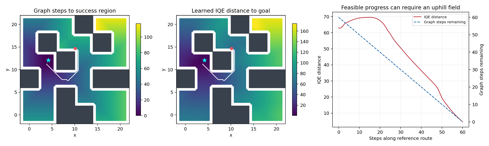

# E0：task3 距离陷阱复核与 critic 对照入口

日期：2026-10-29。分支：exp/ogbench。固定官方100k checkpoint的SHA256为397e919f2c453cee02ec840c615dce3532f31532fd639fbea6757c970fedbf0f。本项重新建立可复用的评价与训练工具，并核验基线；尚不包含A/B处理组终点结论。

## 已验证的基线结果

采用全部五任务、每任务5个固定扰动，保存完整初始integration state与目标。每个模型使用相同的库（SHA256 `5bb143317adf5c9198d1fd12ee3263a57236973719bbb036ff4dffe55525a95b`）。贪心控制每步枚举固定11×11动作，在完整MuJoCo状态恢复后实际执行候选并用critic评分，最终执行后继要求与枚举结果逐位一致。均使用官方成功条件和1000步TimeLimit。

| 任务 | 冻结官方 actor | 真实后继贪心 |
|---|---:|---:|
| task1 | 5/5 | 5/5 |
| task2 | 5/5 | 5/5 |
| task3 | 0/5 | 0/5 |
| task4 | 5/5 | 1/5 |
| task5 | 5/5 | 5/5 |

这复现了task3的actor失败。其他任务中若贪心控制失败，也应视作诊断工具和距离场的额外限制；不能把这组结果混同于官方actor成功率。5个扰动仅供机制检查，不足以宣称统计稳定。

## 距离场与真实可达性

在用户给出的固定锚点(10.1156,14.6827)、目标(4.2055,12.0898)上，以环境墙体和pointbody半径0.7构建0.2间距的独立图。边检查采用线段到矩形的精确最小距离，不只检查端点；没有训练使用的oracle标签。

图含7091个可行节点、53950条有向边；锚点吸附至[10.2, 14.8]，偏移0.1445。图参考剩余成本为60步，参考路线在真实MuJoCo中61步成功，最大节点跟踪误差2.49e-14。这是离散图近似，不能称为连续环境严格最优成本。

网络距离起值62.900；搜索全部图路线后的最低峰值为69.531，仍须上升6.631（整图距离IQR的0.119倍）。锚点没有严格下降通道。最短路线中的最低峰值也为69.531，不是挑选任意成功路线后判断距离错误。

| 路线步数 | 图参考剩余步数 | 网络距离 |
|---:|---:|---:|
| 0 | 60 | 62.900 |
| 10 | 50 | 69.121 |
| 15 | 45 | 69.531 |
| 20 | 40 | 67.533 |
| 30 | 30 | 50.590 |
| 40 | 20 | 36.407 |
| 50 | 10 | 19.479 |
| 60 | 0 | 4.554 |

全图参考步数与网络距离Spearman=0.951；出口走廊区域=0.298。全图下降可达比例=90.016%。这些整体统计不能掩盖当前锚点的局部排序障碍，也不直接揭示训练为什么产生障碍。网络距离未严格校准到环境步数，主要检查方向排序、下降可达性和执行。

## 控制实现与测试

- A逐字调用官方value_loss；损失及全参数梯度与官方实现相等测试通过。
- B只替换平均平方正部约束的残差；实测其梯度到达d(s,g)和d(s_next,g)两个端点，且公式依旧允许目标距离上坡。
- 使用非零预训练动量测试：两组更新value，actor/dynamics参数和Adam一二阶矩均逐位不变，避免零梯度但旧动量仍移动参数。
- 测试了准度量三角关系下goal残差不大于pair残差；扫掠边不能穿墙角；全部路线minimax与最短路线minimax区分正确。
- 在墙角接触态，交替候选后恢复完整mjData和TimeLimit，actor动作后继与原后继精确一致；候选枚举被选动作的真实执行后继亦精确一致。
- 共7项测试通过；另以真实100k模型完成配对两次更新、冻结检查和checkpoint保存烟雾。没有修改官方源码和原始数据。

## 已预注册的下一项实验

E1采用相同100k模型和Adam状态，pair/goal两组各额外10k，训练采样seed2001，同一批次和目标。actor/dynamics冻结，固定终点；每500步记录两类held-out残差，5k和10k保存。B是更弱的约束集合和不同梯度，不能声称原目标不变。

E1已启动，未完成。协议见仓库experiments/ogbench_critic/PROTOCOL.md。完成后用同一评价库和参考图评价110k终点，先比较下降通道与真实后继贪心执行，再决定是否进入多步。没有根据中途约束统计修改预算、学习率、容差或权重。后续若进入多步，需要纳入[MQE官方工作](https://mqe-paper.github.io/)，不将多步本身作为新颖贡献。

本项只确认原始陷阱可复核、实验控制可信；“为何学出该距离场”和“怎样稳定改善”的总目标仍未完成。原始数据、检查点、NPZ轨迹、JSON/CSV、日志及其他产物均不提交，仅提交源码、测试、协议、说明、本报告和引用PNG。
