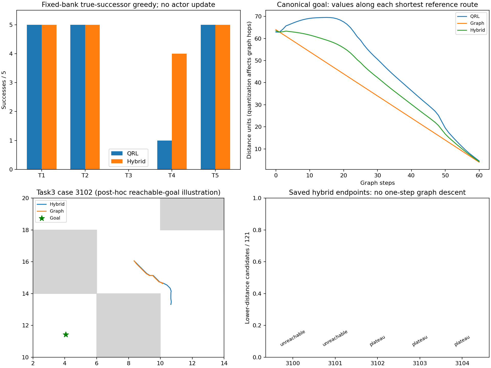

# 数据转移图对照：部分任务改善，task3仍失败

本项只使用官方训练集100万条有效真实转移构建非参数critic，不训练网络、不换seed、不运行1M。固定0.2粗粒化与0.5/0.5距离混合后，五任务真实后继贪心由16/25增至19/25，但task3仍0/5；纯数据图在task3也0/5。因此尚未达到稳定改善，不能把图内最短路或局部通道当成真实执行成功。

## 构造与预算

原官方QRL 100k文件SHA 397e919f2c453cee02ec840c615dce3532f31532fd639fbea6757c970fedbf0f 保持不变。沿官方compact Dataset.valid_idxs/get_subset得到全部训练(s,s')，完整观测恰为二维；penultimate终止转移保留、无效末状态不作源、无跨episode边。未使用验证集构图、MultiEpisodeData、终态quotient、R系列或墙体/参考路线；也未改变原QRL的数据权重。

图有6302个节点、43099条有向单位成本边，重复边是同一约束，未将频次当成本。完整观测rint(s/0.2)生成节点，查询使用最近已占用节点；等距时优先已占用rint格子。不可达距离固定截为节点数6302，仍是有向伪准度量。主critic为原QRL与图距离的等权凸和；图的量化/样本支持可能产生非真实捷径或遗漏连通，不能当环境真值或官方网络改善。

构图及初始化3.29秒，全部预定评价/场检查194.54秒，上限360秒内正常完成；参数摘要与checkpoint文件前后相同。2项测试通过，覆盖官方compact边界、重复边单位成本、方向性、不可达三角结构及保存加载。原actor/dynamics未更新；下表是诊断贪心，不是官方actor 50episode指标。

## 固定25例结果

| 任务 | 原QRL距离 | 混合距离 |
|---|---:|---:|
| task1 | 5/5 | 5/5 |
| task2 | 5/5 | 5/5 |
| task3 | 0/5 | 0/5 |
| task4 | 1/5 | 4/5 |
| task5 | 5/5 | 5/5 |

新增['task4_seed3102', 'task4_seed3103', 'task4_seed3104']，失去[]。纯图仅预定task3五例，全部0/5，其他任务未运行。不能以task4新增3例替代本轮task3目标；也不调整分辨率、混合权重或插值去挽救本实验。

## canonical目标场与实际目标不同

| critic | 原锚点严格下降通道 | 峰差/IQR | 全图Spearman | 原走廊Spearman |
|---|---|---:|---:|---:|
| graph | True | 0.000000 | 0.999115 | 1.000000 |
| hybrid | False | 0.000000 | 0.982427 | 0.944857 |

纯图canonical场排序接近参考最短路，原锚点有下降通道；混合距离仍无该严格通道。两个最低峰差均为零。它们与固定bank五个实际目标不同，不能把canonical的好图形冒充全部目标表现。参考碰撞图只在数据图保存和全部episode之后用于评价，未进入构造。

## 失败终点的只读单步核查

对已保存的两种控制器各五个task3结束integration state，另做post-hoc的121候选单步评分，共1.54秒（独立30秒上限），没有新增完整episode。此核查不改变主实验的194.54秒预算或结果。

| 保存终点 | 数据图不可达 | 当前图距离 | 最低真实后继图距离 | 严格降低候选数/121 |
|---|---|---:|---:|---:|
| hybrid_task3_seed3100 | True | 6302 | 6302 | 0 |
| hybrid_task3_seed3101 | True | 6302 | 6302 | 0 |
| hybrid_task3_seed3102 | False | 53 | 53 | 0 |
| hybrid_task3_seed3103 | False | 60 | 60 | 0 |
| hybrid_task3_seed3104 | False | 52 | 52 | 0 |
| graph_task3_seed3100 | True | 6302 | 6302 | 0 |
| graph_task3_seed3101 | True | 6302 | 6302 | 0 |
| graph_task3_seed3102 | False | 60 | 60 | 0 |
| graph_task3_seed3103 | False | 60 | 60 | 0 |
| graph_task3_seed3104 | False | 70 | 70 | 0 |

前两例的目标映射节点在该有限数据图中，除自身外6301节点都不能到达它，导致截断常数平台。这是图支持/查询映射的缺陷，不是现实环境不可达证据，更不能归为原QRL根因。其余三例目标在图中可达，但保存的两种控制器终点均没有真实单步候选降低图距离；对应较低距离图邻居距实际位置的最大轴差约0.232–0.374，大于名义0.2动作位移。相邻抽象节点的单位边不等于当前完整状态下一步可达，因此有图路径仍会因量化平台停滞。这也不能反推原神经场失败仅由量化造成。

## 决策与复现

不将这个带不可达目标映射和平台的图直接当神经critic监督真值，也不以重新平滑/换网格/调混合系数挽救M4。该项没有证明“只需显式最短路传播即可解决当前神经QRL”，只界定了一种便宜非参数对照的局限；仍需原神经critic上的受控改进与真实执行验证。当前总目标继续，禁止恢复seed1或1M程序。

本地路径：`results/ogbench_critic_20261029/data_graph_critic`，主日志同级`data_graph_critic.log`。命令：`run_data_graph.py <结果根目录> --output <全新目录>`；只读单步核查为`probe_data_graph.py <结果根目录> --output <全新probe目录>`；本报告使用`report_data_graph.py <结果根目录>`重建，不调用模型/环境。协议见[DATA_GRAPH_PROTOCOL.md](../../../experiments/ogbench_critic/DATA_GRAPH_PROTOCOL.md)。Git只提交源码、测试、协议、报告及引用图，原始图/轨迹/JSON/日志保留本地。

第一次post-hoc探针错误地断言所有非零图距离都必有较低邻居，在合法的不可达截断平台处退出；失败源码和日志保留在local_probes及probe_data_graph.log。修复该诊断断言后在全新local_probes_v2记录两类情况，未改主方法、重跑episode或延长主预算。
