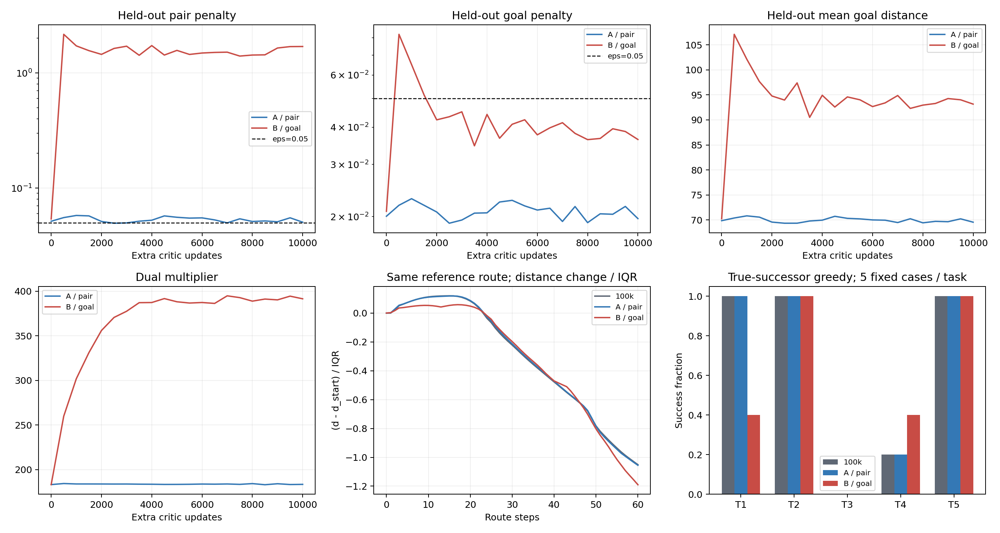
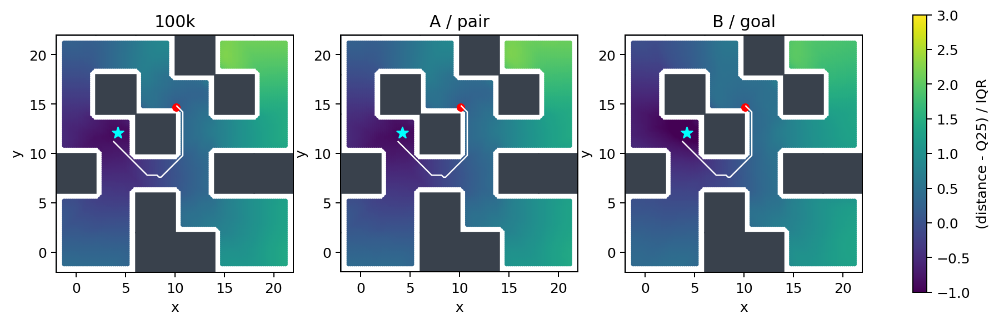

# E1：目标相关距离差与官方pair约束的固定终点对照

本报告只使用预先固定的额外10,000更新终点（总Adam count=110000），不选择中间checkpoint。A/B从相同100k模型和Adam状态恢复，同一采样调用产生批次与目标；actor/dynamics参数和Adam矩冻结。两组计数、全状态有限性、冻结证明及同库actor输出检查均通过。正式配对训练耗时1.622小时。

## 五任务真实后继贪心执行

| 任务 | 原始100k | A：pair续训10k | B：goal续训10k |
|---|---:|---:|---:|
| task1 | 5/5 | 5/5 | 2/5 |
| task2 | 5/5 | 5/5 | 5/5 |
| task3 | 0/5 | 0/5 | 0/5 |
| task4 | 1/5 | 1/5 | 2/5 |
| task5 | 5/5 | 5/5 | 5/5 |

这是固定11×11真实后继贪心诊断，全部episode遵循官方1000步TimeLimit。每任务5个固定扰动，不是官方actor评价或统计稳定性证明。actor被冻结，因此本轮不可能改善它在同一状态的动作。

A相对原始模型：新增成功0、失去0。B相对原始模型：新增成功2、失去4。B相对A：新增成功2、失去4。配对分母均为同一25例。

A/B的task1成功数分别为5/5和2/5；task4中B相对A新增2、失去1。任务级计数必须结合配对得失解释，不能只报有利的净计数。完整配对名单与轨迹保留本地。

## 距离场

| 指标 | 原始100k | A | B |
|---|---:|---:|---:|
| 全部路线最低峰值差 | 6.6311 | 6.565 | 3.3317 |
| 峰值差 / 距离IQR | 0.11946 | 0.11855 | 0.058019 |
| 整图距离IQR | 55.509 | 55.379 | 57.425 |
| 整图下降可达比例 | 0.90016 | 0.89705 | 0.91567 |
| 存在下降最短路后继的节点比例 | 0.96734 | 0.96748 | 0.98431 |
| 整图参考成本/距离Spearman | 0.95132 | 0.95161 | 0.93868 |
| 出口走廊Spearman | 0.29754 | 0.3066 | 0.32365 |
| 锚点严格下降通道 | False | False | False |

三模型使用同一0.2间距、半径0.7的碰撞检查图；参考路线均经真实MuJoCo执行成功。锚点吸附和连续最优性限制沿用E0报告。最低峰值差既报告原尺度，也按IQR归一化；严格下降可达性与秩相关不受统一正缩放和平移影响。曲线使用同一条E0参考路线，不为每个模型选择最有利路线。

B的局部峰值差在归一化后仍明显下降，说明不能把它完全解释成统一尺度变化；但峰值差仍为正，且固定贪心执行没有恢复task3。局部地形变化不足以构成稳定闭环改善。

## 两类约束与距离尺度

| Held-out终点统计 | A | B |
|---|---:|---:|
| pair平方正部 | 0.0505367 | 1.69713 |
| goal平方正部 | 0.0197061 | 0.0363877 |
| pair正残差比例 | 0.558594 | 0.848145 |
| goal正残差比例 | 0.226074 | 0.185059 |
| 随机目标上坡比例 | 0.490723 | 0.498047 |
| 平均目标距离 | 69.564 | 93.1561 |
| lambda | 183.493 | 391.401 |

Held-out为固定验证批次2048条；随机目标下的上坡比例只作诊断，任意行为转移远离任意目标本来可能合理，不能将其全部当作失败。B的约束由三角不等式可知弱于pair约束，所以B自身penalty下降并不证明保留了原局部可行性。必须结合pair统计、尺度和执行结果解释。

B的终点goal平方正部虽在eps=0.05内，但仍高于A；正残差比例较低并不等于平方正部更低。其pair平方正部约为A的33.58倍，这一代价与执行退化必须同时报告。

## 与M1梯度诊断的关系

在M1相同的两个固定probe节点上，原始/A/B的终点距离差分别为6.6311、6.5432、3.0346，相对上坡分别为0.100144、0.098749、0.035206。M1的一步B反事实平均增大该上坡，而10k后的B反而减小了它；这直接说明不能将一次局部梯度投影线性外推为长期结论。长期终点仍必须看通道和执行。

另一个范围限制：M1只分解value_loss，E1也只优化value_loss或其goal替换；官方端到端QRL的value参数还会受到dynamics_loss的梯度。A因此不是完整官方联合训练的预算对照。原方法完整预算是否恢复，仍由独立官方1M运行检验；不能凭E1把完整算法失败唯一归因于某个损失分量。

## 本轮决策与尚未完成的目标

B没有同时改善task3执行和锚点下降通道。本轮停止继续搜索这个约束的权重，下一项转向有明确离线目标的多步学习，并纳入MQE比较。

该结论只覆盖当前100k初始化、续训采样seed2001、单环境及固定25例诊断。稳定改善仍需独立采样/初始化、其他目标、官方完整预算基线以及actor利用新critic的单独验证。用户的总研究目标尚未完成；不凭这次单对照收尾。

若进入多步，遵循[MQE官方论文与代码](https://mqe-paper.github.io/)所涉及的多步准度量学习背景，不将任意行为路线长度强行作为最优距离等式，也不把多步本身视为新贡献。

源码、测试、协议、报告及引用PNG提交Git；模型、CSV/JSON/NPZ、轨迹、日志和其他中间产物保留本地。完整数值和配对结果在同目录analysis.json，原始日志见paired_10k/metrics.csv。
