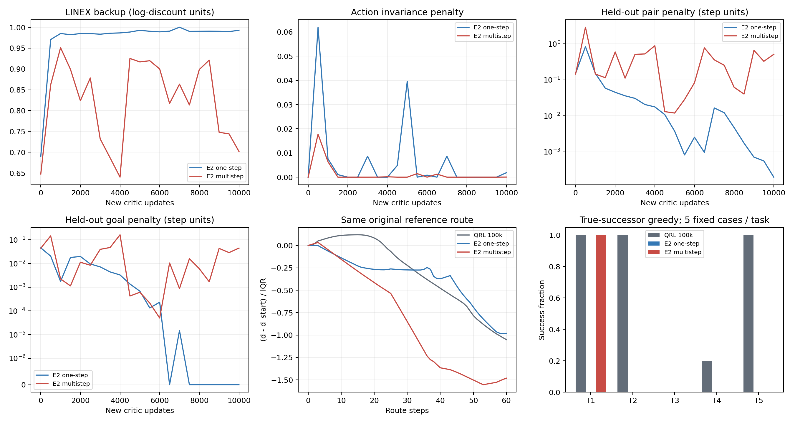
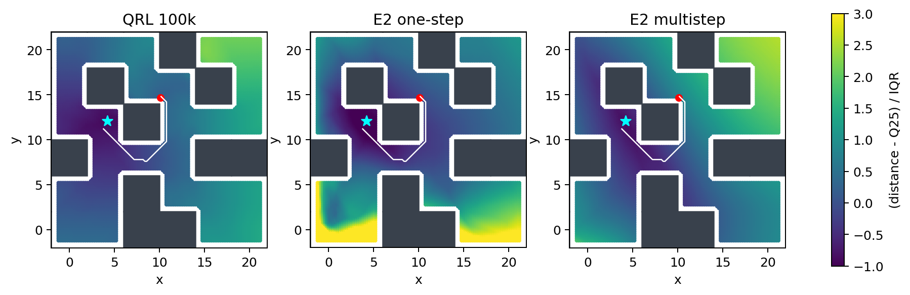

# E2：MQE-style IQE的一步／多步固定预算对照

仅评价预先冻结的新critic各10,000次优化终点，每组2,560,000条源转移；配对训练共耗时5.393小时。不是原官方110k模型，也不是原生MQE。完整新Adam计数、参数有限性、保存加载/RNG往返、原actor/dynamics参数与矩冻结及25例actor动作完全相同均已通过验证。

## 五任务真实后继贪心

| 任务 | 原始QRL 100k | E2 one | E2 multi |
|---|---:|---:|---:|
| task1 | 5/5 | 0/5 | 5/5 |
| task2 | 5/5 | 0/5 | 0/5 |
| task3 | 0/5 | 0/5 | 0/5 |
| task4 | 1/5 | 0/5 | 0/5 |
| task5 | 5/5 | 0/5 | 0/5 |

原始模型仅作起点背景。因果备份长度对照是one与multi：两组共享原始100k初始化、缩放后的IQE、状态动作编码器、全新Adam、转移、目标及批内抽样；两者只改变waypoint/备份步长。与E1相比存在多处改变，不能将跨实验收益只归于多步。

- baseline_to_one：新增0、失去16；新增名单[]；失去名单['task1_seed3100', 'task1_seed3101', 'task1_seed3102', 'task1_seed3103', 'task1_seed3104', 'task2_seed3100', 'task2_seed3101', 'task2_seed3102', 'task2_seed3103', 'task2_seed3104', 'task4_seed3100', 'task5_seed3100', 'task5_seed3101', 'task5_seed3102', 'task5_seed3103', 'task5_seed3104']。
- baseline_to_multi：新增0、失去11；新增名单[]；失去名单['task2_seed3100', 'task2_seed3101', 'task2_seed3102', 'task2_seed3103', 'task2_seed3104', 'task4_seed3100', 'task5_seed3100', 'task5_seed3101', 'task5_seed3102', 'task5_seed3103', 'task5_seed3104']。
- one_to_multi：新增5、失去0；新增名单['task1_seed3100', 'task1_seed3101', 'task1_seed3102', 'task1_seed3103', 'task1_seed3104']；失去名单[]。

同一25例完整integration state和目标、11×11动作网格，候选真实后继恢复与实际执行逐位一致；全部episode使用官方1000步TimeLimit。每任务5例是诊断样本，不能称稳定成功率或官方actor50episode评价。完整逐步轨迹均保留本地，形状、长度和有限性已经核验。

## 距离恢复与约束

| 指标 | 原始QRL 100k | E2 one | E2 multi |
|---|---:|---:|---:|
| 全部路线最低峰差 / IQR | 0.11946 | 0 | 0 |
| 整图严格下降可达比例 | 0.900155 | 0.32365 | 0.751516 |
| 有下降最短路后继的节点比例 | 0.967342 | 0.972761 | 0.957787 |
| 整图成本/距离Spearman | 0.951321 | 0.514468 | 0.87041 |
| 出口走廊Spearman | 0.29754 | 0.929536 | 0.927664 |
| 锚点下降通道 | False | False | False |

同一0.2网格、半径0.7，参考路线均经真实MuJoCo执行成功。下降容差随单位乘c，峰差按各自IQR归一化，同路线曲线使用原模型预先固定路线。IQE输出为log-discount距离，不能把其原始数值直接与QRL步数尺度比较；下表除以c只是确定性换单位，不证明校准为最短到达成本。

最低峰差为零只说明存在一条不超过起点高度的图路线，不等于该路线每一步都严格下降；局部先下降再上升或平台仍可阻断贪心执行。此处两组仍无锚点严格下降通道，不能把零峰差称为陷阱已消除。

| 固定held-out终点 | one | multi |
|---|---:|---:|
| pair平方正部（步数单位） | 0.000197925 | 0.509773 |
| goal平方正部（步数单位） | 0 | 0.0446965 |
| 平均距离（log-discount） | 0.00592106 | 0.285065 |
| 平均距离（除以c） | 1.18125 | 56.8704 |
| 随机目标上坡比例 | 0.501465 | 0.509277 |

两类正残差都是固定2048条验证样本的诊断；E2没有直接优化原pair/goal约束或lambda。随机行为转移可能远离随机目标，不把任意上坡都当作错误。LINEX loss和动作不变性也不能替代通道与执行检验。

one组终点平均距离仅1.18个原步数单位，pair/goal残差很小，但全图排序和执行明显退化。这是距离尺度/辨别能力收缩的证据，不是恢复长程最优距离。multi保留较大距离尺度并优于one的部分排序和task1执行，但仍比原始模型失去11个成功例，task3没有恢复。仅用16个批内目标估计、IQE与单critic等适配也限制了跨方法归因，不能据此宣布原生MQE无效。

## 决策与范围

两组均未恢复task3执行或锚点下降通道；本次固定预算不支持该IQE备份实现已经解决距离恢复。不挑中间模型或调权重挽救本轮；转而结合已完成的原生MQE和既有失败轨迹检验机制，不追加换seed或1M QRL。

采用[MQE原文及官方代码](https://mqe-paper.github.io/)的备份思路，不将多步本身当作新贡献；本实现保留IQE、单critic、冻结actor及固定16个批内目标无偏估计，因此不能标记为原生MQE复现。终点数值、逐步轨迹与两张图已审阅，原生MQE 100k的既有结果另行比较；当前总研究目标未完成。

2026-10-30用户明确禁止以换seed证明非偶然性，也不运行1M QRL；两项对应程序已停止，按[CURRENT_LIMITS.md](../../../experiments/ogbench_critic/CURRENT_LIMITS.md)覆盖旧计划，不再把它们当作后续必要门槛。结论范围限定于现有模型、目标及执行证据，不声称跨seed/完整预算泛化。

原始日志与新critic bundle位于multistep_10k，逐步轨迹和图数组在e2_one/multi_greedy与e2_one/multi_field；机器可读比较位于本目录analysis.json。仅源码、测试、协议、说明、报告及引用PNG进入Git。
