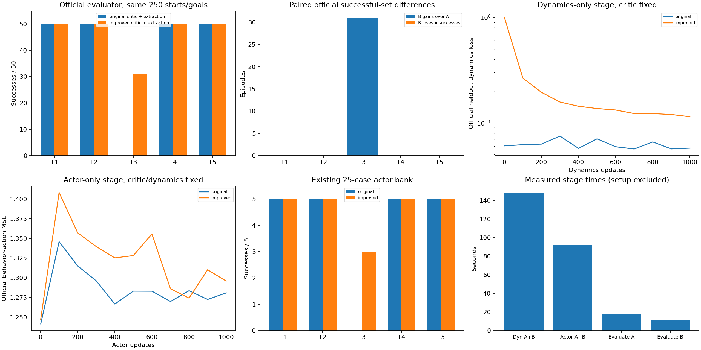
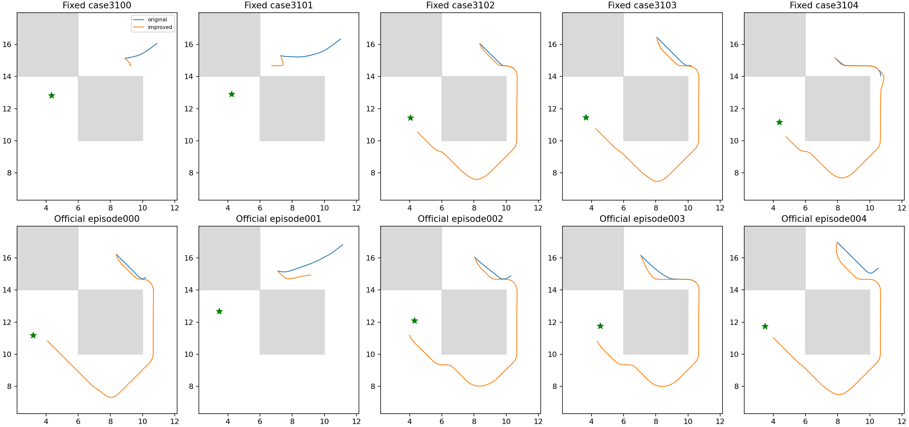

# E17：冻结critic的官方动力学与actor提取对照

两组各完成1000次动力学及1000次actor更新，全流程277.15秒/600秒上限。官方评价器在相同250起点/目标上，A原critic提取200/250（80.0%），B改进critic提取231/250（92.4%）；task3分别0/50、31/50。预定逐任务改善门槛为True；固定bank的B相对原actor新增['task3_seed3102', 'task3_seed3103', 'task3_seed3104']、失去[]。不能将已通过的E16神经贪心门槛当成actor利用成功。

## 受控提取与冻结证据

A为原100k QRL，B为E16固定1000终点；开始时actor/dynamics/lam参数/Adam矩及agent RNG完全相同，value不同。B已有额外1000次价值更新，不声称同总训练预算。本项匹配额外提取更新和批次；两组先仅官方dynamics_loss各1000，再仅官方actor_loss(ddpgbc)各1000，critic/lam全程冻结，actor阶段dynamics也冻结。

原alpha0.0003、lr3e−4、512×3网络、const_std、Q归一化/BC和100%未来actor目标均不改；batch256/seed2001连续2000个原官方批次，阶段间不重置，两组共享每批。无教师/图/评价目标/模拟器搜索训练标签。阶段化与冻结不同于官方main联合优化，属于提取适配实验，不是论文完整预算。

优化器原矩/count保留，冻结模块不经Adam。A/B最后计数102000/103000，分别代表这套分阶段更新次数，不能称官方联合102k/103k。测试确认当前FP32范围的bias correction均为1，1000计数差不改变相同梯度的Adam更新；没有伪造count。agent RNG按官方split顺序更新，阶段NumPy sampler状态也保存本地。

三项测试通过：官方模块梯度/非零矩冻结与RNG/count、FP32计数偏差、记录适配器透明转发。实际smoke每组各两步动力学/两步actor，保存加载完整一致，再重置正式初态；各阶段固定终点全agent/Adam/RNG有限/往返与冻结检查通过。固定2048验证上的critic输出逐位未变，已验证E16距离函数因而保留，未浪费时间重跑其贪心评价。

动力学前三字段流SHA c479992dde1cf84a74d25a0f74c3f88a07252f02198489bd40f4df2604949ab6同E16；含actions/actor_goals全流SHA a3122fb45acb6b6898f041e29472ceef3a2de2880a7dfb056ebcc09d2ee8d01e。actor阶段全流SHA d929d8ea6124aa2aa738d054b3370b5c61ba43bd836703e88544925e668d0ca6。没有查看中间成功率或按最好模型选终点。

## 官方全部五任务，每任务50episode

| 任务 | A原critic+同预算提取 | B改进critic+提取 | B新增A失败 | B失去A成功 |
|---|---:|---:|---:|---:|
| task1 | 50/50 | 50/50 | 0 | 0 |
| task2 | 50/50 | 50/50 | 0 | 0 |
| task3 | 0/50 | 31/50 | 31 | 0 |
| task4 | 50/50 | 50/50 | 0 | 0 |
| task5 | 50/50 | 50/50 | 0 | 0 |

每组全新独立Python进程直接调用固定官方utils.evaluation.evaluate和原QRLAgent.sample_actions，temperature0、gaussian=None、video0。只加deadline/reset/终止记录，不改数值语义；原训练数据加载返回但不用于决策，未导入教师/图/候选筛选模块。全部250起点/目标逐位匹配，不只是相同seed声明。评价RNG0是同样样本流控制，不是换训练seed或独立初始化复现。

上述A为新提取控制，不冒充原100k的那次评价逐例重放；原100k官方结果[50,50,0,50,50]/50、80%仅为历史背景。每个task保存官方全部统计、50条完整观测/动作/goal/奖励/done和末状态。均值为五任务等权，配对得失同时报告。

## 既有25-case actor bank

| 任务 | 原100k actor | A提取 | B提取 |
|---|---:|---:|---:|
| task1 | 5/5 | 5/5 | 5/5 |
| task2 | 5/5 | 5/5 | 5/5 |
| task3 | 0/5 | 0/5 | 3/5 |
| task4 | 5/5 | 5/5 | 5/5 |
| task5 | 5/5 | 5/5 | 5/5 |

既有扰动case全部保留，完整1000步/成功终止，无新增seed或重跑原基线。E16 critic的25/25是真实后继贪心，表中是直接actor，两者必须分开。上方官方250例与此bank也不可混为同一成功率。

## 结论范围及复现

本轮通过预定逐任务改善门槛：task3从0/50到31/50，其他四任务的200例成功全部保留；B官方成功集合对A严格扩展31例、无失去。固定bank恢复三个task3、原actor20成功均保留。说明改进critic可被同一官方提取损失实际利用，效果不是额外actor预算单独解释：A接受同样提取预算，task3仍0/50。

仍有19/50 task3失败，既有bank两例也未恢复，不能宣称task3完全解决或把这些失败全部归于actor。E16贪心25/25来自已知方法选择库；本次250例是冻结终点的新评价流，未用于调E16/E17，但仍为同训练初始化/固定环境范围。下一项应只读区分这些新查询上的critic和提取缺口，不继续调BC权重/lr/阶段长度/预算。

不声明跨seed稳定或官方完整预算最终缺陷，不把没有新初始化/1M当未完成的必需补跑。方法包含新增全局教师先验和阶段化适配，不能称官方QRL算法原样成绩；保留原100k、MQE和负结果对照，最终机制结论仍须限定证据强度。

协议[EXTRACTION_PROTOCOL.md](../../../experiments/ogbench_critic/EXTRACTION_PROTOCOL.md)，test_extraction.py；入口run_extraction.py <根目录> --output <全新目录>，独立评价evaluate_extraction.py由主入口调用，report_extraction.py只读重建。raw results/ogbench_critic_20261029/extraction_1000，日志同级.log与两个子评价.log。A checkpoint original/actor/params_102000.pkl SHA 0f0c1fc98bb1d4cbba09590f6004a132a012ae221a101feb703ea95e465b87a9；B improved/actor/params_103000.pkl SHA dbec9e4ad128ca519611f40ad4d3a1f02118f92e8a6513afd074c8d1a623978e。原100k/E16源文件、官方源码、全部阶段checkpoint/源码/轨迹身份已核验；只提交代码/测试/协议/本报告和两张引用图，原始模型/CSV/JSON/NPZ/日志不提交。
