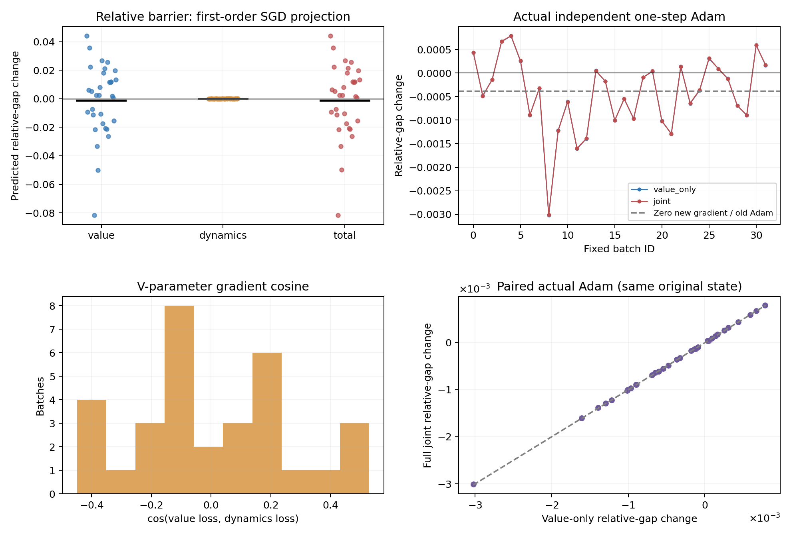

# M2：补齐官方动力学损失对value距离场的梯度作用

在严格固定的原始100k checkpoint附近，动力学损失对当前probe的一步更新影响较小：完整联合Adam相对value-only的平均相对上坡变化差为2.11573e-06，32批次实际变化符号不同的次数为0。动力学分量的一阶SGD投影平均增大上坡，实际联合一步相对value-only平均更不利，但两组实际平均仍为-0.000437039、-0.000434923。actor_loss对value的梯度在本配置下为零。这补齐M1的范围限制，不支持将动力学在此处的一步作用认定为主导原因，也不证明全训练历史的唯一原因。

## 控制与实测核对

与M1使用同一seed4400、32个官方batch1024、同原始模型及Adam状态；probe仍为预先固定参考路线节点0/15及task3目标。每个反事实独立从原模型出发，不串联训练，不保存权重。M1的整条批次流hash一致，32次value-only实际反事实逐项相等，原始状态摘要前后相同。运行约100.49秒。

value+dynamics+actor对value的分量梯度之和与直接total梯度核验通过，各批次最大叶元素误差的均值为3.603e-05，全体最大为5.579e-05；actor对value的梯度范数32/32为零。三项独立测试另外检查原生全参数total梯度切片与分解相等、动力学确实到达value而actor不达，以及数值比较拒绝实质梯度改变。没有把同批次32次测量称为32个初始化。

首次运行只按最大绝对误差<5e-5验证，在第二个批次（batch=1）5.3406e-5处中止，失败日志保留在full_gradient.log。此处重新运行相同32批次，使用逐元素rtol2e-5、atol5e-5以处理独立FP32融合及梯度尺度；没有改变公式、样本、模型或方向判据。最终最大误差和分布仍保留，不将误差截为零。运行时协议的失败批次曾误写“第一批”，此为文字勘误；原运行协议按哈希保留在source_snapshot中。

## 一阶梯度证据

| SGD一阶相对上坡投影 | 均值 | 标准差 | 正 / 负 / 零 |
|---|---:|---:|---:|
| value | -0.0011368051 | 0.025508843 | 19 / 13 / 0 |
| dynamics | 4.907936e-05 | 6.4810103e-05 | 25 / 7 / 0 |
| actor | 0 | 0 | 0 / 0 / 32 |
| total | -0.0010877281 | 0.025505957 | 19 / 13 / 0 |

正值表示该损失分量的普通SGD方向使相对上坡增大，负值表示减小。相对量为gap / 两点距离均值，去除统一正缩放的主要影响；不能代表全图所有目标的空间排序。动力学投影正25/32、负7/32；完整total投影正19/32、负13/32。

value/dynamics在value参数上的梯度夹角cos均值0.000437502；各自梯度范数均值56.3259、0.980491。梯度整体夹角、范数与特定probe投影是不同测量，不能相互替代。

## 实际官方Adam反事实

| 实际一次Adam相对上坡变化 | 均值 | 标准差 | 正 / 负 / 零 |
|---|---:|---:|---:|
| value_only | -0.00043703872 | 0.00078756772 | 11 / 21 / 0 |
| joint | -0.00043492299 | 0.00078691363 | 11 / 21 / 0 |
| joint_minus_value | 2.1157321e-06 | 6.4227656e-06 | 21 / 11 / 0 |

joint直接调用原生agent.update，actor/dynamics也更新；本表只读取更新后的value场，不将joint称为冻结actor实验。zero-new-gradient、仅旧Adam矩产生的相对上坡变化为-0.00038610399。完整联合相对value-only的配对差为正21/32、负11/32。Adam预条件与动量是非线性的，不能把此差值当作可加的“动力学Adam贡献”。

两组实际变化符号不一致的批次数为0/32。相较value-only每批绝对变化均值0.000657216，联合与value-only的平均差仅2.11573e-06。因此在当前probe的一步更新上，动力学影响较小；这既不支持其在此处占主导，也不能排除其在整个训练历史中长期累积的作用。

## 对当前研究的约束

M1只测value_loss的表述应继续保留；M2补测了官方联合梯度，但仍是原模型附近的单步局部证据。特定损失在这个probe上朝不利方向，并不足以证明该损失应被移除；动力学也承担策略提取所需的建模功能。不会据此修改正在进行的E2、MQE或官方基线配置。

距离场为何导致失败的执行机制已有独立图和真实后继控制支持；训练为何形成此场的历史解释仍需结合固定预算终点、完整官方预算及独立seed核验。即使某次SGD投影向好，M1/E1已经表明也不能外推长期通道恢复。稳定改善、其他任务不退化以及actor利用新critic仍待完成。

源码及固定协议见[full_gradient.py](../../../experiments/ogbench_critic/full_gradient.py)与[FULL_GRADIENT_PROTOCOL.md](../../../experiments/ogbench_critic/FULL_GRADIENT_PROTOCOL.md)。原始逐批数据位于本目录analysis.json，成功运行日志位于同级full_gradient_fp32.log；仅源码、测试、协议、报告及引用PNG进入Git。
