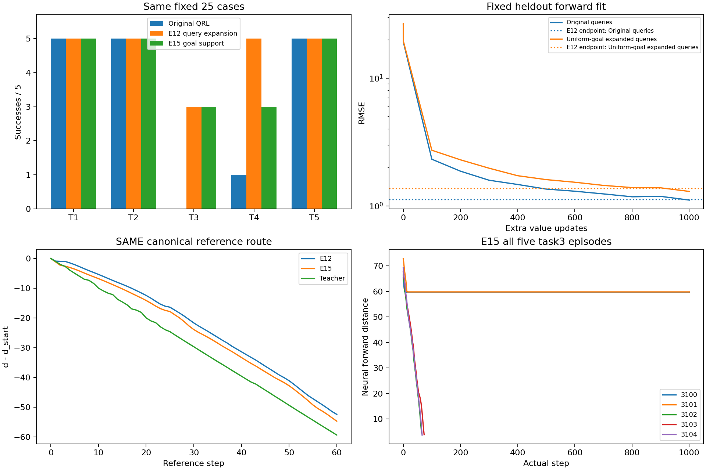
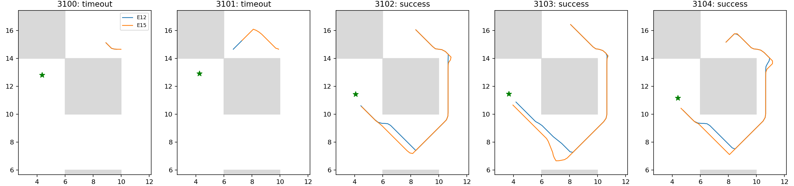

# E15：固定全局教师的目标支持均衡

固定1000步后21/25成功、task3 3/5；E12为23/25、task3 3/5。相对E12新增[]，失去['task4_seed3102', 'task4_seed3103']；失去原100k成功例[]。预定critic门槛False，不能用随机对拟合误差替代。总141.78秒（训练/核验94.65、独立神经评价44.78），低于300秒。

## 唯一变量与训练证据

同E12原100k IQE/value Adam/count/lr、双向等权教师MSE、source查询、batch256/1000步、原官方采样seed2001。偶数行仍原(s,g)，奇数source仍原数据s加同Sobol偏移，goal中心改为均匀遍历E10所有6302个实际数据原型，再加同Sobol goal偏移[-1,1]。幅度/比例/损失和source分布不变，没有新的随机seed、评价墙体/目标/路线标签或原型筛选。不是E7原QRL源权重实验；此处改变的是新全局监督问题的goal分布。

原型j编号乘固定互素stride=3895再模K；stride由ceil(K*(sqrt(5)−1)/2)起取首个互素整数，不扫描。128000个均衡goal每原型20或21次，全部保留，非挑任务邻域；扩展位置可能物理不可达，仅作抽象教师查询，不是新真实转移。M5已证明教师对角跳变，仍不要求全域一致拟合、不把近似先验当真实MDP最优距离。

原始流SHA c479992dde1cf84a74d25a0f74c3f88a07252f02198489bd40f4df2604949ab6同E6/E12；每批source逐位同重建E12，重建旧查询流SHA 0d3204c71dee6c3d07fd7d4136983087a7289060149b04d2fb67d676c7abb812与E12相同。新查询SHA 022856c711ee0d6def23b28014a9765391c2dbd75d394c1474bf4f423c88619c，标签SHA fefaa7f6dafaa1b8520f6be6c5f3a095f17b56567c455bfc0b57251772660d7c；控制E12直接复用，没有重训/重评episode。原/旧扩展/新均衡扩展三组验证同时记录，未按曲线改预算或挑最好。

三项采样器测试通过（人口质量/互素遍历，source/偶数goal/输入不变，分块复现/NumPy RNG不变）；原E11损失与优化器代码不改。实际两步smoke完整保存加载，正式回到原100k及RNG；终点count101000/step101001，全部状态有限/往返、actor/dynamics/lam参数和Adam矩冻结、同bank actor输出逐位核验通过。

## 完整真实执行

| 任务 | 原100k | E12 | E15 | 固定教师 |
|---|---:|---:|---:|---:|
| task1 | 5/5 | 5/5 | 5/5 | 5/5 |
| task2 | 5/5 | 5/5 | 5/5 | 5/5 |
| task3 | 0/5 | 3/5 | 3/5 | 5/5 |
| task4 | 1/5 | 5/5 | 3/5 | 5/5 |
| task5 | 5/5 | 5/5 | 5/5 | 5/5 |

| task3 case | 成功 | 完整步数 | 严格下降比例 | 上坡比例 |
|---|---|---:|---:|---:|
| task3_seed3100 | False | 1000 | 0.0070 | 0.0000 |
| task3_seed3101 | False | 1000 | 0.0170 | 0.0000 |
| task3_seed3102 | True | 64 | 1.0000 | 0.0000 |
| task3_seed3103 | True | 73 | 1.0000 | 0.0000 |
| task3_seed3104 | True | 66 | 1.0000 | 0.0000 |

全部25例独立Python推理子进程仅载入QRL checkpoint、原forward IQE，无教师路径或图导入、无对称包装。121真实后继/T1所选实际后继逐位核验和精确缓存保持，完整1000步/成功终止，不按停滞早停。参考墙体图只在episode后评价；这不是官方actor成绩，原actor仍冻结。

## 三种验证分布及场

原验证forward/reverse RMSE 1.10942/1.08012，E12 1.12335/1.11464。旧E12扩展验证1.27198/1.24078，E12 1.32894/1.31636。新均衡扩展验证1.29650/1.33684，E12在同新批次只读评分1.37311/1.41091。它们的目标分布不同，必须同组比较，不跨组当收敛优劣。

canonical通道True、峰差/IQR 0.000000，全图/corridor相关0.996475/0.993860。仍为0.2参考图、锚点吸附误差0.14451的离散证据，不能替代真实失败。原pair平均/尾风险0.015932/0.115671、goal风险0.001163，lambda固定183.248，不作新优化收敛宣称。

## 出口与复现

本轮门槛未通过：均衡后task3成功集合没变，丢失E12的两个task4成功。三组验证RMSE均略改善而执行下降，说明即使改善另一种广泛查询分布上的平均拟合，也不足以保护关键动作排序；不能据此认定目标频次是充分根因，也不能泛化为所有目标采样均无效。停止本均衡比例/stride/幅度/lr/预算搜索，不启动actor训练。

下一项可另冻结针对高拟合残差的全局监督机制，检验平均损失是否掩盖少量关键误差；不能使用已有评价失败点回填训练，也不能扫描本均衡的参数挽救。此处只是后续假设，尚未运行。现有bank用于方法选择，不是独立跨seed验证；不换seed、不运行1M、不恢复已停程序，不宣称论文完整预算复现或未验证的稳定改善。对原QRL的失败解释不能偷换成“目标数据缺失”，本项没有重新做覆盖审计。当前保留的较好神经方法仍E12/E13的23/25、task3 3/5，总目标未完成。

协议[GOAL_SUPPORT_PROTOCOL.md](../../../experiments/ogbench_critic/GOAL_SUPPORT_PROTOCOL.md)，测试test_goal_support.py，入口run_goal_support.py <根目录> --output <全新目录>，报告report_goal_support.py <根目录>只读重建。raw results/ogbench_critic_20261029/goal_support_1000，日志同级.log，checkpoint model/params_101000.pkl SHA 0962182905edb8ec29b219aa1a4d58f2537dbe9fd13ff80201c5d9461971d1a4。原模型/教师/E12/源码/全部同bank轨迹/结束状态已核验。只提交代码、协议、测试、报告与引用图，原始数组/模型/日志不入库。
