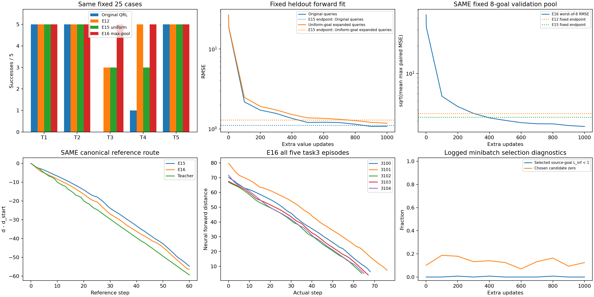
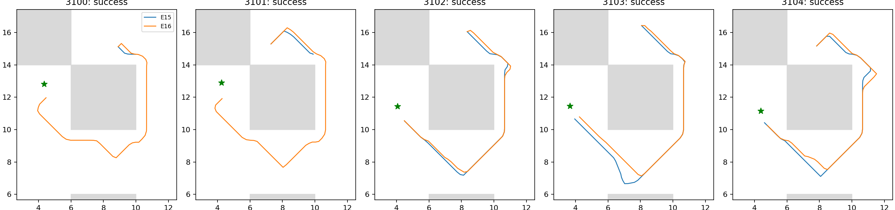

# E16：固定八候选池的最坏全局拟合监督

固定1000次更新后25/25成功，task3 5/5；E15为21/25、task3 3/5，E12为23/25、task3 3/5。相对E15新增['task3_seed3100', 'task3_seed3101', 'task4_seed3102', 'task4_seed3103']，失去[]；失去原100k成功例[]。预定critic门槛True。总297.95秒，训练核验257.42、独立评价38.43，低于360秒；候选前向额外计算，不声称等FLOP/墙钟。

## 固定学习问题与控制

同原100k IQE/value Adam/count/lr、E10教师、原始官方sample256/seed2001/1000更新。actor/dynamics/lam参数和Adam矩冻结。半批原始(s,g)保持，半批source及Sobol扰动同E12/E15；其goal从固定8候选中选当前双向MSE最大的一个，选择不反传。候选k编号((j+k*floor(K/8))*stride)%K，K6302、stride3895，同一行goal偏移相同，候选0逐位同E15，未扫描池大小/比例/相位。

新目标是半批原始平均MSE+半批有限池最大MSE的次梯度，不宣称原经验目标不变，也非原QRL局部风险top-k。只通过训练数据/固定教师/当前网络误差选目标，没有评价失败点、墙体、路线标签或模拟器生成转移；原轨迹/valid/未来目标语义不变。扩展查询可物理不可达，M5对角不可一致拟合限制保留，因此需检查是否追逐近对伪影，不能把高残差都叫真实最优距离误差。

三项测试通过：候选0/source/输入/人口循环/RNG身份，双向误差与并列取首，选中查询梯度等价显式max-pool目标（FP32 rtol2e−5/atol3e−5）。原E11优化器和损失不改。真实两步smoke完整保存加载后重置原模型/RNG，终点count101000/step101001、有限性/全状态往返/冻结参数与矩/同bank actor输出逐位核验通过。

原流SHA c479992dde1cf84a74d25a0f74c3f88a07252f02198489bd40f4df2604949ab6同E6；旧E12 query SHA 0d3204c71dee6c3d07fd7d4136983087a7289060149b04d2fb67d676c7abb812、候选0完整query SHA 022856c711ee0d6def23b28014a9765391c2dbd75d394c1474bf4f423c88619c同E15对应流，每批source逐位核验。池SHA 411bc31c455c481ec4c2ccd049072b9e81d8aadb07b02dd73f76fb593caaa10c，选择SHA 8eb230404dd4d17bef47f3ac7fbf837aa7a0b45947aa0dd58e3c55432d7bde6f，训练query SHA 1595e3bcee235843ce9110dd588b796d015380a84ad2bf1ccf33d748c49ef9ab，target SHA ac2f0a05e2147122d0ed600e50a8d597216b96a504db7fe97617227d3ff4010e。128000次选择覆盖6283个原型、最多一个92次；选择后并非均匀分布，不将候选0每原型20–21次当实际选择人口。

## 全任务真实执行

| 任务 | 原100k | E15 | E16 | 固定教师 |
|---|---:|---:|---:|---:|
| task1 | 5/5 | 5/5 | 5/5 | 5/5 |
| task2 | 5/5 | 5/5 | 5/5 | 5/5 |
| task3 | 0/5 | 3/5 | 5/5 | 5/5 |
| task4 | 1/5 | 3/5 | 5/5 | 5/5 |
| task5 | 5/5 | 5/5 | 5/5 | 5/5 |

| task3 case | 成功 | 完整步数 | 严格下降比例 | 上坡比例 |
|---|---|---:|---:|---:|
| task3_seed3100 | True | 68 | 1.0000 | 0.0000 |
| task3_seed3101 | True | 76 | 1.0000 | 0.0000 |
| task3_seed3102 | True | 64 | 1.0000 | 0.0000 |
| task3_seed3103 | True | 67 | 1.0000 | 0.0000 |
| task3_seed3104 | True | 65 | 1.0000 | 0.0000 |

原独立Python评价进程仅载入QRL checkpoint与原forward IQE，无教师图导入/推理或对称包装；121真实后继/T1所选实际后继逐位核验、精确缓存、完整1000步/成功终止保持。参考墙体图只在episode之后用于场。原actor冻结，不能以神经贪心当官方actor成绩，控制E12/E15没有重跑episode。

## 误差与距离场

固定验证池的mean max paired MSE：原100k 1931.33362，E12 13.37767，E15 11.08975，E16 6.92336；对应池最大RMSE，E12/E15 3.65755/3.33013，E16 2.63123。这是固定非评价数据池的双向误差，不是最坏全域保证。

原验证forward/reverse RMSE 1.07853/1.04886，E15 1.10942/1.08012；旧E12扩展1.16670/1.14382，E15 1.27198/1.24078；E15均衡扩展1.18026/1.20226，E15 1.29650/1.33684。同组比较，不混不同分布数值。

最后记录批次所选source-goal L∞小于1比例0.0000、候选0比例0.1250；记录批次曲线在图中，不将11个记录批当全部128000选择分布，也不能据近对比例直接证明/排除所有教师伪影。

canonical通道True，峰差/IQR 0.000000，全图/corridor相关0.997918/0.998016；0.2参考图/0.14451吸附误差限制仍在。原pair/尾风险0.024516/0.177351、goal风险0.001329，lambda固定183.248，不作新收敛证明。

## 出口及复现

本轮通过预定critic门槛，E15的两个task3和两个task4失败均恢复，无失去；相比原100k新增全部五个task3和四个task4。五个task3分别68/76/64/67/65步、每步神经距离下降，原actor仍未利用新critic，不能据此标记总目标完成。当前成功库已多次用于方法选择，不是独立泛化验证。

## 通过门槛后的只读复核

另用5.90秒（独立60秒上限）核查五个既有task3起点及五个E15已存结束状态，每点121真实后继，无新episode/训练；随后计算五个实际目标的参考场。该项为事后机制解释，不冒充冻结主实验或独立评价。两个模型参数摘要不变。

| 固定探针 | 候选RMSE mean / hard | 教师regret mean / hard | 所选真实位移L∞ mean / hard |
|---|---:|---:|---:|
| task3_seed3100_start | 13.063 / 7.949 | 0.097 / 0.101 | 0.200 / 0.200 |
| task3_seed3100_mean_end | 12.484 / 7.388 | 1.635 / 0.000 | 0.000 / 0.264 |
| task3_seed3101_start | 13.899 / 7.094 | 0.085 / 0.085 | 0.200 / 0.200 |
| task3_seed3101_mean_end | 13.453 / 8.262 | 1.530 / 0.000 | 0.000 / 0.238 |
| task3_seed3102_start | 3.323 / 2.666 | 0.023 / 0.064 | 0.200 / 0.200 |
| task3_seed3102_mean_end | 0.241 / 0.800 | 0.000 / 0.000 | 0.200 / 0.200 |
| task3_seed3103_start | 3.455 / 3.686 | 0.154 / 0.161 | 0.200 / 0.200 |
| task3_seed3103_mean_end | 0.125 / 0.468 | 0.006 / 0.006 | 0.200 / 0.200 |
| task3_seed3104_start | 2.629 / 0.459 | 0.543 / 0.543 | 0.200 / 0.200 |
| task3_seed3104_mean_end | 0.198 / 0.536 | 0.007 / 0.007 | 0.200 / 0.200 |

两个E15失败终点，teacher-regret从约1.635/1.530降到0，所选位移从近零变成0.264/0.238；在相同真实候选上恢复了有用排序。原局部RMSE12.5/13.5降至7.4/8.3仍明显不为零，说明正确行动不需要完美数值校准。其他点误差或regret并非全部单调改善，表格完整保留，不能用一处指标代表全域。

| 实际task3目标 | 起点严格通道 | 峰差/IQR | corridor相关 | 吸附误差 |
|---|---|---:|---:|---:|
| task3_seed3100 | True | 0.000000 | 0.996558 | 0.12309 |
| task3_seed3101 | True | 0.000000 | 0.995807 | 0.13045 |
| task3_seed3102 | True | 0.000000 | 0.998254 | 0.07174 |
| task3_seed3103 | True | 0.000000 | 0.997548 | 0.07274 |
| task3_seed3104 | True | 0.000000 | 0.998465 | 0.04226 |

五个实际目标均有通道，与canonical和真实执行方向一致；仍仅0.2离散图证据，既有真实成功不能扩张成连续最优性证明。每个所选实际后继在主评价中逐位核验，碰撞释放下位移可大于0.2命令增量，表中保存真实后继位移而非强行截断。

同原表示/原Adam、相同梯度更新数与source/候选0流的对照，支持有限池高残差全局监督能恢复当前失败区域。它增加候选前向和目标多样性，未分别消融这些组成，也不单独证明原QRL唯一根因是平均MSE；原QRL本来就不使用此教师回归目标。新增教师及其几何/局部可逆先验和M5不连续限制仍需明示。本项不扫描池大小/比例/打分缩放/lr/预算，不换seed或运行1M；下一项另冻结官方策略/动力学适配对照，验证actor能否实际利用新critic。

协议[HARD_GOAL_PROTOCOL.md](../../../experiments/ogbench_critic/HARD_GOAL_PROTOCOL.md)，测试test_hard_goal.py，入口run_hard_goal.py <根目录> --output <全新目录>，事后probe_hard_goal.py；报告report_hard_goal.py <根目录>只读重建。raw results/ogbench_critic_20261029/hard_goal_1000，日志同级.log，checkpoint model/params_101000.pkl SHA 71a8d61900ac5db435e6c71c3786996d779abe81749884c3cc834a557fbb6777。原模型/教师/E12/E15/源码/全部同bank轨迹/结束状态已核验；只提交代码/测试/协议/本报告及引用图，原始模型/数据/日志不入库。
