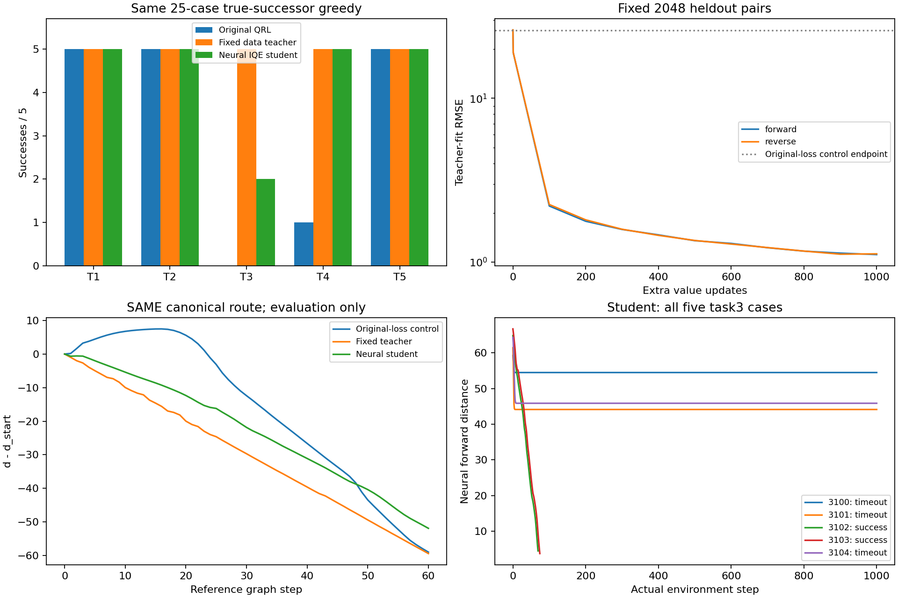
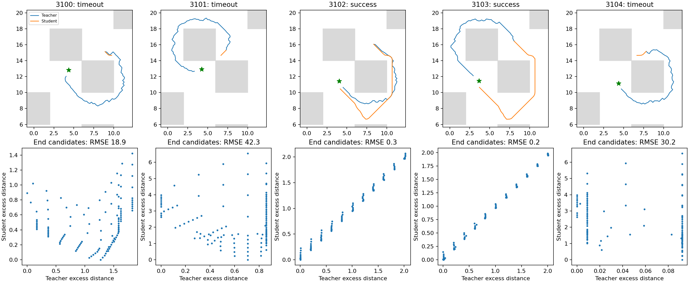

# E11：原IQE学习全局数据距离，恢复部分task3执行

固定1000次更新后，独立神经推理22/25成功，task3为2/5；原16个成功全部保留。教师为25/25。神经学生未通过预定task3五例全部成功门槛，因此不启动actor训练、不追加本MSE方案预算，也不宣称总目标完成。训练、核验及独立推理共133.42秒，其中训练/核验87.27秒、独立评价43.59秒，低于预定300秒。

## 学习问题与对照

原100k QRL的IQE网络、原value Adam矩/count、lr3e−4不变，只更新value。目标替换为固定E10教师的双向等权平方误差；教师包含数据图、局部可逆及几何连接先验，是近似距离而非官方最优步数标签。没有原push/pair/dual更新，actor/dynamics/lam参数与其Adam矩均冻结。故这是新监督学习问题，不是官方算法原样续训或单纯数值校准。

原官方train.sample(256)采样1000次、seed2001；s/s_next/value_goal流SHA c479992dde1cf84a74d25a0f74c3f88a07252f02198489bd40f4df2604949ab6与E6控制相同。A复用原损失1000终点，不重训或重评；其教师拟合forward RMSE为26.01671。训练目标100%原随机目标，不拿评价目标作标签。标签流SHA 6d070cd37a04181e59c2bb3f30edfa014511172aa39b30e085ce7d65e716aaae。先两步完整保存/加载smoke，再从原100k重置正式运行，不恢复smoke；终点Adam count101000。

三个方法测试通过：双向MSE定义、无actor/dynamics/lam梯度、带非零Adam矩的冻结和计数。终点全agent/Adam/RNG数值有限且保存加载完全一致；同25起点actor输出逐位不变，不能声称原actor成功率提高。

## 完整真实执行与距离场

| 任务 | 原QRL/原损失控制 | 数据教师 | 神经学生 |
|---|---:|---:|---:|
| task1 | 5/5 | 5/5 | 5/5 |
| task2 | 5/5 | 5/5 | 5/5 |
| task3 | 0/5 | 5/5 | 2/5 |
| task4 | 1/5 | 5/5 | 5/5 |
| task5 | 5/5 | 5/5 | 5/5 |

新增['task3_seed3102', 'task3_seed3103', 'task4_seed3101', 'task4_seed3102', 'task4_seed3103', 'task4_seed3104']，失去[]。task3成功3102/3103分别69/74步；其余完整1000步超时，没有停滞早停。学生仍使用原forward QRL value，不做对称包装。独立Python子进程只接收原模型路径，完成全部121动作真实后继枚举；启动及结束检查未导入roadmap_metric/data_graph，教师不在决策链中。T1源码身份核验、每个所选实际后继逐位核验、首次缓存命中复算均保留。墙体图只在episode结束后评价，不能混作推理用图。

固定验证2048对的forward/reverse RMSE从26.10538/26.16229降至1.11237/1.12337，paired MSE 682.97815→1.24966；目标均值47.9683，学生均值48.1788/48.1936，方向差均值0.49773。原pair平均/尾部风险0.01211/0.09326、goal风险0.000642；lambda固定183.248，没有优化含义上的新收敛结论。

canonical全图/corridor Spearman 0.993834/0.988345，最低峰差/IQR为0，但锚点严格下降通道仍为False。锚点吸附误差0.14451；无需超过起点高度不等于全程下降，不能以相关性和峰差替代实际三个失败。

## 事后只读教师/学生动作排序检查

完整评价后另用1.58秒（独立30秒上限）检查五个已存起点和五个已存终点，每点121个真实后继，无新episode或训练。该探针是事后解释，不是冻结主实验的独立验证。

| 已存状态 | 局部绝对RMSE | 动作评分Spearman | 学生选择的教师regret | 教师/学生选择位移L∞ |
|---|---:|---:|---:|---:|
| task3_seed3100_start | 19.056 | 0.823 | 0.097 | 0.200 / 0.200 |
| task3_seed3100_end | 18.917 | 0.304 | 1.274 | 0.200 / 0.000 |
| task3_seed3101_start | 25.529 | -0.868 | 4.730 | 0.200 / 0.200 |
| task3_seed3101_end | 42.325 | -0.036 | 0.707 | 0.160 / 0.000 |
| task3_seed3102_start | 4.918 | 0.916 | 0.023 | 0.200 / 0.200 |
| task3_seed3102_end | 0.314 | 0.996 | 0.001 | 0.200 / 0.200 |
| task3_seed3103_start | 4.552 | 0.099 | 0.154 | 0.200 / 0.200 |
| task3_seed3103_end | 0.214 | 0.991 | 0.008 | 0.200 / 0.200 |
| task3_seed3104_start | 7.783 | 0.071 | 2.973 | 0.200 / 0.200 |
| task3_seed3104_end | 30.189 | -0.384 | 0.092 | 0.160 / 0.000 |

三个失败终点的局部拟合RMSE约18.9/42.3/30.2，明显大于随机验证1.1；学生选中位移近零，教师同候选仍有0.16–0.20位移并降低教师距离。3101/3104起点学生动作甚至增加教师距离。两个成功终点RMSE仅0.31/0.21。绝对误差不能单独解释排序，表中regret和相关性补充了动作方向证据；这支持存在任务相关查询上的拟合/推广与局部排序缺口，尚未区分采样、表示能力和优化原因。

## 结论与复现

全局监督可以让原IQE在推理完全无图时恢复两个task3并保留原成功集；网络并非完全不能表达任何有效绕行。但普通随机对上的低MSE不足以保证任务查询的距离梯度和完整执行。教师成功、神经部分恢复、官方actor未变必须分开。结果限已有模型和已知25-case方法选择库，不是跨seed稳定性或论文完整预算复现；seed1及1M保持停止。

后续应检验任务无关的查询分布/局部形状学习机制，不继续延长本loss、搜索学习率或针对三个评价目标回填标签。协议[IQE_DISTILL_PROTOCOL.md](../../../experiments/ogbench_critic/IQE_DISTILL_PROTOCOL.md)，入口`run_iqe_distill.py <根目录> --output <全新目录>`；独立推理`evaluate_neural.py`由主入口调用；事后探针`probe_distillation.py`；本报告`report_iqe_distill.py <根目录>`只读重建。原始目录`results/ogbench_critic_20261029/iqe_distillation_1000`，日志同级`.log`，checkpoint `model/params_101000.pkl` SHA 7ae874b2fd3c60f6a2314354983ef4441f73f7326c5f9989582e593131d24dfe。原模型、教师、控制、源码快照、数据流、同bank轨迹及结束状态均已核对。只提交代码/测试/协议/本报告和两张引用图，原始结果/模型不提交。
