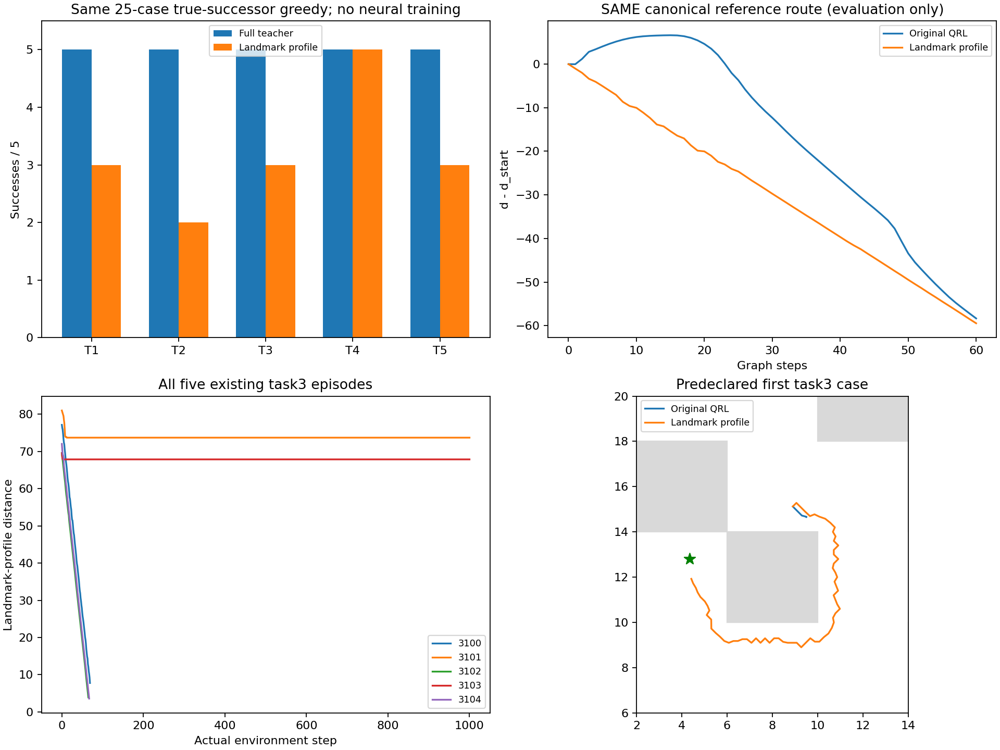
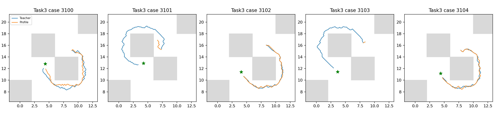

# E14：128地标距离坐标未保留教师的真实执行能力

固定表示在27.08秒内完成全部执行及距离场，训练更新0；成功16/25、task3 3/5，完整教师25/25。本表示未通过预定门槛，不启动其神经训练，也不扫描地标数量/范数/排列挽救。有限表示满足三角性且大尺度相关性高，仍会产生实际停滞，不能把这些条件当执行充分保证。

## 固定表示和核验

只读E10既有6302原型/全距离，最远点遍历固定选128地标，从第0个开始、argmax并列取最小索引；完成并保存后才读bank。原始图覆盖半径7.21030，不是连续物理覆盖保证。h_l(x)=完整教师t(x,landmark_l)，d_profile(x,g)=max_l|h_l(x)−h_l(g)|。这是拉回L∞伪度量，有限地标不保证单射/等距，三角性给出d_profile≤t但不给出正确局部下降。

原E10的局部可逆/几何连接先验保留，非真实MDP最优步数；没有评价墙体/路线标签，没有新神经网络/原QRL参数更新。到地标的连接代价预计算仍来自同教师8连接查询，浮点float64。两项测试覆盖直接教师查询一致、确定选择、自距离/对称/三角/教师下界、保存加载及非单射反例；实际完整图上32个确定偏移点×128地标与直接教师查询一致，保存加载逐位相同。表示构造/核验0.83秒，总120秒上限未超。

## 全任务成功集合

| 任务 | 原100k QRL | 128地标表示 |
|---|---:|---:|
| task1 | 5/5 | 3/5 |
| task2 | 5/5 | 2/5 |
| task3 | 0/5 | 3/5 |
| task4 | 1/5 | 5/5 |
| task5 | 5/5 | 3/5 |

原QRL新增['task3_seed3100', 'task3_seed3102', 'task3_seed3104', 'task4_seed3101', 'task4_seed3102', 'task4_seed3103', 'task4_seed3104']，失去['task1_seed3100', 'task1_seed3101', 'task2_seed3101', 'task2_seed3102', 'task2_seed3104', 'task5_seed3102', 'task5_seed3104']；完整教师的25成功失去9例。task3虽为3/5，但失去3101/3103，并丢失task1/2/5的原成功，不是稳定改善。仍使用全部固定25例、121真实后继、1000完整步/成功终止及T1所选后继逐位检查；不对停滞早停，没有重复原控制。

| 评价目标 | 起点严格下降通道 | 峰差/IQR | 全图Spearman |
|---|---|---:|---:|
| canonical | True | 0.000000 | 0.999287 |
| task3_seed3100 | True | 0.000000 | 0.997746 |
| task3_seed3101 | True | 0.000000 | 0.997669 |
| task3_seed3102 | True | 0.000000 | 0.999389 |
| task3_seed3103 | True | 0.000000 | 0.999220 |
| task3_seed3104 | True | 0.000000 | 0.999059 |

全部六个起点均有离散参考通道，实际仍9个失败。两个task3失败终点附近反而没有严格通道，峰差/IQR约0.01720/0.02625，吸附误差0.17065/0.01750。图是0.2离散化、半径0.7，不能把起点图证据推广成所有实际状态均有下降动作；真实执行结果优先。

## 事后全部失败终点候选检查

完整执行后另用0.16秒（30秒独立上限），只读九个失败终点、每点121个实际后继，无新episode。没有挑一个角点代替全部失败。

| 失败case | 教师−profile当前差 | 教师最佳下降 | profile最佳下降 | 教师/profile选择的位移L∞ |
|---|---:|---:|---:|---:|
| task1_seed3100 | 6.747 | 1.374 | 0.000 | 0.200 / 0.000 |
| task1_seed3101 | 6.277 | 3.456 | 0.000 | 0.200 / 0.000 |
| task2_seed3101 | 1.579 | 1.010 | 0.000 | 0.200 / 0.000 |
| task2_seed3102 | 2.323 | 1.115 | 0.000 | 0.200 / 0.000 |
| task2_seed3104 | 1.539 | 1.010 | 0.000 | 0.200 / 0.000 |
| task3_seed3101 | 2.852 | 1.332 | 0.000 | 0.200 / 0.000 |
| task3_seed3103 | 2.471 | 1.110 | 0.000 | 0.200 / 0.000 |
| task5_seed3102 | 5.135 | 2.773 | 0.000 | 0.200 / 0.000 |
| task5_seed3104 | 4.512 | 1.392 | 0.000 | 0.200 / 0.000 |

九处profile最佳下降均为0，选择位移近零；同候选下完整教师仍有0.2位移且下降1.01–3.46。教师的最佳动作在profile下反而比当前更差，故是距离排序/平台问题，非动作枚举或神经拟合误差。活跃地标仅2–6个，完整教师与投影当前数值差1.54–6.75；差值虽不大，也能改变局部动作方向。不能据这些数据证明增加地标就能解决，协议禁止数量搜索。

## 决策与复现

预定门槛False，停止该表示的神经训练。也不能据此断言所有距离坐标表示无效或IQE容量不足；本项没有训练任何网络。当前可用学习改进仍是E12/E13的23/25、task3 3/5，actor未变、总目标未完成。下一项需要先核验教师查询扩展与连续神经表示之间的可拟合性，避免将抽象查询代价伪影误认作真实MDP最优监督；不重做数据覆盖审计或扩大训练。

协议[LANDMARK_PROFILE_PROTOCOL.md](../../../experiments/ogbench_critic/LANDMARK_PROFILE_PROTOCOL.md)，入口run_landmark_profile.py <根目录> --output <全新目录>；事后probe_landmark_profile.py，报告report_landmark_profile.py只读重建。raw results/ogbench_critic_20261029/landmark_profile，表示profile.npz SHA f367d0b0ee12da662c753e8fcdc1b6ad64e756d0664822455eb513f74d15723f，教师图/距离SHA ee6ca69c3e70c596caf7168239d21915562a663d02345730c3c71829a2bb3f2f / 2d8eda547fb6ea42d9804403f8c61f037c0d28a3a823e2fcd48e9d07ea2880e2。原100k文件SHA前后397e919f2c453cee02ec840c615dce3532f31532fd639fbea6757c970fedbf0f未变，源码快照/同bank/全部轨迹与结束integration state已核验。只提交源码、测试、协议、本报告和引用图，表示/JSON/NPZ/日志不入库。不换seed、不运行1M。
