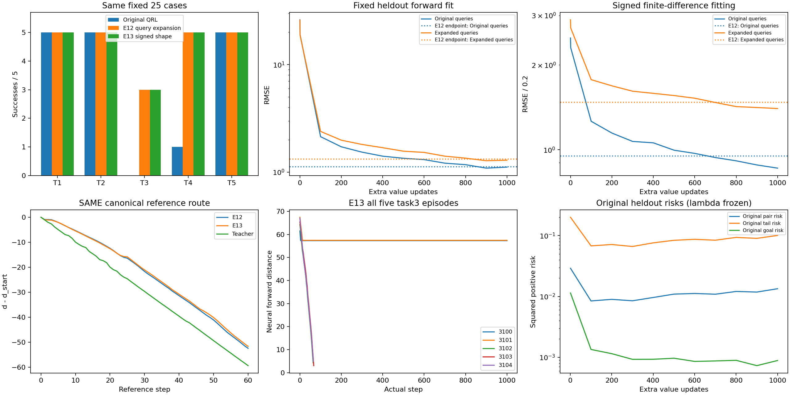
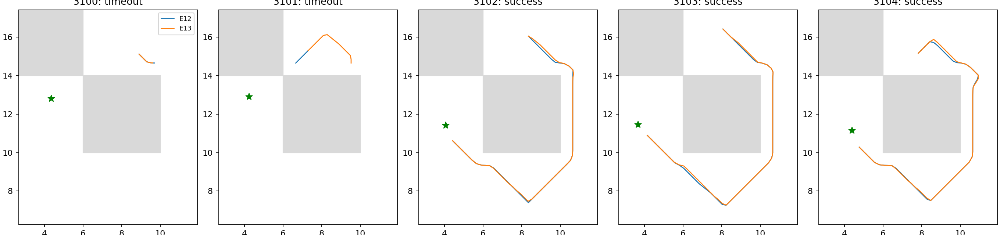

# E13：有符号局部形状监督的固定终点对照

固定1000更新后23/25成功、task3 3/5，E12为23/25、task3 3/5。相对E12新增[]，失去[]；失去原100k成功例[]。预定critic门槛为False。总214.35秒，训练/核验171.17秒、独立评价41.12秒，低于300秒；仅固定终点，没有追加或挑最好。

## 单变量学习问题

同原100k IQE/Adam/count/lr、E10近似教师、E12半批原查询/半批±1确定Sobol扩展；只增加有符号局部距离差监督。F=d(s,g)、F'=d(s_next,g)，R=d(g,s)、R'=d(g,s_next)，Delta=t(s,g)−t(s_next,g)。新loss为原双向绝对MSE加mean[0.5*((F−F'−Delta)/0.2)^2+0.5*((R−R'−Delta)/0.2)^2]，系数1固定、0.2取官方每轴最大位移。Delta允许正负，不截断，不要求行为最优/距离每步减1。教师含数据图/局部可逆/几何先验，不是官方最优成本。

扩展行的next与source加相同偏移，只作抽象查询，不声称平移后还是合法物理转移；不使用评价墙体/目标/路线。原始官方valid轨迹/目标采样保留。训练1000步batch256、采样seed2001不变，从原100k起步而非E12续训；E12直接复用、不重训或重评。actor/dynamics/lam参数和Adam矩冻结，只更新value。

原始流SHA c479992dde1cf84a74d25a0f74c3f88a07252f02198489bd40f4df2604949ab6，当前查询SHA 0d3204c71dee6c3d07fd7d4136983087a7289060149b04d2fb67d676c7abb812及当前教师标签SHA 162a286893ae68b7d2596e0f66d41f05ae03fb13e8fdaf0a34778589dff09799与E12相同；新next查询SHA 4bb3331131969af65238a56643ea06cef5c885c31b8f9466a5c68a1ea8c9545e、新标签SHA cf9957c7743e96a9382cff347faa4306cd3b6e0c00e1c08b8b7cff9c57c6214e。因此绝对监督查询未变，新增变量是局部形状信号。

四项测试最终通过：有符号公式/梯度且无其他模块梯度、next=s时形状零/退化原MSE、非零Adam矩冻结/count、当前查询逐位同E12与next同平移。首次共享/分开编码器调用的FP32梯度累加差约9.54e−6使2e−6阈值失败，保留两个失败日志及修改前源码；loss逐位相同，梯度核验rtol2e−5/atol3e−5，训练公式未改。真实两步smoke完整保存加载后重置原模型/RNG正式运行；终点count101000、完整agent/Adam/RNG往返、有限性、冻结参数/矩/actor输出核验通过。

## 完整真实执行

| 任务 | 原100k | E12 | E13 | 固定教师 |
|---|---:|---:|---:|---:|
| task1 | 5/5 | 5/5 | 5/5 | 5/5 |
| task2 | 5/5 | 5/5 | 5/5 | 5/5 |
| task3 | 0/5 | 3/5 | 3/5 | 5/5 |
| task4 | 1/5 | 5/5 | 5/5 | 5/5 |
| task5 | 5/5 | 5/5 | 5/5 | 5/5 |

| task3 case | 成功 | 完整步数 | 严格下降比例 | 上坡比例 |
|---|---|---:|---:|---:|
| task3_seed3100 | False | 1000 | 0.0060 | 0.0000 |
| task3_seed3101 | False | 1000 | 0.0170 | 0.0000 |
| task3_seed3102 | True | 64 | 1.0000 | 0.0000 |
| task3_seed3103 | True | 67 | 1.0000 | 0.0000 |
| task3_seed3104 | True | 65 | 1.0000 | 0.0000 |

独立Python子进程仅载入原QRL checkpoint与原forward IQE评分，未导入roadmap_metric/data_graph、无教师推理或对称包装。原121动作真实后继、完整episode1000步/成功终止、实际所选后继逐位核验与T1精确缓存不变。参考墙体图只在episode结束后评价。该控制是critic诊断，不是官方actor评价；原actor输出保持不变。

## 拟合与形状

原验证forward/reverse绝对RMSE 1.11559/1.08772，E12为1.12335/1.11464；扩展验证1.29413/1.26767，E12为1.32894/1.31636。

原验证形状forward/reverse RMSE 0.86098/0.83016，E12 0.95085/0.91107；扩展验证1.40108/1.38232，E12 1.47727/1.45308。这些统计记录新目标是否生效，不能单独代替实际成功集和距离通道。

canonical严格下降通道True，最低峰差/IQR 0.000000，全图/corridor相关0.993396/0.988640。0.2离散图与0.14451锚点吸附误差限制仍在，零峰差不代表严格通道。原pair平均/尾风险0.013399/0.100655、goal风险0.000886，lambda固定183.248，不作新优化收敛结论。

## 结论范围与复现

本轮成功集合与E12完全相同，3100/3101仍失败；3101轨迹虽改向另一个墙边，未形成真实成功。原/扩展验证forward形状RMSE分别下降约9.5%/5.2%，说明新信号生效，但这种有限改善未扩大执行成功集。canonical通道保持True亦不足验收。停止该形状系数/缩放/lr/预算搜索，不训练actor、不把风险压低当解决。有限预算的负结果不能证明原IQE表达不了目标距离；下一步可先核验另一种全局距离坐标表示是否保持教师的执行性质，再决定是否训练，避免无依据扩大当前网络训练。

结论仅限现有模型/已知25-case方法选择库；不换seed、不运行1M、不恢复已停止程序，不宣称跨seed稳定、官方actor改善或论文完整预算复现。总目标仍未完成。

协议[LOCAL_SHAPE_PROTOCOL.md](../../../experiments/ogbench_critic/LOCAL_SHAPE_PROTOCOL.md)，测试test_local_shape.py；入口run_local_shape.py <根目录> --output <全新目录>，报告report_local_shape.py <根目录>只读重建。raw results/ogbench_critic_20261029/local_shape_1000，日志同级.log；checkpoint model/params_101000.pkl SHA a294a32ba443176882752d0e851a1c30c47b7ea6c38bbaf93ced8ea61d2ad9b1。教师/控制/E12/原模型/源码快照/全部同bank轨迹与结束状态已核验。只提交源码、测试、协议、报告和两张引用图，原始产物不提交。
