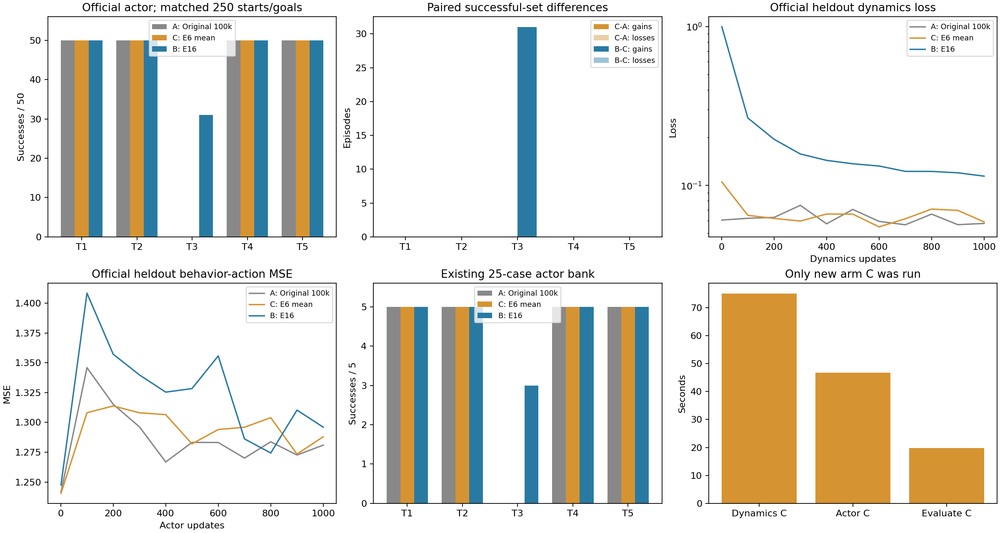
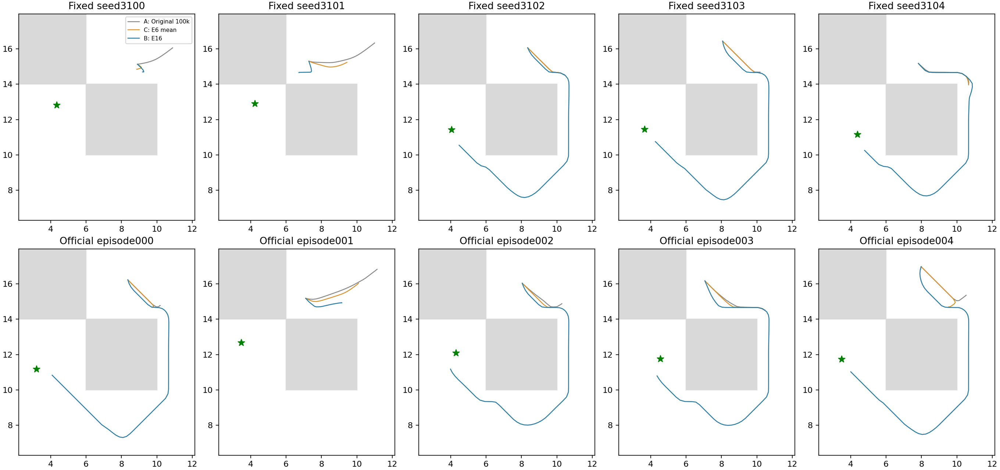

# E18：E6 mean接E17同预算动力学与actor提取

2026-11-01。仅新增C组，从已保存E6 mean终点进行1000次dynamics及1000次actor更新，147.83秒完成，低于600秒上限；A/B直接复用原E17，没有重训或重新评价。普通mean续训在相同提取下task3为0/50，E16为31/50；因此不能仅用“额外1000次普通价值更新加相同提取”解释E16在此流上的全部收益。 逐任务与配对得失如下，不能只比较task3或平均数。

## 起点、控制与核验

C为tail_1000/mean/params_101000.pkl，SHA d92cf664f10345f96a77045f988a689f0985ac2120781ec596ef6b932fdaacec，已完成官方value_loss1000次续训，actor/dynamics及其Adam矩、agent RNG逐位同原100k。完整原Adam/count101000保留；value/lam参数及矩全程冻结，actor阶段动力学亦冻结。两阶段固定终点count102000/103000、TrainState.step102001/103001，均有限、全状态保存加载一致，2048验证critic输出逐位不变。此次没有新增critic更新或重做贪心诊断。

直接复用且核对E17源码SHA的extraction.py、evaluate_extraction.py及官方QRL/evaluate。batch256、lr0.0003、alpha0.0003、512×3、const_std、官方100%未来actor目标不变；连续2000批np采样2001，阶段间不重置。dynamics和actor两个阶段的三字段及含actions/actor_goals完整流均逐位同E17。固定2048验证SHA ed48e5facee70514099101d40186a5b71c2147e1ccf8cbb2a2805f46d161738a亦同。每100步训练/验证日志，未做中间成功率选择或追加预算。

新增一项测试通过：改变小网络lambda参数，官方dynamics/actor的损失、统计与活动模块梯度逐位不变。实际两阶段各2步smoke后完整保存加载，再回到E6 mean原状态/采样2001正式运行。C沿用E6更新过的lambda，不冒充同E16起始完整状态；原网络乘子约183.248138，E6 mean价值终点约184.538101。本轮lambda参数及Adam矩自C起点起逐位冻结，未重置为原值。

## 全部官方任务，各50episode

| 任务 | A 原100k+提取（复用） | C E6 mean+提取（新增） | B E16+提取（复用） |
|---|---:|---:|---:|
| task1 | 50/50 | 50/50 | 50/50 |
| task2 | 50/50 | 50/50 | 50/50 |
| task3 | 0/50 | 0/50 | 31/50 |
| task4 | 50/50 | 50/50 | 50/50 |
| task5 | 50/50 | 50/50 | 50/50 |
| 平均 | 80.0% | 80.0% | 92.4% |

独立子进程原官方actor/evaluate，temperature0、gaussian=None、video0，无图/教师/模拟器搜索参与决策。所有250起点及goal与A/B逐位匹配，不只是声明相同seed。评价rng0是同输入控制，不是换训练seed；原25-case bank也未增加扰动种子。全部275条新增完整轨迹的观测/动作/goal、步数、有限性、done及末状态通过只读报告审计。

| 任务 | C相对A：新增 / 失去 | B相对C：新增 / 失去 |
|---|---:|---:|
| task1 | 0 / 0 | 0 / 0 |
| task2 | 0 / 0 | 0 / 0 |
| task3 | 0 / 0 | 31 / 0 |
| task4 | 0 / 0 | 0 / 0 |
| task5 | 0 / 0 | 0 / 0 |

C-A合计新增0、失去0；B-C合计新增31、失去0。完整逐例名单保存在report_audit.json，不根据结果筛去任务或失败例。



## 原25-case直接actor bank

| 任务 | A 原100k+提取 | C E6 mean+提取 | B E16+提取 |
|---|---:|---:|---:|
| task1 | 5/5 | 5/5 | 5/5 |
| task2 | 5/5 | 5/5 | 5/5 |
| task3 | 0/5 | 0/5 | 3/5 |
| task4 | 5/5 | 5/5 | 5/5 |
| task5 | 5/5 | 5/5 | 5/5 |

C-A新增[]，失去[]；B-C新增['task3_seed3102', 'task3_seed3103', 'task3_seed3104']，失去[]。这里是直接actor，与E6当时的mean神经贪心16/25分开，也不与官方250例混为一项指标。



## 解释范围

普通mean续训在相同提取下task3为0/50，E16为31/50；因此不能仅用“额外1000次普通价值更新加相同提取”解释E16在此流上的全部收益。 这是在看到E17结果后补做的控制，不能冒充原预注册第三组或新的独立验证；所有设置在C运行前冻结，C没有按结果选终点、调参数或追加预算。

C与B均为原100k加1000价值更新、1000动力学更新、1000actor更新，补齐了价值更新次数的控制。前期价值目标/目标查询/教师先验/候选前向成本不同，lambda更新也不同；λ不被这两个官方提取损失读取且本轮冻结，不将其改成另一个起点。此项不单独分离候选多样性与最大误差选择，不声称等总计算量、唯一训练因果、跨seed稳定或完整论文复现。其他四任务及配对失去必须与task3一起解释，保留所有负结果。

## 复现与原始产物

协议[MEAN_EXTRACTION_PROTOCOL.md](../../../experiments/ogbench_critic/MEAN_EXTRACTION_PROTOCOL.md)，源码run_mean_extraction.py、report_mean_extraction.py，新增测试test_mean_extraction.py。从仓库根目录：

```bash
P=experiments/ogbench_official_qrl/.venv/bin/python
E=experiments/ogbench_critic
G=results/ogbench_critic_20261029
export PYTHONDONTWRITEBYTECODE=1 MPLBACKEND=Agg
$P "$E/test_mean_extraction.py"
# 提供复现命令，本次只执行了一次正式C，不自动重复：
$P "$E/run_mean_extraction.py" "$G" --output "$G/mean_extraction_new"
# 当前报告只读重建，不训练/评价：
$P "$E/report_mean_extraction.py" "$G" --output "$G/mean_extraction_1000"
```

raw目录results/ogbench_critic_20261029/mean_extraction_1000，同级mean_extraction_1000.log及mean_extraction_tests.log；子评价evaluation.log。dynamics checkpoint为mean/dynamics/params_102000.pkl，SHA 9dcb9f20221c51117716655fa2db70e0c7078b83e06ef96906f1997084f46282；actor终点mean/actor/params_103000.pkl，SHA 8219d3c77c62cc3fff7f9960adb9b62a56144d036b3149973d6f6dbb2adfe516。协议/source_snapshot、阶段CSV、sampler状态、275轨迹和report_audit.json保留本地。原E6/原100k/E17文件未改变。只提交源码/测试/协议/报告/引用图，不提交checkpoint/JSON/CSV/NPZ/日志。
