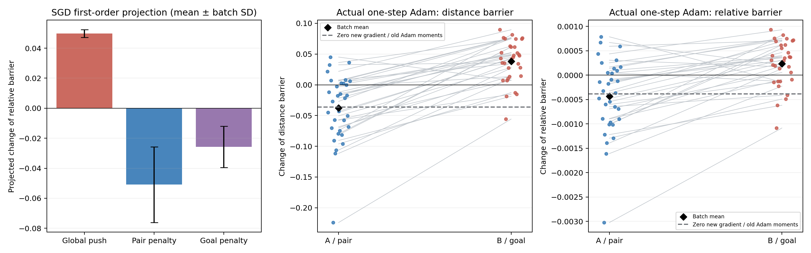

# M1：原始100k模型的距离上坡训练压力

日期：2026-10-29。本项分析严格使用原始100k模型，不查看E1中间模型，不串联续训，也不保存新checkpoint。预先固定seed4400、32个官方随机训练批次、每批1024。各次反事实从相同参数与Adam状态开始。

**局部证据：随机目标距离最大化项在当前失败排序上提供了上坡压力，原pair约束提供相反压力，二者在平均一阶投影上接近抵消。直接替换成goal差约束并不自动加强纠正作用。** 这还不是对整个训练历史或完整预算模型的根因证明。

## 固定probe与问题边界

目标为[4.20550012588501, 12.089799880981445]；锚点与走廊点为[[10.199999809265137, 14.800000190734863], [10.800000190734863, 11.800000190734863]]，来自E0已固定参考路线的第0与第15个节点。网络距离差初值为6.631096。相对上坡定义为 `gap / ((d_peak+d_anchor)/2+1e-6)`，初值0.100144；它移除统一正缩放的影响，不声称对任意变换不敏感。

这些点仅用于评价梯度的投影，未作为训练样本或标签。批次仍由官方GCDataset产生，value目标仍为官方随机目标。actor/dynamics参数与Adam矩逐位冻结。

## 损失分量的普通SGD一阶投影

下表计算 `-lr × <grad(probe), grad(loss_part)>`，lr为固定3e-4。正数表示朝增大上坡方向，负数表示朝减小方向。**这些是局部导数投影，不是执行大幅SGD参数步后的实测结果，也不是实际Adam步的贡献分解。** SD为批次标准差，不是多初始化误差。

| 分量 | gap一阶变化均值 ± SD | 相对上坡一阶变化均值 ± SD | 相对上坡增大批次 |
|---|---:|---:|---:|
| 随机目标距离最大化 | +3.769471 ± 0.180784 | +0.049775 ± 0.002513 | 32/32 |
| lambda × pair约束 | -3.842963 ± 1.816038 | -0.050912 ± 0.025253 | 0/32 |
| lambda × goal约束 | -1.920057 ± 0.998062 | -0.025749 ± 0.013827 | 1/32 |
| push + pair（投影相加） | -0.073492 ± 1.833549 | -0.001137 ± 0.025509 | 19/32 |
| push + goal（投影相加） | +1.849414 ± 1.060561 | +0.024026 ± 0.014707 | 30/32 |

最大化项对相对上坡的投影32/32为正，原pair项32/32为负，说明纠正方向并非原pair梯度完全缺失。goal项的平均纠正投影更小；它改变梯度与可行集合，不能从“更直接涉及目标”推出更好的距离恢复。目标相关残差由准度量三角关系弱于pair残差，但本项只量化了当前probe上的投影，不能推断所有参数方向的梯度强弱。

## 从同一checkpoint出发的一次实际Adam反事实

| 实际Adam一次更新 | gap变化均值 ± SD | 相对上坡变化均值 ± SD | gap增大 / 相对上坡增大 |
|---|---:|---:|---:|
| pair | -0.037768 ± 0.055072 | -0.000437 ± 0.000788 | 9/32；11/32 |
| goal | +0.038221 ± 0.033896 | +0.000232 ± 0.000467 | 28/32；23/32 |
| 新梯度为零、保留原Adam矩 | -0.036049 | -0.000386 | 单次参照 |

B相对A的“相对上坡变化”配对差均值为+0.000669，SD=0.000634，28/32批次中B增大得更多或减小得更少。原pair实际一步平均减小上坡，goal替换实际一步平均增大上坡；因此本项不支持直接声称B会更有效修正当前局部排序。它仍不能预测固定10k续训后的结果。

零新梯度参照说明旧Adam动量本身就可产生参数变化；它只是一项反事实参照。由于Adam的预条件与动量更新有非线性，不能把该参照与各损失一步结果相减后声称得到唯一的因果贡献，也不能将SGD分量投影当作Adam分量贡献。

实际Adam步与probe一阶预测的gap平均绝对误差：A=0.000422043、B=0.000186568；最大绝对误差分别为0.00120308和0.000598341。这支持这些一次局部变化的线性解释，不能外推到多步训练轨迹。

## 对“为什么学出这个场”的推进与限制

现在有训练信号层面的证据：在这个模型与这两个固定走廊点附近，距离最大化会扩大错误相对排序，局部约束则提供相反作用；当前平均局部统计接近容差，并不意味着目标距离场已经处处获得下降方向。该场可以处在存在相互抵消压力的优化位置，而不是简单缺少所有纠正梯度。

这些结果不证明该竞争是训练全程唯一原因，不排除有限参数化、优化路径、随机采样或额外预算的影响。32批次都复用同一checkpoint，不能当成32个模型复现；单次probe的即时变化也不能当成五任务闭环表现。参考路线、模拟器或最短路未进入训练。

本项只分解value_loss；官方端到端QRL的value参数还受到dynamics_loss梯度影响，本项没有分解该辅助项。因此不能把这里的两项投影当作完整官方训练总梯度，也不能据此唯一解释原训练历史。

E1仍按原固定10k预算执行，不因这项检查中止、延长、调权重或换终点；结论仍以终点下降通道、五任务真实后继贪心及两类约束为准。官方1M与独立初始化检查仍需完成，用户要求的“稳定改善”总目标保持未完成。

## 验证与复现

3项新测试通过：梯度分解与实际A/B价值梯度一致；相对上坡移除正距离缩放；零新梯度下旧Adam动量仍能移动value且冻结actor/dynamics。实际32批次反事实也逐一验证冻结证明与有限性。

运行方式见 experiments/ogbench_critic/MECHANISM_PROTOCOL.md 和 README.md。原始protocol.json、analysis.json、progress.json与日志留在本地，不提交；本报告、引用PNG、源码、测试和协议进入本项独立commit。
