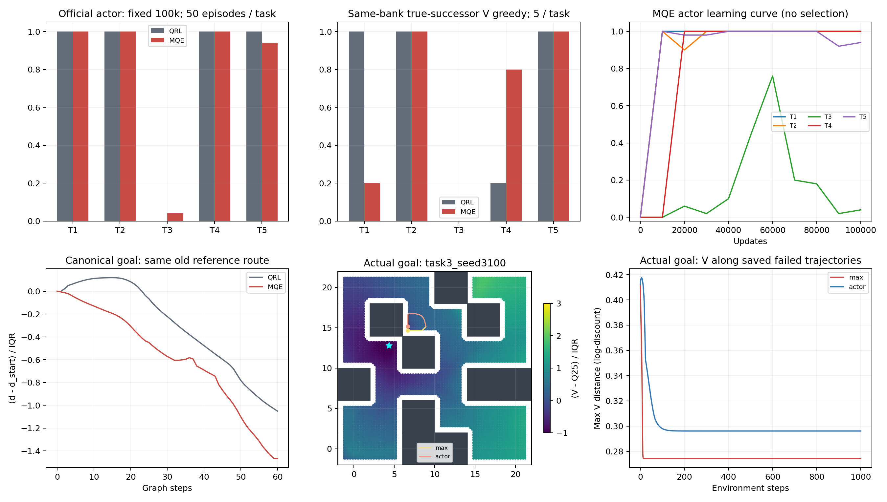

# 原生 MQE 100k：局部通道恢复未转化为task3执行改善

固定原生MQE 100k已完成，实际Adam count100000、全状态有限性/保存加载/原生采样与同库诊断核验均通过。主要max V贪心在task3仍0/5，官方actor为2/50；不能据canonical锚点有下降通道宣称问题已解决。与原QRL相比整体官方actor均值为80.0%/79.6%，没有整体收益。

## 正式终点与方法范围

| 任务 | QRL官方actor | MQE官方actor |
|---|---:|---:|
| task1 | 50/50 | 50/50 |
| task2 | 50/50 | 50/50 |
| task3 | 0/50 | 2/50 |
| task4 | 50/50 | 50/50 |
| task5 | 50/50 | 47/50 |

原生MQE commit04c2697405233e4313fab43e05bd4d95f1b3e111，外部OGBench与QRL同commit a977253ce5b88434f4e4f531c50047cc95993a51、同原始数据。alpha0.03取论文pointmaze配置、diag_backup0.5为显式代码默认；环境选择与macOS适配沿用接入报告。完整模型SHA256为07e3805e167358a477bfe68e0544f7a7938b1aa203085a5ac935a60a5a9edad5。

仅取预定100k，不挑中间最好。MQE双MRN、原生B×B、future目标和actor联合学习等均与QRL不同，是方法参照；不是单变量多步消融。两者更新数相同、batch为256/1024，源转移25.6M/102.4M，不能称同计算预算。MQE主进程耗时6.047小时，运行时存在其他CPU训练，不将耗时差简单当算法速度收益。官方50episode随机流不同，不作配对episode统计。

同一次MQE训练的task3官方曲线在60k记录为76%，到100k为4%，表现明显非单调。这里只报告已存在曲线，不将60k改选为正式结果；尚未据此区分critic变化、actor提取或评价样本的作用，不能仅凭曲线命名为某种遗忘机制。

## 同库25例执行与canonical距离场

| 任务 | QRL V贪心 | MQE max V贪心 | MQE ensemble0 | MQE ensemble1 | MQE actor |
|---|---:|---:|---:|---:|---:|
| task1 | 5/5 | 1/5 | 1/5 | 2/5 | 5/5 |
| task2 | 5/5 | 5/5 | 5/5 | 5/5 | 5/5 |
| task3 | 0/5 | 0/5 | 0/5 | 0/5 | 0/5 |
| task4 | 1/5 | 4/5 | 4/5 | 1/5 | 5/5 |
| task5 | 5/5 | 5/5 | 5/5 | 5/5 | 5/5 |

MQE max V相对QRL V贪心新增3、失去4；新增['task4_seed3102', 'task4_seed3103', 'task4_seed3104']，失去['task1_seed3100', 'task1_seed3101', 'task1_seed3103', 'task1_seed3104']。actor同库相对原QRL新增0、失去0，两者task3仍0/5。主聚合max在查看结果前固定，两个ensemble全部列出，不择优。

canonical目标沿用原诊断目标[4.2055,12.0898]。MQE两个ensemble和max均在原锚点有严格下降通道，max最低峰差/IQR为0；原QRL无通道、峰差/IQR为0.11946。MQE max的整图/走廊Spearman为0.940609/0.950481，原QRL为0.951321/0.29754。这是特定区域的距离结构改善，不是全目标/全轨迹的成功保证。

## 既有五例task3实际目标的只读检查

| 既有task3目标 | 原锚点下降通道 | 起点下降通道 | 贪心终点附近下降通道 | 终点最低峰差/IQR |
|---|---|---|---|---:|
| task3_seed3100 | True | False | False | 0.329945 |
| task3_seed3101 | True | False | False | 0.321361 |
| task3_seed3102 | True | False | False | 0.380728 |
| task3_seed3103 | True | False | False | 0.336387 |
| task3_seed3104 | True | False | False | 0.450959 |

本项只重新前向计算原模型在五个既有目标上的场，没有新增目标、训练seed、训练更新或episode。各位置吸附到同0.2网格，不能把网格结论当连续环境最优性证明。完整吸附位置/误差和场数组留在analysis.json与对应NPZ中。原锚点、起点与贪心停滞位置是不同状态；canonical目标与实际bank目标也不同，必须逐项区分。

五例原锚点均有下降通道，但五个起点及贪心终点附近均无下降通道；对应的是另一处未恢复的距离排序，不是原角点修复后执行便必然成功。起点吸附误差最大0.1305，终点附近最大0.2058，尤其接触状态与无碰撞图节点存在偏差，因此将后者明确称为“附近”检查；真实1000步失败本身来自已保存的模拟器轨迹。

第一例MQE max V贪心最终停在[6.654482388088649, 14.654482388088653]，此前QRL诊断锚点为[10.1156, 14.6827]。下图使用这一例的实际目标，而非用canonical场冒充；轨迹来自已完成的正式诊断。存在某条下降路线也不保证当前贪心选出的分支能到达目标，不能把通道可达性单独当作执行证据。

## 结论与后续约束

本次MQE说明既有多步准度量方法能改变原失败区域的排序，但当前100k主要执行指标没有解决task3，也没有严格扩展原成功集。E2的IQE备份失败与原生MQE的局部通道改善不能混称同一实现。后续优先检查既有失败轨迹对应的局部距离与动作选择，避免只修一个锚点或只看约束统计；本报告不启动新训练。

2026-10-30按用户指令停止QRL seed1与1M完整预算，禁止自动恢复或换seed证明非偶然性。它们不再作为完成门槛，也不能声称已作跨seed/完整预算核验。范围以CURRENT_LIMITS.md为准；当前尚未达到稳定闭环改善，总目标继续。

协议见[ENDPOINT_ANALYSIS_PROTOCOL.md](../../../experiments/ogbench_mqe/ENDPOINT_ANALYSIS_PROTOCOL.md)，复现入口为[analyze_endpoint.py](../../../experiments/ogbench_mqe/analyze_endpoint.py)。仅源码、协议、报告及引用PNG提交，原始模型、CSV/JSON/NPZ与日志保留本地。

分析脚本首次在报告格式化阶段因位置与统计字段重名而退出，原日志/源码副本/已计算场均保留。修复后以resume-analysis复用同目标、同网格的场数组，并用原模型的固定节点前向校验缓存；未重复训练或增加episode。
