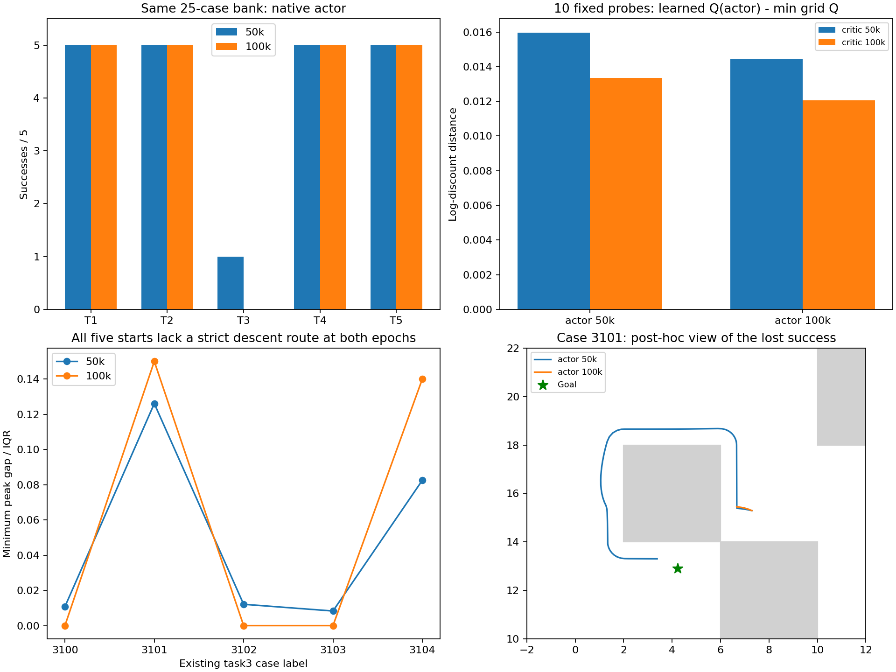

# MQE已有50k/100k模型：不能只归因于actor提取

本项只读同一次已完成MQE训练的预定50k中点和100k终点，耗时102.39秒（上限360秒），训练更新为零。50k仅作机制诊断，正式结果仍是100k；不挑60k峰值、不重训、不换seed、不启动1M。

## 同例真实执行

| 任务 | 50k原生actor | 100k原生actor（复用） |
|---|---:|---:|
| task1 | 5/5 | 5/5 |
| task2 | 5/5 | 5/5 |
| task3 | 1/5 | 0/5 |
| task4 | 5/5 | 5/5 |
| task5 | 5/5 | 5/5 |

同25例从21/25到20/25，新增成功[]，失去['task3_seed3101']。原生actor的task3为1/5到0/5；这组固定样本仅支持一个已有成功例失去，不能用它声称重现了官方随机50episode全部幅度。官方已有50k/100k task3记录为22/50、2/50，评价样本流不同。

两个checkpoint的max-Q网格贪心在task3均0/5；50k真实后继max-V贪心也0/5，与复用的100k结果相同。全部失败episode都执行到1000步。Q控制直接最大化原生learned Q的价值（等价最小化距离），不是模拟器后继评分，也不是官方actor；离散网格、数据外动作和learned Q误差限制其含义。其失败不证明连续动作全局最优策略必然失败，但不支持“只修actor提取即可恢复”的诊断。

## 同观测/目标的2×2交叉评分

10个probe固定为五个task3起点与已有100k actor轨迹第100步观测。距离用原生双critic的max聚合，以下均为log-discount单位。actor减网格最小距离允许负数，不称全局最优性差距；min Q减V也不是独立Bellman真值误差。

| critic | actor | actor−网格最小Q均值 | 范围 | 网格最小Q−V均值 |
|---|---|---:|---:|---:|
| 50k | 50k | 0.015970 | [0.004346, 0.030633] | 0.036271 |
| 50k | 100k | 0.014444 | [0.003170, 0.027166] | 0.036271 |
| 100k | 50k | 0.013356 | [0.007913, 0.027147] | 0.043708 |
| 100k | 100k | 0.012065 | [0.007847, 0.023040] | 0.043708 |

在两个固定critic下，100k actor的平均距离差反而小于50k actor，每个critic各有7/10 probe如此。它与失去一个真实成功例并不矛盾：learned Q的局部评分并不等价于真实闭环质量。这些post-hoc probe不构成actor损失的因果消融，也不能单凭Q−V差命名为后期遗忘或目标不一致的根因。

## 五个实际目标的起点距离场

| 既有task3 case | 50k峰差/IQR | 100k峰差/IQR | 50k / 100k严格下降通道 |
|---|---:|---:|---|
| task3_seed3100 | 0.010795 | 0.000000 | False / False |
| task3_seed3101 | 0.126135 | 0.150087 | False / False |
| task3_seed3102 | 0.012111 | 0.000000 | False / False |
| task3_seed3103 | 0.008295 | 0.000000 | False / False |
| task3_seed3104 | 0.082550 | 0.140076 | False / False |

两模型五个起点均无严格下降通道。100k部分最低峰差降为零，仍不表示存在全程下降路线；另两例峰差增大。使用原0.2网格/0.7碰撞半径，起点吸附误差最大0.1305；仅为离散图诊断。下图3101轨迹在看完结果后选作失去成功例的说明，不作预定独立验证。

## 核验、偏离及复现

两完整checkpoint的实际更新计数50k/100k由原生loader验证，文件SHA与参数摘要前后相同；同bank SHA、保存轨迹起点/目标、完整观测/动作维数、终点与步数均已核对。2项测试通过：原生Q/max评分语义与360秒预算拒绝。50k SHA为499725df61e7be3ac7def8a2cd33aa7c8638b6a08321ddf46571343f571112ba；100k SHA为07e3805e167358a477bfe68e0544f7a7938b1aa203085a5ac935a60a5a9edad5。

透明记录两处文字偏离：协议写“保存完整结束状态”，实际core.rollout保存了完整2D观测和动作序列，未另存MuJoCo内部结束integration state；候选评分仍使用原核验过的完整状态恢复。metadata中loader遗留的“No Q-based action search used”描述来自旧V诊断，不能套用本项Q控制；以controller目录名和上述定义为准。没有为补齐产物重复episode或修改已冻结脚本/协议。

入口：`temporal_diagnostic.py <结果根目录> --output <全新目录>`；本报告复现使用`report_temporal.py <结果根目录>`，只读取已有数组，不调用模型或环境。协议见[TEMPORAL_PROTOCOL.md](../../../experiments/ogbench_mqe/TEMPORAL_PROTOCOL.md)。原始JSON/NPZ/日志保留本目录，Git仅提交源码、测试、协议、报告及引用图。

目前仍无稳定执行改善。已明确不能用canonical角点通道、局部Q评分或最好中点替代正式100k闭环结果。后续继续针对critic目标/长程排序做小预算受控改进，不换seed、不运行1M，也不将这些取消的运行设为完成门槛。
