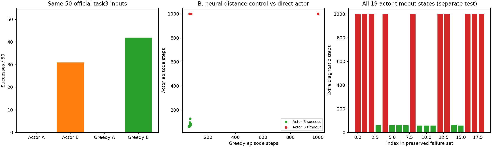
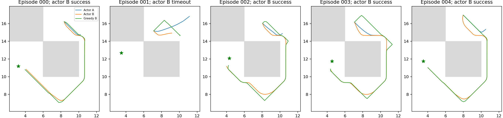

# M6：官方新目标流上的距离恢复与残余提取缺口

同一50个官方task3输入，原critic贪心0/50、改进critic贪心42/50；对应E17直接actor为0/50和31/50。改进critic从全部19个actor失败末状态续行，9/19成功。官方actor指标仍31/50，这些真模拟器候选控制和超时后额外诊断绝不加进正式策略成功率。

## 运行时预算偏离完整保留

原240秒协议实际在240.01秒触发TimeoutError、exit1，只完成40个原critic案例，第41例中断；未执行改进组。原目录及失败源码/日志/轨迹只读保留，不能称原240秒协议通过。因为振荡轨迹每步输入不同、精确缓存miss多，部分单例约12–14秒，算时估计不足。

显式[预算修订](../../../experiments/ogbench_critic/OFFICIAL_COUNTERFACTUAL_COMPLETION.md)在新目录只补未执行的10+50+19个episode，新阶段242.53秒/300秒上限，合计482.54秒。40个完整旧案例经逐例文件/hash验证后复用，未重跑；原未完整第41例从同初态重新完成。合计119个完整反事实episode及一次中断尝试。修订只针对只读计算成本，未改变训练更新（始终0）、模型、控制器、样本、episode上限或基于成功率改预算；未换seed、缩数据、启动1M。不能写成“未扩计算预算”。

## 相同输入与物理状态证据

按固定官方evaluate的np rng0调用顺序复建五任务250 reset，每任务前同一次actor key随机数；所有250 observation/goal与E17 A/B逐位一致。50个task3保存完整reset integration后，使用实际core.load_case恢复，分别执行原两组已存首动作，100个第一后继完整观测逐位一致。测试另将复建序列与实际官方evaluate在确定mock上比较，并用step消耗随机数的mock证明不可泛化跳过step的假设，两项通过。

这里并未声称将原未保存的初始mjData逐字段读回比较；证据是固定无传送PointMaze源码、全部reset输入、100实际首步和后续每个候选所选真实后继核验。对原始随机环境不能无条件套用此复建方法。未重跑旧完整actorepisode，无新增评价seed。

## 全部50例配对距离控制

| 控制器 | task3成功 | 范围 |
|---|---:|---|
| 原critic + E17同预算官方actor | 0/50 | 正式actor评价 |
| 改进critic + 同预算官方actor | 31/50 | 正式actor评价 |
| 原100k critic真后继贪心 | 0/50 | 本只读诊断 |
| E16 critic真后继贪心 | 42/50 | 本只读诊断 |

改进critic贪心配对新增42、失去0。改进初态贪心失败名单['task3_episode001', 'task3_episode006', 'task3_episode009', 'task3_episode023', 'task3_episode037', 'task3_episode045', 'task3_episode047', 'task3_episode048']，末状态续行失败名单['task3_episode001', 'task3_episode005', 'task3_episode006', 'task3_episode009', 'task3_episode023', 'task3_episode035', 'task3_episode037', 'task3_episode045', 'task3_episode047', 'task3_episode048']。全部50新目标在E16/E17终点冻结后才用于评价，没有回填训练或修改模型/超参数；它们与已知25-case方法选择库不同。但本反事实用途为事后解释，不当独立训练seed/全域泛化证明。

两组同原121动作真实后继/1000步上限，绕过actor和潜在动力学，仅原神经forward IQE评分。T1物理/精确有效输入缓存源码身份未变，每个选中后继仍逐位同实际env.step。轨迹日志state_values以固定128行padding前向，下降/上坡容差1e−4；这只改变日志批形状，候选评分原121行不变，不把小FP32误差作上坡证据。没有教师/图模块导入或在线训练标签。

## 19个actor超时末状态

| 原失败episode | 同critic续行成功 | 额外步数 | 下降比例 | 上坡比例 |
|---|---|---:|---:|---:|
| task3_episode001 | False | 1000 | 0.5560 | 0.4430 |
| task3_episode005 | False | 1000 | 0.0080 | 0.0000 |
| task3_episode006 | False | 1000 | 0.5470 | 0.4510 |
| task3_episode007 | True | 61 | 1.0000 | 0.0000 |
| task3_episode009 | False | 1000 | 0.6450 | 0.3520 |
| task3_episode011 | True | 62 | 1.0000 | 0.0000 |
| task3_episode015 | True | 63 | 1.0000 | 0.0000 |
| task3_episode017 | True | 61 | 1.0000 | 0.0000 |
| task3_episode023 | False | 1000 | 0.0070 | 0.0000 |
| task3_episode030 | True | 59 | 1.0000 | 0.0000 |
| task3_episode031 | True | 59 | 1.0000 | 0.0000 |
| task3_episode033 | True | 59 | 1.0000 | 0.0000 |
| task3_episode035 | False | 1000 | 0.0090 | 0.0000 |
| task3_episode037 | False | 1000 | 0.0090 | 0.0000 |
| task3_episode038 | True | 65 | 1.0000 | 0.0000 |
| task3_episode042 | True | 59 | 1.0000 | 0.0000 |
| task3_episode045 | False | 1000 | 0.3810 | 0.6180 |
| task3_episode047 | False | 1000 | 0.3820 | 0.6180 |
| task3_episode048 | False | 1000 | 0.0040 | 0.0000 |

完整保留全部19例。起点为原actor第1000步结束integration，重新给1000步TimeLimit只为反事实诊断，不是原episode继续被算成功。模型和goal未变，能够或不能够从这些状态离开，才是这里的测量。

本项将残留actor失败与是否存在可用critic引导分开；贪心同时绕过actor和潜在动力学，不能再进一步唯一归因BC权重、actor容量或动力学误差。候选仅121个离散动作，也不是连续最优性证明。所有结论限当前模型、任务/目标流和控制范围。

本轮结果不能概括为“剩余都是actor问题”：8例从原初态及actor末状态贪心都失败；2例从原初态贪心成功，但actor进入了另一个同critic仍无法脱困的状态；9例从原初态及失败末状态贪心都成功。后一组支持提取链路仍有缺口，前两组直接保留了残余距离陷阱证据。新初态42/50相对原0/50、正式actor31/50相对0/50且其他四任务无损，说明恢复可扩展到既有小bank之外；不是对全部状态都可下降或task3完全解决的证明。

## 复现与只读证明

原100k/E16参数摘要及文件前后不变，原E17的100条task3轨迹文件哈希前后不变；50-bank及所有旧/新源码、40复用/79新轨迹的起点/goal/步数/结束integration/有限性已核验。原协议[OFFICIAL_COUNTERFACTUAL_PROTOCOL.md](../../../experiments/ogbench_critic/OFFICIAL_COUNTERFACTUAL_PROTOCOL.md)与修订均保留。入口run_official_counterfactual.py，修订finish_official_counterfactual.py仅在特定超时/完整前缀被验证后补齐；本报告report_official_counterfactual.py只读重建。

raw results/ogbench_critic_20261029/official_counterfactual及official_counterfactual_completion，日志同级.log；后者analysis.json记录每条轨迹来源。只提交源码、测试、协议、中文报告及两张引用图，bank/模型/JSON/NPZ/日志不提交。19个actor失败仍是最终方法的限制；本项不自动追加学习或调参数。
