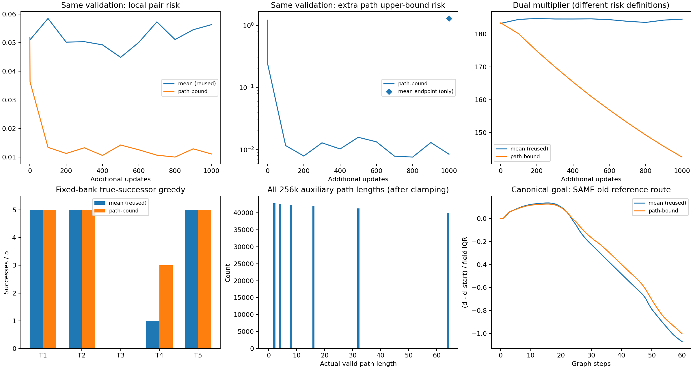
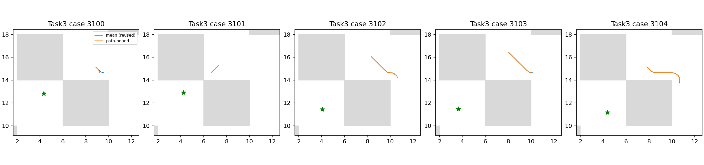

# E8：直接多步上界改善task4，task3仍未恢复

新增一个固定1000步原IQE critic续训组，复用E6 mean控制组而不重训/重跑。全部原训练批次流逐字节相同，actor/dynamics参数及Adam矩冻结。25例成功数由16增至18，新增两个task4成功且没有丢失原成功；task3仍0/5，canonical原锚点仍无严格下降通道，因此稳定恢复目标尚未达成。

总用时181.24秒，其中载入/smoke/训练/完整状态核验126.92秒，低于预定300秒上限。没有延长预算、换seed/初始化、选中间checkpoint或启动1M。

## 方法与可解释范围

B保留原距离最大化/随机目标、原IQE和单位、原Adam/lr/eps。原逐行h1=relu(d(s,s_next)−1)^2，新真实路径hk=relu(d(s,s_k)−k)^2，以mean(max(h1,hk))作为同一dual约束风险。max不削弱原pair项，不引入混合权重、动作编码器、折扣/LINEX、目标网络或图监督。它与E2多步备份是不同实验，单纯多步不当新贡献。

硬满足所有单步上界时，三角不等式本已蕴含路径上界；这里检验软平均局部预算下的累积误差与学习效率。k只是真实行为路径成本上界，未把它当最优距离等式。跨度固定2/4/8/16/32/64轮转，原value/actor目标字段及RNG完全保留。

源索引通过保存/恢复RNG状态恢复原官方采样索引；新路径截到官方first terminal，valid前缀保证跨度内每个源转移有效，保留双terminal和k=0语义。所有256000个辅助路径中，k=0有272个，平均实际长度20.535746；原pair仍包括penultimate的真实next，没有删掉这些转移。

## 全部25例真实后继贪心

| 任务 | E6 mean复用 | path-bound |
|---|---:|---:|
| task1 | 5/5 | 5/5 |
| task2 | 5/5 | 5/5 |
| task3 | 0/5 | 0/5 |
| task4 | 1/5 | 3/5 |
| task5 | 5/5 | 5/5 |

新增['task4_seed3102', 'task4_seed3103']，失去[]。这是当前固定bank中的成功集扩展，不能以task4的两例收益替代task3目标或推广为跨seed稳定性。冻结actor输出不变，不将诊断贪心冒充官方actor成绩。全部失败episode仍完成1000步，T1精确缓存只减少原函数求值，没有早停。

## 约束、尺度与目标相关排序

| 同原2048验证转移 | mean | path-bound |
|---|---:|---:|
| pair_mean_squared_positive | 0.0562795 | 0.0111187 |
| pair_tail_squared_positive | 0.316492 | 0.0853114 |
| goal_squared_positive | 0.0208975 | 0.00328493 |
| goal_mean | 69.8946 | 57.1371 |
| lam | 184.538 | 142.55 |

| 同2048额外真实路径 | mean终点（只读前向） | path-bound终点 |
|---|---:|---:|
| path_loss | 1.28678 | 0.00835845 |
| d_pos_loss | 1.31284 | 0.0180616 |
| path_active_fraction | 0.3125 | 0.0610352 |
| path_distance_mean | 15.8779 | 13.2332 |
| path_cost_mean | 20.5098 | 20.5098 |
| path_zero_fraction | 0.000976562 | 0.000976562 |

多步上界风险从约1.287降至0.00836，最大风险从1.313降至0.01806，确实约束了原模型在这些真实路径上的过估。平均随机目标距离也从69.89降到57.14，不能单凭风险大幅下降或绝对峰差变小宣称距离恢复。路径成本均值及零长度比例在两个终点完全相同，控制组没有重新训练来适配新路径。

| critic | 原锚点严格下降通道 | 最低峰差/IQR | 全图Spearman | 原走廊Spearman |
|---|---|---:|---:|---:|
| mean | False | 0.135673 | 0.951360 | 0.245509 |
| path-bound | False | 0.126257 | 0.949893 | 0.219746 |

归一化最低峰差仅从0.1357降至0.1263，仍为正；原始100k对应0.1195。绝对峰差的缩小伴随距离尺度变化，不能当全程下降路线。参考图0.2网格/0.7半径只用于评价，canonical目标与五个bank实际目标分开，吸附结论不等于连续环境最优性证明。

## 核验、决策及复现

四项测试覆盖原batch和后续RNG完全不变、双terminal/valid边界与零长度、一步退化损失/梯度、非零动量冻结/实际count。首次仅风险均值的单独编译归约相差一个FP32 ULP，失败日志与原测试源码保留；最终允许该诊断比较2e−6误差，一步损失精确、梯度rtol1e−6/atol2e−6，未改损失公式。最终四项通过。

实际两步smoke与正式终点完整agent/优化器/RNG往返相同，count101000、step101001、冻结参数/矩、同25例actor输出和所有数值有限均通过。源/目标及结束integration state、模型和源码摘要已核验。原批次流SHA c479992dde1cf84a74d25a0f74c3f88a07252f02198489bd40f4df2604949ab6 与E6一致，额外路径流SHA 6636163b4265fb2987c4418f512d2c2c7d3e6fcf682b93b239da053c34982dce；终点模型SHA 666d64f3dc1a8981080c5f38fa8afe6962daf3ab969b9730fdc5d825714792ce。

该固定短预算方法对task4有真实收益，但未修复task3；不搜索跨度、归一化、混合权重、lr或eps挽救本次方案，也不据1000步否定所有长程约束或宣称充分收敛。后续可检验当前场中的方向不对称等结构偏差，不能由本次实验断言其为唯一根因；不把约束风险再压低当作目标完成。不恢复seed1或1M。

协议见[PATH_BOUND_PROTOCOL.md](../../../experiments/ogbench_critic/PATH_BOUND_PROTOCOL.md)。本地原始目录`results/ogbench_critic_20261029/path_bound_1000`，日志同级`path_bound_1000.log`。入口`run_path_bound.py <结果根目录> --output <全新目录>`，报告`report_path_bound.py <结果根目录>`只读重建，不训练或重跑评价。只提交源码/测试/协议/报告及引用图，原始模型/CSV/JSON/NPZ/日志留本地。
