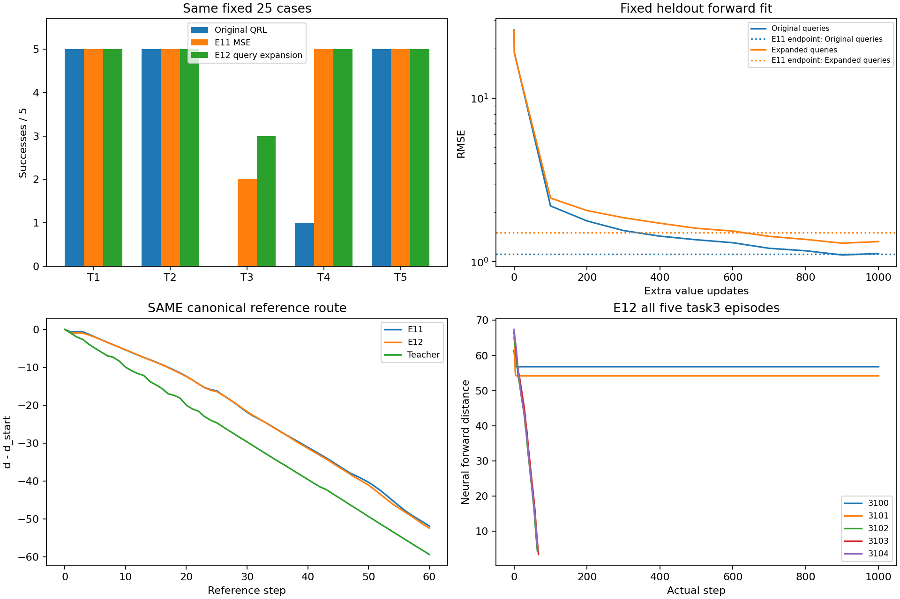
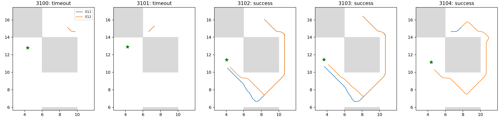

# E12：任务无关查询扩展与原IQE距离学习

固定1000次更新完成，全部23/25成功，task3为3/5；E11为22/25、task3 2/5。相对E11新增['task3_seed3104']，失去[]；失去原100k成功例[]。预定critic门槛为False，不能以平均拟合误差替代此门槛。总133.81秒，其中训练/核验90.37秒，独立评价41.08秒，低于300秒。

## 固定方法与控制

E10教师、原IQE/Adam/count/lr、双向等权MSE与E11完全相同；只改变训练查询分布。每批偶数行保留原(s,g)，奇数行分别加四维非scramble Sobol偏移[-1,1]，不截断/过滤。幅度1来自固定官方maze.py的noise=1和maze_unit=4公式，不来自评价case调参。训练使用前128000个Sobol偏移，验证接下来1024个；没有新随机seed、不改变NumPy官方采样RNG。原数据转移和轨迹/未来目标语义不变，扩展只作教师查询，不把虚构点当真实转移。这些点可能在物理不可达处，标签仅抽象数据/几何先验，非真实MDP最优成本。

正式从同原100k出发1000步batch256/seed2001，只更新value；actor/dynamics/lam及矩冻结。原采样流SHA c479992dde1cf84a74d25a0f74c3f88a07252f02198489bd40f4df2604949ab6与E6/E11相同，扩展查询流SHA 0d3204c71dee6c3d07fd7d4136983087a7289060149b04d2fb67d676c7abb812，标签流SHA 162a286893ae68b7d2596e0f66d41f05ae03fb13e8fdaf0a34778589dff09799。E11与原损失控制直接复用、不重训或重评。两项采样器测试通过，原损失/梯度/优化器测试复用E11通过证据；实际两步smoke保存加载后正式重置原模型，终点count101000/全部状态往返、数值有限、冻结参数/矩/actor输出通过。

## 全任务执行与拟合

| 任务 | 原100k | E11 | E12 | 固定教师 |
|---|---:|---:|---:|---:|
| task1 | 5/5 | 5/5 | 5/5 | 5/5 |
| task2 | 5/5 | 5/5 | 5/5 | 5/5 |
| task3 | 0/5 | 2/5 | 3/5 | 5/5 |
| task4 | 1/5 | 5/5 | 5/5 | 5/5 |
| task5 | 5/5 | 5/5 | 5/5 | 5/5 |

| task3 case | 成功 | 完整步数 | 严格下降比例 | 上坡比例 |
|---|---|---:|---:|---:|
| task3_seed3100 | False | 1000 | 0.0070 | 0.0000 |
| task3_seed3101 | False | 1000 | 0.0090 | 0.0000 |
| task3_seed3102 | True | 64 | 1.0000 | 0.0000 |
| task3_seed3103 | True | 67 | 1.0000 | 0.0000 |
| task3_seed3104 | True | 65 | 1.0000 | 0.0000 |

独立子进程仅载入原QRL checkpoint、原forward神经评分，不导入roadmap_metric/data_graph，不使用教师路径或对称包装。25例完整官方1000步/成功终止，121真实后继、实际选中后继逐位核验与精确缓存保持；参考墙体图仅末尾用于场评价。不是官方actor评价，原actor仍冻结；25-case是已有方法选择库，不是独立跨seed验证。

原验证forward/reverse RMSE终点1.12335/1.11464；E11为1.11237/1.12337。扩展验证终点1.32894/1.31636，E11为1.50675/1.53291。两种heldout独立保留，未据误差或成功率追加训练/选择中间终点。

canonical严格下降通道True，峰差/IQR 0.000000，全图/corridor相关0.993920/0.990758。仍为0.2参考图/吸附误差0.14451的离散检查，零峰差不保证严格通道。原pair平均/尾风险0.014690/0.109975，goal风险0.001030，lambda固定183.248；不把冻结lambda作新优化收敛证明。

## 出口与复现

本轮门槛未通过：新增3104，两个旧成功保留，但3100/3101仍停在墙边。扩展验证误差降低（原验证基本不变）伴随一例真实收益，支持查询分布参与恢复，但不足以解释或消除剩余距离场错误。canonical通道由False变True仍有实际失败，单锚点不足以验收。停止本扩展幅度/比例/排列/学习率/预算搜索，不启动actor训练，不据小随机误差宣称解决；下一项应针对目标距离的局部形状信号或表示机制，而非继续采样幅度搜索。不换seed、不运行1M、不中途挑模型。查询分布扩展只检验这一固定方案，不能将失败泛化为所有采样或距离表示均无效。

协议[QUERY_AUGMENT_PROTOCOL.md](../../../experiments/ogbench_critic/QUERY_AUGMENT_PROTOCOL.md)，测试`test_query_augmentation.py`；正式入口`run_query_augmentation.py <根目录> --output <全新目录>`，报告`report_query_augmentation.py <根目录>`只读重建。raw `results/ogbench_critic_20261029/query_augmentation_1000`，日志同级`.log`，checkpoint `model/params_101000.pkl` SHA 041972b77abcb6dfc57f2132dd58cc09c290de4659361d0abe9619e081a7bf00。已核验固定教师、E11/控制、原模型/源码快照、同bank全部轨迹/结束状态；只提交代码、协议、测试、报告及引用图，原始结果不提交。
