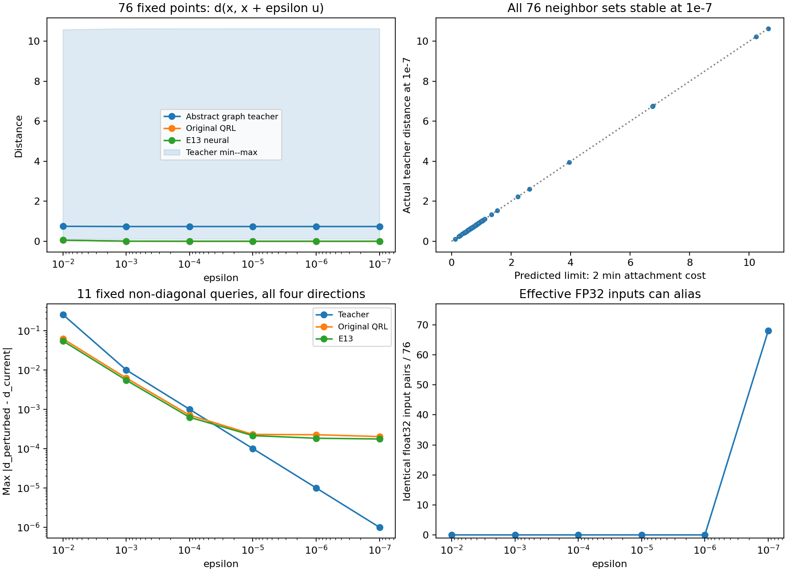

# M5：新增教师存在对角跳变，固定远距离查询未发现相同跳变

只读检查用时2.51秒、训练/episode均0。76个预定点全部有正对角极限（0.11504–10.63807，中位0.73747），且最小epsilon处8邻居集合全部稳定，预测极限与实际误差最大7.07e-07。因此E10抽象查询教师不是欧氏坐标下连续的距离标签，不能要求连续神经距离在全域一致拟合它。

但另11个实际非对角查询，在四个坐标方向epsilon=1e−7处教师变化最大仅1.00e-06、邻居集合未变。两个失败终点的教师−学生差仍约17–18个距离单位，不能将这些远距离误差归因于已证明的对角跳变。此检查修正教师可拟合性边界，未解决或证明原QRL的唯一训练根因。

## 构造与解析证据

E10对查询点x连接原图的8个代价为b_i=a_i+delta。不同查询必须经过原图，故在邻居集合稳定、y→x且y≠x时：lim t(x,y)=min_ij[b_i+Dij+b_j]=2 min_i b_i。Dij≥|b_i−b_j|给出至少2 min b的下界，i=j选最小b取到等号。实现却在相同完整观测时直接取t(x,x)=0。

正极限表示每个连续坐标查询被当成带正连接代价的独立辅助图顶点；这是抽象图度量的合法语义，不能当作连续物理最优距离。连续且自距离为0的神经距离无法在该邻域将一致误差压到小于min b；这不排除随机对分布上的期望MSE很小，不否定已观察到的25/25教师执行。

两项合成测试通过：稳定连接的正对角极限与同点零，及不同float64查询映射到相同float32输入却有不同教师标签。76点来自既有固定验证批次前32 observations/前32 value_goals、canonical锚点/目标、五个既有task3起点/目标，无按结果挑点。验证seed9001只是复现原批次，SHA ed48e5facee70514099101d40186a5b71c2147e1ccf8cbb2a2805f46d161738a同E13；没有新训练seed或重做覆盖审计。

epsilon固定1e−2..1e−7，方向固定(1,1/sqrt(2))。原100k/E13的近对角距离随epsilon下降；最小epsilon处E13最大约4.87e-05，其中68/76对有效float32输入已经相同。数值平台/零值有FP32别名及归约影响，不能当解析梯度证明；图中非对角响应仅作有限扰动检查。

## 与实际失败分开解释

固定canonical锚点、五个task3起点、五个E13结束观测，共11对(s,g)，分别扰动source/goal沿±x/±y四方向。所有查询和所有epsilon保留，不找最大跳变另加点；无新episode或参考墙体/路线输入。

| 固定查询 | 当前教师−E13 | 最小epsilon source响应最大值 | goal响应最大值 | 邻居变化方向数 source/goal |
|---|---:|---:|---:|---:|
| canonical | 8.5658 | 5.00e-07 | 1.00e-06 | 0 / 0 |
| task3_seed3100_start | 16.8202 | 7.50e-07 | 5.00e-07 | 0 / 0 |
| task3_seed3100_end | 16.9897 | 0.00e+00 | 5.00e-07 | 0 / 0 |
| task3_seed3101_start | 19.6896 | 1.00e-06 | 5.00e-07 | 0 / 0 |
| task3_seed3101_end | 17.6242 | 5.00e-07 | 5.00e-07 | 0 / 0 |
| task3_seed3102_start | 5.4145 | 5.00e-07 | 2.50e-07 | 0 / 0 |
| task3_seed3102_end | -0.2149 | 2.50e-07 | 2.50e-07 | 0 / 0 |
| task3_seed3103_start | 6.0560 | 5.00e-07 | 5.00e-07 | 0 / 0 |
| task3_seed3103_end | -0.0876 | 5.00e-07 | 5.00e-07 | 0 / 0 |
| task3_seed3104_start | 4.9973 | 2.50e-07 | 5.00e-07 | 0 / 0 |
| task3_seed3104_end | -0.5007 | 5.00e-07 | 5.00e-07 | 0 / 0 |

这些非对角输入在最小扰动下稳定，不能从“教师对角不连续”跳到“两个task3停滞完全由教师跳变造成”。也不能据四方向有限检查证明全域连续或排除别处连接边界。之前报告称教师仅抽象先验、非连续物理真值的限制现在有直接反例；三角性、全图相关及随机拟合误差仍不是局部动作排序的充分证据。

## 下一步与产物

停止把完整教师当可全域一致逼近的真值，不扩大原MSE/形状预算或地标数搜索。现有随机对低RMSE与固定远距离大误差的缺口仍需处理；下一项可另冻结对非对角全局监督的目标分布均衡检查，而不是反复修改局部约束或只追一个锚点。任何教师修改/训练须另立协议，不能用本检查给新标签预先背书。

原100k与E13完整参数摘要/文件只读不变，模型SHA 397e919f2c453cee02ec840c615dce3532f31532fd639fbea6757c970fedbf0f / a294a32ba443176882752d0e851a1c30c47b7ea6c38bbaf93ced8ea61d2ad9b1；图/全距离/源码/bank身份已核对。协议[QUERY_REGULARITY_PROTOCOL.md](../../../experiments/ogbench_critic/QUERY_REGULARITY_PROTOCOL.md)，测试test_query_regularity.py，入口query_regularity.py <根目录> --output <全新目录>，本报告report_query_regularity.py只读重建。raw results/ogbench_critic_20261029/query_regularity，日志同级.log；只提交代码/测试/协议/报告与引用图，数组/JSON/日志不提交。不换seed、不运行1M，总目标仍未完成。
