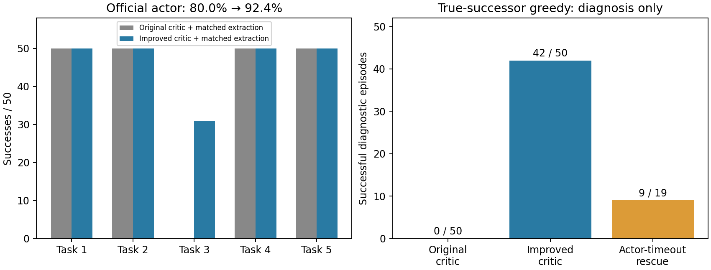

# OGBench QRL：100k接入、task3机制与小预算改进交付

2026-10-31。原官方seed0、100k接入已经完成，平均成功率80%，task3为0/50。后续受控研究表明：当前critic在已有覆盖的绕行走廊上产生反向距离排序；补入数据支持的全局监督并处理高残差目标后，同预算官方策略提取的task3从0/50提升至31/50，平均80%→92.4%，其他四任务各50/50。冻结后另查同50个task3输入，神经critic真实后继贪心从0/50提升至42/50。**改进已在当前初始化、固定公共任务及新评价目标流上成立；仍有距离陷阱与提取缺口，未证明跨seed稳定、全域最优或官方完整预算缺陷。**

用户已明确禁止用换训练seed或官方1M证明非偶然性。官方seed1与seed0完整预算均已停止（exit -15），产物保留，不自动恢复。本次收尾只审计文件、整理复现入口；没有再跑完整改进配方、seed1或1M。

## 1. 官方接入与100k终点

官方[OGBench](https://github.com/seohongpark/ogbench)固定commit `a977253ce5b88434f4e4f531c50047cc95993a51`。直接调用官方main.py、agents/qrl.py和官方数据/评价流程，保持网络、损失、目标采样、actor提取；navigate的alpha=0.0003。独立Python3.10.19环境，macOS arm64、CPU `TFRT_CPU_0`，没有假设CUDA。JAX/jaxlib0.4.35、Flax0.10.2、Optax0.2.4、NumPy1.26.4、MuJoCo3.17.0、Gymnasium1.4.0、W&B0.18.7；完整依赖锁与安装命令见[官方入口](../../../experiments/ogbench_official_qrl/README.md)。

主训练固定100,000次更新，从头seed0、batch1024；每1k记录训练/验证统计，每10k评价和保存，全官方任务各50episode。19.182小时完成，正式结果仅100k终点，不挑最好checkpoint。十个checkpoint、冻结配置、100行训练日志及11轮评价（含官方step1）保留。训练/验证局部罚项终点0.048534/0.047921，容差0.05；训练日志乘子约183.251。它们是批平均统计，不保证全部目标的下降方向。

原checkpoint SHA256：`397e919f2c453cee02ec840c615dce3532f31532fd639fbea6757c970fedbf0f`。原smoke通过一次更新、完整保存加载及完整episode；100k额外加载核验通过count100000/TrainState.step100001、有限性和完整状态往返。官方基线完整报告、学习曲线及日志索引见[100k报告](../../ogbench_official_qrl_20261026_seed0/report.md)。这是100k接入试跑，不是完整论文复现。

适配只有CPU兼容依赖、显式固定源码路径、本地官方dataset_dir、W&B离线和video=0，以及约定预算/日志频率；不因视频阻断数值评价。官方main本身不完整保存环境/NumPy RNG，因此不宣称跨机逐位复现或无缝断点续训。初始化与后处理失败均保留日志，修复没有重训或改原模型。R1/R2、PHR、Dubins、MPPI、MultiEpisodeData和终态quotient没有进入本流程。

## 2. 数据只读审计

| 数据 | 完整观测行 | 有效转移 | episode×长度 | 完整观测冗余 | 完整转移冗余 |
|---|---:|---:|---:|---:|---:|
| train | 1,001,000 | 1,000,000 | 1000×1000 | 345（0.034466%） | 19（0.001900%） |
| validation | 100,100 | 100,000 | 100×1000 | 30（0.029970%） | 2（0.002000%） |

以原始完整浮点行精确比较，转移为完整(s,a,s_next,terminal)，冗余率=(N-unique)/N；没有舍入或按位置投影。本环境完整观测恰为二维。episode/valid/未来目标保留官方加载及GCDataset语义；没有根据此审计去重或改变基线训练权重。精确重复很少，只能限制“消除完全重复”的预期作用，不能排除近邻密度与瓶颈不均衡。数据哈希、组重复率等见原data_audit.json，最终再次核对train/val SHA未变。

## 3. 为什么当前距离场会导致失败

首先确定执行机制，而后区分训练解释的证据强度。

- **覆盖与可达性：**失败墙角、绕行走廊和出口存在跨episode推进转移；参考路线每个节点附近至少281条转移、101个episode，同向动作最少20条。紧墙角仍稀少，不能说密度均匀，但不是完全缺边。独立碰撞图约60步，真实MuJoCo沿路线61步成功，只作诊断参考，不当训练最优标签。
- **空间排序错误：**参考剩余成本60→45时，原网络距离约62.81→69.52；搜索参考图全部路线仍需明显上坡。绕过actor及潜在动力学，以真实后继原critic评分的贪心仍失败，因此局部动力学误差或actor单步选择不是充分解释。
- **训练信号的局限：**M1局部梯度干预显示距离最大化与局部罚项对绕行方向可相互抵消；M2没有支持联合动力学梯度单独造成关键符号反转。平均局部约束接近容差没有直接检验目标相关长程排序，稀少的目标相关误差可被平均统计掩盖。这解释当前信号为何允许失败场，并非证明唯一的全训练历史因果链。
- **受控训练检验：**仅改目标差约束、尾风险、源均衡或轨迹上界，没有恢复task3；随机全局回归可显著降低总体误差而仍在执行点失败。由此没有继续搜索局部权重/lr/预算，也不把平均误差或图相关性当成功替代指标。

主要对照及停止结论均保留，不只报告正结果：

| 实验 | 固定终点结果 | 支持的判断 |
|---|---|---|
| E1原pair约束 vs目标差约束，各10k | task3均0；25例16→14 | 直接目标差上界不足，停止权重搜索 |
| E2一步/多步IQE，各10k | 0/25、5/25，task3均0 | 新Bellman目标并未自动恢复 |
| 原生MQE 100k | 官方actor task3 2/50、总体79.6%；同bank task3 0/5 | 多步准度量比较已做；不同实现/采样不是单变量因果对照 |
| E6尾风险、E7源均衡、E8路径上界 | task3均0/5 | 局部统计/重加权/行为路径上界不足 |
| E10全数据支持教师，只读 | 贪心25/25 | 数据加局部可逆先验能提供可用全局引导；不是神经或官方actor成绩 |
| E11普通回归→E12查询扩展 | 神经贪心22/25→23/25 | 拟合/查询覆盖有作用但不充分 |
| E13形状监督、E15目标均衡 | 23/25、21/25 | 验证误差改善可伴执行不变或退化 |
| E16固定8候选高残差目标 | 神经贪心25/25、task3 5/5 | 通过既有critic门槛，随后冻结检查新目标流与actor利用 |

E16改变的是全局监督目标及目标选择，不是保持原QRL目标不变。候选多样性与最大误差选择尚未分别消融，不能唯一归因其中一项。教师由6302实际数据原型、21524条观测支持无向边构造，包含局部可逆先验、分数边代价和查询接入；不是严格连续MDP最短到达成本。M5还证明教师存在正对角极限，连续神经距离不能全域一致拟合；不能把它宣称为无伪影真值。

证据链和每项源码/协议/报告导航见[研究README](../../../experiments/ogbench_critic/README.md)、[WORKLOG](../../../experiments/ogbench_critic/WORKLOG.md)。

## 4. 改进能否被官方actor利用

E16从原100k状态只更新IQE价值1000次，actor/dynamics/lam及其Adam矩冻结。E17 A用原critic、B用E16critic，开始actor/dynamics/lam/RNG一致；各用相同2000批原官方数据，先官方dynamics_loss1000次，再官方ddpgbc actor_loss1000次。critic/lam全程冻结，actor阶段动力学也冻结。alpha、lr、网络、const_std、100%未来actor目标不改，batch256。B先前另有1000价值更新，阶段化也不同于main联合训练，不能称同总预算的原算法成绩。

终点冻结后独立进程直接调用官方actor/evaluate：五任务各50episode，250起点和goal逐位匹配。没有教师、图、候选动作搜索或模拟器规划用于actor决策。评价rng0是配对输入控制，不是新增训练seed。

| 官方任务 | A原critic+同预算提取 | B改进critic+提取 |
|---|---:|---:|
| task1 | 50/50 | 50/50 |
| task2 | 50/50 | 50/50 |
| task3 | 0/50 | 31/50 |
| task4 | 50/50 | 50/50 |
| task5 | 50/50 | 50/50 |
| 平均 | 80.0% | 92.4% |

配对新增31例、失去0例。A接受相同额外提取预算仍task3为0，说明额外actor训练本身不是本对照增益的充分解释。新评价流未用于E16/E17选择或训练；既有25例已用于方法选择，单独保留而不冒充独立验证。该范围内已经达到可复核改善，不以跨seed或1M作为补跑门槛。



冻结后M6只读复建同50个官方task3输入：原critic真后继贪心0/50、改进42/50。19个改进actor超时末状态另给1000步诊断，仅9/19被同critic贪心救援，**不加到31/50正式成绩**。8例从初态及actor末状态贪心均失败；另2例初态可成功但actor进入新距离陷阱；9例初态与末状态均可贪心成功，保留提取链路缺口。贪心同时绕过actor与潜在动力学，不能唯一责怪BC或actor。

M6原240秒只读预算超时exit1，完成40例；显式新协议补10+50+19，复用40完整轨迹不重跑，新增阶段242.53秒，累计482.54秒。原故障/不完整尝试保留，不称原预算通过、不称未扩计算预算。训练更新仍0，没有按成功率扩训练或换seed。详见[E17报告](../extraction_1000/report.md)、[M6报告与修订](../official_counterfactual_completion/report.md)。

## 5. 交付、运行约束与复现

| 要求 | 交付证据与状态 |
|---|---|
| 固定官方实现、独立环境、实际设备 | OFFICIAL_COMMIT、依赖锁、host/preflight、源码69文件哈希；CPU、W&B离线、视频可选 |
| 原始数据、轨迹/valid/目标语义 | 官方make_env_and_datasets及GCDataset；train/val SHA复核，完整精确重复审计 |
| smoke→从头固定100k | 一次更新/完整checkpoint往返/episode通过；100k正常退出，十个checkpoint，终点评价 |
| 损失/约束/乘子/评价/耗时 | train.csv、eval.csv、runtime.json、冻结flags、原学习曲线与中文报告保留 |
| stitch配置准备 | 官方README及prepared_stitch_100k；actor current/traj/random从0/1/0改0/0.5/0.5，均匀未来分支；未启动 |
| 完整预算命令 | 原README保留供文档查阅；最新用户指令禁止执行，不再以它作完成门槛 |
| seed1与seed0完整预算停止 | 两个USER_STOPPED.json记录exit -15、restart_authorized=false；最终进程检查无相关Python运行 |
| 正向方法独立入口 | run_improvement.py，plan/smoke/improve显式选择；只需原100k和完整官方数据，不依赖历史控制产物 |
| 独立入口验证 | 各阶段2步smoke共18.93秒，三次完整保存加载/冻结/count、五完整官方episode通过；未再运行正式1000×3 |
| 研究可审查性 | exp/ogbench逐项中文提交代码/测试/协议/报告/引用PNG；原模型、JSON/CSV/NPZ/日志保留本地，不进Git |

最终文件审计finalize_delivery.py只读检查十个原checkpoint、69份官方源码、train/val哈希、250配对输入/得失、四阶段提取checkpoint、119反事实轨迹及standalone smoke，全部通过。原始delivery_audit.json存于本目录，不提交。没有为了收尾重复旧测试或正式训练。

安装/原100k/stitch命令见[官方README](../../../experiments/ogbench_official_qrl/README.md)。正向方法命令、预算与smoke详情见[独立复现说明](../../../experiments/ogbench_critic/STANDALONE_REPRODUCTION.md)。仅重做文件审计及图：

```bash
PYTHONDONTWRITEBYTECODE=1 MPLBACKEND=Agg MPLCONFIGDIR=/private/tmp/ogbench_critic_mplcache \
experiments/ogbench_official_qrl/.venv/bin/python experiments/ogbench_critic/finalize_delivery.py
```

当前本地原始产物根目录：results/ogbench_official_qrl_20261026_seed0和results/ogbench_critic_20261029。关键checkpoint相对研究根目录：

| 用途 | 路径 | SHA256 |
|---|---|---|
| E16神经critic | hard_goal_1000/model/params_101000.pkl | 71a8d61900ac5db435e6c71c3786996d779abe81749884c3cc834a557fbb6777 |
| E17原critic提取控制 | extraction_1000/original/actor/params_102000.pkl | 0f0c1fc98bb1d4cbba09590f6004a132a012ae221a101feb703ea95e465b87a9 |
| E17改进actor终点 | extraction_1000/improved/actor/params_103000.pkl | dbec9e4ad128ca519611f40ad4d3a1f02118f92e8a6513afd074c8d1a623978e |

当前阶段完成了公共100k入口、覆盖/距离排序/训练信号的受控研究，以及同初始化下跨固定任务和新评价流的实际改善。没有证明唯一全训练历史根因、task3全部解决或论文完整复现；这些限制不通过用户已取消的seed1/1M或追加预算强行消除。
