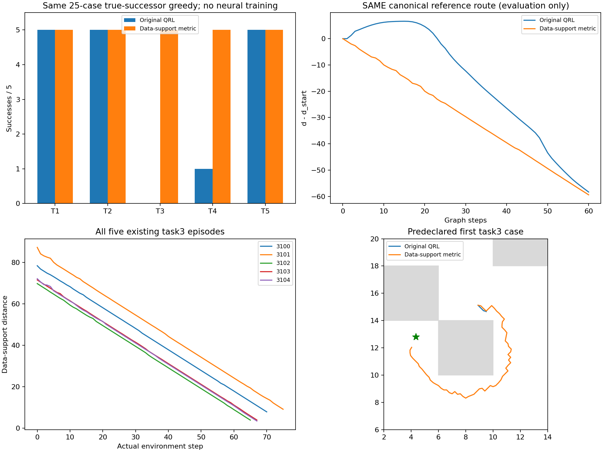
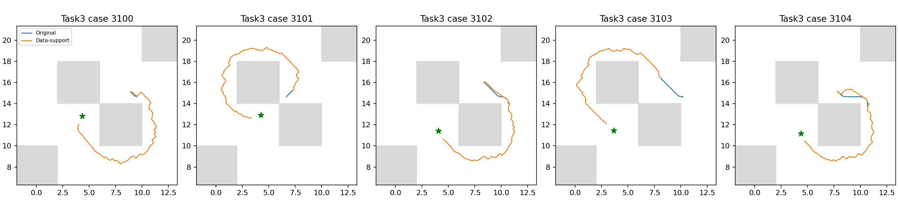

# E10：数据支持距离在全部既有case中恢复绕行

独立数据构造在17.98秒完成（其中构图及全距离10.95秒），全部25例成功，task3为5/5；五个task3都逐步严格降低预测距离，无上坡。这首次通过预定神经拟合候选门槛，但尚未训练神经critic、更新actor或完成总目标，不能将它当官方QRL成绩。

## 固定构造与新增先验

只使用官方全部1000000条valid训练转移，不改行权重/边界/未来目标，不调用R系列。完整二维观测固定0.2格子，每格选实际观测中距格心最近的样本而非格心；得到6302个原型。只有真实转移对应的格子对构成21524条无向边，代价为原型L∞间距/0.2，频次不累加。

这里显式加入局部可逆和几何连接先验，边代价是连续几何时间近似，不是官方离散步数真值。与M4相比，节点、方向/代价和查询构造均不同，不当单变量消融；没有通过修改M4结果或扫描网格/系数制造收益。原型/图/全部距离完成后才读bank和评价几何，没有使用墙体/参考路线标签。

每个查询连接最近8个原型，a_i=||x−v_i||∞/0.2；delta=0.5*max(0,max_ij[D_ij−a_i−a_j])，b_i=a_i+delta。满足|b_i−b_j|≤D_ij≤b_i+b_j，因此查询节点不会给原图制造更短捷径。不同查询间取min_ij(b_i+D_ij+b_j)，相同完整观测取0，给出查询空间的对称度量。它不保证物理最优性、连续性或在原型坐标上的插值；这些限制不能靠通过有限执行验证而取消。

所有原型保留且图连通，没有取最大分量。距离float64全量有限/对称/自距离零、不低于几何直距，固定子集三角检查通过；保存加载查询逐位一致。起点/目标50个查询的delta范围0.000000–4.721251，只报告而不调修正。

## 全部25例真实后继贪心

| 任务 | 原100k QRL | 数据支持距离 |
|---|---:|---:|
| task1 | 5/5 | 5/5 |
| task2 | 5/5 | 5/5 |
| task3 | 0/5 | 5/5 |
| task4 | 1/5 | 5/5 |
| task5 | 5/5 | 5/5 |

新增['task3_seed3100', 'task3_seed3101', 'task3_seed3102', 'task3_seed3103', 'task3_seed3104', 'task4_seed3101', 'task4_seed3102', 'task4_seed3103', 'task4_seed3104']，失去[]。原16个成功全部保留，五个task3完成65–75步，每步预测距离严格下降。控制器仍是原121动作真实后继评分/官方1000步上限，T1物理原样执行每个选中动作并逐位检查后继；没有早停失败或新增训练seed。

| 评价目标 | 原锚点/实际起点严格下降通道 | 最低峰差/IQR | 全图Spearman |
|---|---|---:|---:|
| canonical | True | 0.000000 | 0.999397 |
| task3_seed3100 | True | 0.000000 | 0.999324 |
| task3_seed3101 | True | 0.000000 | 0.999400 |
| task3_seed3102 | True | 0.000000 | 0.999386 |
| task3_seed3103 | True | 0.000000 | 0.999248 |
| task3_seed3104 | True | 0.000000 | 0.999117 |

这些参考图/墙体只在完整真实执行之后评价，全部六个目标都有通道，不能反过来说构造使用了参考真距离。仍为同0.2网格/0.7半径下的离散证据；实际成功来自完整MuJoCo轨迹，图相关接近1也不构成连续最优性证明。

## 核验、门槛与结论范围

三项测试覆盖实际原型/边和保存加载、查询一致修正与对称/自距离/三角结构、不连通直接拒绝。训练更新0，原100k文件SHA前后仍为397e919f2c453cee02ec840c615dce3532f31532fd639fbea6757c970fedbf0f。图SHA ee6ca69c3e70c596caf7168239d21915562a663d02345730c3c71829a2bb3f2f，全距离矩阵SHA 2d8eda547fb6ea42d9804403f8c61f037c0d28a3a823e2fcd48e9d07ea2880e2，全部源转移端点SHA 664b021f05a477f2ab0ae76ad79c73e549aedeccbad18a7b0710ec63d00f8ac1；源码/快照、bank与完整观测/动作/评分/结束integration state已经核验。

预定门槛（task3五例全成功且不失去原成功例）为True。这只是在已知bank上的方法选择，不是独立泛化验证，更不是神经QRL恢复。它证明在这个数据构造和先验下可得到有效绕行距离，尚不能单独判断原神经优化/表示的哪一项为根因。下一项需要检验原神经critic能否学习该全局信号，并在推理时完全不用图；随后才考虑actor利用。不能以本非参数结果替代学习目标收尾。

协议见[ROADMAP_METRIC_PROTOCOL.md](../../../experiments/ogbench_critic/ROADMAP_METRIC_PROTOCOL.md)。命令`run_roadmap_metric.py <结果根目录> --output <全新目录>`，报告`report_roadmap_metric.py <结果根目录>`只读重建。本地目录`results/ogbench_critic_20261029/roadmap_metric`及同级日志。只提交源码/测试/协议/报告和引用图；全距离矩阵、原型/图、轨迹、JSON/NPZ/日志保留本地。不换seed、不启动1M。
