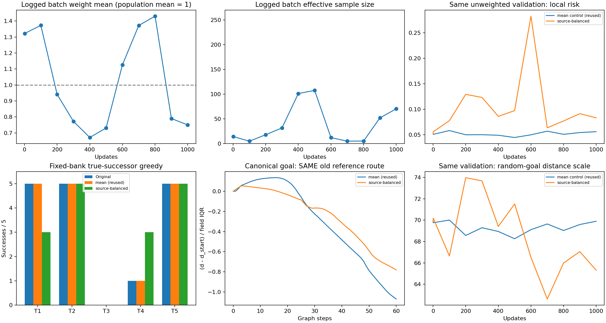
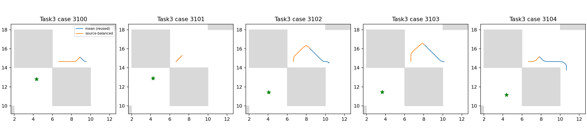

# E7：源格子均衡改变排序，但没有恢复task3

仅新增一个原100k IQE的固定1000步critic续训组，复用E6已经完成的mean控制组，不重复训练A或原始基线。两组训练批次字节流完全相同。正式总用时138.07秒，其中构造、smoke、训练和状态核验88.91秒，处于预定300秒上限。没有换seed/初始化、挑checkpoint或启动1M。

## 新方法与控制组身份

源完整二维观测仅用于rint(s/0.2)频次，网络仍接收原始连续观测。对全部100万官方valid源行，w=N/(K*n_c)，同时加权原push与pair惩罚；dual使用同加权pair与原eps。所有原行仍被官方采样，轨迹边界和随机/未来目标语义不变；不去重、不改目标、不用R系列、终态quotient、图边/最短路、墙体或评价数据训练。

这改变经验源分布，不能称原官方目标不变，也不是精确重复去重或源/边同时均衡。原精确重复审计很低，本项没有重复覆盖审计或重写原100k基线。batch256、lr/eps、1000更新、原Adam、IQE和官方目标配置与E6一致，actor/dynamics及其Adam矩冻结。源码/模型身份和数据流核验后才复用A。

| 人口统计 | 实际值 |
|---|---:|
| 有效源行N / 占用源格子K | 1000000 / 6302 |
| 最小 / 最大格子频次 | 1 / 3530 |
| 最小 / 最大行权重 | 0.044952 / 158.679779 |
| 人口平均权重 | 0.9999999921 |
| 人口重要性有效样本数 | 50743.54 |

人口有效样本数约原始N的5.1%，不是对转移的温和去重。没有batch重归一或权重截断；有限batch的权重均值会波动，这正是人口归一的重要性估计，日志保留均值/最大值/有效样本数。不能把不均一损失波动误当配置或数据流变化。

## 全部25例真实执行

| 任务 | 原100k | E6 mean复用 | 源均衡B |
|---|---:|---:|---:|
| task1 | 5/5 | 5/5 | 3/5 |
| task2 | 5/5 | 5/5 | 5/5 |
| task3 | 0/5 | 0/5 | 0/5 |
| task4 | 1/5 | 1/5 | 3/5 |
| task5 | 5/5 | 5/5 | 5/5 |

总成功为16/25、16/25、16/25。B相对A新增['task4_seed3102', 'task4_seed3103']，失去['task1_seed3101', 'task1_seed3104']。不是原成功集合的稳定扩展；冻结actor未重新评价或学习，该表不冒充官方actor指标。完整episode仍为1000步，精确缓存与四线程物理只减少重复计算，实际选中后继和首次hit均核验。

## 原分布验证与距离场

| 原2048验证转移指标 | 原100k | E6 mean | 源均衡B |
|---|---:|---:|---:|
| pair_mean_squared_positive | 0.0517811 | 0.0562795 | 0.0833838 |
| pair_tail_squared_positive | 0.278726 | 0.316492 | 0.508025 |
| pair_q99 | 1.70154 | 1.71127 | 1.89647 |
| pair_max | 2.45032 | 2.7919 | 2.95918 |
| goal_squared_positive | 0.0201905 | 0.0208975 | 0.033597 |
| goal_mean | 69.9158 | 69.8946 | 65.3135 |
| lam | 183.248 | 184.538 | 213.322 |

这里是完全相同的**未加权**验证分布，不等同于新源分布下的约束风险。B的加权训练pair最后记录为0.055583，未加权验证pair为0.083384；不能把不同统计混为一个已满足的约束。乘子与距离尺度均明示，不凭lambda或单个风险宣称成功。

| critic | canonical原锚点严格下降通道 | 最低峰差/IQR | 全图Spearman | 原走廊Spearman |
|---|---|---:|---:|---:|
| mean | False | 0.135673 | 0.951360 | 0.245509 |
| source-balanced | False | 0.000000 | 0.860865 | 0.552326 |

源均衡提高了原走廊的局部排序相关，却降低整图排序；最低峰差为零仍没有严格下降通道。它意味着能找到不超过起点高度的路线，不表示沿途不再上坡。以上只用同0.2参考图、0.7半径与canonical目标评价；不把它混作bank五个实际目标，也不把离散图吸附结论推广到所有连续状态。

## 核验、决策与复现

三项方法测试通过：全1权重损失/梯度退化官方、完整观测区分与人口质量归一/保存加载、非零动量冻结及计数。实际两步smoke保存加载完整agent/优化器/RNG相等，正式从原100k开始；终点全状态往返、数值有限、count101000、冻结参数/矩与同25例actor输出均通过。B原始轨迹/结束integration state与同bank起点/目标已核对。

共享批次流SHA c479992dde1cf84a74d25a0f74c3f88a07252f02198489bd40f4df2604949ab6，与E6 A完全相同；复用A checkpoint SHA d92cf664f10345f96a77045f988a689f0985ac2120781ec596ef6b932fdaacec，B SHA b7422b7efd118eeac26659dcb370f703c29064b7d64c408bea72cdd34763bb46。缓存共有10843次请求、2117次实际函数求值，其中首次hit重算14次；没有提前终止停滞episode。

本次源均衡未解决task3；不调网格、权重指数/截断、学习率或eps挽救。 这只约束当前初始化、数据流、固定网格定义与短预算，不能称所有均衡方法无效；也不能以一个局部场统计改善为总目标收尾。稳定改善尚未达成，不恢复seed1或1M。

协议见[SOURCE_BALANCE_PROTOCOL.md](../../../experiments/ogbench_critic/SOURCE_BALANCE_PROTOCOL.md)。原始路径`results/ogbench_critic_20261029/source_balance_1000`，日志同级`source_balance_1000.log`；命令`run_source_balance.py <结果根目录> --output <全新目录>`。报告由`report_source_balance.py <结果根目录>`只读重建，不训练或重复评价。Git只提交源码/测试/协议/报告及引用图，模型/计数表/CSV/JSON/NPZ/日志保留本地。
