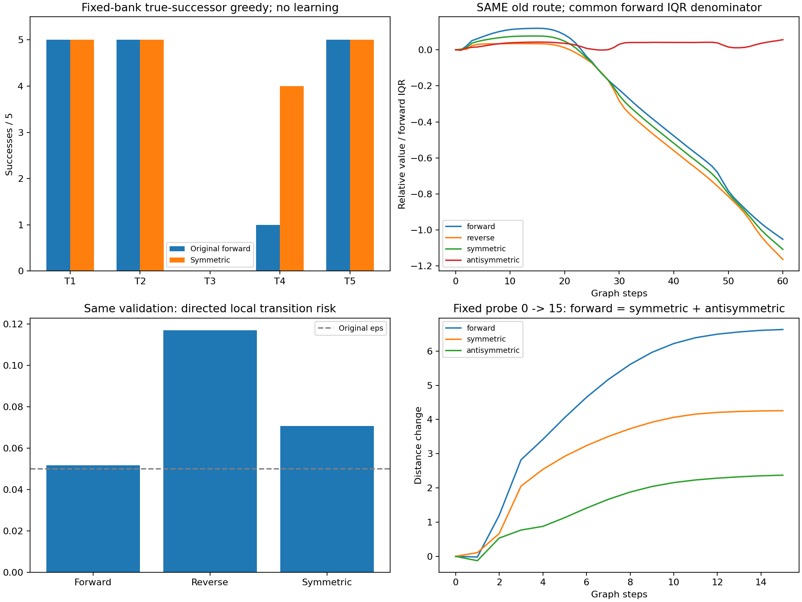
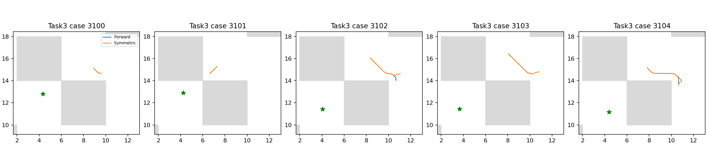

# E9：方向不对称解释部分上坡，等权对称仍未解决task3

固定原100k QRL，只读构造S(s,g)=(d(s,g)+d(g,s))/2，训练更新为0。全部25例真实后继贪心由16/25增至19/25，新增三个task4成功且无失去，但task3仍0/5。不能把原失败单独归因于方向不对称，也不能把S包装为官方基线或原actor改进。

## 固定投影与数学范围

F=d(s,g)，R=d(g,s)，S=(F+R)/2，A=(F−R)/2。S是本轮唯一主要critic，R仅作场/分解，没有试跑反向控制或扫描混合系数。准度量及其反向的等权和仍满足准度量结构并对称，A为有符号分量，不当距离评价。点maze的反向运动结构提供研究动机，但未断言接触/初始化/完整MuJoCo成本严格对称，不能推广到Dubins等方向性任务。

原push为凸的100 softplus(5−d/100)。源与随机value goal同分布独立时，交换源/目标不改变总体分布；配对有限样本也满足push(S)≤(push(F)+push(R))/2。原2048验证上配对push为431.520038751，S为431.519902904，仅改善约0.000135848。未配对F/R分别为431.543371447/431.496706056，不能把配对Jensen不等式错误地当成任一有限未配对样本上的保证。

随机目标平均绝对F−R差1.907576，平均相对差约1.965%。原转移pair风险F/R/S为0.051781/0.117018/0.070699。S虽低于配对风险均值0.084400，仍高于F且超过原eps0.05；没有声称该投影满足原已训练单向风险约束，反向转移也不直接当真单步标签。

## 同25例真实执行

| 任务 | 原F | 等权S |
|---|---:|---:|
| task1 | 5/5 | 5/5 |
| task2 | 5/5 | 5/5 |
| task3 | 0/5 | 0/5 |
| task4 | 1/5 | 4/5 |
| task5 | 5/5 | 5/5 |

新增['task4_seed3102', 'task4_seed3103', 'task4_seed3104']，失去[]。全部既有case完成原121动作网格、官方1000步上限，失败episode没有按停滞早停。原F直接复用旧数组；S明确使用两个方向的原函数评分，权重/参数未改变，actor没有更新或重新学习。

## canonical场的固定0/15分解

| critic | 原锚点严格下降通道 | 最低峰差/IQR | 全图Spearman | 原走廊Spearman |
|---|---|---:|---:|---:|
| forward | False | 0.119460 | 0.951321 | 0.297540 |
| reverse | False | 0.035077 | 0.953574 | 0.231316 |
| symmetric | False | 0.077097 | 0.953115 | 0.268051 |

固定旧路径节点[[10.2, 14.8], [10.8, 11.8]]间，ΔF=6.631111，ΔR=1.885117，ΔS=4.258110，ΔA=2.372997。ΔF=ΔS+ΔA在FP32误差内成立；反对称部分约占原上坡35.8%，但剩余对称上坡仍约4.26。这个分解说明不对称参与了该模型的上坡，并不证明训练历史的唯一因果；F、R、S均没有原锚点下降通道。

## 五个实际task3目标与失败终点

| 既有case | 起点F通道 | 起点R通道 | 起点S通道 | S终点附近峰差/IQR |
|---|---|---|---|---:|
| task3_seed3100 | False | False | False | 0.134994 |
| task3_seed3101 | False | False | False | 0.147627 |
| task3_seed3102 | False | False | False | 0.039659 |
| task3_seed3103 | False | False | False | 0.067432 |
| task3_seed3104 | False | False | False | 0.019240 |

三个方向场在全部五个起点均无严格下降通道；S五个真实失败终点附近也无通道，终点附近峰差/IQR约0.019–0.148。终点吸附误差最大约0.206，保留同0.2网格/0.7碰撞半径的离散限制，不能将附近检查当连续状态最优性证明。canonical目标与实际五个目标分开计算，未用一个好看的目标代表全部执行。

## 核验与决策

三项测试通过：等权定义/分解、对称/自距离/三角结构、配对凸性及缓存评分等于原函数双方向。完整agent摘要和checkpoint SHA前后不变，source/模型/bank摘要、字段代数与轨迹起点/目标/评分/结束integration state核验通过。整个诊断76.63秒，低于240秒上限；精确缓存16530次原方向评分请求，实际求值4758次（首次hit复算16次），没有训练或新checkpoint。

S在现有bank的task4有收益，但未解决核心task3；不扫描系数、挑R方向或换较好终点挽救本项。当前证据要求保留“对称场本身仍有错误上坡”，不能把方向不对称命名为唯一根因。稳定恢复目标继续，不恢复seed1/1M，不以跨seed或完整预算作为必要门槛。

协议见[SYMMETRY_PROTOCOL.md](../../../experiments/ogbench_critic/SYMMETRY_PROTOCOL.md)。原始路径`results/ogbench_critic_20261029/symmetry_projection`，日志同级`symmetry_projection.log`；入口`run_symmetry.py <结果根目录> --output <全新目录>`。报告由`report_symmetry.py <结果根目录>`只读重建。源码/测试/协议/报告和引用图提交，数组/JSON/日志保留本地。
