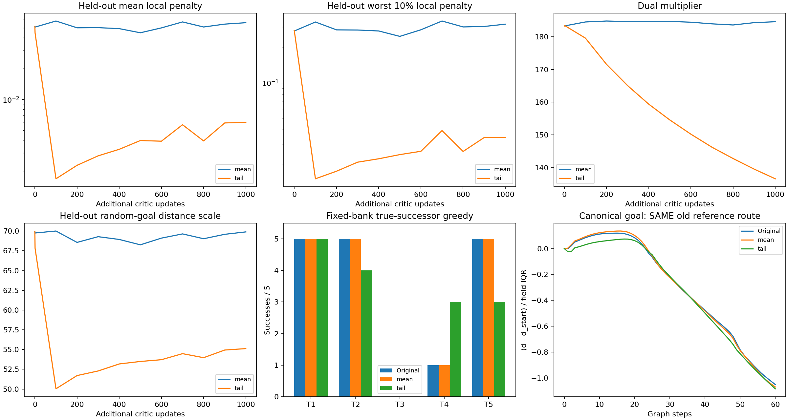
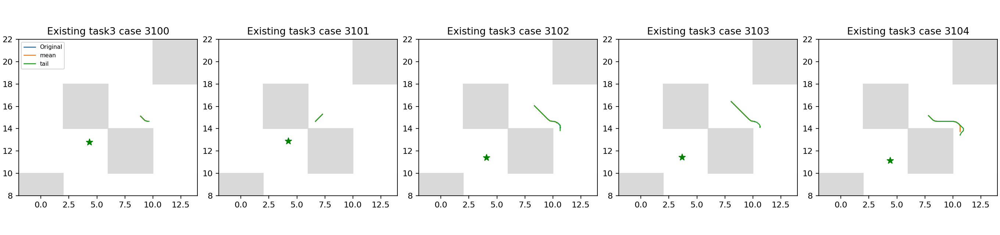

# E6：局部约束平均／尾部风险的固定短预算对照

两组从相同原始QRL 100k IQE出发，各完成额外1000次critic更新，实际Adam count101000，actor/dynamics参数与Adam矩冻结。仅将局部正部平方从均值改为最差26/256项均值，目标采样、学习率、IQE、负距离最大化和eps不变。两组同批次、沿用采样seed2001，不是换初始化/独立seed验证；与原官方1024 batch不同，只解释本配对内部聚合变量。

正式训练及完整诊断用时581.75秒，处于预定600秒上限；训练、保存加载与冻结核验阶段165.01秒。没有选中间模型、按成功率早停、追加更新或启动1M。3项方法测试与实际全网络两步smoke通过，正式从原100k开始而非smoke模型。

## 全部既有25例真实后继贪心

| 任务 | 原100k | mean额外1000 | tail额外1000 |
|---|---:|---:|---:|
| task1 | 5/5 | 5/5 | 5/5 |
| task2 | 5/5 | 5/5 | 4/5 |
| task3 | 0/5 | 0/5 | 0/5 |
| task4 | 1/5 | 1/5 | 3/5 |
| task5 | 5/5 | 5/5 | 3/5 |

原/mean/tail总成功数为16/25、16/25、15/25。这是同121动作网格、完整MuJoCo状态恢复、1000步上限的诊断控制，不是官方actor 50episode指标。actor同库动作逐位未变，不声称已改善原actor。

- tail_vs_mean：新增['task4_seed3102', 'task4_seed3103']，失去['task2_seed3101', 'task5_seed3102', 'task5_seed3104']。
- mean_vs_original：新增[]，失去[]。
- tail_vs_original：新增['task4_seed3102', 'task4_seed3103']，失去['task2_seed3101', 'task5_seed3102', 'task5_seed3104']。

## 固定2048验证转移的约束与尺度

| 指标 | 原始 | mean终点 | tail终点 |
|---|---:|---:|---:|
| pair_mean_squared_positive | 0.0517811 | 0.0562795 | 0.00598544 |
| pair_tail_squared_positive | 0.278726 | 0.316492 | 0.0342802 |
| pair_q99 | 1.70154 | 1.71127 | 1.23911 |
| pair_max | 2.45032 | 2.7919 | 1.54597 |
| goal_squared_positive | 0.0201905 | 0.0208975 | 0.00178022 |
| goal_mean | 69.9158 | 69.8946 | 55.1148 |
| lam | 183.248 | 184.538 | 136.656 |

尾部约束仍是上界风险定义，不能自动保证目标距离沿可达路径下降。两组的乘子面对不同风险统计，lambda数值不能直接当作同一原约束已被更好满足。训练取ceil(0.1*256)=26，即10.15625%；验证尾部取205/2048。两种风险均保存，不只报告有利指标；尺度变化需要和归一化场/实际执行一起解释。

tail的验证平均/尾部局部惩罚分别约为mean的10.6%/10.8%，平均目标距离也下降约21.1%。风险收紧确实生效，却伴随三个原成功例丢失，说明“把较大局部违反压低”在当前预算下没有自动转化为更好的闭环距离。该目标也比原均值约束更严格，不能把差异单独归为稀有状态重加权或某一墙角得到关注。

## canonical目标场与全部task3轨迹

| critic | 原锚点严格下降通道 | 最低峰差/IQR | 全图Spearman | 原走廊Spearman |
|---|---|---:|---:|---:|
| mean | False | 0.135673 | 0.951360 | 0.245509 |
| tail | False | 0.073602 | 0.953326 | 0.126390 |

场采用既有0.2参考图/0.7半径、原锚点及canonical目标，不参与训练；它与bank五个实际目标区分。图吸附不是连续环境最优性证明，峰差下降/归零也不等价严格下降通道。

tail相对mean的原锚点峰差/IQR从0.1357降为0.0736，仍为正且没有通道；原走廊排序相关反从0.2455降至0.1264。它改变了局部排序和距离尺度，但没有消除阻断。不能由此声称局部约束与原失败无关，或声称1000更新已充分收敛；这里只否定这次固定短预算改法达成稳定改善。

## 决策与复现

tail未解决task3，不搜索尾部比例、eps、学习率或lambda权重挽救本方案。 本项只能解释当前初始化、固定数据流和短预算的结果，不作跨seed或完整预算概括。当前稳定改善总目标仍未完成；不恢复seed1/1M，也不把它们作为完成门槛。

完整模型/优化器/RNG保存加载逐位相等，数值有限、count/step正确，冻结模块的参数及非零Adam矩不变，同25例actor输出相等；两个终点SHA、源码快照、同bank起点/目标、逐步评分及结束integration state已核对。批次流SHA为c479992dde1cf84a74d25a0f74c3f88a07252f02198489bd40f4df2604949ab6。mean checkpoint SHA为d92cf664f10345f96a77045f988a689f0985ac2120781ec596ef6b932fdaacec；tail为199a3bcba07617f3ec627871498f13db2e188b90fd97fcda5894a7a2dfd70a80。

协议见[TAIL_PROTOCOL.md](../../../experiments/ogbench_critic/TAIL_PROTOCOL.md)。实际路径`results/ogbench_critic_20261029/tail_1000`，日志同级`tail_1000.log`；入口`run_tail.py <结果根目录> --output <全新目录>`，两步smoke增加`--smoke`。本报告通过`report_tail.py <结果根目录>`只读重建，不重新训练或评价。只提交源码/测试/协议/报告与引用图，完整模型、CSV/JSON/NPZ、日志保留本地。
