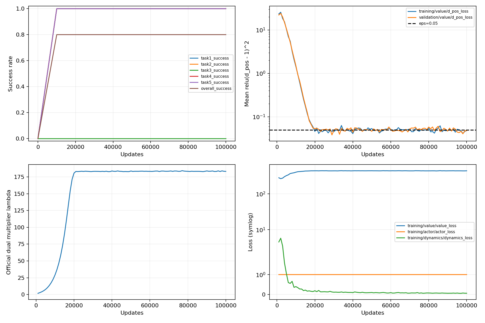

# OGBench 官方 QRL 100k 接入试跑报告

报告生成时间：2026-10-27 11:26:08（Asia/Shanghai）。接入、烟雾、固定 100,000 次更新、正式终点评价和后续 checkpoint 加载校验均已完成。**100k 终点五任务平均成功率为 80%：四个任务各 50/50，task3 为 0/50。** 本结果是 pointmaze-medium-navigate-v0、seed0 的 100k 接入试跑，完整论文预算复现仍未进行。没有启动 stitch、多 seed 或其他算法，没有按成功率筛选 checkpoint。

## 固定版本、协议与设备

官方仓库：[seohongpark/ogbench](https://github.com/seohongpark/ogbench)，固定 commit：`a977253ce5b88434f4e4f531c50047cc95993a51`，包版本 1.2.1。官方 main.py、agents/qrl.py 及冻结配置内全部官方 Python 源码哈希核对一致，归档见 [official_source.tar.gz](official_source.tar.gz)。

独立 Python 3.10 环境，macOS 26.5.2 arm64、32 GiB 内存、10 核 CPU。训练设备：`['TFRT_CPU_0']`；恢复验证设备：`['TFRT_CPU_0']`，均为 CPU。主要依赖为 JAX/jaxlib 0.4.35、Flax 0.10.2、Optax 0.2.4、Distrax 0.1.5、NumPy 1.26.4、MuJoCo 3.17.0、Gymnasium 1.4.0、W&B 0.18.7。修复后各依赖版本与安装锁逐项一致，见 [依赖版本核对](postprocessing/dependency_version_comparison.json)。

固定配置为 IQE QRL、actor/value 隐层 (512,512,512)、latent_dim=512、layer_norm=True、lr=0.0003、eps=0.05；actor_loss=ddpgbc、const_std=True、alpha=0.0003。batch_size=1024，seed=0，从头初始化、restore_path=None；100k 更新，每 1k 记录训练/验证日志，每 10k 评价及保存 checkpoint。实际运行 flags 与 [冻结配置](main/frozen_config.json) 核对一致，[配置 SHA256](main/frozen_config.sha256) 校验通过。

正式主进程：2026-10-26 11:56:27 → 2026-10-27 07:07:22（Asia/Shanghai），耗时 **19.182 小时**，平均约 1.448 次更新/秒，包含初始化、编译、训练、逐轮评价、保存和日志退出；主进程退出码为 0。

## 固定终点的官方评价

| 官方任务 | 100k 成功数 / 50 | 成功率 |
|---|---:|---:|
| task1 | 50 / 50 | 100.0% |
| task2 | 50 / 50 | 100.0% |
| task3 | 0 / 50 | 0.0% |
| task4 | 50 / 50 | 100.0% |
| task5 | 50 / 50 | 100.0% |
| 平均 | — | 80.0% |

全部官方任务各 50 episode，官方 actor、temperature=0、无额外 Gaussian 噪声，成功率来自 step=100000 的官方 eval.csv。学习曲线仅用于观察，见 learning_curves.png/pdf；每轮 250 episode，保留官方 step1 评价，总计 11 轮。单 seed、每任务 50 个 episode 的结果存在采样波动，不能据此宣称达到论文成绩。

| 更新步数 | task1 | task2 | task3 | task4 | task5 | 平均 |
|---:|---:|---:|---:|---:|---:|---:|
| 1 | 0% | 0% | 0% | 0% | 0% | 0% |
| 10,000 | 100% | 100% | 0% | 100% | 100% | 80% |
| 20,000 | 100% | 100% | 0% | 100% | 100% | 80% |
| 30,000 | 100% | 100% | 0% | 100% | 100% | 80% |
| 40,000 | 100% | 100% | 0% | 100% | 100% | 80% |
| 50,000 | 100% | 100% | 0% | 100% | 100% | 80% |
| 60,000 | 100% | 100% | 0% | 100% | 100% | 80% |
| 70,000 | 100% | 100% | 0% | 100% | 100% | 80% |
| 80,000 | 100% | 100% | 0% | 100% | 100% | 80% |
| 90,000 | 100% | 100% | 0% | 100% | 100% | 80% |
| 100,000 | 100% | 100% | 0% | 100% | 100% | 80% |

四个成功任务在首次 10k 评价已经达到 100%，此后每个评价点保持相同结果；task3 在所有评价点均为 0%。本轮证明接入可训练且能完成四个官方任务，但没有观察到 10k 以后成功率继续提高。task3 的官方起点为 (8,16)、目标为 (4,12)，其失败机制尚未定位：现有 CSV 没有保存逐步轨迹，不能据此断定是距离估计、策略提取、数据覆盖或绕行中的哪一环节造成失败。

共完成 2,750 个正式评价 episode，正式结论仅取固定 100k 终点。额外加载验证 episode 不计入上表，也没有替换任何正式评价结果。



曲线文件：[PNG](learning_curves.png)、[PDF](learning_curves.pdf)。

## 烟雾及 checkpoint

烟雾通过：一次更新，全部五任务各一个完整 episode；随后确认参数发生改变、Adam count=1、checkpoint 完整 PyTree 保存/加载相等，并完成额外评价 episode（1000 步），见 [烟雾验证](smoke/checkpoint_verification.json)。

100k checkpoint 亦通过相同 round-trip 检查：Adam count=100000，官方 TrainState.step=100001（其初值为 1），所有状态叶子为有限值，参数与初始化不同，包含优化器和 JAX RNG 的完整状态逐叶一致。加载后的 task1 完整 episode 为 122 步，success=1。该 episode 只验证加载后的模型能够运行，未计入正式成功率，见 [终点验证](main/checkpoint_verification.json)。

## 数据只读审计

| 数据 | 原始观测行 | 有效转移 | episode | 长度 min / mean / max | 全观测冗余率 | 全转移冗余率 |
|---|---:|---:|---:|---|---:|---:|
| train | 1001000 | 1000000 | 1000 | 1000 / 1000.0 / 1000 | 0.034466% | 0.001900% |
| validation | 100100 | 100000 | 100 | 1000 / 1000.0 / 1000 | 0.029970% | 0.002000% |

“冗余率”定义为 `(N-unique)/N`。完整观测和 `(s,a,s_next,terminal)` 按全部维度精确比较，无舍入和位置投影。原始 episode 由原始 terminals 计算，compact valids 保持官方有效转移语义。更详细的重复组比例、最大重数、数据 SHA256、维数及 dtype 见 data_audit.json。没有根据审计结果修改采样权重。精确重复统计只能判断完全重复样本的规模，不能单凭它推断近邻密度不均衡、拓扑瓶颈或后续加权方法收益。

本任务官方完整观测本身是二维 PointMaze 状态，动作同为二维，没有主动截取位置或丢弃状态维度。训练集完整观测冗余 345 行、完整有效转移冗余 19 行；验证集分别为 30 行、2 行。仅考察有效源状态时，训练集冗余 342 行、占 0.0342%。重复组最大重数均为 2。报告生成前再次核对原始 train/val 数据 SHA256 均未改变。

对后续源/边均衡而言，完全相同源/边的重复规模很小，单纯按精确重复次数均衡直接涉及的样本比例有限；近邻密度、瓶颈覆盖等问题不由此统计刻画。因此这不能排除其他均衡方法，也不能作为其有效性的证明。本轮没有进行重加权或去重。

## 训练损失、局部约束与乘子分析

train.csv 共 100 行，覆盖 1k–100k，训练及验证的全部记录均为有限值，没有 NaN/Inf。下表 1k 是第一次日志采样，不是模型初始化时的损失。

| 日志指标 | 1k 首次记录 | 100k 终点 | 91k–100k 十个日志批次均值 |
|---|---:|---:|---:|
| `training/value/d_pos_loss` | 23.4834 | 0.048534 | 0.0481297 |
| `validation/value/d_pos_loss` | 22.1273 | 0.0479207 | 0.0479223 |
| `training/value/lam` | 1.79846 | 183.251 | 183.48 |
| `training/dynamics/dynamics_loss` | 4.53562 | 0.062363 | 0.0649243 |
| `validation/dynamics/dynamics_loss` | 4.46414 | 0.0575614 | 0.0626724 |
| `training/value/d_neg_mean` | 278.011 | 69.2923 | 69.9514 |
| `training/actor/actor_loss` | 1.00088 | 1.0009 | 1.00091 |
| `training/actor/mse` | 1.08855 | 1.15858 | 1.19656 |

100k 时训练批次的 d_pos_loss=0.048534，官方约束容差 eps=0.05，lambda=183.251。这只是最后一个日志批次的局部约束统计，不是全数据约束保证。train.csv 同时保留训练/验证的 d_pos min/mean/max、局部罚项、lambda、value/actor/dynamics 损失及耗时。

官方局部统计为 `mean(relu(d(s,s_next)-1)^2)`；终点训练/验证约 0.04853/0.04792，最后十个日志批次均值约 0.04813/0.04792。乘子从首次记录约 1.8 增长并在后期约 183 附近稳定。这支持“被记录批次的平均局部罚项已压至容差附近”，不等于每条边都满足 d<=1，也不保证 task3 的目标策略已学会。

动力学训练/验证损失从首次记录约 4.54/4.46 降至终点约 0.0624/0.0576，两者后期量级接近。随机目标距离均值由早期约 278 变为终点约 69.3，要结合局部约束和乘子一起解读，不能用某个损失是否单调下降判定整个约束优化是否正确。

actor 总损失约 1.0009，并不能仅凭数值接近常数判断 actor 没有学习。官方 DDPG+BC 使用 `q_loss=-mean(q)/stop_gradient(mean(abs(q))+1e-6)`；q 为负时前向标量接近 1，但分母停止梯度，分子梯度不会因此相消。BC 项约 0.0009，与官方 alpha=0.0003 有关。actor 训练 MSE 没有整体下降，说明模仿误差和任务成功率并非同一指标。日志未单独保存 actor 梯度范数，因此不把该解释延伸为 task3 失败的因果诊断。

完整指标首值、终值、范围和最后十个批次均值/标准差见 [analysis.json](analysis.json)。

## 后处理故障修复与复现边界

训练结束后最初的报告链失败，是导入路径和目录发现问题：

1. `ogbench.pth` 带 macOS `UF_HIDDEN` 标记，Python 的 site.addpackage 会跳过隐藏 .pth。包元信息和固定源码仍在，但源码目录未进入 sys.path，导致 `ModuleNotFoundError: ogbench`。
2. runtime.py 现显式加入已固定的官方源码根目录，并验证实际导入位置；没有修改依赖版本或官方算法。
3. 结果目录扫描原先会把 Finder 的 `.DS_Store` 算作实验目录，现仅接收带 flags.json 的目录。
4. 原失败日志保留为 main/checkpoint_check_failed_import.log、main/checkpoint_check_failed_discovery.log；原临时报告备份在 postprocessing/provisional_report_before_recovery.md。正式文件统一命名为 **report.md**。

本次只补做后处理及加载验证，没有重训、续训、增加更新预算或改写原始训练 checkpoint、train.csv、eval.csv。十个 checkpoint 的 SHA256 见 analysis.json、summary.json；新修复源码及哈希位于 postprocessing，训练时冻结配置与历史源码快照均保留。

安装、复现命令、1M 官方预算命令及 stitch 配置差异见仓库 experiments/ogbench_official_qrl/README.md。适配仅包括 CPU 依赖、本地 dataset_dir、显式离线 W&B、关闭视频、预算和日志频率。官方网络、损失、目标采样和策略提取未修改；没有迁移现有实验权重、PHR、Dubins 或 MPPI。

官方 seed0 设置未覆盖 Gymnasium 的所有随机源，checkpoint 也不保存完整 NumPy/环境 RNG，官方 restore 不恢复主循环计数，因此不承诺跨机器逐位一致或无缝断点续训。

## 安装、复现与未启动的完整预算

完整命令见 [实验入口 README](../../experiments/ogbench_official_qrl/README.md)。从仓库根目录仅重做当前结果的加载检查与报告：

```bash
P=experiments/ogbench_official_qrl/.venv/bin/python
E=experiments/ogbench_official_qrl
R=results/ogbench_official_qrl_20261026_seed0
$P "$E/check_checkpoint.py" "$R/main" 100000
$P "$E/report.py" "$R"
```

stitch 对应官方配置已准备：actor 的 current/trajectory/random 概率由 navigate 的 0/1/0 改为 0/0.5/0.5；两者 actor_geom_sample=False，均使用官方均匀未来目标分支，alpha=0.0003，actor_loss=ddpgbc。value 目标概率均为 0/0/1。本轮没有启动 stitch。

官方完整预算为 1M 更新、5k 日志、100k 评价、1M 保存、每任务 50 episode，后续手动命令如下，本轮未执行：

```bash
$P "$E/protocol.py" navigate full results/ogbench_qrl_navigate_full_new
$P "$E/launch.py" results/ogbench_qrl_navigate_full_new
$P "$E/protocol.py" stitch full results/ogbench_qrl_stitch_full_new
$P "$E/launch.py" results/ogbench_qrl_stitch_full_new
```

## 产物索引与结论

checkpoint/CSV 目录：`/Users/z./Documents/博士/本科毕设/quasimetric-rl-topology-improvements/results/ogbench_official_qrl_20261026_seed0/main/OGBench/navigate_100k/sd000_20261026_115628`。各 10k checkpoint 全部保留，正式终点为 params_100000.pkl。

- 正式结果：[summary.json](summary.json)、本文件 report.md；统计分析：[analysis.json](analysis.json)。
- [训练日志](main/OGBench/navigate_100k/sd000_20261026_115628/train.csv)、[官方评价日志](main/OGBench/navigate_100k/sd000_20261026_115628/eval.csv)、[主进程日志](main/console.log)、[耗时](main/runtime.json)。
- [冻结配置](main/frozen_config.json)、[配置哈希](main/frozen_config.sha256)、[训练时依赖](main/pip-freeze.txt)，离线 W&B 在 main/tmp。
- [数据审计](data_audit.json)、[加载验证](main/checkpoint_verification.json)、[学习曲线 PNG](learning_curves.png) / [PDF](learning_curves.pdf)。
- [后处理校验清单及哈希](postprocessing/integrity.json)，全部生成及校验成功后写出 [COMPLETE](COMPLETE)。

接入已成功，固定 100k 的学习表现为平均 80%、task3 持续失败；官方 1M、多 seed 与完整论文结果复现仍待后续独立实验。
