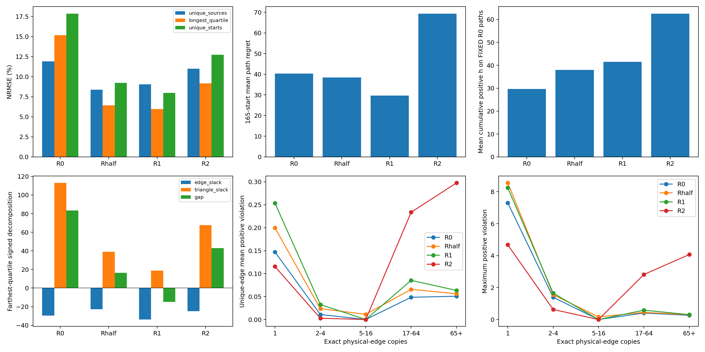

# R2：PHR唯一物理边均衡（seed606，正式50k）

本轮未实现“降低局部违反的同时保留R1的长程紧致性和路径收益”。不同统计测度下的违反变化方向不同，不能把唯一边均值或最大值下降概括成约束问题已解决。

R2相对R1：去重边平均正违反 0.214654→0.114751，最大正违反 8.250990→4.681380；最远四分位NRMSE 5.9564%→9.1729%，165独立起点平均路径regret 29.7446→69.2955。局部违反、长程紧致性和路径决策分别判断，不能用最大违反下降或到达率代替决策改善。

## 冻结协议与必要验证

本轮仅训练seed606 R2，直接复用经配置/数据/完整初始化/预算/hash核验的R0/R1/Rhalf。保留R1 task源均衡 `-.6 mean(w*d_task)` 及原B1 `-.4 mean(d_B1)`。唯一变化是PHR按全局唯一物理边权重聚合：`mean(v_i*PHR_i)`，`v_i=N/(K*m(e_i))`，边身份为完整canonical source、target、action字节、原始cost。

逐记录PHR分子先乘v再取均值，最后除共同2ρ。所有副本的multiplier分别进入各自PHR；这等价于每条唯一边内部对副本PHR取平均后，再对边等权平均，不能用代表行PHR替代。不按minibatch权重和归一化，不改变采样或乘子数量。dual仍为逐访问、primal前残差的 `lambda_i=relu(lambda_i+h_i)`，不乘v。

实测N=42536、K=6958；平均v=0.9999999699，范围0.036173–6.113251，最大副本数169。task权重与R1指纹一致，M=6766。

共享encoder/projector/IQE；seed606，batch256，sampler seed2307，B1 seed42，task_mode=all，AdamW/weight_decay0、rho100、eta1、4线程；前45k学习率2e-5，后5k从2e-6几何衰减到2e-7。每1000步全量审计，保留epoch末尾40条小批次，固定50k停止。训练/权重/停止不读取图参考或Oracle。

初始model/optimizer/zero dual/visits/sampler/RNG/counters与全部基线逐项一致。完整有序采样序列独立重建通过；各行访问299–300次，共12,735,416次访问，R2有51次全量审计（含0步）。最终乘子正常独立演化，未要求最终参数/乘子一致。

7项训练测试通过：边权重均值/边总权重、完整边身份、不同副本乘子的PHR值与梯度（含gradcheck）、全1边权重与R1精确更新一致、task/B1/PHR及不加权dual、50k访问预算、真实4步保存/恢复及权重/模式/配置拒绝。另有3项后验统计测试通过。运行环境与旧实验一致；源码、数据、协议均已冻结，旧代码与产物未覆盖。

## 距离误差与偏差

bias=预测−修正参考，NRMSE=RMSE/RMS(参考)。修正参考仅在训练预算完成后读取。

| 分组 | 模型 | MAE | RMSE | NRMSE % | bias |
|---|---|---:|---:|---:|---:|
| 42,536记录 | R0 | 22.3837 | 32.6570 | 11.1768 | +11.9275 |
| 42,536记录 | Rhalf | 21.8579 | 29.9538 | 10.2516 | +17.8181 |
| 42,536记录 | R1 | 23.5858 | 32.0300 | 10.9622 | +21.0967 |
| 42,536记录 | R2 | 37.6192 | 45.4092 | 15.5412 | +32.9756 |
| 6,766去重源 | R0 | 40.1326 | 54.5342 | 11.9017 | -10.6338 |
| 6,766去重源 | Rhalf | 30.3336 | 38.4205 | 8.3850 | +13.7382 |
| 6,766去重源 | R1 | 34.1096 | 41.3817 | 9.0312 | +25.5929 |
| 6,766去重源 | R2 | 42.1545 | 50.4028 | 11.0000 | +17.1097 |
| 最远四分位 | R0 | 83.4675 | 93.3882 | 15.1820 | -83.4597 |
| 最远四分位 | Rhalf | 28.4454 | 39.5623 | 6.4316 | -16.3755 |
| 最远四分位 | R1 | 31.7203 | 36.6391 | 5.9564 | +14.9502 |
| 最远四分位 | R2 | 44.4485 | 56.4247 | 9.1729 | -42.9001 |
| 165独立起点 | R0 | 84.4465 | 100.1222 | 17.8406 | -67.9311 |
| 165独立起点 | Rhalf | 39.2143 | 51.7833 | 9.2272 | -12.2276 |
| 165独立起点 | R1 | 35.1809 | 44.8050 | 7.9837 | +14.1315 |
| 165独立起点 | R2 | 60.7194 | 71.4644 | 12.7341 | -29.1330 |
| 307原始起点 | R0 | 59.5647 | 77.4675 | 16.0950 | -28.3572 |
| 307原始起点 | Rhalf | 36.3354 | 46.3964 | 9.6395 | +7.8156 |
| 307原始起点 | R1 | 36.7256 | 45.2900 | 9.4097 | +25.1165 |
| 307原始起点 | R2 | 54.0029 | 63.2986 | 13.1512 | +4.0200 |

## 长程累计边项与三角松弛

沿固定参考最短路径：`D*−J = Σ(cost−d_edge) + [Σd_edge−J]`。前项为有符号累计边项，后项为累计三角松弛。该恒等式分解有符号误差及其均值，不是RMSE可加归因；更负边项可能掩盖正三角松弛。

| 分组 | 模型 | D*−J | 累计边项 | 累计三角松弛 |
|---|---|---:|---:|---:|
| 6,766去重源 | R0 | 10.6338 | -26.1682 | 36.8020 |
| 6,766去重源 | Rhalf | -13.7382 | -25.7361 | 11.9979 |
| 6,766去重源 | R1 | -25.5929 | -31.8933 | 6.3004 |
| 6,766去重源 | R2 | -17.1097 | -38.1204 | 21.0106 |
| 最远四分位 | R0 | 83.4597 | -29.6058 | 113.0655 |
| 最远四分位 | Rhalf | 16.3755 | -22.6668 | 39.0424 |
| 最远四分位 | R1 | -14.9502 | -33.8106 | 18.8604 |
| 最远四分位 | R2 | 42.9001 | -24.7798 | 67.6799 |
| 165独立起点 | R0 | 67.9311 | -26.7130 | 94.6441 |
| 165独立起点 | Rhalf | 12.2276 | -24.8155 | 37.0431 |
| 165独立起点 | R1 | -14.1315 | -34.9453 | 20.8139 |
| 165独立起点 | R2 | 29.1330 | -27.5216 | 56.6547 |

## 局部违反：均值、尾部和最大值

残差h=d(s,s′)−原始一步成本，正违反=relu(h)。违反数阈值1e-5；分位数对全部正违反值（含零）计算。top1%均值取最大的ceil(0.01n)项。完整JSON还包括p90、signed mean及仅违反项的p95。

| 分布 | 模型 | 违反数/总数 | 平均正违反 | p95 | p99 | top1%均值 | 最大值 |
|---|---|---:|---:|---:|---:|---:|---:|
| records | R0 | 19649/42536 | 0.060431 | 0.208256 | 0.672816 | 1.392047 | 7.308139 |
| records | Rhalf | 20506/42536 | 0.077456 | 0.273407 | 0.905151 | 1.748570 | 8.553942 |
| records | R1 | 20232/42536 | 0.095564 | 0.371433 | 1.089879 | 2.129314 | 8.250990 |
| records | R2 | 18490/42536 | 0.272666 | 1.305736 | 3.322209 | 3.679377 | 4.681380 |
| unique_edges | R0 | 1646/6958 | 0.124127 | 0.804920 | 2.013872 | 2.919869 | 7.308139 |
| unique_edges | Rhalf | 1855/6958 | 0.169041 | 1.027893 | 2.383485 | 3.660354 | 8.553942 |
| unique_edges | R1 | 2081/6958 | 0.214654 | 1.276237 | 2.944565 | 4.387359 | 8.250990 |
| unique_edges | R2 | 1475/6958 | 0.114751 | 0.712767 | 1.628374 | 2.483512 | 4.681380 |

### 按唯一边的副本数分组

分组边界在训练前固定，仅使用物理记录副本数。不是源重复次数分组。每组分别给唯一边等权与记录加权统计。

| m(e) | 唯一边数 | 物理记录数 | 原记录PHR权重占比 | R2边均衡PHR权重占比 |
|---|---:|---:|---:|---:|
| 1 | 5609 | 5609 | 13.19% | 80.61% |
| 2-4 | 744 | 1790 | 4.21% | 10.69% |
| 5-16 | 17 | 118 | 0.28% | 0.24% |
| 17-64 | 420 | 21134 | 49.68% | 6.04% |
| 65+ | 168 | 13885 | 32.64% | 2.41% |

#### 唯一边等权

| 副本数 | 模型 | 违反数/总数 | 平均正违反 | p95 | p99 | top1%均值 | 最大值 |
|---|---|---:|---:|---:|---:|---:|---:|
| 1 | R0 | 1325/5609 | 0.147372 | 0.923529 | 2.137916 | 3.114419 | 7.308139 |
| 1 | Rhalf | 1509/5609 | 0.199917 | 1.172825 | 2.578434 | 3.928694 | 8.553942 |
| 1 | R1 | 1725/5609 | 0.253654 | 1.436002 | 3.377288 | 4.678493 | 8.250990 |
| 1 | R2 | 1191/5609 | 0.115552 | 0.723116 | 1.650768 | 2.427840 | 4.681380 |
| 2-4 | R0 | 23/744 | 0.010981 | 0.000000 | 0.279983 | 0.853844 | 1.392914 |
| 2-4 | Rhalf | 39/744 | 0.023635 | 0.003520 | 0.849120 | 1.186434 | 1.555127 |
| 2-4 | R1 | 58/744 | 0.032641 | 0.189572 | 0.850206 | 1.166463 | 1.654643 |
| 2-4 | R2 | 6/744 | 0.002806 | 0.000000 | 0.000000 | 0.260987 | 0.630038 |
| 5-16 | R0 | 0/17 | 0.000000 | 0.000000 | 0.000000 | 0.000000 | 0.000000 |
| 5-16 | Rhalf | 2/17 | 0.011337 | 0.055373 | 0.142824 | 0.164687 | 0.164687 |
| 5-16 | R1 | 0/17 | 0.000000 | 0.000000 | 0.000000 | 0.000000 | 0.000000 |
| 5-16 | R2 | 0/17 | 0.000000 | 0.000000 | 0.000000 | 0.000000 | 0.000000 |
| 17-64 | R0 | 203/420 | 0.048511 | 0.197313 | 0.291740 | 0.340148 | 0.407623 |
| 17-64 | Rhalf | 208/420 | 0.065849 | 0.272082 | 0.372794 | 0.407996 | 0.449967 |
| 17-64 | R1 | 202/420 | 0.085421 | 0.385418 | 0.503679 | 0.552150 | 0.586167 |
| 17-64 | R2 | 199/420 | 0.233794 | 1.014392 | 1.697715 | 2.486705 | 2.818875 |
| 65+ | R0 | 95/168 | 0.050755 | 0.186868 | 0.224351 | 0.244375 | 0.261932 |
| 65+ | Rhalf | 97/168 | 0.056086 | 0.191394 | 0.256136 | 0.282840 | 0.296693 |
| 65+ | R1 | 96/168 | 0.063431 | 0.229914 | 0.259153 | 0.283646 | 0.304284 |
| 65+ | R2 | 79/168 | 0.297777 | 1.330827 | 3.411736 | 3.831109 | 4.068714 |

#### 记录加权

| 副本数 | 模型 | 违反数/总数 | 平均正违反 | p95 | p99 | top1%均值 | 最大值 |
|---|---|---:|---:|---:|---:|---:|---:|
| 1 | R0 | 1325/5609 | 0.147372 | 0.923529 | 2.137916 | 3.114419 | 7.308139 |
| 1 | Rhalf | 1509/5609 | 0.199917 | 1.172825 | 2.578434 | 3.928694 | 8.553942 |
| 1 | R1 | 1725/5609 | 0.253654 | 1.436002 | 3.377288 | 4.678493 | 8.250990 |
| 1 | R2 | 1191/5609 | 0.115552 | 0.723116 | 1.650768 | 2.427840 | 4.681380 |
| 2-4 | R0 | 53/1790 | 0.009736 | 0.000000 | 0.224524 | 0.792405 | 1.392914 |
| 2-4 | Rhalf | 87/1790 | 0.020546 | 0.000000 | 0.805167 | 1.145136 | 1.555127 |
| 2-4 | R1 | 128/1790 | 0.028346 | 0.133598 | 0.758837 | 1.130426 | 1.654643 |
| 2-4 | R2 | 13/1790 | 0.002681 | 0.000000 | 0.000000 | 0.266645 | 0.630038 |
| 5-16 | R0 | 0/118 | 0.000000 | 0.000000 | 0.000000 | 0.000000 | 0.000000 |
| 5-16 | Rhalf | 13/118 | 0.008880 | 0.028045 | 0.164687 | 0.164687 | 0.164687 |
| 5-16 | R1 | 0/118 | 0.000000 | 0.000000 | 0.000000 | 0.000000 | 0.000000 |
| 5-16 | R2 | 0/118 | 0.000000 | 0.000000 | 0.000000 | 0.000000 | 0.000000 |
| 17-64 | R0 | 10113/21134 | 0.047216 | 0.197142 | 0.298397 | 0.344947 | 0.407623 |
| 17-64 | Rhalf | 10495/21134 | 0.063997 | 0.272012 | 0.375871 | 0.414077 | 0.449967 |
| 17-64 | R1 | 10111/21134 | 0.081064 | 0.367577 | 0.504279 | 0.553072 | 0.586167 |
| 17-64 | R2 | 10119/21134 | 0.238062 | 1.069977 | 1.699613 | 2.534970 | 2.818875 |
| 65+ | R0 | 8158/13885 | 0.052472 | 0.192097 | 0.226817 | 0.244754 | 0.261932 |
| 65+ | Rhalf | 8402/13885 | 0.056391 | 0.192117 | 0.268988 | 0.282342 | 0.296693 |
| 65+ | R1 | 8268/13885 | 0.063250 | 0.229351 | 0.263008 | 0.282607 | 0.304284 |
| 65+ | R2 | 7167/13885 | 0.425927 | 2.923631 | 3.593505 | 4.065295 | 4.068714 |

## 固定R0路径的累计正违反

使用seed606 R0的50k冻结路径，所有模型的h都在同一套物理边路径上累加relu(h)。165唯一起点等权为主；307原始起点为辅助。以下累计值是模型残差诊断，不是额外环境成本，也不等价于regret。

| 路径集 | 模型 | 路径平均Σh+ | p95路径Σh+ | 最大路径Σh+ |
|---|---|---:|---:|---:|
| fixed_R0_paths165 | R0 | 29.709196 | 39.804100 | 82.513211 |
| fixed_R0_paths165 | Rhalf | 37.936176 | 59.292644 | 138.608830 |
| fixed_R0_paths165 | R1 | 41.518537 | 72.918755 | 162.314467 |
| fixed_R0_paths165 | R2 | 62.509298 | 69.820943 | 128.307102 |
| fixed_R0_paths307 | R0 | 27.426063 | 42.082146 | 82.513211 |
| fixed_R0_paths307 | Rhalf | 34.925497 | 59.383588 | 138.608830 |
| fixed_R0_paths307 | R1 | 38.044249 | 74.268140 | 162.314467 |
| fixed_R0_paths307 | R2 | 56.536258 | 69.980053 | 128.307102 |
| own_paths165 | R0 | 29.709196 | 39.804100 | 82.513211 |
| own_paths165 | Rhalf | 36.935245 | 54.546353 | 138.608830 |
| own_paths165 | R1 | 51.205781 | 73.507101 | 176.284442 |
| own_paths165 | R2 | 54.742033 | 65.487336 | 125.251700 |

固定R0路径的直接累加值与唯一边路径暴露次数加权值独立核对相等。各自路径统计仅辅助，不能通过路线更换掩盖违反。

## 分支、后继预测误差差分与路径regret

| 模型 | 最优分支/58 | 严格排序正确率 | 分支平均regret | 165起点路径regret | 165最优路径数 | 307路径regret |
|---|---:|---:|---:|---:|---:|---:|
| R0 | 30 | 65.0104% | 10.6993 | 40.3047 | 11 | 33.6643 |
| Rhalf | 26 | 67.9089% | 10.9403 | 38.3876 | 7 | 30.3288 |
| R1 | 28 | 68.5300% | 9.3763 | 29.7446 | 8 | 24.9558 |
| R2 | 28 | 63.1470% | 10.2718 | 69.2955 | 9 | 53.1011 |

所有模型使用同一真实候选边及cost+预测后继距离贪心规则。图为DAG、唯一汇点是目标，最长275步；307/307到达率主要由图结构保证，仅为完整性检查。

令ε(t)=J(t)−D*(t)，对模型所选边a和参考最优边b，核对`score(a)−score(b)=regret(a)+ε(t_a)−ε(t_b)`。错误选择通常需足够负的后继误差差分抵消真实regret。所选错误分支的集合因模型而变，其均值不能直接当作配对改善。

| 模型 | 非最优分支数 | 所选边误差差分均值（全部58） | 非最优所选边差分均值 | 固定严格候选对差分RMS | 排序正确对数 |
|---|---:|---:|---:|---:|---:|
| R0 | 28 | -11.0389 | -22.8662 | 37.3889 | 314/483 |
| Rhalf | 32 | -11.3310 | -20.5374 | 37.4092 | 328/483 |
| R1 | 30 | -9.8026 | -18.9517 | 37.2781 | 331/483 |
| R2 | 30 | -10.5813 | -20.4572 | 37.5589 | 305/483 |

对完全相同的严格参考候选对，R1→R2：错误变正确59对，正确变错误85对。共有29个分支更换所选边。下表列出所有更换分支；完整58分支和全部候选对明细见JSON。

| 源ID | R1选择→R2选择 | R1 regret | R2 regret | R1所选后继误差差分 | R2所选后继误差差分 |
|---|---|---:|---:|---:|---:|
| 0 | 25419→25066 | 2.3684 | 16.9188 | -3.8017 | -18.3053 |
| 16 | 25592→26070 | 48.4276 | 19.9173 | -48.9738 | -20.6963 |
| 33 | 211→33 | 18.2176 | 0.0000 | -18.2235 | 0.0000 |
| 34 | 12013→34 | 96.9470 | 0.0000 | -96.9755 | 0.0000 |
| 88 | 15145→15054 | 1.5470 | 4.1142 | -1.7165 | -5.1576 |
| 120 | 16121→15950 | 13.7284 | 0.0000 | -14.4475 | 0.0000 |
| 240 | 17561→17918 | 4.2532 | 32.1162 | -5.2445 | -32.3205 |
| 272 | 18651→18732 | 0.0000 | 0.4982 | 0.0000 | -0.5335 |
| 288 | 19070→19342 | 4.2715 | 45.3203 | -4.4131 | -45.7962 |
| 304 | 19621→19420 | 27.2221 | 0.0000 | -27.6220 | 0.0000 |
| 336 | 346→19845 | 0.0000 | 0.0029 | 0.0000 | -0.0544 |
| 382 | 584→403 | 20.0969 | 0.0000 | -20.1228 | 0.0000 |
| 383 | 12309→404 | 70.9808 | 0.0000 | -70.9892 | 0.0000 |
| 388 | 20442→20296 | 0.0000 | 75.2485 | 0.0000 | -75.5099 |
| 404 | 20956→20577 | 0.0000 | 45.9639 | 0.0000 | -46.8765 |
| 420 | 441→21077 | 0.0000 | 16.2212 | 0.0000 | -16.3899 |
| 452 | 21868→21794 | 14.9031 | 19.2887 | -15.6516 | -20.3699 |
| 468 | 489→22006 | 0.4466 | 18.8375 | -0.4514 | -18.9571 |
| 543 | 12458→585 | 16.9067 | 0.0000 | -16.9584 | 0.0000 |
| 548 | 22883→590 | 0.0000 | 50.8835 | 0.0000 | -50.8889 |
| 596 | 23918→23822 | 0.0000 | 2.6665 | 0.0000 | -2.6698 |
| 628 | 670→24334 | 0.0000 | 43.9684 | 0.0000 | -44.9176 |
| 660 | 25002→24950 | 0.0000 | 77.1645 | 0.0000 | -77.5024 |
| 676 | 25034→25050 | 0.4095 | 0.0000 | -0.8237 | 0.0000 |
| 827 | 26410→1500 | 0.9387 | 27.2969 | -2.4725 | -28.5104 |
| 1067 | 27606→27249 | 0.0000 | 15.1428 | 0.0000 | -15.4772 |
| 1083 | 27945→28425 | 6.1168 | 3.9390 | -6.1998 | -5.9801 |
| 1536 | 29074→5983 | 38.8613 | 0.0000 | -39.2531 | 0.0000 |
| 1769 | 30051→7474 | 76.9255 | 0.0000 | -79.8667 | 0.0000 |

## R2相对R1：是否降低违反并保留收益

- records：平均正违反变化 +0.177102，p99变化 +2.232330，最大值变化 -3.569611；违反数变化 -1742。
- unique_edges：平均正违反变化 -0.099903，p99变化 -1.316191，最大值变化 -3.569611；违反数变化 -606。
- 固定R0的165起点路径平均累计正违反：41.518537→62.509298。
- 6,766去重源：NRMSE 9.0312%→11.0000%，bias +25.5929→+17.1097。
- 最远四分位：NRMSE 5.9564%→9.1729%，bias +14.9502→-42.9001。
- 165独立起点：NRMSE 7.9837%→12.7341%，bias +14.1315→-29.1330。
- 远端有符号gap变化 +57.8504 = 累计边项变化 +9.0308 + 累计三角松弛变化 +48.8196。
- 最优分支 28→28，排序正确率 68.5300%→63.1470%，分支平均regret 9.3763→10.2718，165路径regret 29.7446→69.2955。

### 改善与代价出现在哪些边

- m(e)=1：唯一边平均正违反 0.253654→0.115552，p99 3.377288→1.650768，最大值 8.250990→4.681380。
- m(e)=2-4：唯一边平均正违反 0.032641→0.002806，p99 0.850206→0.000000，最大值 1.654643→0.630038。
- m(e)=5-16：唯一边平均正违反 0.000000→0.000000，p99 0.000000→0.000000，最大值 0.000000→0.000000。
- m(e)=17-64：唯一边平均正违反 0.085421→0.233794，p99 0.503679→1.697715，最大值 0.586167→2.818875。
- m(e)=65+：唯一边平均正违反 0.063431→0.297777，p99 0.259153→3.411736，最大值 0.304284→4.068714。

固定R0的165条唯一起点路径中，151条累计正违反上升，14条下降，0条近似不变。这避免了把本模型路线更换误当成局部可行性改善。

远端累计边项是有符号量，负残差可抵消正残差；固定R0路径的累计正违反只累加正项，而且路径集不同。因此有符号累计边项变得更不负，与固定R0路径累计正违反增加并不矛盾。

最优分支数量相同也不能保证路径收益相同：错误发生在哪些分支、真实advantage大小及哪些起点经过它们，都会改变完整路径regret。后继误差差分恒等式直接核验选择原因，但不证明某条局部违反是某次错误选择的因果来源。

本轮不据此追加训练、调rho/dual或搜索其他权重，按固定50k如实保留结果。

## 45k仅作事后分析

| 模型/步数 | 去重源NRMSE % | 远端NRMSE % | 远端三角松弛 | 165路径regret | 最大违反 | 固定R0路径平均Σh+ |
|---|---:|---:|---:|---:|---:|---:|
| R0/45000 | 12.8639 | 17.2855 | 115.3665 | 38.9201 | 7.221553 | 28.180028 |
| R0/50000 | 11.9017 | 15.1820 | 113.0655 | 40.3047 | 7.308139 | 29.709196 |
| Rhalf/45000 | 7.8335 | 7.6593 | 44.9767 | 51.6132 | 8.664814 | 38.407104 |
| Rhalf/50000 | 8.3850 | 6.4316 | 39.0424 | 38.3876 | 8.553942 | 37.936176 |
| R1/45000 | 7.5064 | 5.3363 | 28.3774 | 29.1463 | 8.316708 | 45.441060 |
| R1/50000 | 9.0312 | 5.9564 | 18.8604 | 29.7446 | 8.250990 | 41.518537 |
| R2/45000 | 10.5429 | 11.7794 | 72.3907 | 95.7930 | 9.655724 | 62.404255 |
| R2/50000 | 11.0000 | 9.1729 | 67.6799 | 69.2955 | 4.681380 | 62.509298 |

50k固定为正式终点，不挑最好checkpoint，不搜索配置，不追加预算。单seed606、4线程、不承诺逐位复现；结论仅适用于该有限记录图，不证明多seed稳定性或连续控制泛化。共享副本与路径不是统计独立样本。

复现命令与实现：`experiments/phr_edge_balance/PROTOCOL.md`；冻结配置 `../protocol.json`，复用核验 `../reuse_verification.json`，测试 `../../tests.log` 与 `../../analysis_tests.log`，完整结果 `summary.json`，候选对/分支变更 `branch_differences.json`，节点预测、残差、分解、边副本ID `arrays.npz`。

