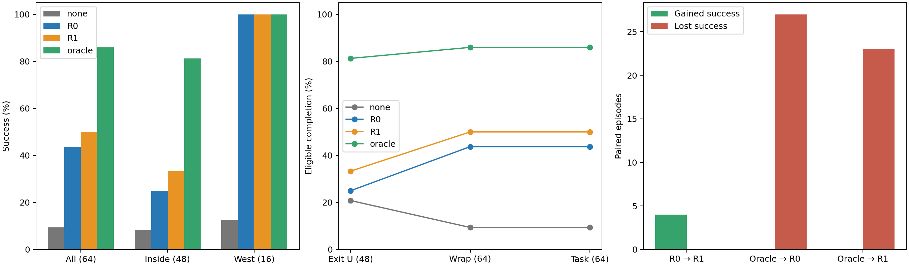
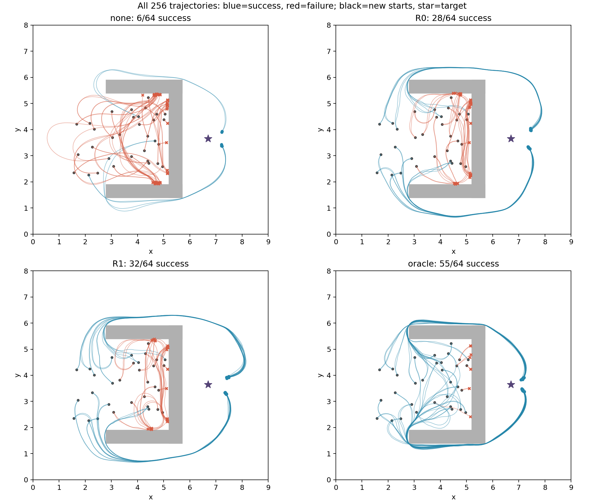

# R0/R1 + MPPI 连续环境闭环配对评价（seed606，固定50k）

本轮256个正式episode全部完成。成功数：无终值 6/64，R0 28/64，R1 32/64，Oracle 55/64。
R0→R1配对新增成功 4，失去成功 0，净变化 +4。本批起点上观察到有限的连续导航成功收益；共同成功成本并未同步改善，不能据此宣布全面更优或多seed稳健提升。

## 协议、适配和配对核验

只评价已冻结的seed606 R0/R1 50k checkpoint，不训练、不校准、不挑选checkpoint。encoder/projector/IQE严格转移到生产连续观测接口，distance_scale=1，正距离以正终端成本加入MPPI；不查图、不吸附到专家节点、不使用QP或修复动作。

MPPI与提交e591c088a294c02f1b6f0244802768562dec449f核心源码逐字一致：H10/N128，noise .8，temperature 1，terminal_weight 1，invalid penalty 1e6，terminal_samples128，动作[-3,3]，v1/dt.1，上限300步。每回合新建planner、nominal归零，RNG=planner seed+7001，后续移位warm start。两planner seeds为314159、271828。每worker1个Torch线程，四组并行。

32个起点以seed2026102601冻结：内部24点，x∈[2.9,5.1]、y∈[2.0,5.3]；西出口8点，x∈[1.5,2.7]、y∈[2.0,5.3]。heading分[-π,π)的8层，层内均匀；内部每层3点，出口每层1点。只检查合法非终态，不用模型/Oracle/结果筛选。西出口起点已完成离开U阶段，不算新增离开U成功。

- training_starts：检查307个pose，精确pose重合0；最小位置距离0.043168。
- old_test_and_local_probes：检查72个pose，精确pose重合0；最小位置距离0.075651。

- R0：127915个记录task/B1/edge距离误差最大0；全部canonical节点task值误差最大0；97个未见连续观测批量/分块误差最大0；16个合法终态值均为0。checkpoint SHA256 `4225998ede46ac2cb34ab4c6114d9989b413f682863ebc498fa9e709db772c44`。
- R1：127915个记录task/B1/edge距离误差最大0；全部canonical节点task值误差最大0；97个未见连续观测批量/分块误差最大0；16个合法终态值均为0。checkpoint SHA256 `6751085907c40ea7b8a4d087b95c74e124e6773133661b1f8b5d1c50a27db7c8`。
- 7项执行前测试通过；8个独立开发案例各重复两遍（16次烟雾执行），状态、动作、奖励精确相同，未使用正式起点。另有3项事后统计/覆盖测试通过。
- 256条正式动作序列全部通过真实env.step重放，共14357步；状态、奖励、逐步成本分项和终止类型精确一致。四组64个state/seed键完整配对，首次候选控制bank逐项hash相同。闭环分化后只保证同一扰动生成规则。
- 所有源码、训练数据、checkpoint、缓存、起点与冻结指纹复核；参数未更新，旧产物未写入。

## 成功率与阶段完成

离开U采用原stage_metrics的西出口框/线段交叉判定；绕墙要求先到y<1.4或y>5.9，再到x>5.7。任务成功只取真实环境合法终态。下表离开U/绕墙均为“新完成/eligible”；heading编号h对应[-180+45h, -135+45h)度。

| 分组 | 控制器 | 成功 | 成功率 | 新离开U | 绕墙 | 碰撞/越界/超时 |
|---|---|---:|---:|---:|---:|---:|
| all | 无终值 | 6/64 | 9.38% | 10/48 | 6/64 | 58/0/0 |
| all | R0+MPPI | 28/64 | 43.75% | 12/48 | 28/64 | 36/0/0 |
| all | R1+MPPI | 32/64 | 50.00% | 16/48 | 32/64 | 32/0/0 |
| all | Oracle+MPPI | 55/64 | 85.94% | 39/48 | 55/64 | 9/0/0 |
| inside | 无终值 | 4/48 | 8.33% | 10/48 | 4/48 | 44/0/0 |
| inside | R0+MPPI | 12/48 | 25.00% | 12/48 | 12/48 | 36/0/0 |
| inside | R1+MPPI | 16/48 | 33.33% | 16/48 | 16/48 | 32/0/0 |
| inside | Oracle+MPPI | 39/48 | 81.25% | 39/48 | 39/48 | 9/0/0 |
| west | 无终值 | 2/16 | 12.50% | 不适用 | 2/16 | 14/0/0 |
| west | R0+MPPI | 16/16 | 100.00% | 不适用 | 16/16 | 0/0/0 |
| west | R1+MPPI | 16/16 | 100.00% | 不适用 | 16/16 | 0/0/0 |
| west | Oracle+MPPI | 16/16 | 100.00% | 不适用 | 16/16 | 0/0/0 |
| heading_0 | 无终值 | 2/8 | 25.00% | 4/6 | 2/8 | 6/0/0 |
| heading_0 | R0+MPPI | 6/8 | 75.00% | 4/6 | 6/8 | 2/0/0 |
| heading_0 | R1+MPPI | 6/8 | 75.00% | 4/6 | 6/8 | 2/0/0 |
| heading_0 | Oracle+MPPI | 8/8 | 100.00% | 6/6 | 8/8 | 0/0/0 |
| heading_1 | 无终值 | 0/8 | 0.00% | 2/6 | 0/8 | 8/0/0 |
| heading_1 | R0+MPPI | 4/8 | 50.00% | 2/6 | 4/8 | 4/0/0 |
| heading_1 | R1+MPPI | 6/8 | 75.00% | 4/6 | 6/8 | 2/0/0 |
| heading_1 | Oracle+MPPI | 8/8 | 100.00% | 6/6 | 8/8 | 0/0/0 |
| heading_2 | 无终值 | 2/8 | 25.00% | 0/6 | 2/8 | 6/0/0 |
| heading_2 | R0+MPPI | 2/8 | 25.00% | 0/6 | 2/8 | 6/0/0 |
| heading_2 | R1+MPPI | 2/8 | 25.00% | 0/6 | 2/8 | 6/0/0 |
| heading_2 | Oracle+MPPI | 6/8 | 75.00% | 4/6 | 6/8 | 2/0/0 |
| heading_3 | 无终值 | 0/8 | 0.00% | 0/6 | 0/8 | 8/0/0 |
| heading_3 | R0+MPPI | 2/8 | 25.00% | 0/6 | 2/8 | 6/0/0 |
| heading_3 | R1+MPPI | 2/8 | 25.00% | 0/6 | 2/8 | 6/0/0 |
| heading_3 | Oracle+MPPI | 7/8 | 87.50% | 5/6 | 7/8 | 1/0/0 |
| heading_4 | 无终值 | 0/8 | 0.00% | 0/6 | 0/8 | 8/0/0 |
| heading_4 | R0+MPPI | 2/8 | 25.00% | 0/6 | 2/8 | 6/0/0 |
| heading_4 | R1+MPPI | 2/8 | 25.00% | 0/6 | 2/8 | 6/0/0 |
| heading_4 | Oracle+MPPI | 4/8 | 50.00% | 2/6 | 4/8 | 4/0/0 |
| heading_5 | 无终值 | 0/8 | 0.00% | 0/6 | 0/8 | 8/0/0 |
| heading_5 | R0+MPPI | 2/8 | 25.00% | 0/6 | 2/8 | 6/0/0 |
| heading_5 | R1+MPPI | 2/8 | 25.00% | 0/6 | 2/8 | 6/0/0 |
| heading_5 | Oracle+MPPI | 6/8 | 75.00% | 4/6 | 6/8 | 2/0/0 |
| heading_6 | 无终值 | 0/8 | 0.00% | 0/6 | 0/8 | 8/0/0 |
| heading_6 | R0+MPPI | 4/8 | 50.00% | 2/6 | 4/8 | 4/0/0 |
| heading_6 | R1+MPPI | 4/8 | 50.00% | 2/6 | 4/8 | 4/0/0 |
| heading_6 | Oracle+MPPI | 8/8 | 100.00% | 6/6 | 8/8 | 0/0/0 |
| heading_7 | 无终值 | 2/8 | 25.00% | 4/6 | 2/8 | 6/0/0 |
| heading_7 | R0+MPPI | 6/8 | 75.00% | 4/6 | 6/8 | 2/0/0 |
| heading_7 | R1+MPPI | 8/8 | 100.00% | 6/6 | 8/8 | 0/0/0 |
| heading_7 | Oracle+MPPI | 8/8 | 100.00% | 6/6 | 8/8 | 0/0/0 |

## 配对成功变化与共同成功成本/步数

方向均为前者→后者；新增=前失败后成功，失去=前成功后失败；Δ成本/步数=后−前，仅在同一起点及planner seed下两者都成功时计算。Oracle对照差值不是最优regret。

| 分组 | 配对 | 新增 | 失去 | 都失败 | 共同成功 | 共同成功平均Δ成本 | 平均Δ步数 |
|---|---|---:|---:|---:|---:|---:|---:|
| all | R0_to_R1 | 4 | 0 | 32 | 28 | 2.17 | 1.18 |
| all | oracle_to_R0 | 0 | 27 | 9 | 28 | 45.91 | 10.89 |
| all | oracle_to_R1 | 0 | 23 | 9 | 32 | 47.71 | 12.16 |
| inside | R0_to_R1 | 4 | 0 | 32 | 12 | -2.14 | 0.83 |
| inside | oracle_to_R0 | 0 | 27 | 9 | 12 | 41.10 | 10.75 |
| inside | oracle_to_R1 | 0 | 23 | 9 | 16 | 40.51 | 11.88 |
| west | R0_to_R1 | 0 | 0 | 0 | 16 | 5.39 | 1.44 |
| west | oracle_to_R0 | 0 | 0 | 0 | 16 | 49.51 | 11.00 |
| west | oracle_to_R1 | 0 | 0 | 0 | 16 | 54.90 | 12.44 |
| heading_0 | R0_to_R1 | 0 | 0 | 2 | 6 | -0.48 | 0.67 |
| heading_0 | oracle_to_R0 | 0 | 2 | 0 | 6 | 41.48 | 10.00 |
| heading_0 | oracle_to_R1 | 0 | 2 | 0 | 6 | 41.00 | 10.67 |
| heading_1 | R0_to_R1 | 2 | 0 | 2 | 4 | 2.28 | -0.50 |
| heading_1 | oracle_to_R0 | 0 | 4 | 0 | 4 | 50.98 | 10.50 |
| heading_1 | oracle_to_R1 | 0 | 2 | 0 | 6 | 46.95 | 9.50 |
| heading_2 | R0_to_R1 | 0 | 0 | 6 | 2 | 0.70 | -0.50 |
| heading_2 | oracle_to_R0 | 0 | 4 | 2 | 2 | 48.09 | 10.00 |
| heading_2 | oracle_to_R1 | 0 | 4 | 2 | 2 | 48.80 | 9.50 |
| heading_3 | R0_to_R1 | 0 | 0 | 6 | 2 | 1.97 | 0.00 |
| heading_3 | oracle_to_R0 | 0 | 5 | 1 | 2 | 39.10 | 7.50 |
| heading_3 | oracle_to_R1 | 0 | 5 | 1 | 2 | 41.07 | 7.50 |
| heading_4 | R0_to_R1 | 0 | 0 | 6 | 2 | 6.65 | 3.50 |
| heading_4 | oracle_to_R0 | 0 | 2 | 4 | 2 | 56.09 | 13.50 |
| heading_4 | oracle_to_R1 | 0 | 2 | 4 | 2 | 62.75 | 17.00 |
| heading_5 | R0_to_R1 | 0 | 0 | 6 | 2 | 1.78 | -0.50 |
| heading_5 | oracle_to_R0 | 0 | 4 | 2 | 2 | 46.18 | 9.50 |
| heading_5 | oracle_to_R1 | 0 | 4 | 2 | 2 | 47.97 | 9.00 |
| heading_6 | R0_to_R1 | 0 | 0 | 4 | 4 | 6.90 | 3.75 |
| heading_6 | oracle_to_R0 | 0 | 4 | 0 | 4 | 45.87 | 12.75 |
| heading_6 | oracle_to_R1 | 0 | 4 | 0 | 4 | 52.77 | 16.50 |
| heading_7 | R0_to_R1 | 2 | 0 | 0 | 6 | 0.76 | 1.83 |
| heading_7 | oracle_to_R0 | 0 | 2 | 0 | 6 | 45.03 | 11.83 |
| heading_7 | oracle_to_R1 | 0 | 0 | 0 | 8 | 48.33 | 14.50 |

共同成功成本差的分项核对（后−前，分项之和等于上表总成本差）：

| 配对 | 时间 | 观测违反 | 通信违反 | 观测失败 | 通信中断 | 碰撞 | 越界 |
|---|---:|---:|---:|---:|---:|---:|---:|
| R0_to_R1 | 0.1179 | 1.7525 | 0.0000 | 0.2946 | 0.0000 | 0.0000 | 0.0000 |
| oracle_to_R0 | 1.0893 | 42.0942 | 0.0000 | 2.7232 | 0.0000 | 0.0000 | 0.0000 |
| oracle_to_R1 | 1.2156 | 43.4521 | 0.0000 | 3.0391 | 0.0000 | 0.0000 | 0.0000 |

### 实际累计成本与步数：成功和失败分开

不同组的成功episode集合不同，成功条件均值也不能独立证明控制器更好。失败的早停低成本不作为优势。全部逐回合成本、步数和七项成本分量保存于episodes.jsonl及对应轨迹JSON/NPZ；区域×heading及planner seed完整分层见分组附表和summary.json。

| 分组 | 控制器 | 成功平均成本 | 成功平均步数 | 失败数 | 失败实际平均成本（仅描述） | 失败平均步数 |
|---|---|---:|---:|---:|---:|---:|
| all | 无终值 | 245.64 | 84.33 | 58 | 123.35 | 32.67 |
| all | R0+MPPI | 275.20 | 89.21 | 36 | 88.25 | 25.67 |
| all | R1+MPPI | 280.13 | 91.47 | 32 | 92.71 | 27.38 |
| all | Oracle+MPPI | 246.91 | 84.91 | 9 | 29.77 | 6.78 |
| inside | 无终值 | 272.12 | 91.50 | 44 | 108.78 | 29.84 |
| inside | R0+MPPI | 269.67 | 91.33 | 36 | 88.25 | 25.67 |
| inside | R1+MPPI | 275.52 | 93.88 | 32 | 92.71 | 27.38 |
| inside | Oracle+MPPI | 253.92 | 88.31 | 9 | 29.77 | 6.78 |
| west | 无终值 | 192.66 | 70.00 | 14 | 169.13 | 41.57 |
| west | R0+MPPI | 279.35 | 87.62 | 0 | — | — |
| west | R1+MPPI | 284.74 | 89.06 | 0 | — | — |
| west | Oracle+MPPI | 229.83 | 76.62 | 0 | — | — |
| heading_0 | 无终值 | 283.48 | 95.50 | 6 | 231.76 | 54.67 |
| heading_0 | R0+MPPI | 262.58 | 85.83 | 2 | 73.77 | 21.00 |
| heading_0 | R1+MPPI | 262.10 | 86.50 | 2 | 128.43 | 39.50 |
| heading_0 | Oracle+MPPI | 230.62 | 79.38 | 0 | — | — |
| heading_1 | 无终值 | — | — | 8 | 163.18 | 43.38 |
| heading_1 | R0+MPPI | 289.25 | 91.00 | 4 | 120.61 | 36.00 |
| heading_1 | R1+MPPI | 296.75 | 93.83 | 2 | 208.41 | 63.00 |
| heading_1 | Oracle+MPPI | 253.77 | 86.12 | 0 | — | — |
| heading_2 | 无终值 | 192.66 | 70.00 | 6 | 64.20 | 17.67 |
| heading_2 | R0+MPPI | 238.29 | 78.50 | 6 | 98.83 | 29.33 |
| heading_2 | R1+MPPI | 238.99 | 78.00 | 6 | 99.46 | 29.50 |
| heading_2 | Oracle+MPPI | 249.99 | 87.50 | 2 | 19.06 | 3.00 |
| heading_3 | 无终值 | — | — | 8 | 97.65 | 28.25 |
| heading_3 | R0+MPPI | 275.25 | 88.00 | 6 | 68.96 | 19.83 |
| heading_3 | R1+MPPI | 277.22 | 88.00 | 6 | 86.16 | 25.67 |
| heading_3 | Oracle+MPPI | 269.81 | 93.14 | 1 | 57.00 | 16.00 |
| heading_4 | 无终值 | — | — | 8 | 68.03 | 17.38 |
| heading_4 | R0+MPPI | 295.02 | 91.50 | 6 | 81.96 | 24.00 |
| heading_4 | R1+MPPI | 301.67 | 95.00 | 6 | 84.31 | 24.67 |
| heading_4 | Oracle+MPPI | 235.29 | 79.75 | 4 | 27.42 | 5.75 |
| heading_5 | 无终值 | — | — | 8 | 106.93 | 29.62 |
| heading_5 | R0+MPPI | 277.30 | 86.50 | 6 | 66.50 | 18.83 |
| heading_5 | R1+MPPI | 279.09 | 86.00 | 6 | 67.69 | 19.17 |
| heading_5 | Oracle+MPPI | 256.38 | 87.50 | 2 | 31.58 | 8.00 |
| heading_6 | 无终值 | — | — | 8 | 117.13 | 33.00 |
| heading_6 | R0+MPPI | 284.58 | 95.25 | 4 | 76.03 | 22.00 |
| heading_6 | R1+MPPI | 291.48 | 99.00 | 4 | 66.87 | 19.25 |
| heading_6 | Oracle+MPPI | 246.54 | 85.75 | 0 | — | — |
| heading_7 | 无终值 | 260.77 | 87.50 | 6 | 159.18 | 41.33 |
| heading_7 | R0+MPPI | 277.18 | 91.50 | 2 | 172.63 | 49.00 |
| heading_7 | R1+MPPI | 281.40 | 94.38 | 0 | — | — |
| heading_7 | Oracle+MPPI | 233.06 | 79.88 | 0 | — | — |

## Oracle缓存与终端查询诊断

缓存签名 `e247996da6d357cf8767fcdfb9fd4dc2ac2a37ff6284e60898a840eb89129846` 与旧缓存匹配=True；SHA256 `2a01ed8b720ef47430c5766d900c7c8a3704535d986898f5747b6451270bbcf7`。完整环境/任务/成本/格点signature保存在oracle_validation.json，旧缓存只读，新目录保留字节相同副本。
预检缓存初始化/加载耗时0.002240s；本轮缓存构建耗时0.000000s。旧缓存元数据中的历史构建耗时不计入本轮。正式每回合新建provider，因此加载单列为初始化时间；在线规划时间为act耗时，包含被动诊断记录开销。

| 控制器 | 真实终值查询数 | 无效查询比例 | 不可达比例 | 候选invalid比例 | 全候选invalid决策数 | 在线总秒 | 每步平均ms | p95 ms | 初始化总秒 |
|---|---:|---:|---:|---:|---:|---:|---:|---:|---:|
| 无终值 | 0 | 0.0000% | 0.0000% | 21.74% | 362 | 14.869 | 6.193 | 9.419 | 0.001197 |
| R0+MPPI | 326666 | 0.0000% | 0.0000% | 19.42% | 208 | 64.984 | 18.990 | 27.200 | 0.001368 |
| R1+MPPI | 372567 | 0.0000% | 0.0000% | 16.81% | 171 | 72.669 | 19.108 | 27.069 | 0.001397 |
| Oracle+MPPI | 488026 | 0.0000% | 1.6970% | 13.09% | 45 | 37.304 | 7.885 | 10.607 | 0.132059 |

Oracle正式episode缓存命中 64/64，miss 0；none组不调用终值，查询数为0。invalid候选被原MPPI惩罚并排除终值查询；‘无效查询’与‘连续有效但最近格点不可达’分开统计。

Oracle是拥有完整环境模型的离散格点参考：位置.25、24个heading、5步恒定动作primitive、反向Dijkstra；连续状态采用最近格点查询，合法真实终态强制零值。不是连续环境精确最优值、也不是严格性能上界。它只提供候选末态成本，没有直接沿Oracle路径控制；专家图参考文件不参与本轮执行。

## 训练支持覆盖（事后辅助）

训练支持取6768个去重物理source/next pose，不使用抽象目标节点。XY最近距离按欧氏距离，其最近点heading差另存JSON（等距时按KD树返回点）；另按sqrt(dx²+dy²+(0.5·wrapped_dheading)²)寻找联合最近支持，报告其heading差。heading为弧度，位置为环境单位。每个实际访问/查询按出现次数统计，重复和轨迹相关性保留。这些量只描述覆盖，不证明可达性或泛化。

| 控制器 | 状态集合 | 数量 | XY最近距离均值/p95 | 联合最近heading差均值/p95 | 联合距离均值/p95 |
|---|---|---:|---:|---:|---:|
| 无终值 | executed | 2465 | 0.1227/0.5809 | 0.3442/1.1737 | 0.3587/0.8470 |
| 无终值 | candidate_valid_unfinished | 236005 | 0.1458/0.6462 | 0.3464/1.0585 | 0.3655/0.8715 |
| 无终值 | queried | 0 | —/— | —/— | —/— |
| R0+MPPI | executed | 3486 | 0.1816/0.8267 | 0.3134/1.1217 | 0.3448/0.9884 |
| R0+MPPI | candidate_valid_unfinished | 326666 | 0.2269/0.8610 | 0.3682/1.3159 | 0.3777/1.0729 |
| R0+MPPI | queried | 326666 | 0.2269/0.8610 | 0.3682/1.3159 | 0.3777/1.0729 |
| R1+MPPI | executed | 3867 | 0.1926/0.7857 | 0.3088/1.0599 | 0.3398/0.9446 |
| R1+MPPI | candidate_valid_unfinished | 372567 | 0.2393/0.8776 | 0.3711/1.2562 | 0.3776/1.0747 |
| R1+MPPI | queried | 372567 | 0.2393/0.8776 | 0.3711/1.2562 | 0.3776/1.0747 |
| Oracle+MPPI | executed | 4795 | 0.3856/1.0055 | 0.4203/1.6110 | 0.5233/1.2083 |
| Oracle+MPPI | candidate_valid_unfinished | 488026 | 0.3917/1.0574 | 0.4787/1.8922 | 0.5542/1.2881 |
| Oracle+MPPI | queried | 488026 | 0.3917/1.0574 | 0.4787/1.8922 | 0.5542/1.2881 |

candidate_valid_unfinished为全部组相同规则的有效未完成候选末态；模型/Oracle组它就是实际终值查询集，none组仅作事后覆盖。全部候选（含invalid）的覆盖统计另存JSON。

## 图内改善是否转化为连续导航收益

历史固定图上，R0→R1最远四分位NRMSE 15.18%→5.96%，165起点图内路径regret 40.30→29.74。这里只引用既有图结果作背景，没有拿图最短路计算连续轨迹regret。

本轮连续闭环成功率变化为+6.25个百分点（净+4/64），同时失去0个R0成功案例。共同成功28个episode中，R1−R0实际成本差均值2.17、步数差1.18。这些指标共同描述转化程度；不能把图内距离改善直接等同于稳健导航提升。

新增成功来自2个地理起点：inside_09, inside_23；两个planner seeds共享这些起点，因此4次新增成功不等于4个独立地理案例。

- inside：成功R0 12/48→R1 16/48，新增4、失去0；共同成功平均成本差-2.14。
- west：成功R0 16/16→R1 16/16，新增0、失去0；共同成功平均成本差5.39。

- Oracle→R0：Oracle成功而R0失败27例，反向新增0例；共同成功28例中R0−Oracle成本差45.91、步数差10.89。R0新离开U 12/48、绕墙28/64；Oracle分别39/48、55/64。
- Oracle→R1：Oracle成功而R1失败23例，反向新增0例；共同成功32例中R1−Oracle成本差47.71、步数差12.16。R1新离开U 16/48、绕墙32/64；Oracle分别39/48、55/64。

本轮R0/R1/Oracle的内部失败均发生在离开U之前；三组从西出口出发均成功。因而相对Oracle的成功率差距主要表现为U内逃逸，R1只改善其中两个起点。

所有正式失败轨迹均保留。阶段差异说明收益/失败发生在流程的哪一段，但不能仅凭位置覆盖或单条轨迹证明误差的因果来源。MPPI采用短视域候选和加权平均控制，其执行也会碰撞；Oracle的失败不能自动归因于模型价值，Oracle的成功也不构成最优上界。

本轮按冻结256episode结束，不追加预算、调参、挑起点或扩展训练seed。只有一个训练初始化seed606、32个地理起点与两个配对planner seeds；同一起点的两回合并非独立地理样本，也不能代表多训练seed稳定性。固定场景内随机新起点不等于场景外泛化。时间受四进程竞争和诊断开销影响。

## 文件与复现

- `experiments/r_series_mppi/PROTOCOL.md`：完整冻结规则与复现命令；事后统计测试命令：`$PY -m pytest experiments/r_series_mppi/test_analysis.py -q`。
- `../manifest.json`、`../states.json`、`../start_overlap.json`：共同配置、32个pose及重合检查。
- `../tests.log`、`../smoke.json`、`replay_audit.json`：必要测试、独立烟雾及256条轨迹真实重放。
- `../arms/{none,R0,R1,oracle}/episodes.jsonl`、各episode的JSON/NPZ：全部实际轨迹、分项成本、候选末态、终值查询、规划耗时和失败。
- `summary.json`、`group_tables.md`：完整分组及配对新增/失去成功列表、共同成功逐episode差值。
- `*_coverage.npz`：每个实际访问/候选/查询的训练支持距离；`../final_integrity.json`：完整产物指纹。

