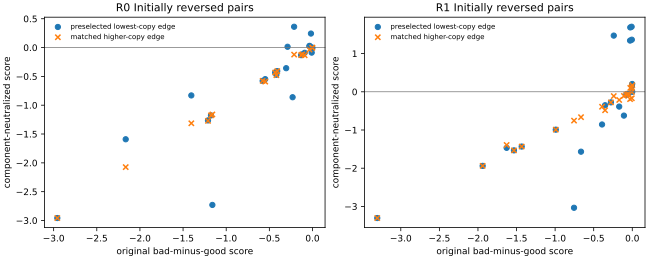

# 小图的稀有边机制，能否直接解释真实 U-trap 的错序？

2026-11-03 · 冻结 R0/R1 50k · 无训练、无新执行轨迹

**不能简化成“找到一条最低暴露边、消掉它的误差就能解释多数失败”。** 在两个模型各自的 24 个预选错序动作对上，最低副本边的分解项归零只恢复 5/24、7/24；将两后缀上全部单副本边的有符号误差归零则恢复 19/24、16/24。低暴露边上的累计误差确实占据重要位置，但它分布在整条后缀上，且一条边可能同时属于两个后缀，完全不影响相对次序。本项没有把这种分解关联提升为训练权重的因果结论。

## 1. 按参考预选，再读模型

复用 c279ed0 的全部 58 个分支：先按精确图参考选最佳动作与最近严格次优，后继分别沿同一个修订 next_edge 到唯一任务目标。没有根据模型的出错位置选边。每个最佳后缀里，先选物理副本数最小的边，再按最小代表记录编号破并列。高暴露控制来自同一后缀，要求副本数严格更大且成本差不超过 max(0.05, 0.1×稀有边成本)，先按成本差、再按副本数和记录编号排序；不放宽缺失控制。[冻结协议](PROTOCOL.md)

副本是 (src,dst,cost) 完全一致的物理记录；不把抽象锚边算进去。42536 条记录对应 6958 条独特物理边。两个模型使用同一预选动作对和同一选边规则，但各自有 24 个错对，错对集合并不相同。58 对中 40 对有控制；限制到各自错对后，R0 有 18 对、R1 有 23 对，另外 6 对和 1 对缺失，单列保留。

## 2. 归零的是什么

对同一目标，记 h=d_edge−c，τ=d_edge+J后−J前，两后继的真实最短后缀有

**m=参考动作间隔+(H坏−H好)−(T坏−T好)。**

m 是坏动作减好动作的模型成本，m>10⁻⁴ 才算严格恢复，绝对值≤10⁻⁴ 单列为并列。目标的 J 为 0，所有项保持有符号值。58 对×2 模型的最大闭合误差为 0。

只把一条物理边 e 的 h 项置零时，新间隔是 m−(n坏(e)−n好(e))h_e。若该边是共享后缀，两个计数相同，贡献必须抵消。**这种操作保持其余分解项不变，不保证存在对应的合法准度量矩阵，更不保证存在对应网络参数。** 它检验已实现误差在数量上是否足够，不能替代训练干预。

| 分解项反事实 | R0 初始错对恢复 | R1 初始错对恢复 |
|---|---:|---:|
| 预选最低副本单边 h 置零 | 5/24 | 7/24 |
| 同一操作只去正部 h | 5/24 | 7/24 |
| 全部单副本边 h 置零（两后缀同时） | 19/24 | 16/24 |
| 两后缀全部 H 置零 | 21/24 | 24/24 |
| 两后缀全部 T 置零 | 8/24 | 6/24 |
| 事后挑任何一条最有利的边，恢复数量上界 | 22/24 | 23/24 |

最后一行允许看过 h 后挑边，只是描述性上界，不能与参考预选稀有边视作同样的选择程序。大多数错对并非不存在能翻转它的一条边，而是“最低暴露”本身没有定位到那一条。

这些反事实还会伤害原来排对的动作对。对全部 58 对，预选单边操作在 R0 新增 6 个错序、R1 新增 2 个；全部单副本边操作分别新增 8、5 个；全部 H 归零分别新增 5、1 个。因此不能只报“修复了多少旧错误”，或把整组误差归零当成可部署改法。[全部动作对](pairs.csv) · [汇总](summary.csv)



图中高于零线才恢复正确次序。蓝点覆盖各模型全部 24 个错对，橙叉仅覆盖有合格高暴露控制的子集，分母不同。

## 3. 与成本接近的高暴露边作同对比较

| 同一错对同时有两种边 | R0：18 对 | R1：23 对 |
|---|---:|---:|
| 最低暴露边恢复 | 2/18 | 6/23 |
| 高暴露控制恢复 | 0/18 | 3/23 |
| 最低暴露边操作平均 Δm | +0.00592 | +0.16506 |
| 高暴露边操作平均 Δm | +0.00365 | +0.01244 |

该固定选择规则下，最低暴露边比控制多恢复一些错对；但它仍未覆盖多数，控制也非全无作用。控制只匹配同后缀的成本，并没有匹配到目标距离、空间位置、梯度或路径作用，不能将差异归于副本数本身。

两个模型的错对中，所选最低暴露边都恰为单副本，经验质量为 1/42536≈2.35×10⁻⁵；各有 11/24 位于共享后缀，单边操作对这些对的间隔严格为零。这解释了为何“便宜后缀上存在稀有边”还不够，必须考察它是否影响两个后继的差分。

所选边的 h 中位数，R0/R1 分别为 +0.0945/+0.1546；保存的 λ 副本均值中位数为 213.68/194.64。24 条所选边中，原 PHR 有效系数大于零的分别为 19、18 条。它们不能整体解释为没有乘子或没有局部响应；标量有效系数也不保证其参数梯度在修正这次分支排序。[边、副本、乘子和有效系数](edges.csv)

## 4. 与小图及 OGBench 的关系

85b7b16 的小图固定查询和所有边可见性，只变一条边的平均风险权重 q，并通过全局证书证明低 q 可以迫使最优解反序。真实 U 的这些单副本边也有很低的经验质量，但 **U 用逐记录 PHR 与独立乘子，没有同一个平均平方可行预算 η**；不能把数值约为 10⁻⁵ 的质量直接代入小图相变阈值。

本项给出了更接近真实模型的支持与限制：U 的错序常对整组低暴露边的累计有符号误差敏感，却不能由一个最低副本边统一解释；重复边权重是否造成这些误差，仍需看训练干预。已有 R1→R2 约束边均衡降低低副本边违反、却恶化完整图路径成本，也不支持简单等同两者。

OG 原模型在统一诊断中，错选后继的相对低估主要落在指定后续图路线的额外 T 项；这与本项 U 的 H 敏感性不同。不过 OG 旧分解比较的是 critic 最终所选动作与参考最佳，本项是参考预选最近严格次优，两套样本不能直接比较修复比例。可以确认的是：**小图证明的充分机制没有自动成为两个真实 checkpoint 的同一个已识别训练原因。** [小图报告](../edge_weight_graph_20261102/report.md) · [统一机制诊断](../unified_mechanism_20261102/report.md) · [原配方梯度诊断](../native_margin_20261102_verified/report.md) · [U 边权均衡历史](../phr_edge_balance_20261026/main/comparison/report.md)

## 复现与核验

```bash
PYTHONDONTWRITEBYTECODE=1 MPLCONFIGDIR=/tmp/qrl-rare-edge-mpl OMP_NUM_THREADS=1 \
../quasimetric-rl/.venv/bin/python experiments/rare_edge_attribution/run.py \
"/Users/z./.codex/worktrees/5670/quasimetric-rl-topology-improvements" results/rare_edge_reproduction
```

核心测试覆盖共享后缀抵消、有符号负 h、正部附表、成本匹配和缺失控制，两项通过。两个 checkpoint 与修订参考均核验完整 SHA，并确认读取后文件不变。报告没有新导航成功率，分解反事实也没有另存或覆盖网络参数。数值、审计和临时 PNG 留本地，仅提交源码、测试、协议、报告和引用 SVG。[实现](../../experiments/rare_edge_attribution/run.py) · [核心函数](../../experiments/rare_edge_attribution/core.py)

从全新目录完整重算，两次生成的 pairs.csv、edges.csv、summary.csv 逐字节一致。[复算核验](reproduction.json)
